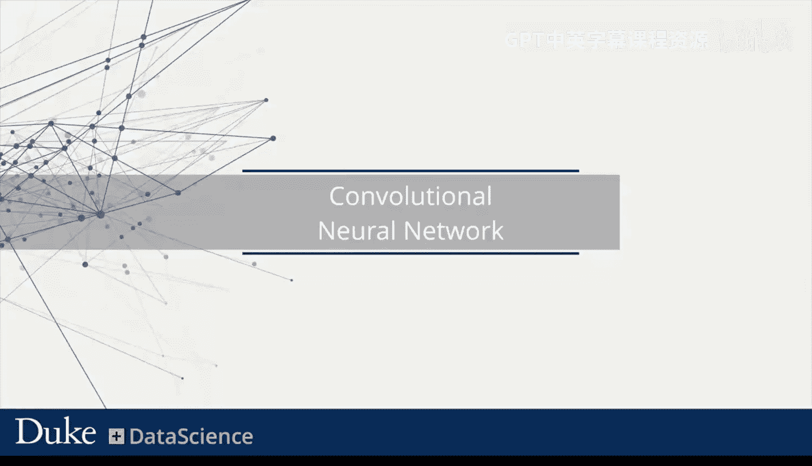
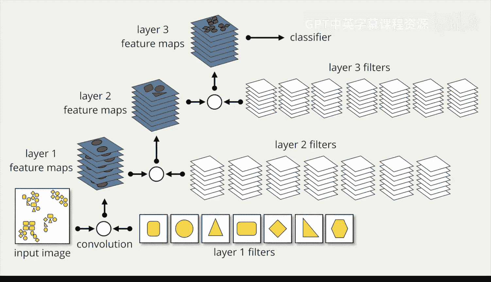
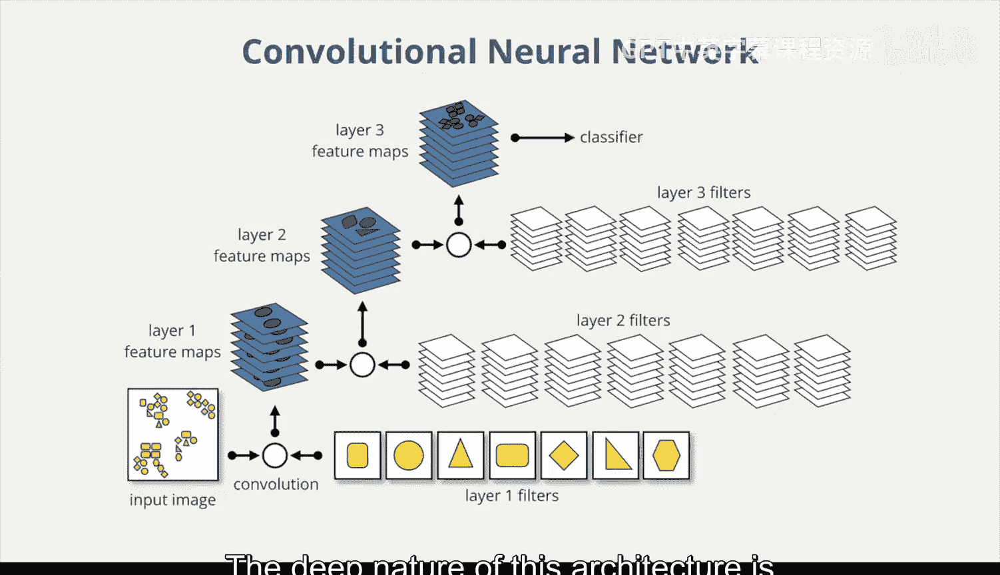
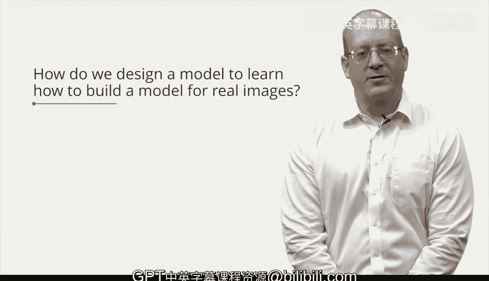

# 机器学习：16：卷积神经网络

在本节课中，我们将学习卷积神经网络的基本架构和工作原理。这是一种专门用于处理图像等网格状数据的深度学习模型。

## 概述

卷积神经网络是一种深度架构，其核心思想是通过重复应用相同的过程，从原始图像中逐步提取并组合特征，最终做出分类决策。

## 网络架构与工作流程

卷积神经网络的工作流程可以概括为：从原始图像开始，通过多层卷积操作，逐步构建出越来越复杂的特征表示，最终基于最高层的特征进行分类。

### 特征提取过程

以下是卷积神经网络构建特征的核心步骤：

1.  **第一层特征提取**：我们从左下角的原始图像开始。使用一组基础的“原子”或基本构建块图像对该图像进行卷积操作。“卷积”意味着我们将每个原子元素移动到图像中的每个位置。完成此操作后，我们得到一个特征图，它反映了每个原子元素在图像中出现的程度。我们对每个原子元素都执行此操作，最终得到一组特征图，即一个特征图堆栈。这为我们提供了图像中基本构建块的表现图谱。

2.  **第二层特征提取**：接下来，我们构建第二层滤波器。这些第二层滤波器旨在寻找第一层中彼此邻近且同时被激活的元素组合。如果第一层的原子元素在彼此附近被同时激活，它们就构成了一个“子模式”。因此，第二层滤波器就是在搜索这些子模式。我们将第二层滤波器与第一层特征图进行卷积，从而得到第二层特征图。

3.  **第三层特征提取与分类**：然后，我们构建第三层滤波器，这些滤波器被设计用来寻找更复杂的“模式”。将这些滤波器与第二层特征图进行卷积，最终我们得到第三层特征图。这层特征图是我们的最终特征表示。基于这些特征，我们将做出分类决策，例如判断图像的类别。

### 应用实例

例如，在医学放射学研究中，我们可能进行的分类是确定医学图像对应的是良性肿瘤还是恶性肿瘤。这个分类决策将基于网络顶层的特征做出。

## 核心概念解析

这种架构被称为**卷积神经网络**。

*   “卷积”通过上述的**滑动/移位过程**来实现。
*   “神经网络”的称谓源于一些技术细节（为简化起见，此处暂不展开）。
*   该架构的“深度”特性通过其**多层构造**得以体现。

## 总结与展望

本节课我们一起学习了卷积神经网络的基本直觉和架构。我们了解到，它通过多层卷积，从原始像素中逐步构建出用于分类的抽象特征。

现在，我们需要思考的下一个问题是：在现实世界中，我们处理的不是玩具图像或简单形状，那么如何设计一个模型，使其能够从真实图像中学习并构建出这样的网络呢？这将是我们在下一课中要探讨的主题。