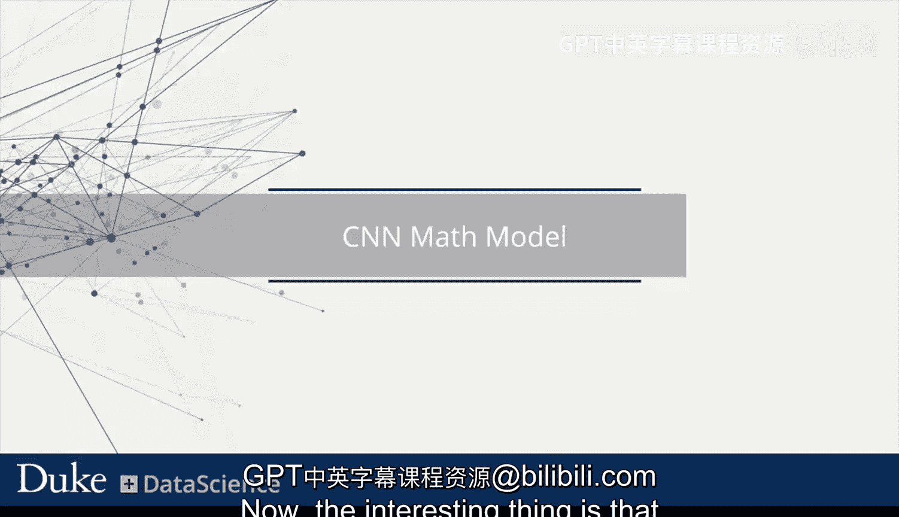
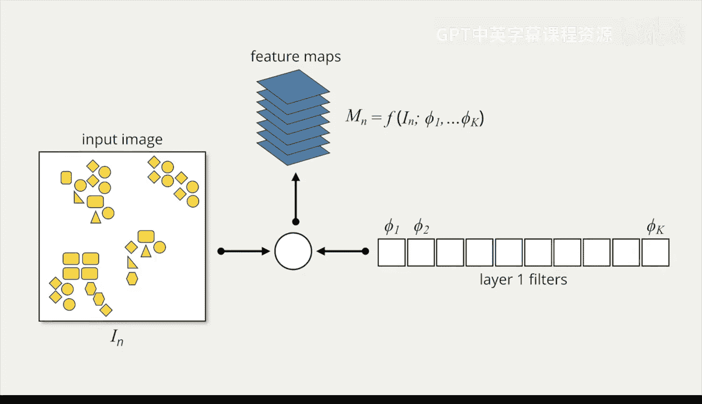
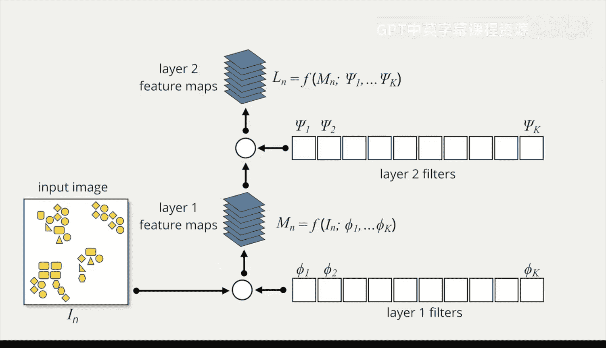
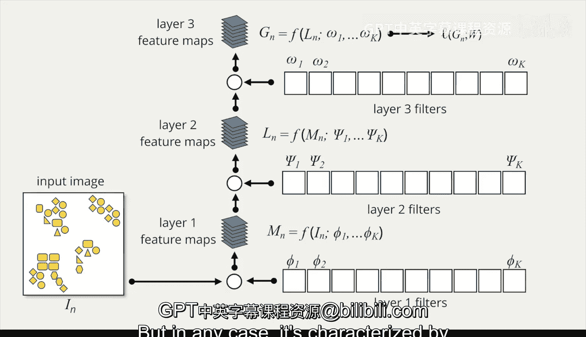

# 杜克大学《机器学习｜Introduction to Machine Learning》中英字幕 p17 17_01_04_CNN数学模型.zh_en -BV1yjvdBQEaU_p17-

Now， the interesting thing is that everything。That we learn in our illustrative example。

 essentially directly carries over。 So let's again。

 start by studying the convolutional neural network。Wwhich is designed to study and analyze images。

 So I subN is meant to represent the nth image， which is meant to emphasize that we're not going to do this for just one image。

 we're going to do this for thousands and millions。 Tens of millions of images。 So to do learning。

 we're going to use many， many images。 And by studying these and analyzing these images well be able to learn a model。

 So within the context of that learning， we the model is given access to each of those images。

 And so just for depiction， we again show one of those toy images， but of course。

 it will be a real image。 and I sub n is the nth image。Now， remember。

That the first part of this model。Was to convolve。Atomic。Elements。

Remember in the form of shapes in the toy example。Convolve those atomic elements to every location in the in the image。

 every two dimensional location in an image， and then to constitute a feature map where the feature map reflects how strongly that atomic element is manifested in the image。

So what we're going to do is the same thing。But now I do not know the atomic elements。

 So what I'm going to do is I'm going to represent them by parameters that we're going to learn。

So phi1 phi2 through pK correspond to K filters， instead of them being shapes and as they were in our toy example。

 these are just going to be the parameters of these filters are just the pixel values。

 and so what we're going to try to do is learn the pixel values associated with filter p1 filter p2 and filter pK。

Now， I want to learn what those parameters are。 I want to learn the values of the pixels for each of those filters。

 Now， let's assume we knew what they were。At this moment， let's just assume we knew Phi1 through P K。

If we know those pixel values， we can shift them to every location in the image and constitute a feature map exactly in the way we did for our toy example。

 And so the way that this is depicted in the second line。Is that I N is the Ih image。

This process of filtering， which manifests these feature maps。

Is a function of the filters phi1 through pK。And then this yields a feature map。

 which I'll call M subN， where M sub n is the feature map。

 the stack of feature map at layer 1 for the anth image。

And then we could repeat this process。 So now the stack of feature maps from layer1 is convolved with a layer 2 set of filters。

 which I'll represent as posesi 1， Pos 2 through Pisi K。 Again， I don't know what those are。

 I don't know what the values of those filters are。

And what I mean by the values is each one of those filters， Pasai 1。

 Pasi 2 through Pasai K is a digital mini stack of images stacked to match the feature map from the layer below。

I don't know what the values are， but if I did know what the values were。

 I can convolve each of those filters Pasaii 1 through Pasai K。

With the layer 1 feature maps and then manifest layer 2 feature maps。

 which are a function of the feature maps from the layer below M sub N and the filters posesai 1 through Pases K from the second layer。

If I knew what those were， if I knew it Pos1 through Pos K R， I can do that operation。

 What we're going to do is we're going to learn those parameters。

 We're going to learn Posi1 through Pos K。And then this process can be repeated。

We go to the layer 3， and we have filters， omega1。Through omega K， these are again stacks of filters。

 they have values， we no longer have those simple shapes， but they have values in the same way。

 which can convolve those layer 3 filters with the layer 2 feature maps and then finally get a feature map at the top layer which we call G subN。

 which is the top layer feature map， which is a function of the feature map at the layer below。

 and the filters at the layer below。And then finally， based upon the features at the top。

 we can build a classifier， which will provide a label for that image。

 So script L is meant to represent the label， the label is a function of the features at the top G sub n and parameters W which reflect the parameters of our classifier。

 So now if we look at this， first of all， the structure of this model is exactly the same as in our toy example。

 the only thing that distinguishes this from the toy example is that we're no longer assuming those basic atomic shapes。

 Instead， we have these parameters。The parameters are the values of value the pixel values at every location within those filters in the process of convolutional filtering is exactly the same and then at the top of this model we have the top layer feature maps which we call G sububN。

 those are sent into a classifier which is characterized by parameters W。

That classifier could take a form that we're familiar with， for example。

 that classifier could be a multi layerer perceptron or it could be a logistic regression。

 but in any case it's characterized by some parameters which we denote。

By W。