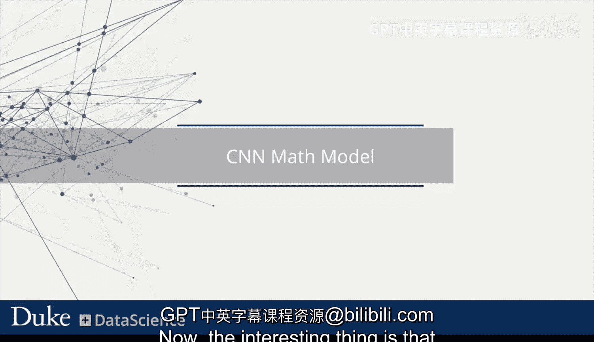
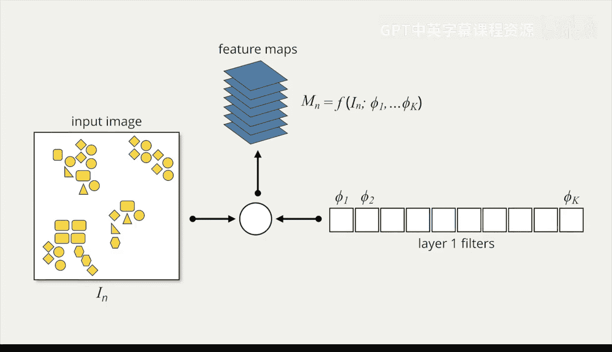
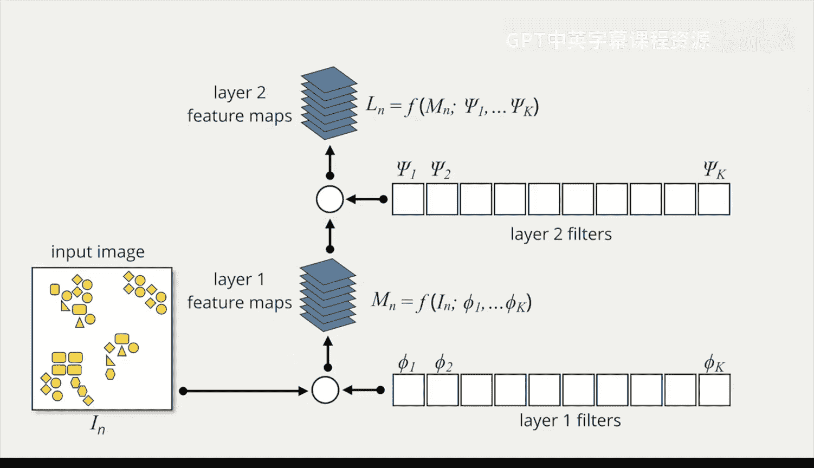
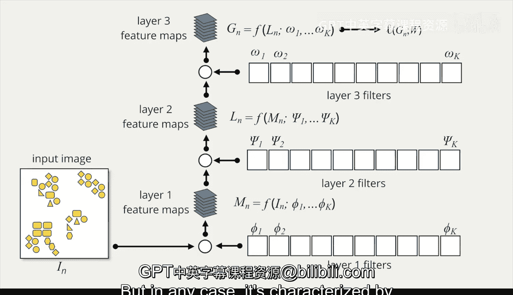

# 机器学习：17：卷积神经网络数学模型 🧠

在本节课中，我们将学习卷积神经网络的数学模型。我们将从图像分析入手，理解模型如何通过多层卷积操作提取特征，并最终通过分类器进行预测。整个过程的核心在于学习卷积核的参数，而非预先定义好形状。

## 卷积操作与特征图

上一节我们介绍了卷积的基本概念，本节中我们来看看如何将其数学模型化。模型处理的输入是第 `n` 张图像，记作 `I_n`。这强调了我们并非只处理单张图像，而是会使用成千上万乃至数百万张图像进行学习。

模型的第一部分是将原子元素（在示例中是形状）与图像的每个二维位置进行卷积，从而构成一个特征图。该特征图反映了该原子元素在图像中的显现强度。

在数学模型中，我们并不知道这些原子元素是什么。因此，我们将用一系列待学习的参数来表示它们。

以下是第一层卷积的数学描述：
*   `φ1, φ2, ..., φK` 对应 K 个滤波器。它们不再是示例中的具体形状，而是由待学习的像素值参数构成。
*   我们的目标是学习与滤波器 `φ1`, `φ2`, ..., `φK` 相关联的像素值。

现在，假设我们已知这些参数 `φ1` 到 `φK`。如果知道这些像素值，我们就可以像在示例中那样，将它们滑动到图像的每个位置，从而构成特征图。

这个过程在数学上可以描述为：对于第 `n` 张图像 `I_n`，滤波过程（生成特征图）是滤波器 `φ1` 到 `φK` 的函数。这将产生一个特征图，我们称之为 `M_n`，它代表第 `n` 张图像在第一层的特征图堆栈。

## 多层卷积堆叠

我们刚刚构建了第一层的特征图，接下来可以重复这个过程。现在，第一层的特征图堆栈将与第二层的一组滤波器进行卷积。

以下是第二层卷积的要点：
*   我们用 `ψ1, ψ2, ..., ψK` 表示第二层的滤波器。同样，我们不知道这些滤波器的值。
*   每个滤波器 `ψ1, ψ2, ..., ψK` 都是一个数字化的迷你图像堆栈，其维度需与来自下层的特征图匹配。
*   如果已知这些值，我们可以将每个滤波器 `ψ1` 到 `ψK` 与第一层特征图进行卷积，从而生成第二层特征图。

第二层特征图是下层特征图 `M_n` 和第二层滤波器 `ψ1` 到 `ψK` 的函数。我们的目标正是学习这些参数 `ψ1` 到 `ψK`。

## 顶层特征与分类器

这个堆叠过程可以继续重复。我们进入第三层，拥有滤波器 `ω1` 到 `ωK`。这些同样是滤波器堆栈，具有数值。

我们可以将这些第三层滤波器与第二层特征图进行卷积，最终得到顶层特征图，我们称之为 `G_n`。

最后，基于顶层的特征，我们可以构建一个分类器来为该图像提供标签。

以下是分类阶段的描述：
*   `L` 表示标签。
*   标签是顶层特征 `G_n` 和参数 `W` 的函数，参数 `W` 反映了我们分类器的参数。
*   这个分类器可以采用我们熟悉的形式，例如，它可以是一个多层感知机，也可以是逻辑回归。无论如何，它都由我们记为 `W` 的一些参数来表征。

## 模型总结与对比

综上所述，这个模型的结构与我们的玩具示例完全相同。唯一的不同之处在于，我们不再假设那些基本的原子形状，而是拥有了这些参数。参数就是这些滤波器在卷积过滤过程中每个位置上的像素值。在这个模型的顶部，我们得到了顶层特征图 `G_n`，它们被送入一个由参数 `W` 表征的分类器。

本节课中我们一起学习了卷积神经网络的数学模型。我们理解了模型如何通过未知的、可学习的滤波器参数在多层级联中进行卷积操作，从原始图像中逐步提取出高层次的特征表示，并最终利用这些特征通过一个参数化的分类器完成预测任务。整个框架的核心思想是将特征提取的过程本身也参数化，并纳入到端到端的学习范式中。