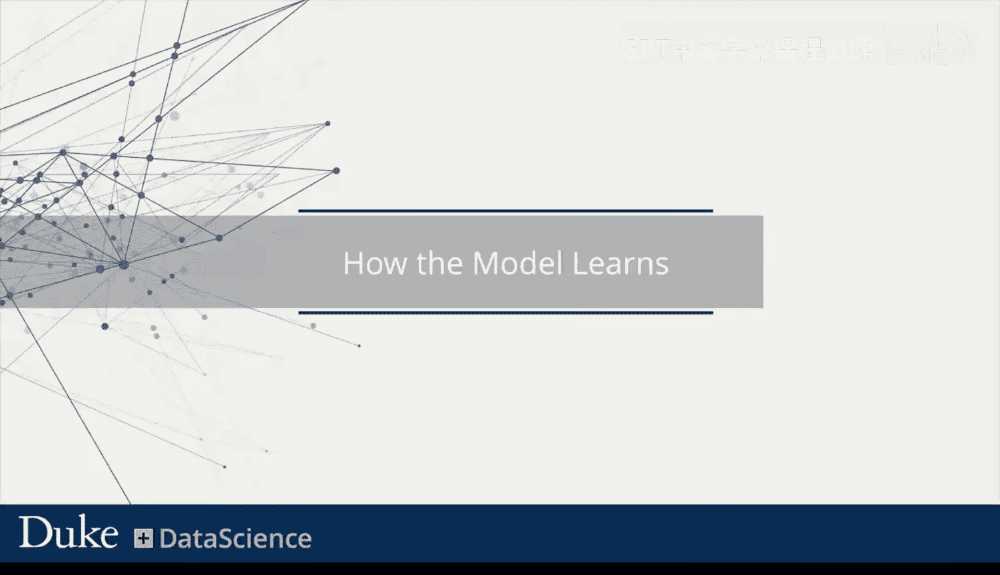
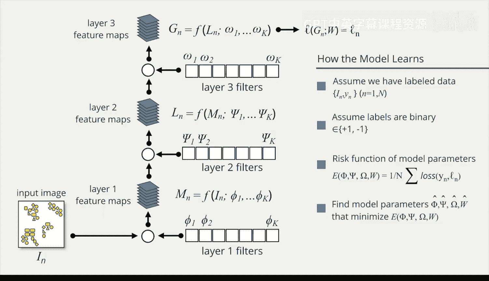
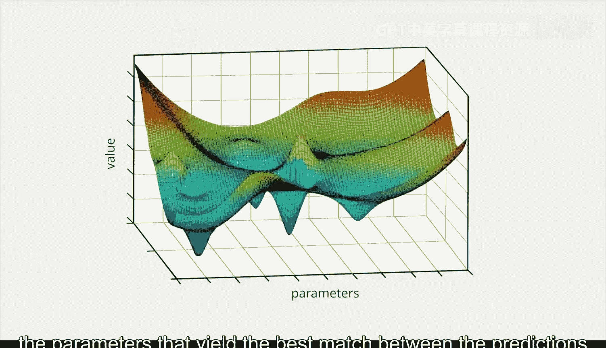

# 杜克大学《机器学习｜Introduction to Machine Learning》中英字幕 p18 18_01_05_模型如何学习.zh_en -BV1yjvdBQEaU_p18-

So if we look at this model。What we now have。Is a model characterized by parameters。

 The parameters of the model are the filters at the bottom。

 the filters at the second layer and the filters at the third layer， phi pi and omega。

 and then finally the parameters of our classifier W。

 and so on the right the last bullet is to emphasize that the parameters of this model which are unknown in which we wish to learn are phi psi。

 omega and W。And so now the assumption。The way we do learning is we have access。

 We assume that we have access to a large set of data， a large set of label data。

 Now recall that I said that one of the key。Things that has made this technology。

 which was developed in 1989。One of the key things that has made it so powerful。

In recent years is access to massive quantities of data。

And so here that data is represented by the pair IN is the I is the nth image IN is the nth image。

 and yn is the label of the image and recall that from the very beginning of this module we always talked about the concept that we needed label data to do learning and here we assume we have capital n examples of images in labels。

 we look at the second bullet we're for simplicity much as we did when we study the logistic regression in the multilayer perceptron。

 we're going to assume that the labels are binary， either plus one or minus one we're doing that here purely for simplicity。

In other situations， the number of labels could be very large， hundreds， thousands。

 but for simplicity， let's just leave it to be the labels to be plus1 or minus1。

Binary to be consistent with our discussion of logistic regression and our prior discussion of the multi layer perceptron。

So now looking at the third bullet on the Rhine。What we're going to do is we're going to constitute。

A， what we call a an energy function， what I represent by E。

 which is going to compute what we say we call the loss。Between the true label。Y。

 N and our model label， L N。 So if we look at the figure on the left。

 we see that at the top of the network。We take the features。

 the feature maps at the top of the network and using our model our classifier with parameters W。

 we make a prediction of the label script L。 And so what we could do is we can calculate a loss and the loss is a measure of the difference between the true label Yn and our predicted label L N。

 and what we would like to do is to make that loss as small as possible。

 and there are many ways that one can choose that loss。

 The loss is just simply a measure of the difference between Yn and L N。 and again。

 there are many different ways that one can compute that。

 And so our goal here looking at the simple equation after the third bullet。

Is to try to learn or identify or compute。The parameters phi， psi， omega and W。That minimize。

That sum over loss， the loss， again， is essentially the difference between our accuracy of our predicted labels and the true labels。

This is what we mean by learning。 So we talk about machine learning。 this figure。

 this slide really brings it together。 the left figure。

 our convolutional neural network is the machine。 what we're trying that's what we're trying to build。

To try to characterize images。The learning part is manifested by taking data here N examples of image I N and label Y N in trying to learn。

The parameters。 So what we mean by learning is to learn the parameters of our machine， of our model。

 such that the the difference between the prediction of the model。

L N and the true label Y N is small and so we in the last in the last bullet。

 we say that we put what's called a hat sign on the top of those symbols， which is the anyway。

 a small little symbol like a hat those are our predictions。

 And so our goal is to try to design or predict or estimate those model parameters， phi psi。

 omega and W such that the total loss。Manifested in the middle equation between our predicted labels and the true labels is small。

 This is what we mean by learning。

Now， why is this hard？It turns out that this is a very。challenging problem。

 which is part of the reason that we've had that long history of machine learning。

 And so while when we talk about， when I talked about the seasons of machine learning and we went through springs and winters and more springs and summers and winters。

The reason that we went through those periods of enthusiasm and then feelings of desperation was because there were many challenges to doing this learning。

 to estimating these parameters。And one of the key aspects。Of that is that the search。

The estimation of those optimal parameters。To try to estimate phi pisi， omega and W。

 the number of parameters that we have to estimate is massive。Very， very large。 And so consequently。

 trying to estimate those parameters is very difficult。

 And so just to give you an example of what that might mean。

 here is a situation in which we're only looking at two parameters so along the twodial bottom axes。

 we might be looking at parameter1 in parameter 2 and along the vertical axes we're looking at the value of that function E。

 which is a measure of the quality of the fit of the parameters to the data。

 and so what you notice here is that there are multiple valleys。

 multiple areas where the parameter might lead to relatively small。

Le。And so what we find is is that that there are many different sets of parameters which give what we call local optimal solutions for the model。

 so it is very difficult to move in this parameter space to actually optimize for the parameters and here in this simple example。

 I'm only showing it for two parameters。And again， the vertical axis is the quality， the error， E。

 and the other two axes represent the values of the parameters。

So in two dimensions in this simple example I can actually draw a picture and look at it。

 but for the real problem， the number of parameters in phi psi， omega and W could be millions。

 millions of parameters and so consequently we can't even draw a picture like this and it is extremely difficult to search in that massively high dimensional parameter space to find the parameters that yield the best match between the predictions of the model and true the truth of the labels。

 and so it has taken literally decades of research and study to learn how to do that in an effective way and that research and the developments that have been made during that period have played a key role in the success of modern deep learning in addition to the computational power in the access to data。

