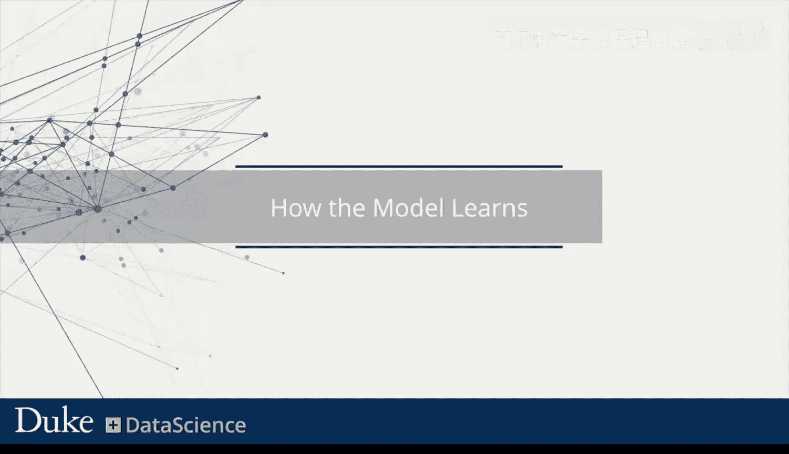
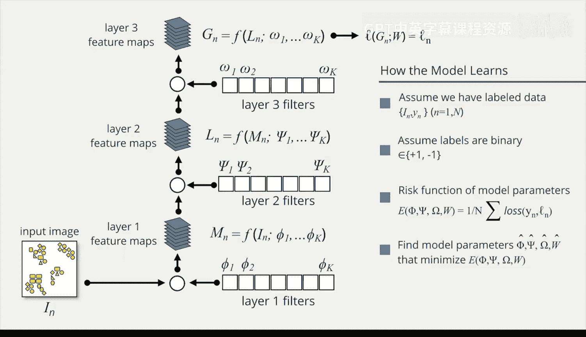
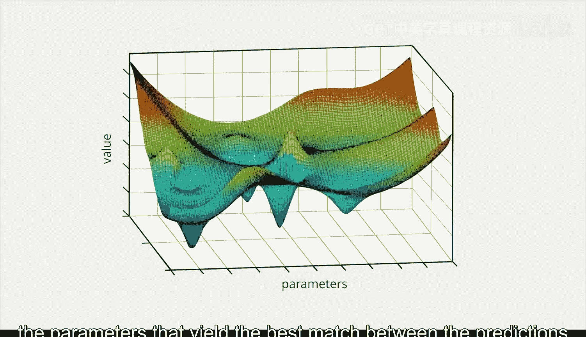

# 机器学习入门：18：模型如何学习

在本节课中，我们将要学习机器学习模型是如何通过数据来“学习”的。我们将以卷积神经网络为例，深入探讨模型参数、学习目标以及学习过程中面临的挑战。

## 模型参数

上一节我们介绍了卷积神经网络的结构，本节中我们来看看构成这个模型的“可学习”部分——参数。

观察这个模型，我们发现它由一系列参数来刻画。模型的参数包括底层的滤波器、第二层的滤波器、第三层的滤波器，以及分类器的参数。

以下是模型参数的具体构成：
*   模型的参数是底层的滤波器。
*   第二层的滤波器。
*   第三层的滤波器，分别用 **φ**、**ψ** 和 **ω** 表示。
*   最后是我们分类器的参数 **W**。

因此，这个模型的未知参数，也就是我们希望学习的目标，就是 **φ**、**ψ**、**ω** 和 **W**。

## 学习的数据基础

了解了模型参数后，我们来看看学习过程需要什么。学习的关键在于我们假设能够访问一个大型的、带有标签的数据集。

以下是关于学习数据的几个要点：
*   这项技术（指深度学习）在近年来变得如此强大的一个关键因素是能够获取海量数据。
*   这里的数据由成对的 `(I_n, y_n)` 表示，其中 `I_n` 是第 `n` 张图像，`y_n` 是该图像的标签。
*   为了简化，与之前学习逻辑回归和多层感知机时一样，我们假设标签是二元的，即 `+1` 或 `-1`。
*   在其他情况下，标签数量可能非常庞大（成百上千），但这里我们保持简化。

## 学习的目标：最小化损失

有了数据和模型，我们如何定义“学习”呢？学习的目标是调整模型参数，使其预测尽可能准确。

在右侧的第三个要点中，我们将构建一个所谓的能量函数（用 **E** 表示），它将计算真实标签 `y_n` 和模型预测标签 `l_n` 之间的损失。

观察左侧的图，在网络的顶部，我们利用特征图和分类器参数 **W** 来预测标签 `l`。我们可以计算一个损失，这个损失衡量了真实标签 `y_n` 和预测标签 `l_n` 之间的差异。我们希望使这个损失尽可能小。损失的计算方式有很多种，它本质上就是 `y_n` 和 `l_n` 差异的度量。

因此，我们的目标（见第三个要点后的简单公式）是尝试学习或计算出参数 **φ**、**ψ**、**ω** 和 **W**，以最小化所有数据点上损失的总和。损失再次体现了我们预测标签的准确性与真实标签之间的差异。这就是我们所说的“学习”。

这张幻灯片将“机器学习”的概念整合在一起。左侧的卷积神经网络就是我们要构建的“机器”，用于刻画图像。而“学习”部分则体现在利用 `N` 个图像和标签样本 `(I_n, y_n)` 来尝试学习模型的参数。学习意味着学习我们模型（机器）的参数，使得模型预测 `l_n` 与真实标签 `y_n` 之间的差异很小。在最后一个要点中，我们在这些符号上加了“帽子”符号（如 **φ̂**），这表示它们是我们的预测或估计值。

我们的目标是设计或估计出模型参数 **φ**、**ψ**、**ω** 和 **W**，使得我们的预测标签与真实标签之间的总损失（体现在中间公式中）最小化。这就是学习的含义。

## 学习为何困难？

然而，这个学习过程非常具有挑战性，这也是机器学习历史曲折的部分原因。

当我们谈论机器学习的“季节”，经历春天、冬天、再到春天、夏天和冬天时，之所以会有热情期和绝望期，正是因为进行这种学习、估计这些参数面临许多挑战。

其中一个关键方面在于，搜索或估计这些最优参数（**φ**、**ψ**、**ω** 和 **W**）时，需要估计的参数数量是巨大的。因此，尝试估计这些参数非常困难。

为了让你理解这意味着什么，这里有一个只涉及两个参数的简单示例。在二维底部坐标轴上，我们可能观察参数1和参数2，而在垂直轴上，我们观察函数 **E** 的值，它衡量了参数对数据拟合的质量。

你在这里会注意到存在多个“山谷”，即参数的多个区域可能导致相对较小的 **E** 值。

我们发现，存在许多不同的参数集，它们为模型提供了所谓的局部最优解。因此，在这个参数空间中移动以实际优化参数是非常困难的。在这个简单示例中，我只展示了两个参数的情况。同样，垂直轴表示质量（误差 **E**），另外两个轴表示参数的值。

在这个简单的二维例子中，我还可以画图观察。但对于实际问题，**φ**、**ψ**、**ω** 和 **W** 中的参数数量可能达到数百万。因此，我们甚至无法画出这样的图，并且在这个极高维的参数空间中搜索，以找到能使模型预测与真实标签最匹配的参数，是极其困难的。

这花费了数十年的研究和探索，才学会了如何有效地进行这种学习。那段时期的研究和发展，除了计算能力和数据获取之外，在现代深度学习的成功中也扮演了关键角色。

## 总结

本节课中我们一起学习了机器学习模型的核心学习机制。我们明确了模型的参数构成，理解了学习需要依赖带标签的数据，并定义了学习的目标是最小化预测值与真实值之间的损失。最后，我们也认识到，由于参数空间巨大且存在多个局部最优解，模型的学习过程本身是一个复杂且具有挑战性的优化问题，这也是该领域历经多年发展才取得突破的原因之一。