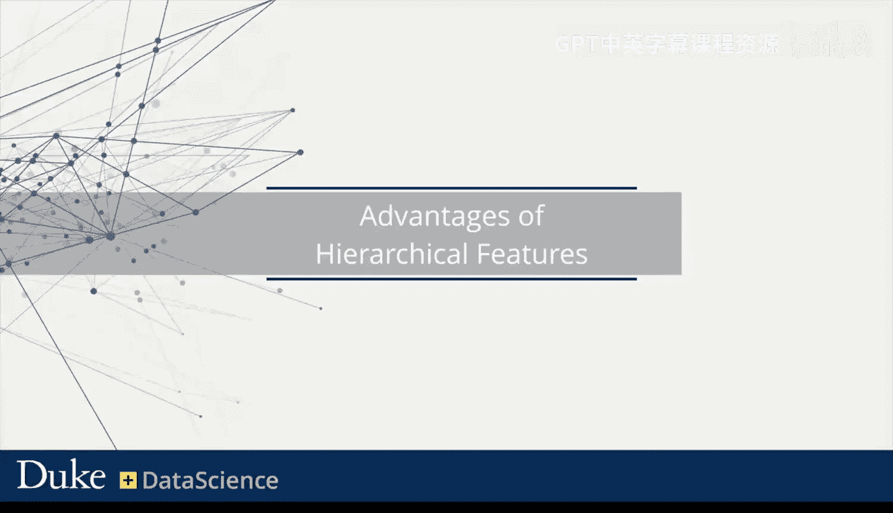
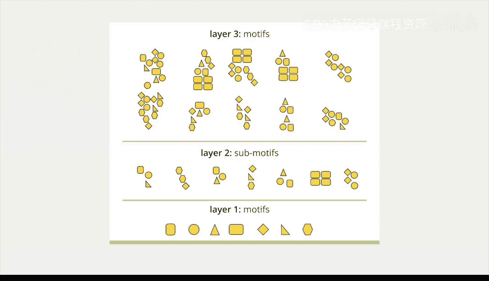
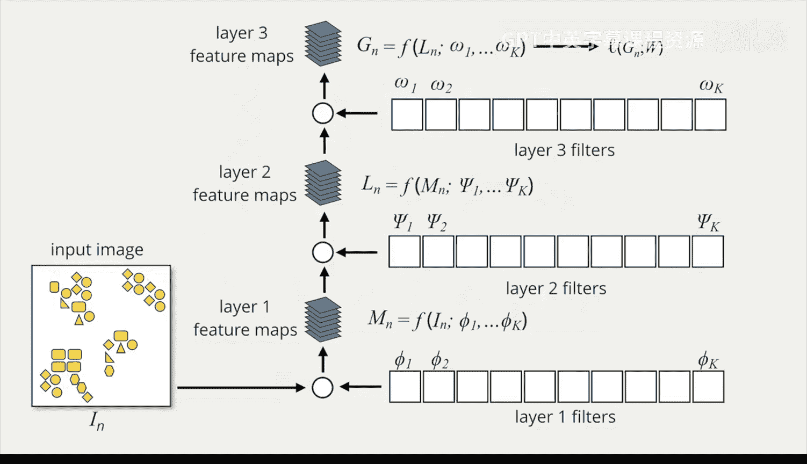
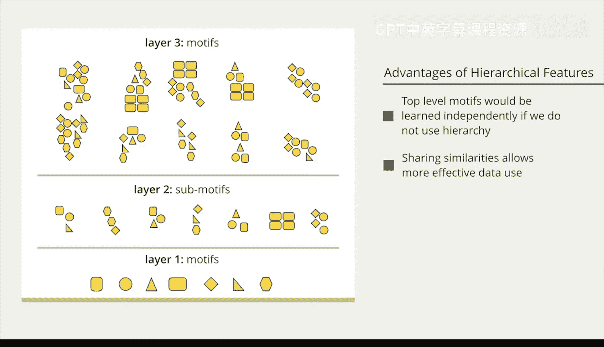
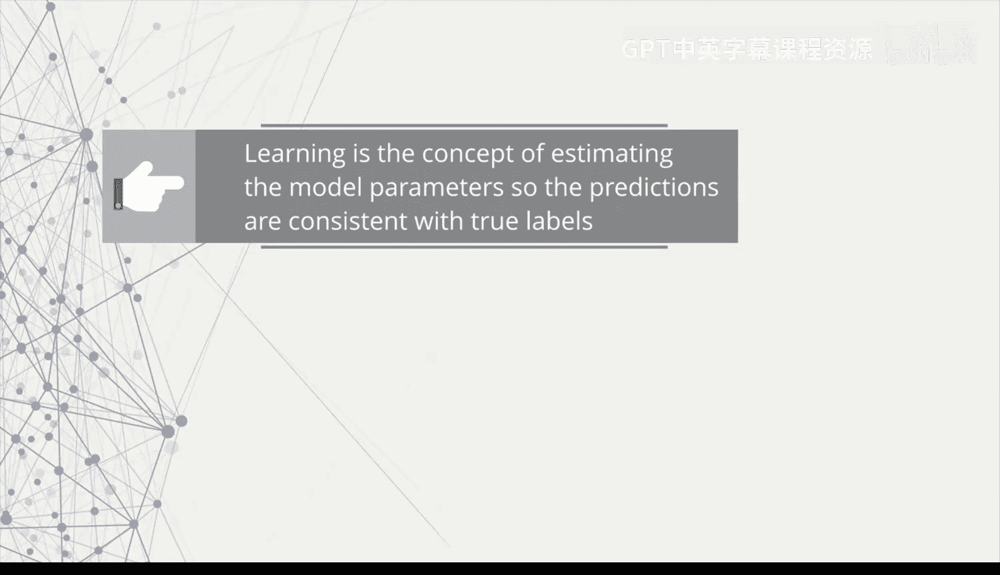

# 杜克大学《机器学习｜Introduction to Machine Learning》中英字幕 p19 19_01_06_层次特征的优势.zh_en -BV1yjvdBQEaU_p19-

What is the advantage？Of this deep architecture。 So we'll go back to where we started。

 So remember that the motivation here was we had those those toy examples and we had those those fundamental atomic elements composed of the shapes。

 And here we at layer1， we have the simplest atomic elements which are the basic shapes at layer 2。

 we have what I call the submotifs which are basic combinations of those fundamental shapes。

 and then finally at the layer 3， we have the motifs， which are combinations of submotifs。

So the thing that that one might ask is if。

In this model。At the end， at the top of the architecture。

The learning is based upon the features at the top of the architecture。

 which are ultimately used to make a classification decision。

Why can't we just build a model based upon the top layer motifs without having to worry about the submotifs at layer 2 and the atomic elements at layer1。

 What's the advantage of this deep architecture。And so if we were to build an architecture。

Which was only based upon the filters at layer 3。Then each of those layer3 filters would be learned independently。

There would be no understanding in the learning of those filters。That they share structure。

And so I'm reminding you by showing examples of repeated structure at layer 3 and at layer 2。

That indeed， it's that layered structure that motivates the deep architecture。And so， any time。

A particular submotif。Is manifested in any of the motifs at layerer 3。

The learning of that motif provides information about the other motifs through the shared information。

 And so the， the idea is， is that by sharing structure between the different。

Elements of the filters at the various layers manifested by the fact that they are all made up of shifted versions of more fundamental building blocks through that shared structure and by this deep architecture。

 we can use our data more effectively and share knowledge between each of the motifs such that knowledge of one motif can improve knowledge of another motif through the shared substructure that they possess。

So now we have a little bit of a sense of how machine learning is manifested。

 We have a sense of how we build a machine here the deep。Convolutional neural network。

 We have our first taste of how learning occurs where learning is manifested by taking large quantities of data。

 typically label data， which means that we have the data and we have the associated label we have learned we have seen what we mean by learning。

 learning is the concept of trying to estimate the model parameters。

 such that the predictions of our model are consistent with the labels， the true labels of the data。

 we also have gotten some understanding， at least some intuition that this could be quite challenging that learning could be challenging。

 particularly when the number of parameters is large。

So as we conclude this module on the introduction to machine learning。In the next。

Blessing will provide some will provide some examples。

Of how modern machine learning is transforming life for people around the world。

 those examples in how this technology is providing breakthroughs in many areas will help to motivate us as we dig deeper and try to learn more about modern machine learning。

