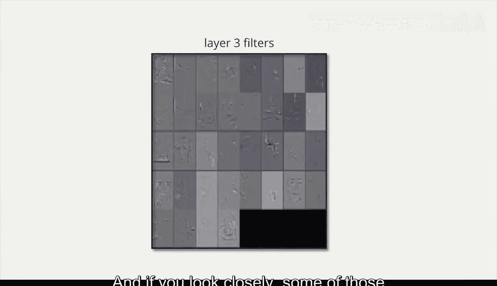

# 杜克大学《机器学习｜Introduction to Machine Learning》中英字幕 p20 20_01_01_真实图像上的CNN.zh_en -BV1yjvdBQEaU_p20-

So， we have。Gain some intuition。Into how the convolutional neural network works。

We've also gained some early indications on how machine learning is manifested from the standpoint of learning the model parameters based upon the data。

So as we move forward in this module。We're going to learn more of the complexity and details of how this model learning is actually implemented in practice。

 Some of these details are challenging， and so as we move through those challenges。

I think that it might be nice for us to remind ourselves from time to time about the significant advances that have been manifested by modern machine learning and deep learning and through that motivation to push through some of the technical challenges and details to actually make this work。

So in this lesson。We're going to talk a little bit more about these models and also show how they're used in practice。

Recall that in the previous lesson。We introduced the concept。

Of how one learns these filters based upon data。So now we're moving away from those toy examples of atomic elements。

And we're now moving towards real data。So when we analyze real data。What do these filters look like。

 What do the filters at the different layers look like。

So just to give an example of what these look like and to also provide some intuition and motivation。

We'll look at these filters for a particular data set which was composed of images of faces， cars。

 motorcycles， and things like that。And so at the top。What we're depicting。Are each。

Of the filters that were learned at the first layer of the model， at the bottom layer of the model。

And so each of those small squares represents each。

An example of one of the learned filters through the convolutional neural network。

And recall that in our original discussion， we were talking about basic shapes。

 but now we're talking about filters， which are actually learned based upon data。In these。

In these small images at the top。You notice that there are dark colors。And bright colors。

 white colors。The dark colors correspond to negative values at those pixels。

 and the white corresponds to positive values at those pixels。 And so the thing that you notice。

 if you look at those subims closely，Is that they are characterized by rotated versions of a fundamental。

Shape， which is manifested by a dark。Set of pixels and a bright set of pixels which are near each other are aligned with each other。

 What this corresponds to is like one cycle of a sine wave where one cycle goes down。

 the other cycle goes up。 These are manifested in two dimensional shape and that that single cycle of a sine wave。

Is rotated to a different rotational angle for each one of these layer one filters。

 so each of the layer one filters are by and large manifested by a single cycle of a sine wave。

Rotated to a different angle。Within within that particular atomic element or sub that particular filter。

These shapes。it turns out have been widely studied in mathematics。

 they have very fundamental characteristics in mathematics， and they're called Gaor functions。

Perhaps more interesting。Is that people。Have done studies。On mammals， like rabbits and rats and mice。

 And what they've done is they've shined light。Into ontoto the retina。Of a mammal。

And have asked the question。What shape。Should one shine on the light of a retina of。

 of a mammal such that a single。Neuron in the visual cortex of that animal is turned on。

And so if you turn on a single neuron。In the visual cortex of a mammal。Arguably。

 that would indicate that that is the most fundamental shape。That the visual cortex。Can recognize。

 So again， what， what has been done is that very fundamental shapes have been shined on the retina of a mammal。

With the goal of trying to identify which shape shined onto the eye of a mammal will trigger a single neuron。

 which is reflective of the fact that this is the most fundamental shape that the visual cortex can recognize。

It has been determined that those shapes look almost exactly like the atoms that the convolutional neural network has learned at the first layer of this model。

 So it turns out that the shapes and the the shapes that you see on the top of this figure。

 each of those little squares。Which are the basic atomic elements that have been learned by the convolutional neural network。

Correspond very closely to what biological studies indicate are the most fundamental elements that a visual。

 a visual system of a mammal can recognize。 This was not required。

Of the convolutional neural network。 But we think many people feel very interesting to see that this computational engine。

 the convolutional neural network， at least at the first layer of this architecture seems to behave in a way that's consistent with the visual system of mammals。

 So now we go to the second layer of our deep architecture。

 and that corresponds to the images at the bottom left。

 And at the bottom left what we're reflecting each of those squares represents one of the filters at the second layer of our deep architecture。

 And remember that I called those submotifs previously。 If you look at that at these closely。

 you'll notice that each of them corresponds to a fundamental shape。Or structure。

 which is more sophisticated than our atomic elements at layer 1。

 If you look closely at some of those layer 2。Images or filters。 You'll notice things like eyeballs。

 And remember that we are these， are these are images of faces that we're analyzing and other such things。

 And then if we look at the bottom right， these correspond to filters at the。

Third layer of the architecture at the top layer of the architecture， and if you look closely。

 some of those filters correspond to sketches of faces。

 so the interesting thing that these filters which are learned entirely based upon the data is that at the first layer。

 the most fundamental layer， the layer1 filters correspond to building block filters which are consistent with what seems to be the fundamental means of exciting the neural architecture of the visual system of mammals。

At the layer2， which is at the bottom left， we see more sophisticated structure。

 If you look closely you'll see things like eyeballs。

 Those are manifested of substructure in the image and then finally at the higher level where we now see more sophisticated structure we could actually see sketches of faces。

 So this gives us some further intuition into what these filters。

At the multiple layers of the model are actually learning whenever they're given real images。

