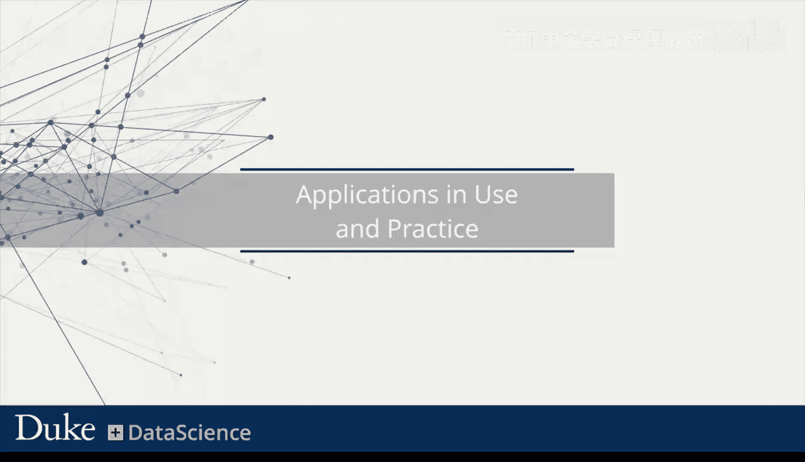
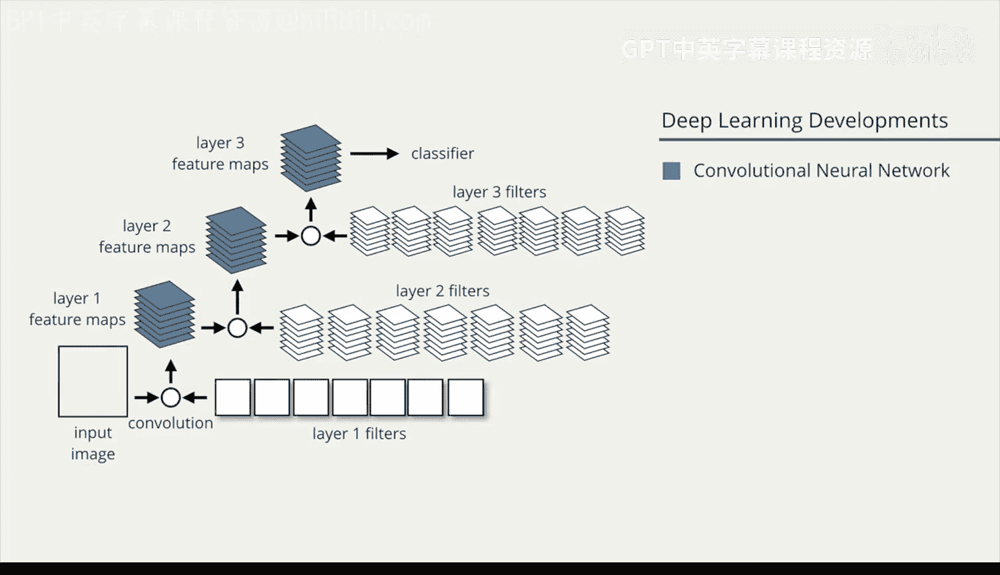
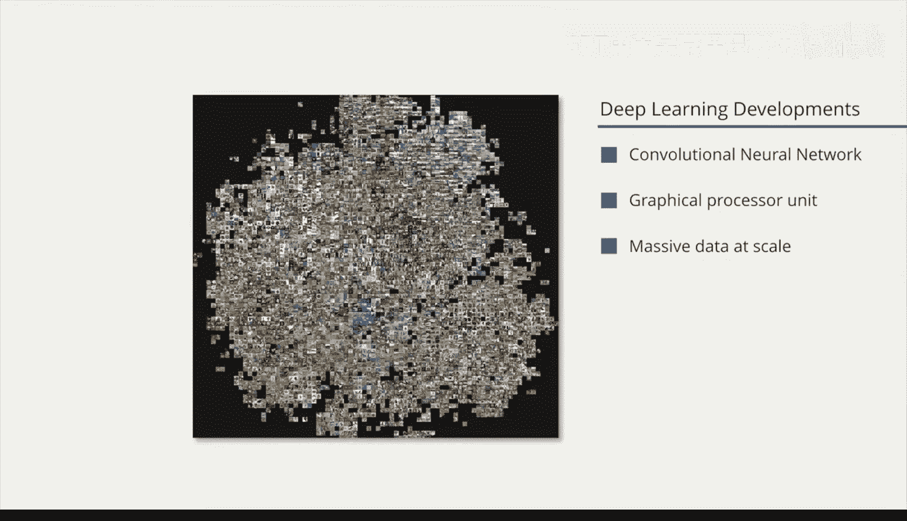
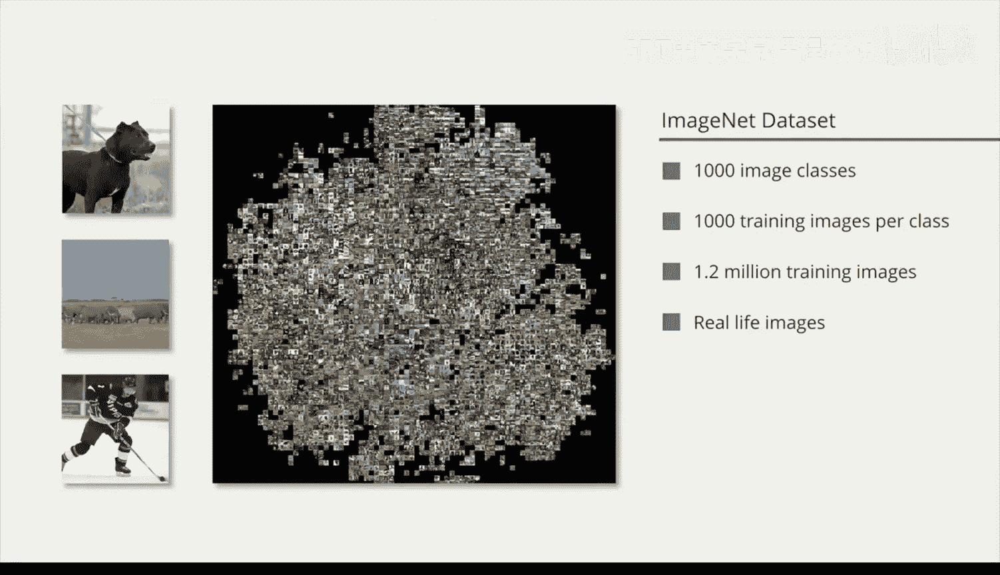
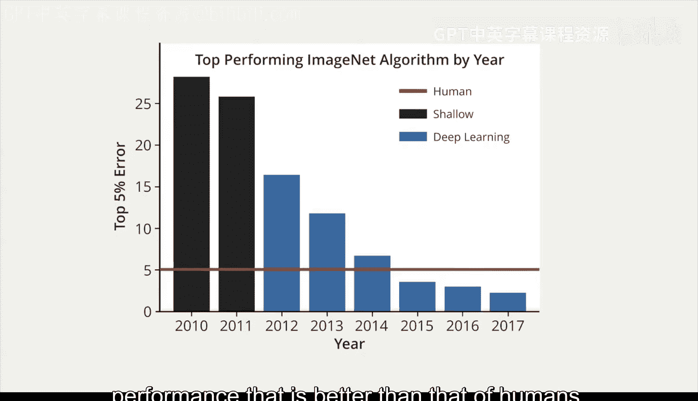
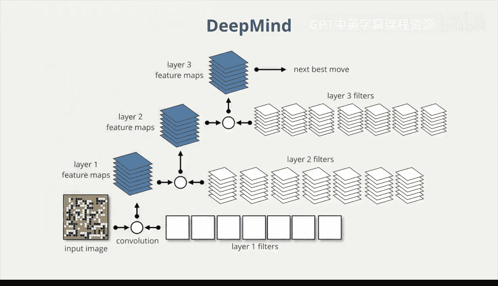
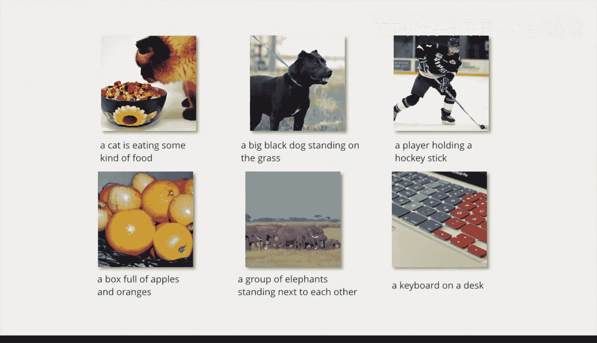
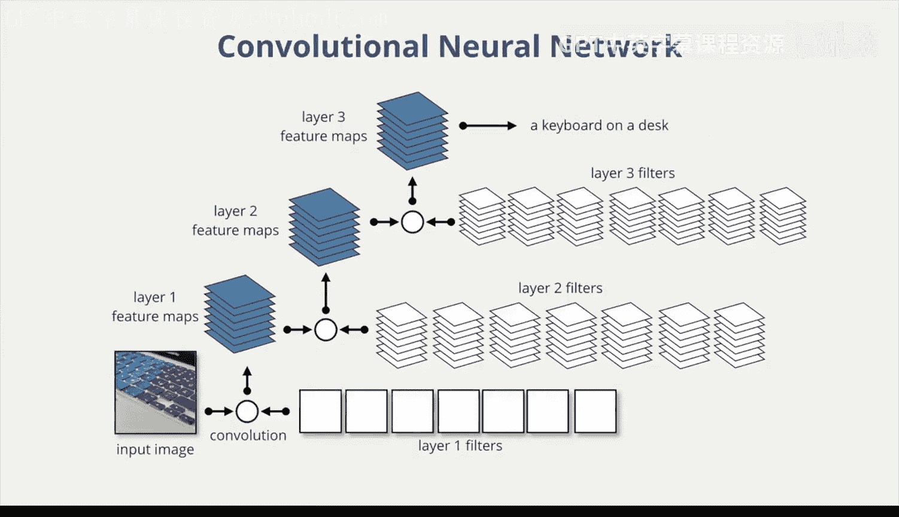
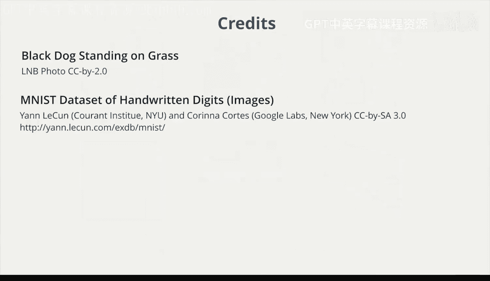

# 杜克大学《机器学习｜Introduction to Machine Learning》中英字幕 p21 21_01_02_应用与实践.zh_en -BV1yjvdBQEaU_p21-

So now let's based upon using that even further intuition， let's ask the question。

 how well does this technology perform？On real data at massive scale。

 it so recall that one of the significant developments in deep learning occurred around 2013。

 which was the bringing together of the convolutional neural network。Which was our fundamental model。

 which actually was developed around 1989。

Computational power， the graphical processor unit and massive data at scale。

 and so what you see here are many， many images reflective of what's called the Inet data set。

 this corresponds to classifying 100 different types of images，100 classes。

 So remember when we were talking about the labels of the images。

We were talking about binary labels， plus 1， minus1， we introduced that purely for simplicity。

We are now using with this deep convolutional neural network architecture at the top of the network。

 we're making a classification to 1 thousand different classes， so significantly more than binary。

For the training data， and remember that one of the key things that made neural networks work so well was massive quantities of data。

So there was roughly 1000 example training images for each of the 1000 image classes and consequently about 1 million or actually 1。

2 million training images to give you an example of what some of these images look like three of them are shown at the bottom left and so the thing to take away for this figure is we look at the bottom left。

 these are real images， these are sophisticated images and we're going to use these deep convolutional neural networks to classify them and the thing that the image to the right is simply to depict massive quantities of data。

So now how well does this technology work， And so the technology was developed around， as I said。

 around 2013， this is the performance of these models as a function of time。

 So these are the best performing algorithms。As a function of time。 So the the in 2010 and 2011。

 that is technology that preceded the convolutional neural net。 and then around 2012，2013。

I when the convolutional neural network came to the forefront and you can see that there was a significant improvement in performance。

 this is the classification accuracy， the vertical axis represents classification accuracy in the horizontal line at 5% is representative of performance of humans。

 and so we could see that as the years have moved from 2012 to 2013 to 2017。

 we are now at a point where these deep convolutional neural network architectures are providing performance that is better than that of humans。

So now to give you a sense of other things that we could do with this architecture。

So these are eight images， example images。 And this is an example of how the model works。

 So recall that there are1 thousand different labels。

And the model provides a probability of which label is associated with the image under test。

 and so what you're seeing here is in each case you see the image under test and then beneath that。

 you see the probabilities。From the model of what the model thinks the image is representative of。

 so you could see that in each example the bar represents probability。

 so what we're listing is for each image on the top beneath it we're depicting the five most probable labels that correspond to that image and so if you look at each of these and these are representative examples。

 the performance is quite impressive and so the takeaway from this is that first the images are of significant realism and complexity and secondly。

 the performance of the model is truly extraordinary when we look at this relative to the performance of humans the ability of humans to do this labeling process is actually and currently inferior to the performance of these deep。

Neuro network architectures。Another key breakthrough that I talked about in the history of the deep architecture occurred recently was in the context of go。

 so go is a very famous game that is played largely in Asia。

 the go board depict which is depicted here is significantly more complicated than a game such as chess。

 this game go is almost religious game in places like South Korea。

 there are people in South Korea who are essentially professional go players and there' are schools for learning how to play Go the game go。

Which is a two player game。Was believed to be so sophisticated and so challenging that there was no way that a machine or an algorithm of the sort that we have looked at could。

 could defeat a human。 so recently。deep mind whos based in the UK。

They developed an algorithm which at its heart was based upon the deep convolutional neural network technology that we have discussed at length。

And they built an algorithm that could take a picture of the goboard。

 send that picture into a deep convolutional neural network。

 and then based upon what the algorithm saw in the image or of the goboard。

 it would recommend the best next moved for the machine to take。

And so Deep Min developed this technology， it worked well。

 they ultimately did a match between the machine which essentially is based upon the deep convolutional neural network and some additional technology which is put on the top of that which is called reinforcement learning but the heart of it was actually the convolutional neural network。

 that algorithm or that machine played among played some of the finest go players in the world。

 many of them from Asia， and as I mentioned， these are essentially professional go players。

And something occurred that previously people thought was inconceivable。

 and that was that this deep machine learning technology beat the very finest go players in the world。

 This was a very， very significant milestone it represented the fact that this deep learning technology had truly matured to the point where it could do things that previously people thought were impossible。

Other things that have been done， digit recognition。

 these deep architectures have been used to do other things such as recognizing images that correspond to human writing a significant challenge。

 Another thing that has been done just to give again。

 a sense of the sophistication of the technology， So here are six images each of which was analyzed by the convolutional neural network architecture that we've discussed。

 a deep convolutional network architecture。 So the algorithm took the image in。

And then send that through a deep neural network architecture， the features。

At the top of the architecture， which were previously used for classification。

 are here used to do something arguably even more challenging。

 So given the features at the top of the neural network。

Those features were sent in to a natural language processing algorithm。

 which then synthesized text to describe the image。

 so each of the captions that you see written here in English was manifested by a machine。

So what is going on here is the image goes in。That image is sent through a deep convolutional neural network。

 The features at the top of that deep convolutional network are then sent into a different neural network。

 which is then used to synthesize text。 And so if you look at the text。

 you notice that it's a very high quality， highly realistic grammatically correct。

 also very well representative of。

Of of what is happening in the image。 So this is an example of how modern machine learning is generating so much excitement。

 This is an integration of image analysis and text synthesis。 if we recall back to a prior lesson。

 we talked about something called long， short term memory。

 which we will discuss in further detail elsewhere in this module。

The text analysis or the text synthesis that you see here is based upon the long。

 short term memory architecture。

