# 杜克大学《机器学习｜Introduction to Machine Learning》中英字幕 p22 22_01_03_深度学习与迁移学习.zh_en -BV1yjvdBQEaU_p22-

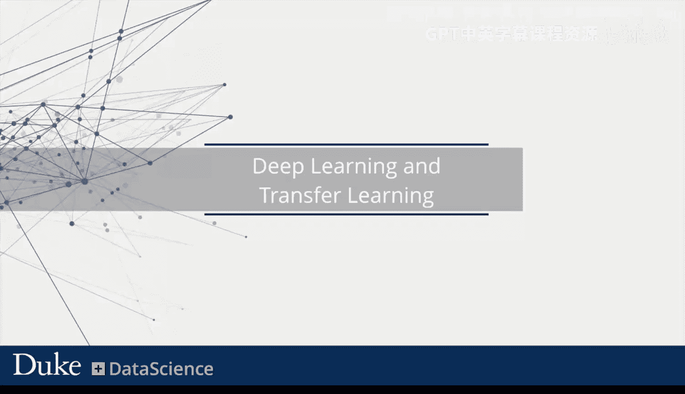

Now， to close this lesson。Playing the go game。Is interesting。

Synthesizing text to describe images is also interesting。

But there are many other things that one might be concerned with that perhaps have more value in human life。

 and so another area where image analysis is very important is in fields like radiology。

 ophthalmology， in dermatology in medicine。

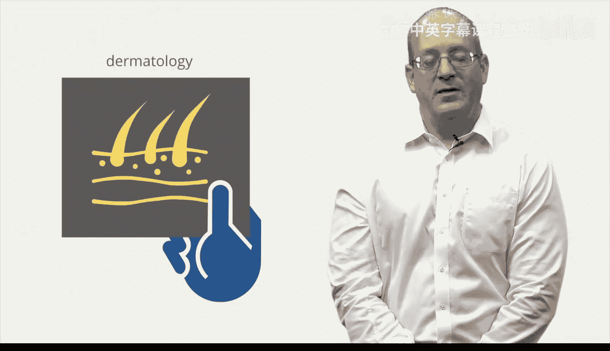

And so medical doctors are very busy people。And some medical doctors spend a tremendous amount of time looking at images instead of talking and counseling patients。

And so one area。Where deep learning seems to offer a significant opportunity is in the context of image analysis for medical imaging。

And so areas in which deep learning has shown tremendous promise。Is in ophthalmology， for example。

 in diabetic retinopathy， it's been demonstrated that convolutional neural networkss can perform as well。

 if not better than ophthalmologists， a similar performance has been manifested in dermatology and in radiology。

 so one of the things as we close this lesson。

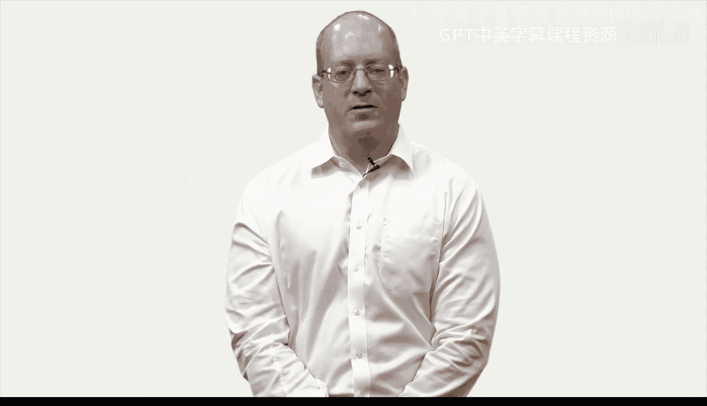

That is interesting， so recall that in the deep architecture。

 so what we're showing here is deep learning and in one of our previous lessons we talked about transfer learning。

So I talked about IageNe。And the fact that we have millions of labeled real images。

 and so on the top portion of this slide， I'm showing a set of images from IageNe。

 and then on the top to the right of them， I'm showing a deep convolutional neural network。

And so idea the question that you might ask is as we look at the deep convolutional neural network。

Which is a sequence of convolutional filters acting upon an image at multiple layers。

 at multiple scales。Is there something unique？About medical images that would require us to only train on medical images。

 or can we reuse the parameters of the model？From the imagenet and apply them to medical imaging。

So this is actually very important because recall that one of the key。

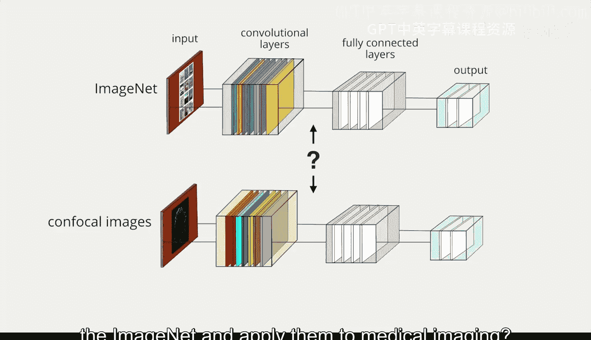

Aspects that has made deep learning work so effectively is the access to massive quantities of label data。

 So the imagenet is an example， millions of examples of images and corresponding labels。

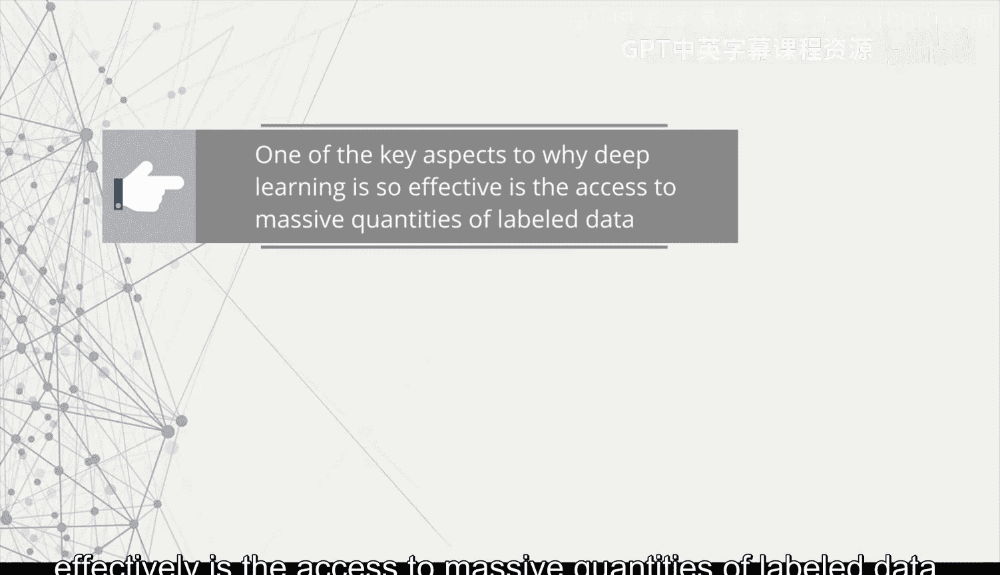

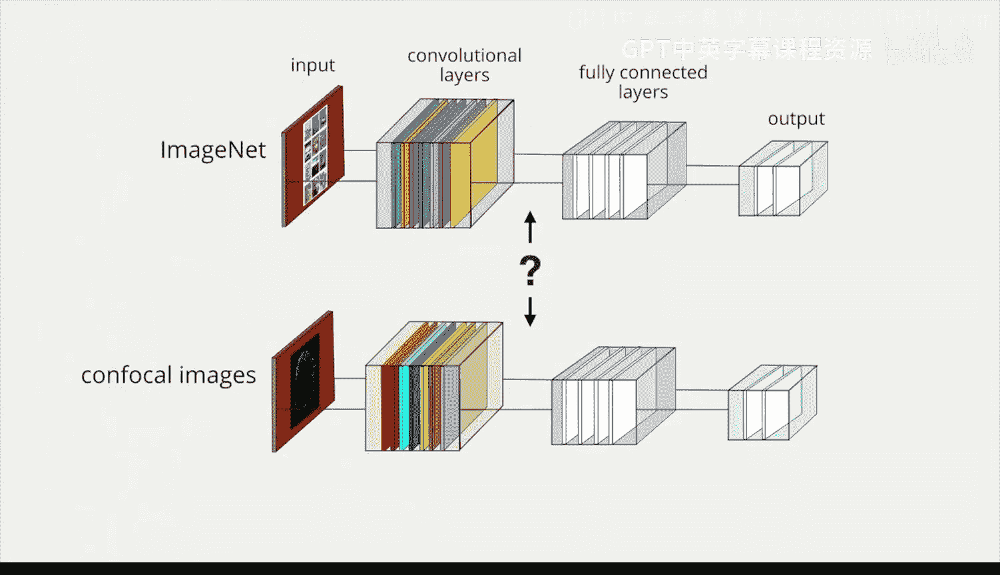

However， in medicine。This is actually very challenging。 So if you think about， for example。

 dermatology。For us to build a deep learning algorithm for which we had millions of images。

 dermatological images that were labeled。 that would imply that we would have to have millions of images of various aspects of skin disease。

 and we would need medical doctors to label them， that would be a very expensive and time consuming process。

 So the question that one might ask is if we look at the architecture that was designed for the imagenet based upon natural images。

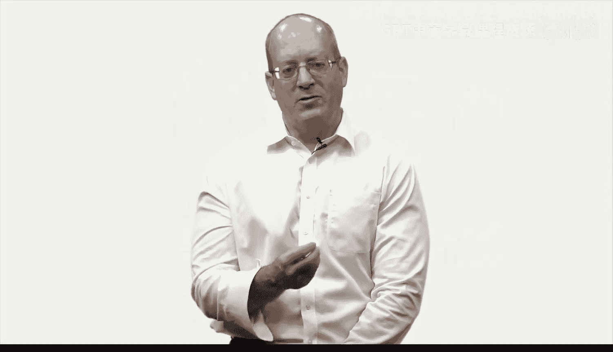

Can we transfer those filters to a model applied to dermatology or to ophthalmology or to radiology？

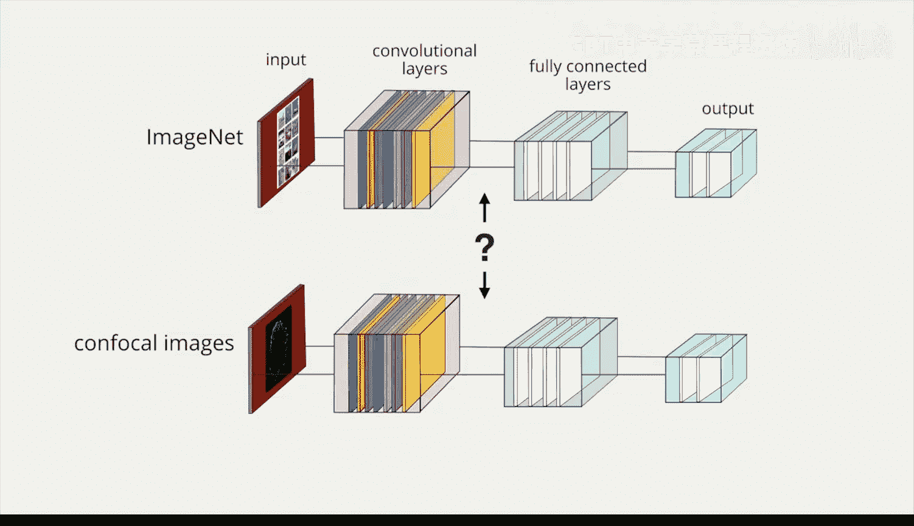

If the answer to that is yes， that would imply that the ability to apply this technology to other fields can be significantly advanced by leveraging the massive quantities of data that we have for natural scenes in the world。

 again， based upon digital handheld cameras， for example。

 and so the key thing I want to reflect by this slide。

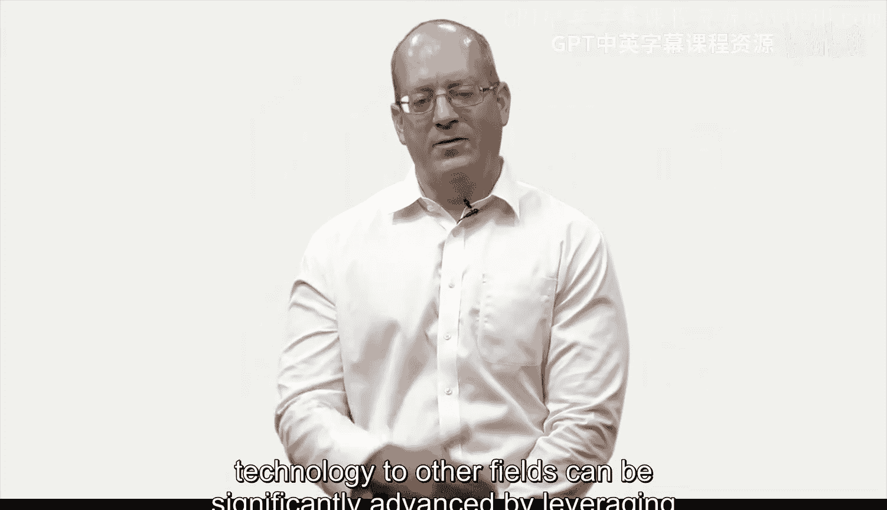

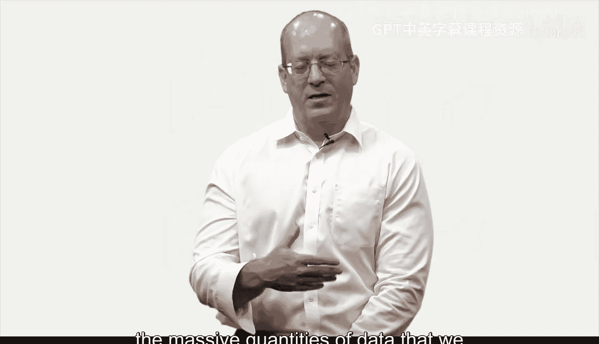

Is that it has been found。That one can take a deep neural network designed for imagenet。

You can take that deep learning architecture and the parameters of that and almost entirely transfer them to applications。

 for example， in for the analysis of diabetic retinopathy in ophthalmology。

 The rectangle is meant to show that we can take the weights of the model that were learned based upon imagenet and transfer them to images that look ostensibly very different here from a confocal images。

And then transfer those images， sorry， transfer those parameters in the rectangle and then only learn parameters at the top of the network。

 which are directly applicable to the confocal images and so consequently the number of parameters that we have to learn is significantly reduced because instead of having to learn all of the parameters。

 we only learn for the medical images， the new parameters at the top of the network。

 and then we transfer all of the parameters from the image net。

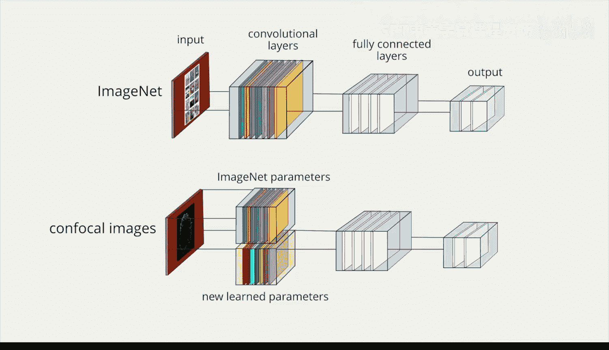

This concept of transferring parameters from a model trained on INe。To different images， for example。

 in medical applications， this is a significant positive aspect of deep neural networks which has been proven to be very valuable in applying these technologies to new and different fields for which we may not have quite as much label data such as in medical imaging and so I close this session this lesson by showing some examples of digital pathology data。

 these are images of cells used for example cancer diagnosis this is another area where deep learning and deep convolutional neural networks are expected to have very。

 very significant application so as we close this lesson the key thing to notice is that this deep learning architecture。

This convolutional neural network。Is now being used across a wide array of different types of applications and different types of images and is now producing performance。

 which which is often exceeding the performance of humans。

 The key thing is through this concept of transfer learning， many of the parameters。

Across these different arguably very different applications can be transferred almost directly。

 this concept of transfer is very powerful and play will play an increasingly important role as deep learning is applied to other fields of image analysis。

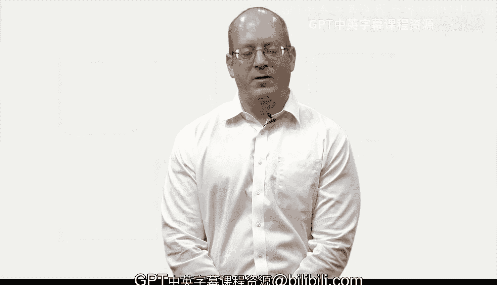