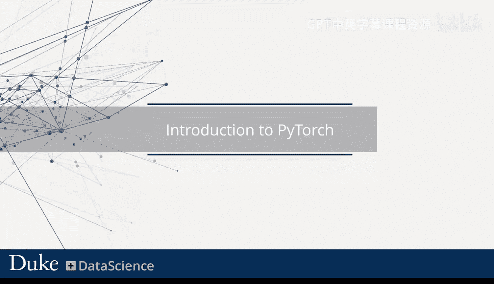
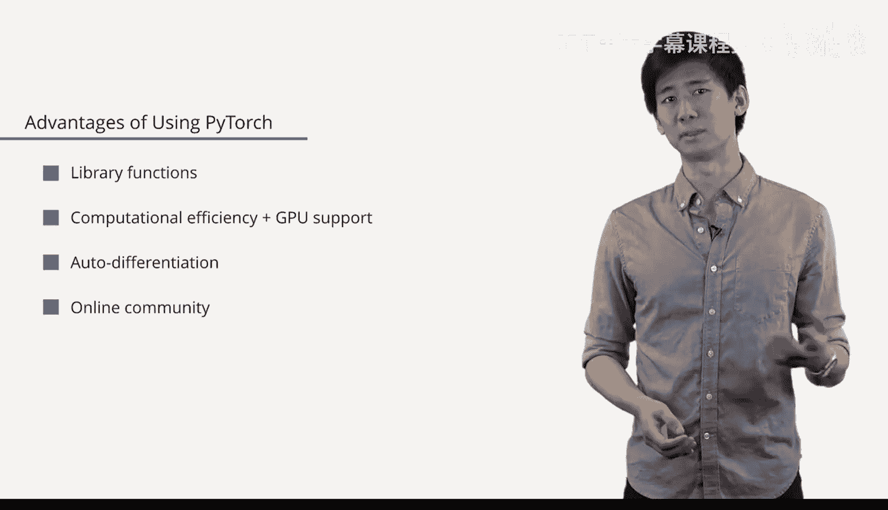
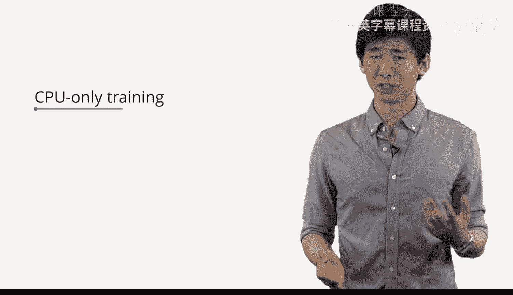

# 杜克大学《机器学习｜Introduction to Machine Learning》中英字幕 p23 23_01_01_PyTorch简介.zh_en -BV1yjvdBQEaU_p23-

Hello， everyone。 Welcome to the hands on portion of the course。 My name is Kevin Li Aang。

 I'm a PhD student advised by Professor Lawrence Karen here at Duke。

 and I'll be your instructor for these sections。😊，In these parts。

 we'll walk through how to build the basic components of the neural networks we learned about during previous video lectures in Python。

These sections are considered optional， but we strongly believe that working through these exercises is the best way to develop a thorough understanding。

 just like in any other math or computer science course。

We could actually build our neural networks in pure Python or with Python's numerical computation package。

 nu P。However， we'd find these implementations to be slow， both to write and to run。

Although it's a great exercise if you want full mastery in practice。

 we typically build deep learning models with one of a number of machine learning libraries。

For this class， we'll be using Pytor， the framework builds primarily by Facebook， AI research。

There are many advantages to using a library like Pytorch。First。

 many deep learning models have certain operations in common。

Using something like patchwork means we don't have to write all these functions ourselves。

Importantly， though， a key difference between these libraries and the way we would probably implement them is that they are also written to be computationally efficient with the capability of utilizing graphical processing units or GPUs。

Deep learning models can take a long time to train。

 and a GPU implementation can be the difference between a model training in hours and one that takes days or weeks。

Additionally， as we'll see in the next module， almost all neural networks are learned through back propagation。

 which requires1 gradient with respect to your network。These can be derived by hand。

 and indeed if you're using Python and nuPy， you would probably have to do that yourself。

On the other hand， Pytorch's autogra engine can do this differentiation for us automatically。

 which makes building models much easier。Finally， it's a really exciting time to be in machine learning right now with a very large community out there。

 researchers， professionals and students。Pychorch has one of the fastest growing communities of users and it's very common to find open source implementations of state the art models。

 step by step tutorials with code examples， and active forums teeing with debugging advice or recent trends。

Most of the materials for the hands on sections are organized in Jupyter I Pthon notebooks。

 with text explanations and figures embedded between the cells of code。

Before I direct you over to the first notebooks on setting up your environments。

 a couple brief comments。

First， we're going to assume some basic familiarity with Python and numpy。

 Check out the notebook Python prerequisites and make sure you understand most of the sample code。

 If you're a little rusty or have never seen Python before。

 we recommend brushing up before attempting any of the hands on sections of this course。

Second， while GPUs greatly accelerate the training process。

 not everyone has access to ones capable of handling the computation for deep learning models。

 as such will be sticking to simpler problems that can be run with just CPUs。

 You'll find that writing for CPU computation is very similar to writing for GPUus。

All right， that wraps up our introduction。 Now let's get a coding environment set up。

