# 机器学习：24：如何定义学习 📚

在本节课中，我们将要学习如何从数学上定义“学习”这一过程。我们将探讨如何将学习问题形式化，以便能够实际地训练一个神经网络模型。

## 概述

上一节我们介绍了不同类型的网络，并讨论了深度神经网络是什么以及它们能做什么。本节中，我们来看看如何从数学上定义“学习”，从而将训练网络设定为一个可以求解的优化问题。

## 从数据到模型

回顾之前的示意图，我们的目标是结合训练数据（左侧）与一个网络模型（右侧），以学习能够根据特征预测结果的参数。

*   **训练数据**：包含多个独立的训练样本，每个样本由特征（协变量）和一个特定的结果（标签 Y）组成。
*   **网络模型**：以逻辑回归模型为例，特征通过线性组合生成 Z，再通过 Sigmoid 函数转换为预测概率 σ(Z)。

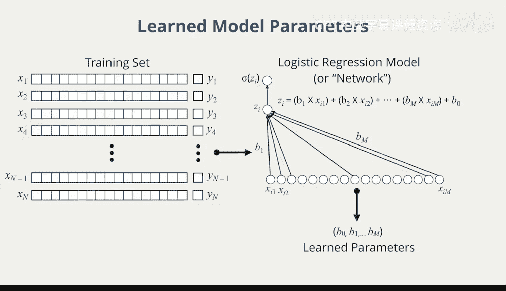

我们的核心任务是：给定训练数据和想要学习的网络结构，如何实际地学习出模型的参数？

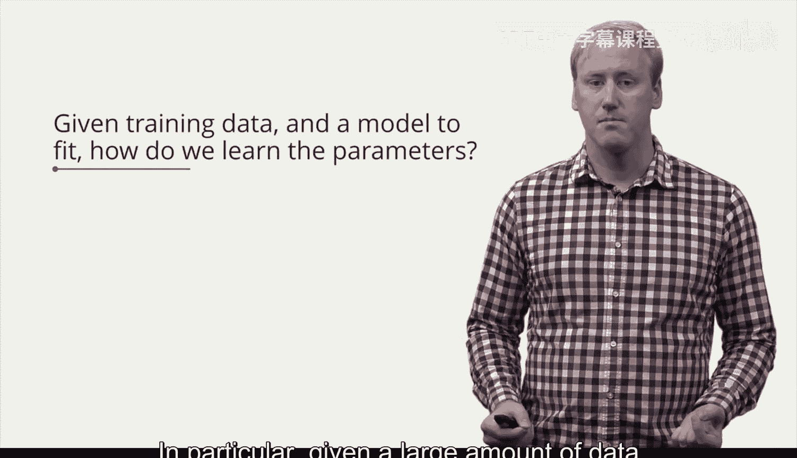

## 学习的核心问题

因此，我们今天要讨论的基本问题是：**给定大量数据和我们想要拟合的模型（网络），如何既高效又有效地学习模型参数？**

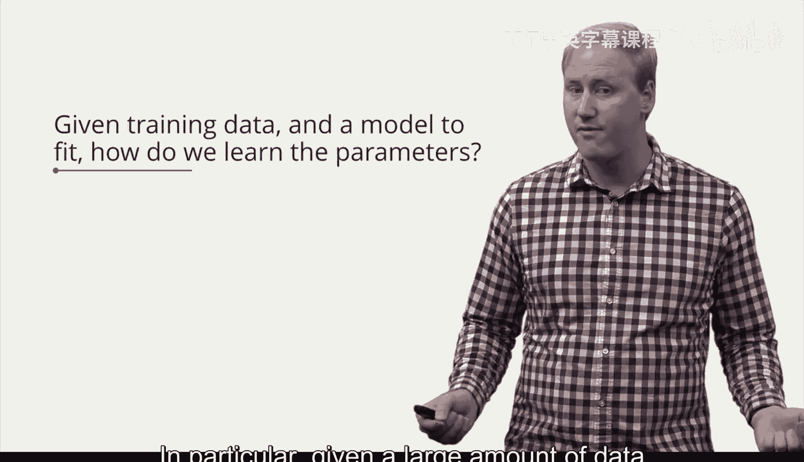

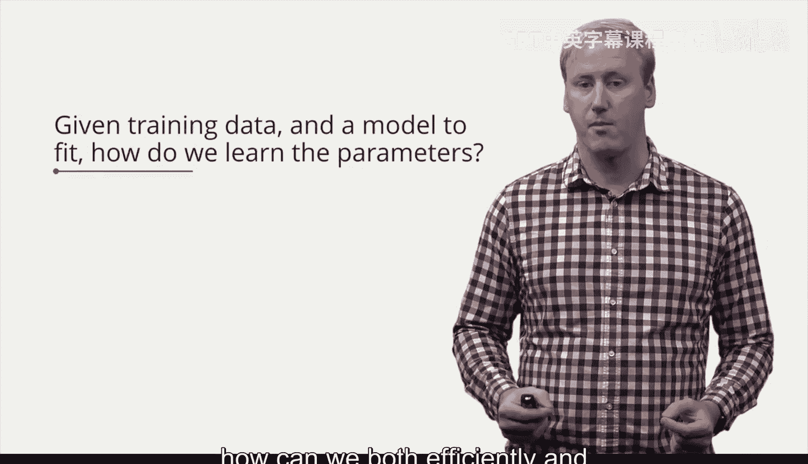

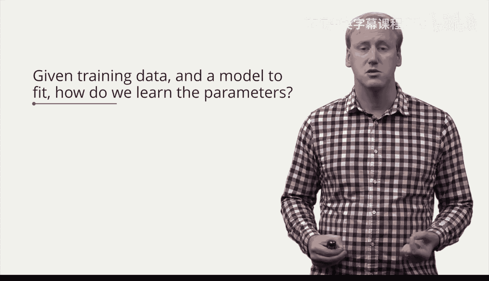

*   **有效性**：我们希望学习到的参数能够做出非常准确的预测。
*   **高效性**：我们希望利用有限的计算资源高效地完成学习过程。这在手机应用或实时学习等场景中尤为重要。

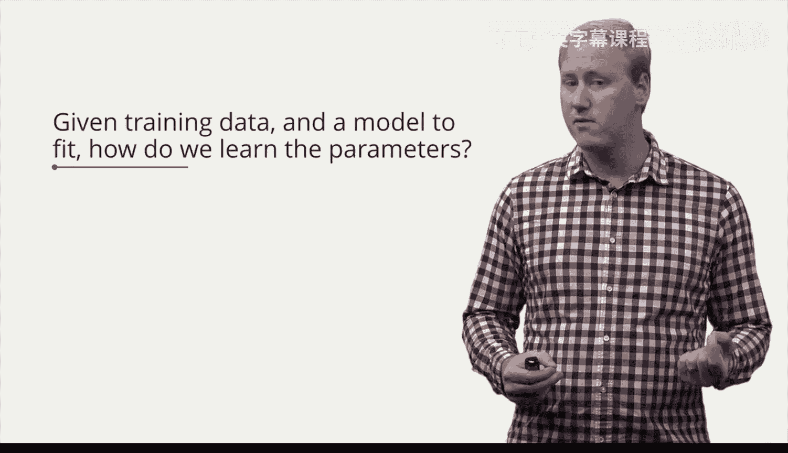

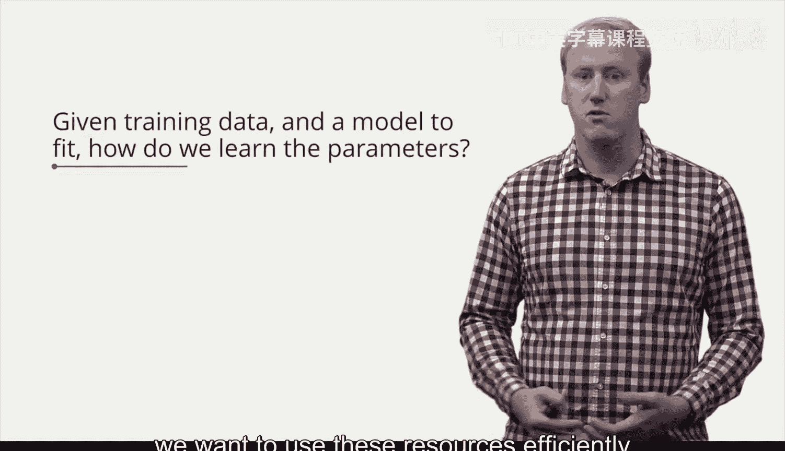

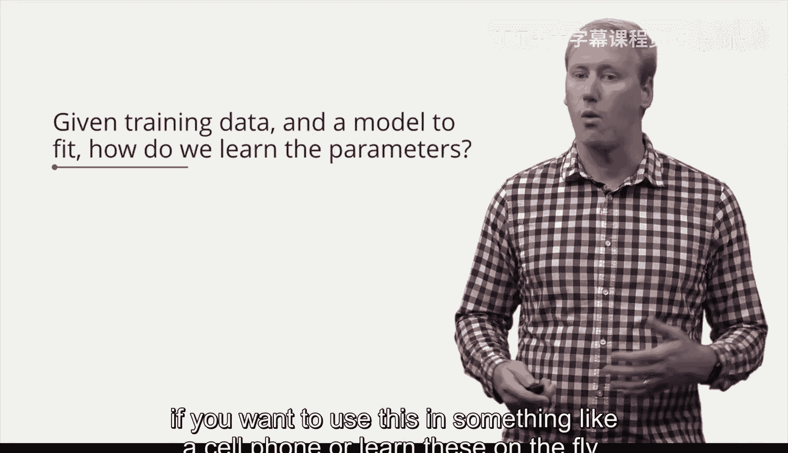

## 定义“最佳性能”

具体来说，当我们尝试进行学习时，我们试图做的事情是：**学习能给我们带来最佳性能的参数。**

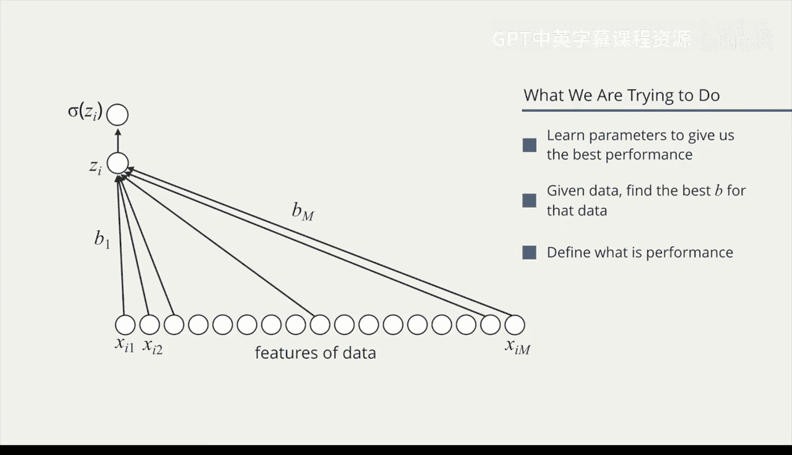

这意味着，给定数据，我们要找到对该数据而言最好的参数 B。但我们立刻遇到了第一个问题：我们还没有定义什么是“性能”。我们如何定义这个网络的性能好坏呢？

## 经验风险最小化

解决这个问题的途径是使用**经验风险最小化**。这是机器学习领域的术语，其核心是引入一个**损失函数**。

损失函数接受两个输入：
1.  真实值或真实结果（Y）。
2.  我们的预测值（Ŷ）。

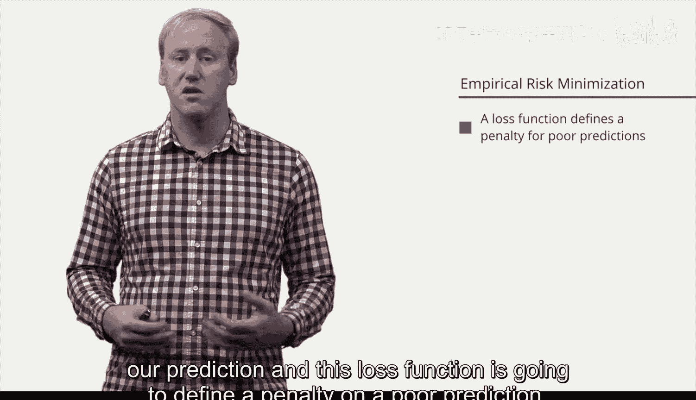

这个函数的作用是：**为糟糕的预测定义惩罚**。如果我们预测得很好，就不会受到什么惩罚（损失很小）；而每当预测得很差时，我们就会付出很大的损失。

我们的目标就是**最小化平均损失**。既然损失是对表现差的惩罚，我们自然希望它越小越好。

## 学习的数学表述

因此，我们可以用数学语言表述如何寻找最优参数 B：

**B\* = argmin₍ᵦ₎ (1/n) Σᵢ L(Yᵢ, σ(Zᵢ))**

其中：
*   **B\*** 是我们的最优参数。
*   **argmin** 表示寻找使后面表达式值最小的参数 B。
*   **n** 是数据点的总数。
*   **Σᵢ** 表示对所有数据点 i 求和。
*   **L** 是损失函数。
*   **Yᵢ** 是第 i 个数据点的真实标签。
*   **σ(Zᵢ)** 是我们的模型对第 i 个数据点的预测概率。注意，Zᵢ 依赖于参数 B，因此预测也由参数 B 决定。

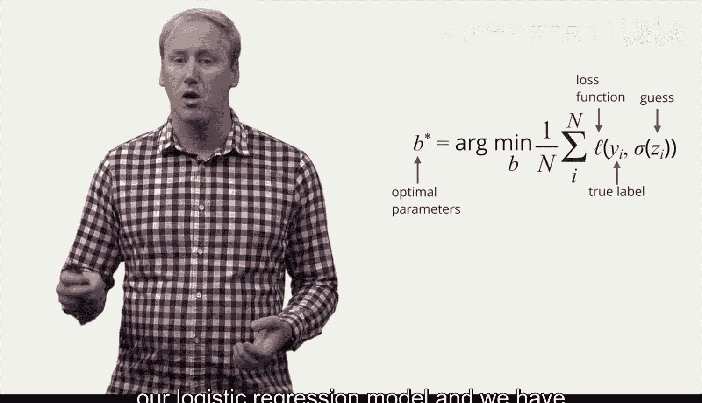

这个公式的含义是：**我们希望找到能使所有数据点上平均损失最小的那组参数 B**。这就是我们对“学习”的数学定义。

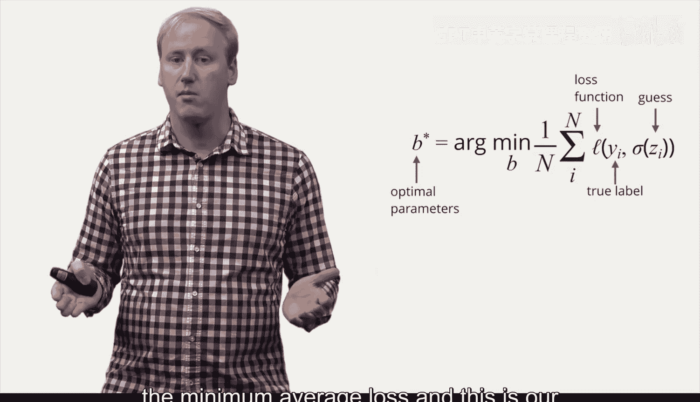

## 定义损失函数：以二分类为例

我们还需要定义损失函数 L 的具体形式。以二分类问题为例：

*   **σ(Z)** 是我们的模型预测的“正类”概率。
*   **Yᵢ** 是来自训练集的真实标签（通常为 0 或 1）。

我们可以将损失函数视为**负对数似然**。在统计学中，我们通常尝试最大化对数似然。而在损失函数语境下，由于我们要最小化损失，因此直接取对数似然的负数。即：

**L(Y, σ(Z)) = -log P(Y | σ(Z))**

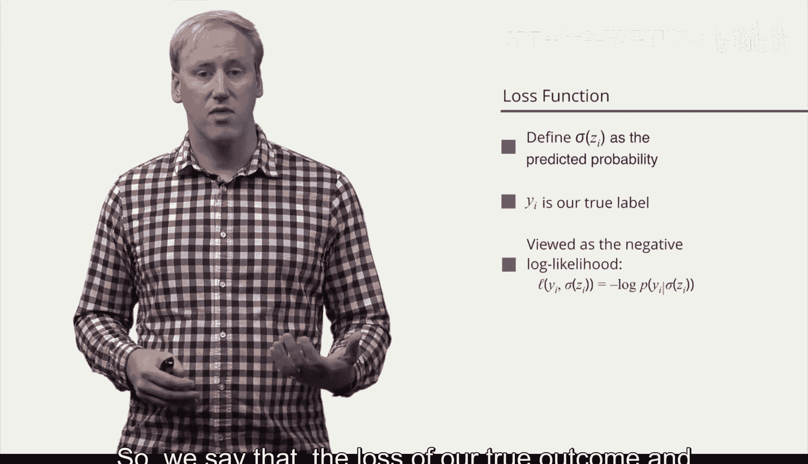

对于任何二分类问题，这个负对数似然（也称为**逻辑损失**或**交叉熵损失**）的具体数学形式如下：

**L(y, σ(z)) = -[y · log(σ(z)) + (1 - y) · log(1 - σ(z))]**

## 理解逻辑损失函数

这个数学形式可能有些抽象，我们可以通过可视化来理解它的行为。逻辑损失函数根据真实标签 Y 的不同（0 或 1），有两种情况：

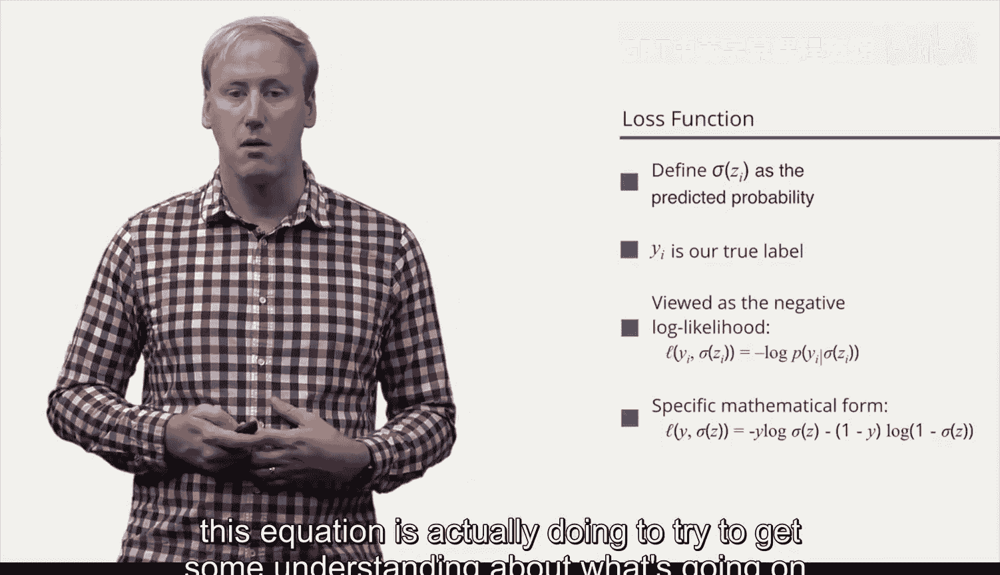

以下是损失函数随预测概率 σ(z) 变化的趋势：

*   **当真实标签 y=1（正例）时**：
    *   如果我们预测概率 σ(z)=1（即100%确信为正例），且预测正确，则损失为 0。
    *   但如果我们过度自信（例如预测概率很高，但实际是负例，y=0），损失会急剧增大直至无穷大。这惩罚了“过度自信的错误预测”。
*   **当真实标签 y=0（负例）时**：
    *   行为对称，预测概率 σ(z)=0 时损失最小。
    *   同样，对负例做出过度自信的正例预测也会导致巨大损失。

这个损失函数的好处在于：**它鼓励模型做出正确预测，但同时惩罚过度自信的预测**，其背后有深刻的统计学原理支持。

## 完整的优化目标

现在，对于使用逻辑回归（或任何进行概率性二分类）的问题，我们可以使用上述逻辑损失/交叉熵损失。我们的完整优化目标变为：

**B\* = argmin₍ᵦ₎ (1/n) Σᵢ [ -Yᵢ · log(σ(Zᵢ)) - (1 - Yᵢ) · log(1 - σ(Zᵢ)) ]**

我们的任务就是找到最小化这个平均损失的参数 B*。

## 总结

本节课中我们一起学习了如何从数学上定义机器学习中的“学习”过程：

1.  **目标**：我们拥有训练集和待学习的模型（网络）。
2.  **定义性能**：通过引入**损失函数**来量化模型预测的好坏。损失函数惩罚错误预测，正确预测则损失小。
3.  **数学形式化**：学习的目标被定义为寻找能**最小化所有训练样本上平均损失**的那组模型参数。这称为**经验风险最小化**。
4.  **具体例子**：对于二分类问题，常用的损失函数是**逻辑损失（交叉熵损失）**，它源自负对数似然，能有效工作。

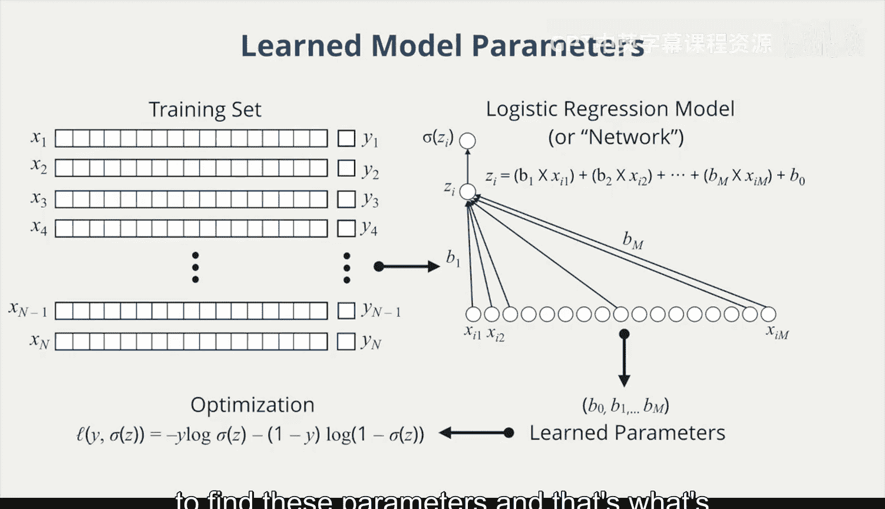

现在，我们已经有了“学习”的精确数学表述（一个优化问题）。接下来的课程中，我们将探讨实际的**优化算法**，来寻找这些最优参数 B*。