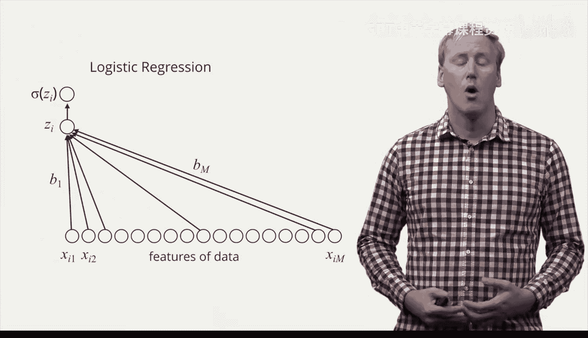
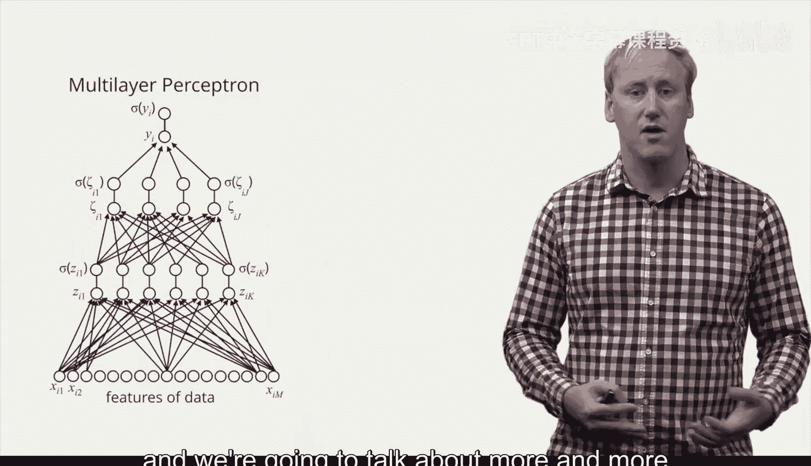
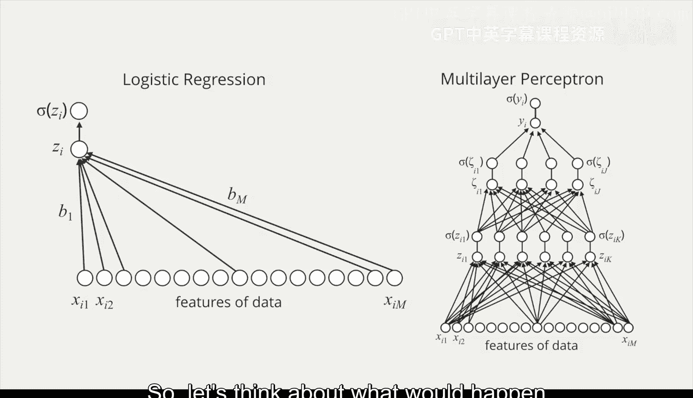
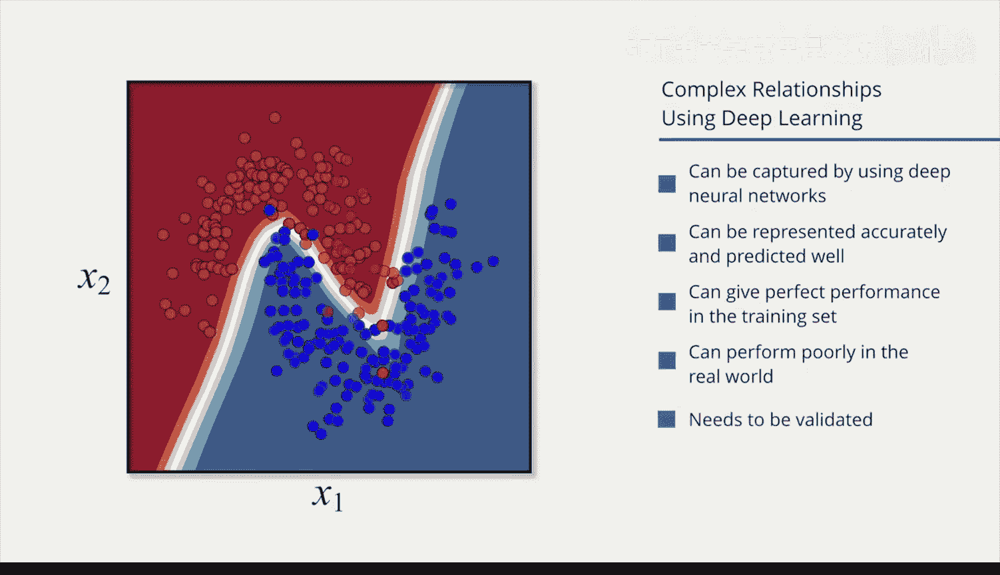
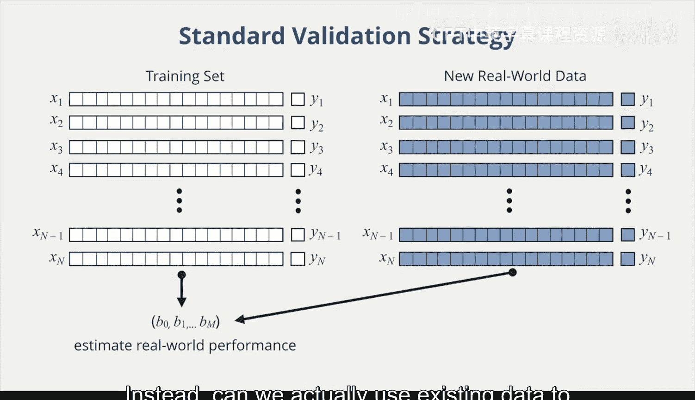
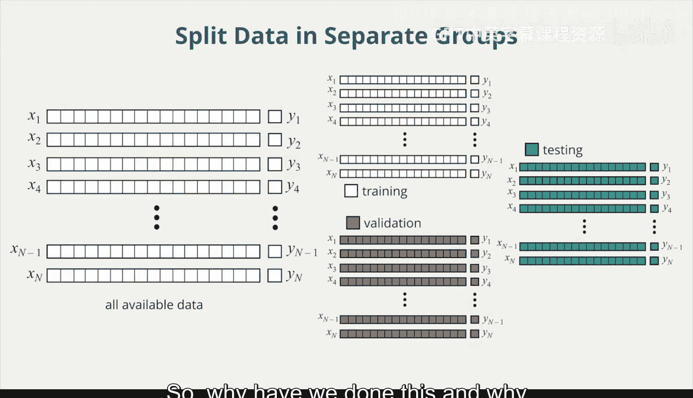
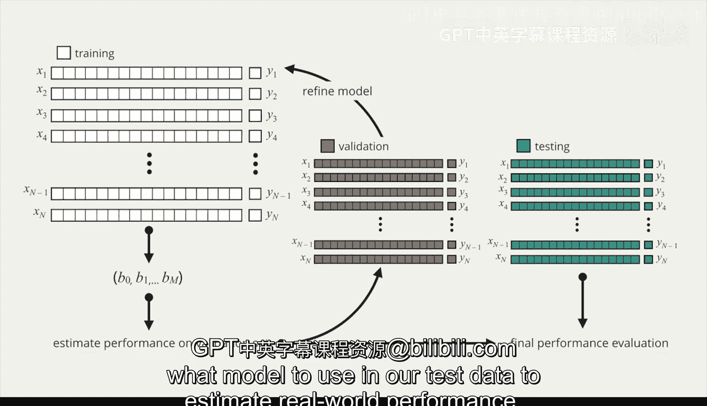

# 杜克大学《机器学习｜Introduction to Machine Learning》中英字幕 p25 25_02_02_如何评估网络.zh_en -BV1yjvdBQEaU_p25-

In this video， we're going to talk about how we actually evaluate our networks。

 We've talked a lot a lot about different options we have for defining a network。

 We can make very shallow networks。 We can use logistic regression。

 which is considered to be a fairly simple model， or we can use these deep neural networks。

 and we're going to talk about more and more complicated networks as this course goes on。

But one of the fundamental questions we're going to have is how do we actually evaluate how well these networks are going to work？

We're going to start out of a question， right， We've talked about this logistic regression。

 this logistic regression we went through and we talked about in depth， what this network is doing。

 It has all these features。 We're going to combine them in a linear fashion。

 and then we're going to convert it into a probability。So。When we do this。

This is a fairly simple model。 It's backed by decades of statistical theory on what it's actually doing and when it's going to work。

On the right， we're showing this multi layer perceptron， this is a deep neural network。

And we showed you this network， and it can do a lot more than logistic regression。

 It can capture a lot more properties than logistic regression ever could。 Now， the question is。

 do we actually always want to do this。So let's think about what would happen as we increase the complexity。

Well， first， creating deep models really helps us learn complex relationships。

 So what I'm showing here is a famous toy dataset set called the2 Moons dataset set。

 So we have our red class on the top and it curls around and we have our blue class on the bottom and it curls around If we use something like logistic regression。

 it can't separate these two classes， it can never predict very well on this because the model is just very limited in what it can capture。

If we use a deep neural network， we can actually capture much more complicated relationships。

 so what I'm showing here is I'm showing in the color red where a multilayer perceptron has learned to predict that it's going to be the red class and in blue or the multilayer perceptron has learned to predict the blue class。

And a deep neural network， in this case， a multi layerer perception can represent this very。

 very accurately， and it predicts very， very well。But we can come up with a lot of cases where this type of complexity is not warranted。

 so a deep model can actually give perfect performance on the training data set and then when we go into the real world。

 it can fail completely and so this is really bad and we actually need to validate the performance is this neural network going to work as well as we think it is。

So how can we actually go through and do this validation and why do we need to do this？

And before we jump into how we do the validation， let's think about a little bit more about the concept of overfitting。

Overfitting is what happens when where our learn model is going to increase complexity to fit the observed training data too well。

 we're going to predict extremely well on our training data set。But then when it comes to real data。

 we're not going to predict well。 And so why does this happen？

So let's start out with a really simple example， so on the right here I'm showing a collection of a few data points。

 we have a few observations and we want to come up with a function that's going to predict what our observation will be given the value of x。

 So what do we want to use to fit these example data points。

One strategy we can use from a very classical point of view is to increase our polynomial order。

So on the left here， I'm showing a simple linear regression fit。And we have our observations。

 and we have our x here。 and we can say this first order fit。 if we get a new value of x。

 this is what our prediction is going to be。It's this red line right here。So this does pretty well。

 And a lot of people would be very satisfied with this。 But there's this question。

 can we actually increase the complexity a little bit to actually predict better。

So let's look at what happens when we go to a third order fit， this is a cubic fit。

So in this cubic fit we have X here， we have f of x。

 and you can see that we can trace out this line here， and if we look at our observed data points。

 it actually fits a little bit better over the range that I'm showing plotted here。

 it seems pretty feasible that this could be what's happening。

You might be a little bit worried about what's happening outside the vegetable range here。

 So outside 0 and 4。This could be going off and funny and things， but inside this range here。

 it actually seems like it's doing really well。But we can keep increasing the complexity。

So what I'm showing here is an eighth order fit to these data points。

And I think if you go and show this to anybody that's taking you seriously。

 they will stop taking you seriously， right， because this is not a legitimate prediction， right。

 We'd never have enough information to say that this is good。 It just looks ridiculous。 And if you。

I don't think anyone would argue that this is the best model that's going to work the best in reality。

 It's fitting really well to our training data， but it's not fitting very well if we try to predict future points。

So what actually happens in overfitting right So when we're increasing the depth of our neural network。

 which is what we've talked about so far， it means that we're actually going to increase the number of parameters in the model。

 So logistic regression has a finite number of parameters and each time we add an additional layer in a multilayer perceptron we're getting more and more parameters But remember we have to estimate these parameters。

 So if we have more parameters to estimate we're going to get each parameters a little bit more wrong and all the errors we're going to add up and these parameters。

😊，嗯。But the second thing， which we really like actually is that when we have these more complex models or networks。

 we can learn more complex relationships， but maybe these relationships are actually too complex for a reality。

We can learn any complex relationship we want， does this complex relationship actually happen？

When we're overfitting， this means we're not going to generalize。

 We want our models and our analysis to generalize。

 which means that if we go out into the real world and say this is a model that we trained。

 we're now going to make predictions。 We want these predictions to actually hold。

 We want this to work when we go out into the real world。And so we want to know。

How well is our network and our model fitting actually going to work in the real world right so we had our training data。

 and we use our training data set， and we talked about how to mathematically set up our goal to get our parameters。

 And now we want to say， well how well is this actually going to work in the real world。😊。

I want to now introduce a very standard validation strategy。

So if our goal in the end is to understand how well this network will perform in the real world。

A good approach and a really the gold standard approach is actually try it in the real world right So what we can do。

 we can take our training data set。 We can estimate our parameters。

 and then we're going to get new real worldor data and say， let's use our network on this。

 Did we predict well， and we can estimate the real world performance in this way。😊。

And this is really the gold standard， right， if you want to say that your network is working。

 this is the best thing you can do。 However， this is extremely costly。So we don't want to do this。

When we're just trying to validate whether our model is working， instead。

 can we actually use existing data to estimate performance。

The answer is yes， we're going to try to use our existing data and we're going to try to use our existing data intelligently。

To create ways of validating how well we think this is going to work in the real world based off of our available data that we've already collected。

 We don't want to have to go out and collect a new experiment。

So we have all of our available data here， and what we're going to do is we're going to split this data into separate groups。

So we're going to define three groups of data and I'm going to talk through what each of these groups of data is actually doing and what we use them for。

 but for now we're just going to have a training data set。

 a validation data set and a testing data and we're showing these three different data sets in different colors。

And what we're going to do is we're going to take all of our available data。

 we're going to put some of it into our training data set。

And we're gonna put some of it into a validation data set。

 and we're gonna put some of it into a test data。 we're just going to randomly assign them to these different groups。

 and we're going assign them in different proportions。 So our training data。

 We've already talked a lot about what it's used for。

 We talk about how we use our training data to get our model parameters。

 So we already know what we're gonna to use our training data for。

 And we can just show this right here。 We can split these data into separate groups。

 We can take all of our available data。 We can make some of our training data。

 We already know how to use this。 But we've now created two separate data sets。

 a testing data and a validation data。 So why have we done this and why is this a good thing for us to do。

First， the test set， test set is a very standard practice in machine learning。

And we want to create the test set prior to any analysis。

 We don't want to use the data at all before we create the test set。

 and the test set will never be used to learn or fit any parameters。And after learning the network。

 we can evaluate its performance on the test set。And so the idea here is that this data was not included in the training or fitting。

 so what this means is that if we fit our data or we've trained or learned from our training data set。

We now are trying it on this new test set， but we've never seen this test set before。

 so this is analogous to running a new experiment。 It's a synthetic experiment。

 but it's analogous to running a new experiment。And a big deal is that the test set is ideally going to be used once。

If we reuse the test set， it's going to lead to bias and what this means is that our performance estimates will be optimistic。

And when we say they're optimistic， this means that when we go out into the real world。

 we think that our performance is going to be higher than it actually is。

 and this comes from the fact that we kept reusing our test data set。

To get around this problem that we only want to use a test set once。

 we're going to create a validation set。And so the idea of the validation set is we want to be able to compare which approach is best。

And we can't really do this if we're only using the test that once。

 we can't compare all these approaches and just say this approach is best because then on our test set。

 we're overestimating performance。 So we want to create the second head out data set that we're going to call the validation data set。

And so the validation data set， we're also not going to use it to learn parameters。

 but it can be used to repeatedly estimate the performance of a model。

And the idea is that if we're gonna try a lot of different structures of networks。

 we're gonna have our logistic regression model。 We're gonna have our multi layer perception。

 We'll have a number of other different models we want to try。 We can learn all of them。

 and we can estimate their performance on the validation data set。😊。

And once we've picked out what model we want to use。

 we can run the final evaluation on the test data， and we're only going to run on the test data once。

To visualize what's happening here。We have our training data that we've split out from all of our available data and we're going to put it and we're going to learn our parameters from our training data。

 but then using our validation data we're going to estimate the performance and what we're going to do is we're going to take this performance estimate on this particular model and we're going to use it to refine our model or network we're going change our architecture we're going to say well maybe we need more complexity。

 maybe we do use less complexity and we're going to keep doing this until we think we know what model is best for our data and then once we have that。

 we're going to break out of this loop here and we're going to go and combine it and use our test data wants to estimate our final performance。

And so this is the structure that we want to use when we're using machine learning。

 we want to use our validation data to help us figure out what model to use and our test data to estimate real world performance。

