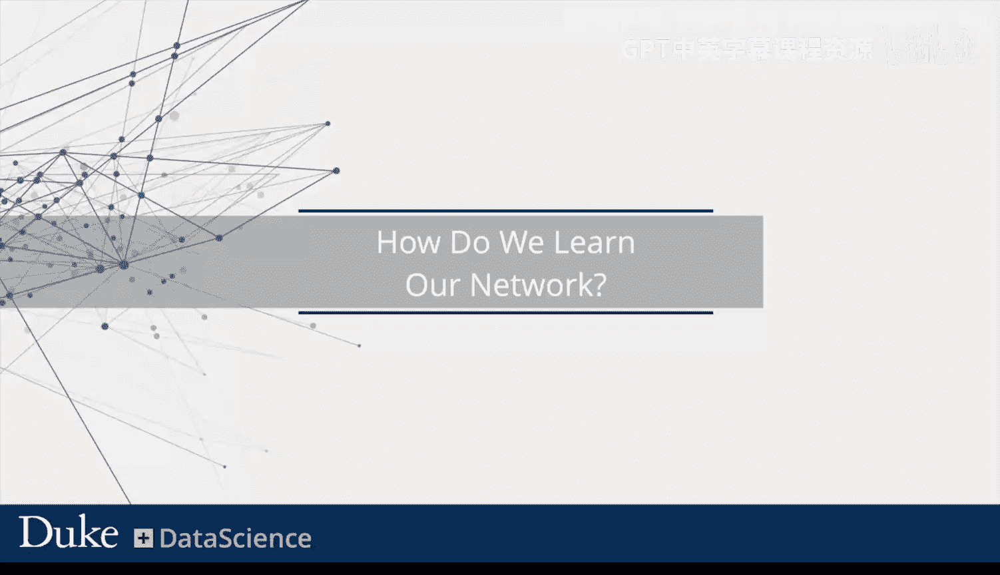
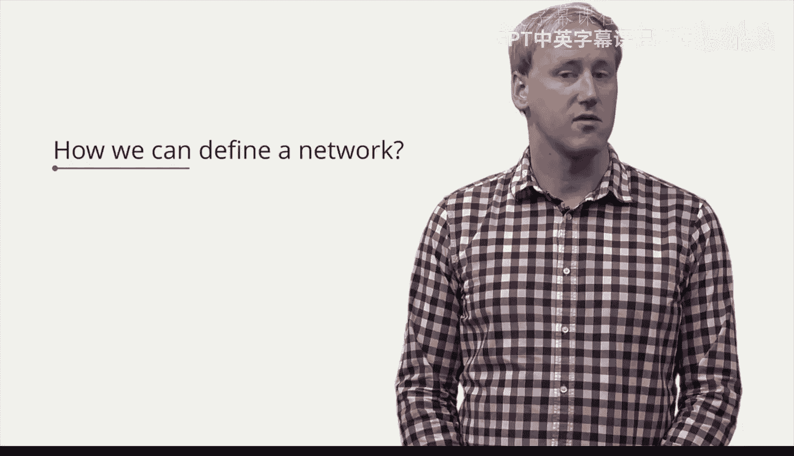
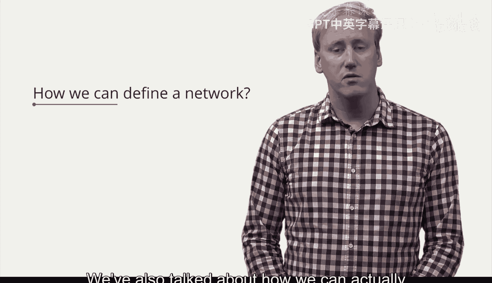
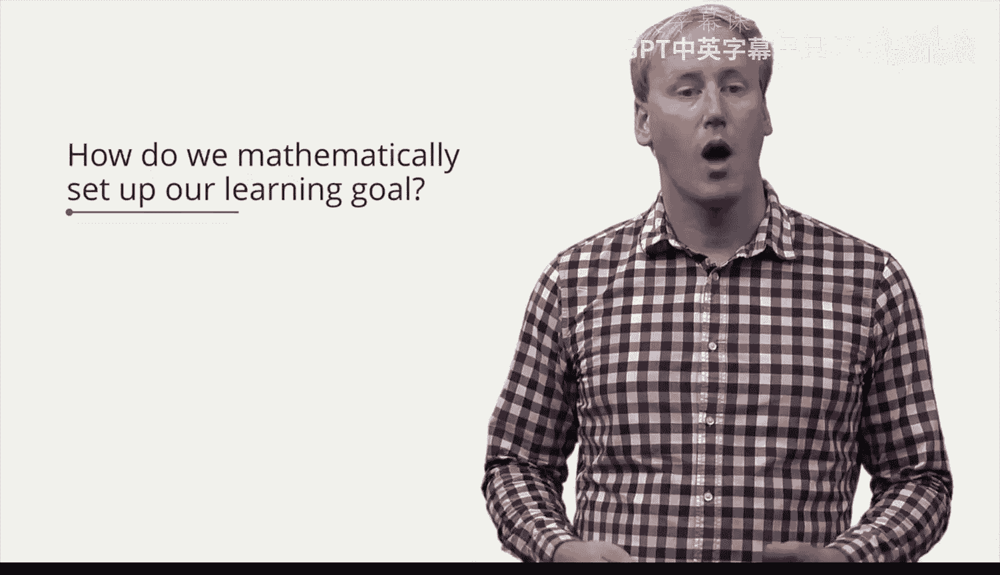
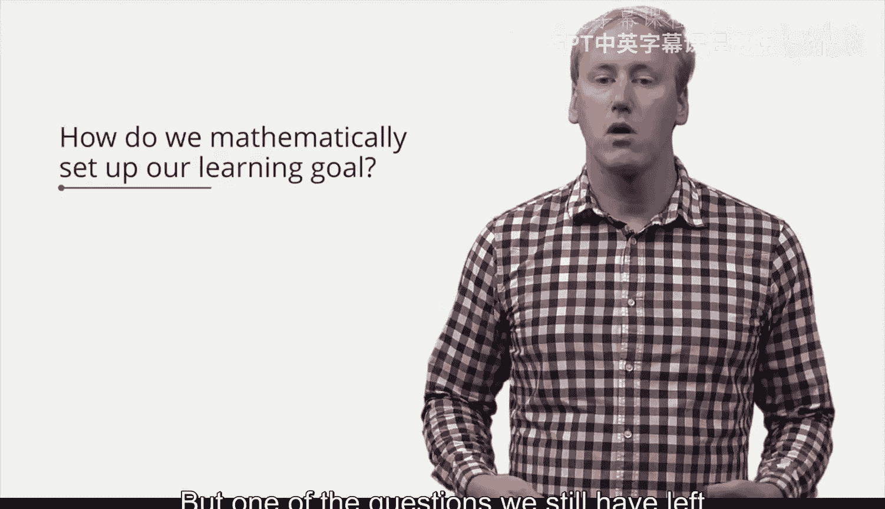
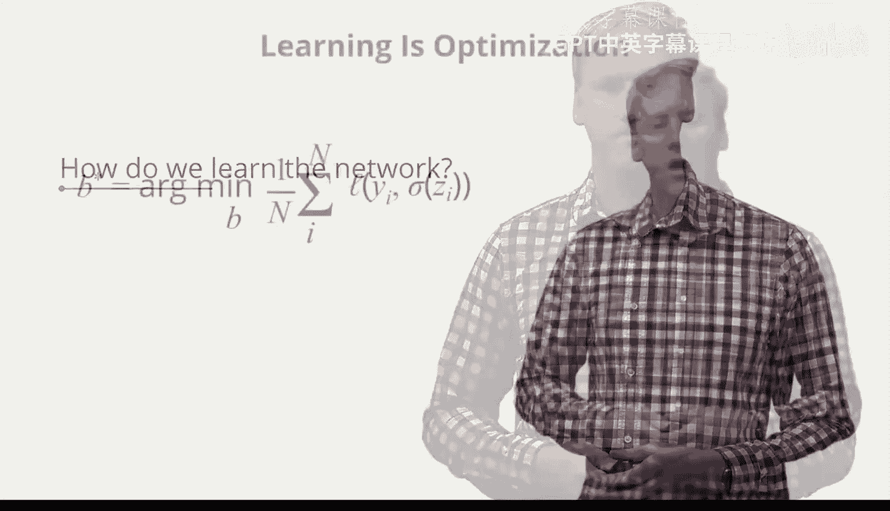
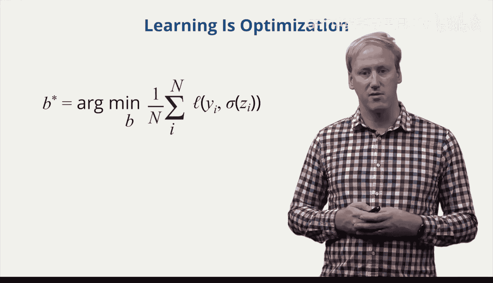
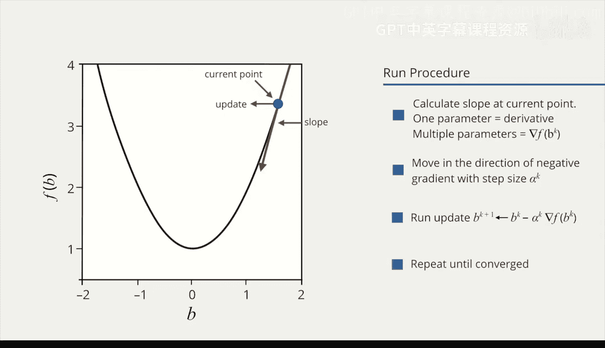
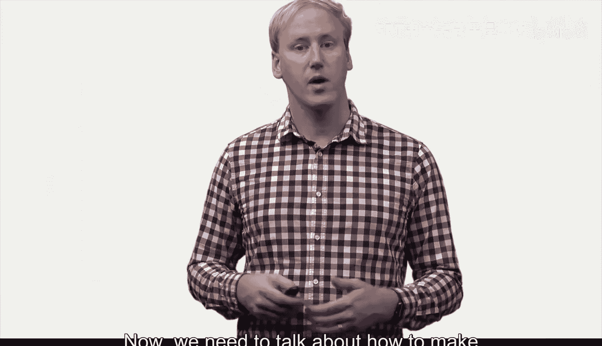

# 杜克大学《机器学习｜Introduction to Machine Learning》中英字幕 p26 26_02_01_如何学习网络.zh_en -BV1yjvdBQEaU_p26-

So far we've talked about how we can define a network。

 this could be a simple network such as logistic regression or more complicated deep networks。

 and we've also talked about how we can actually mathematically set up our learning goal。

 how do we actually want to define what our optimal parameters are。

But one of the questions we still have left is how do we actually learn the network。

 we've set up a mathematical description， how do we learn from this mathematical description。

So learning itself is going to turn into an optimization problem。So as a reminder。

 we want to find the parameters that minimize the average loss and we can define our average loss here。

 we're saying our optimal parameters B are going to be the parameters that minimize our average loss and this is going to be over all of our training data examples。

 so we have our loss。Over our true values and our predicted values。

So how do we actually go through and find the parameters， We have this nice。

 clear mathematical statement。But we want to understand how can we actually find the parameters that minimize this？

How do we actually optimize B in order to minimize this function？

So in order to do this， I want to talk about。Graadient descent。

 Ingraient descent is an incredibly famous mathematical optimization algorithm that has a long。

 long history。And instead of talking about it from a mathematical point of view。

 we want to talk about visually what's happening。So our goal。

 as a reminder is we have some sort of mathematical function。

 such as our average loss function that we want to minimize。And the approach you want to do。

Is to try to find something that minimizes this function。 And so I'm showing here on the right。

 I'm showing a simple one dimensional function。 And we want to find the parameter B here。

 It's a single parameter that minimizes this function。 Now。

 everyone can see just by looking at this visualization that the minimum as at 0。😊。

But this is because this is a one dimensional function and we can just plot it out the whole function。

When we go to these very high dimensional and very complex functions。

 we're not going to be able to plot it out and just see where the minimum is。

 So we have to come up with an algorithm that can help us find the minimum。

So one approach we can take to do this is to start at a particular parameter value。

And here we're starting at about 1。5， and we're showing here in this blue circle。

 and we have current point that's marking where we currently are。

And often what we can do is instead of saying where the minimum is， we can say， well。

 at our current point， we can figure out what the slope of our function is。

 So we're showing here the slope of our function。 Now。

 if we know we want to go to the direction that's going to help us find the minimum。We can just say。

 well， if we know our slope， what direction is pointing us down the hill？So at our current point。

 we have our slope and we say if we go to the right。

 we're going to be going up the hill because that's what our slope is saying is going to happen and if we go left。

 we're going to go down the hill。So we can actually do this by saying， well。

 if this is our current point， we can figure out what our slope is and our slope says let's take a step to the left because if we take a step to the left。

 we're going to be able to get to a lower function value and actually start getting closer and closer to this minimum that we want So our update is going to take a step to the left。

So if we do that。We can just visualize what happens。And we have a new current point。

 We've taken a step to the left。 We have a new current point。 We have a new slope。

So after one update， we could say， well， we've taken one update now， we have a lower function value。

 we're not at the minimum yet， but we have a strategy that seems to be getting us closer and closer to the minimum。

And so we can just repeat the exact same thing we did before， we can say， well。

 we know our current point， we know the slope of our current point， and it says once again。

 we want to take a step to the left。So we can take a second update where we again take a step to the left。

So after the second update， we can now say we've taken one step to the left and another step to the left。

 and we now are getting closer and closer to the minimum， and we can once again calculate the slope。

And we can keep doing this。 So this is after two updates， after three updates。

 we can see what's happening and we get it a little bit closer。 We can repeat the same thing again。

Fourth update。 and we just keep repeating this until we're satisfied。

And so instead of talking about this visually， we can also talk about what this is doing mathematically。

So if we have a function here。And we're saying we want to find the parameter that minimizes this function。

So what we're going to do if we're going to run with this gradient descent strategy is we're going to start at an initial value。

 So we're going to start at what we're going to call B superscript 0。

 And what we're going to do is we're going to keep running a series of updates and this update is going to move us from B。

 Our case value of V B。To our K plus1 value of B。And this can be， for example。

 for moving us from our zeroth update to our first update， and our zeroth update is where we start。

So we're going to iteratively run the procedure。So one。

 we're going to calculate the slope at the current point。For one parameter。

 this is going to be the derivative。 This is just the name from calculus for multiple parameters。

 this is going to be the gradient and the gradient here is going to be denoted by this upside down triangle or upside down delta on our function and the gradient here is just going to mean a multidimensional slope。

It just means we're going to take the slope in each one of our dimensions。

 and we're going to use this to define the gradient over our function。

And we're going to move in the direction of the negative gradient。

With step size alpha K and alpha K is going to be our step size on our K federation。

 we get to choose what it is During the hands-on session。

 we'll talk about some strategies for choosing what this value alpha is going to be but for now we're just going to consider it a value that's saying how much do we want to move in this direction。

And we're going to run our update。 And this we have this beta K。

 and we're going to move a little bit in the direction of the。Negative gradients。

 So if we're looking at our slope here。Negative is going to be to the left。

And so this is just a mathematical description of this exact update we just did。

We're just going to keep running one to two until we're converged。

So far， we've talked about gradient descent now。

We need to talk about how to make this work when we have truly big data。

And I will come up in a following lecture。

