# 杜克大学《机器学习｜Introduction to Machine Learning》中英字幕 p27 27_02_02_如何处理大数据.zh_en -BV1yjvdBQEaU_p27-

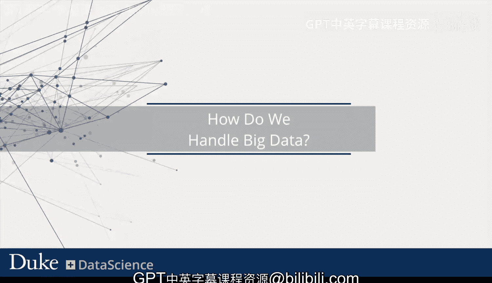

So we have previously talked about gradient descent。

 and gradient descent is a fantastic optimization algorithm。

But we're going to run into trouble when we hit truly big data。 So in this video。

 we're going to talk about how we actually can handle big data from an optimization perspective。

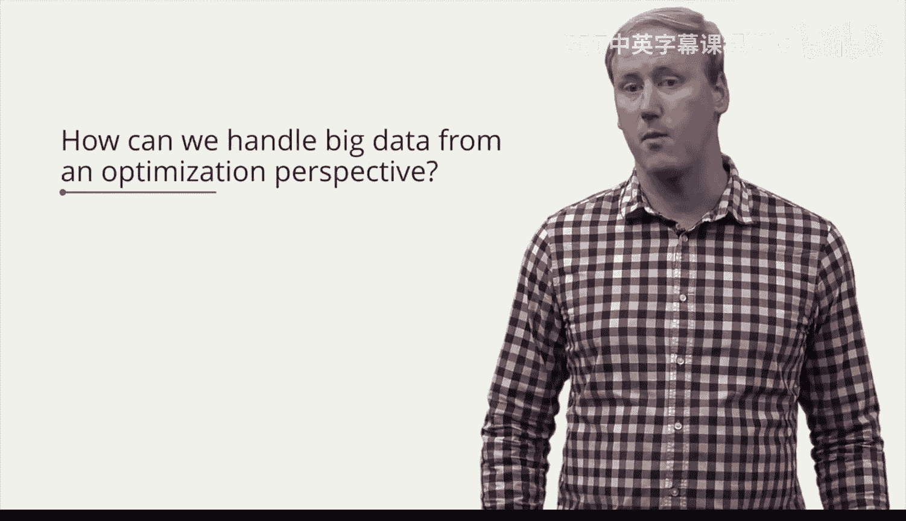

And so in order to do this， let's actually go back to our optimization goal。So we have this network。

 we have our training data。And we want to find the best parameters for all data points。

So we have this B star is the value that minimizes our function on the right。

 our average loss function。And we have just talked about how we can do this through gradient descent。

Calculating the gradient requires looking at every single data point。

 this is a big drawback because we need to calculate the gradient or multidimensional slope over all data points。

 this is going to require looking at all of our data。

And you can see this mathematically here if you want。

 by just showing that the gradient over all of our data points is just going to be the sum over the gradients of our individual data points。

 this just happens because a gradient is something known as a linear operator。

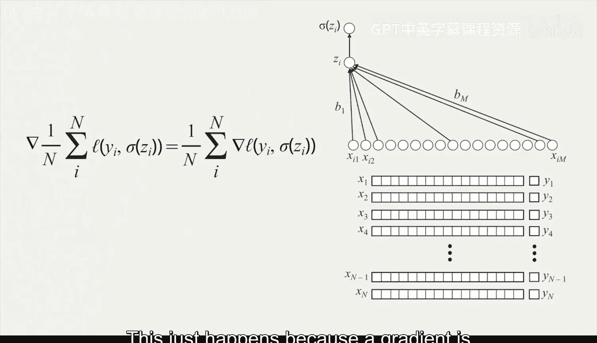

And this can be very problematic in big data。And this。

 which we've previously talked about this was our data set of images of numbers。

 It has on the order of 60000 images。And when you go to these very large data sets。

 we can actually have millions of examples or billions depending on the application。

 and this is very feasible。

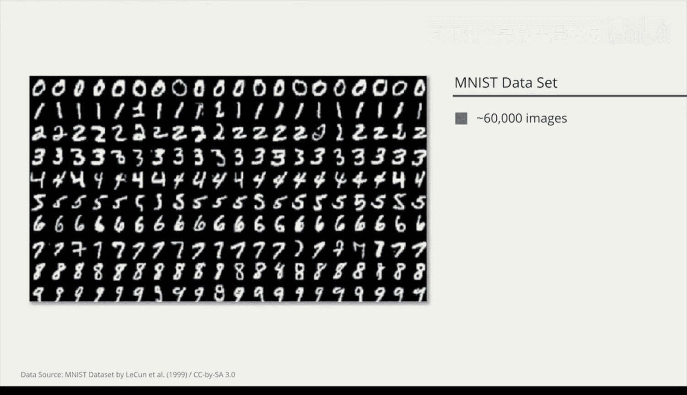

So。This is really problematic if we're going to look at every single data point。

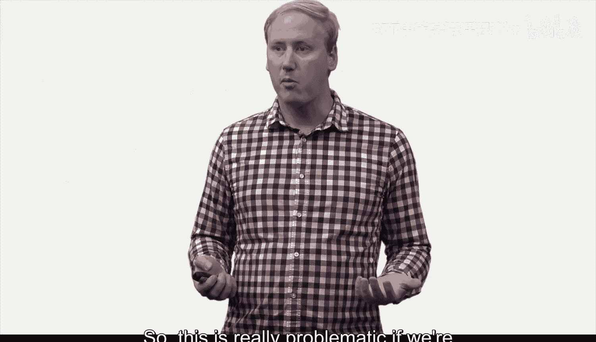

If we have to run through a million images just to calculate a gradient to take one little update。

 this is not very scalable。

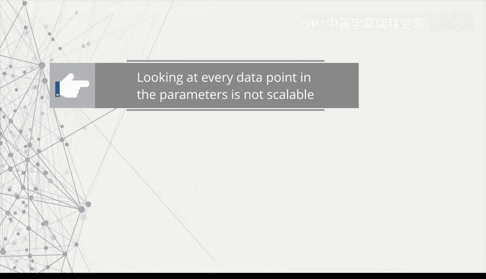

So。Let's just go through and approximate the gradient。

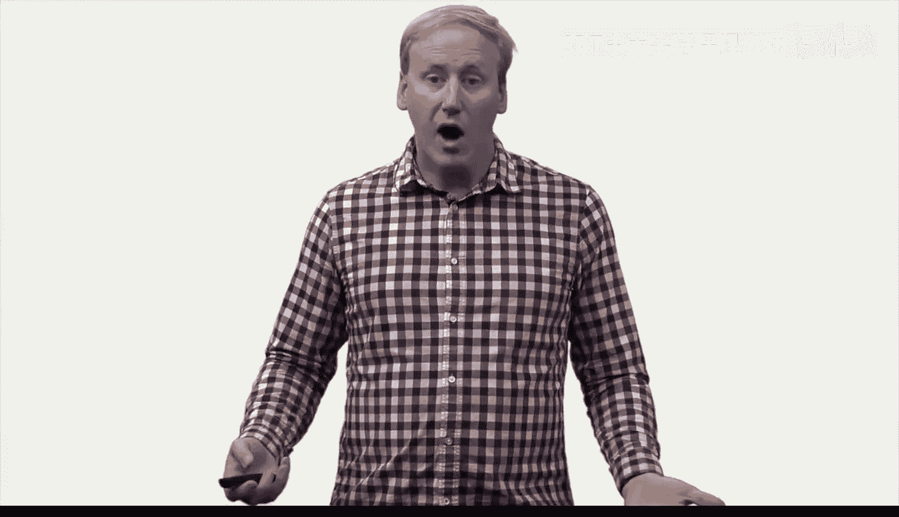

And。We don't want to look at every single data point to update our parameters。

 And so there's a question， do we actually need to do that。

 So let's just think about a strategy and just run it through and see what would happen。

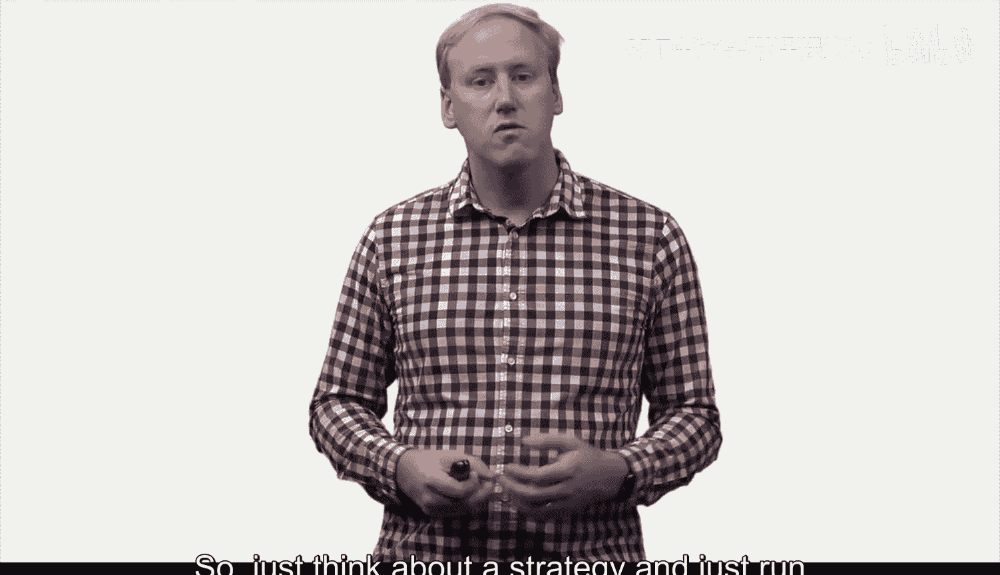

So we're going to take a single example J。And we're going to pick J at randomandum。

And we're going to use it to approximate the gradient。

 And what we're showing here is that we're just going to say the gradient over our average loss。

 if we take the gradient over every single data point。

 we're going to approximate it by taking the gradient with respect to a single data point。

 and it's a randomly chosen data point。So。The reason we want to do this is that this is incredibly faster。

 so if we think about this MIS data set， this data set we're looking at just images of numbers of handwritten numbers。

 this is 60，000 times faster。 we can run this 60，000 times in a data with a million images This is a million times faster。

 literally a million。

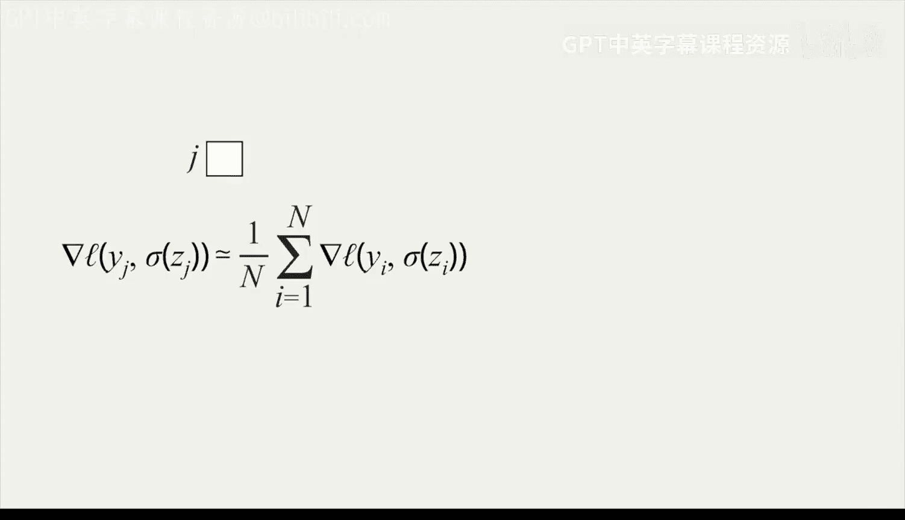

So does this work， right， is this actually a good idea？And what would this look like？

So let's actually go through a visualization to show what's actually happening here when we run gradient descent versus stochastic gradient descent。

So I've just started the simulation here on gradient descent。

 so what's happening in gradient descent， we're making very， very smooth progress。

 we're taking little steps that are going down the hill。Now。

 we can see that it's making good progress。 It keeps going。

 and we're going to get to the bottom eventually， and it's going to make very smooth progress。

 We know we're going to be improving。😊，If we run stochastic gradient descent， we can run it。

And we get way faster updates， Sometimes we're actually moving in the wrong direction。

 sometimes our gradient approximation is not very good。

 but on average we're moving in the correct direction and we get near the minimum very。

 very quickly And what we're showing here is that we can run updates many times faster in stochtastic gradient descent。

But in reality， this is on 1000 data points。 This is a simple problem。

 I've actually drastically slowed down stocastastic gradient descent so that you can actually see what's happening。

 It's actually many times faster than this。 And as we get more and more data points。

 it's going to be an even bigger difference。😊，And we can see the gradient in the sun is still going。

 and we're not going to let it finish because we just don't want to sit here and watch it。

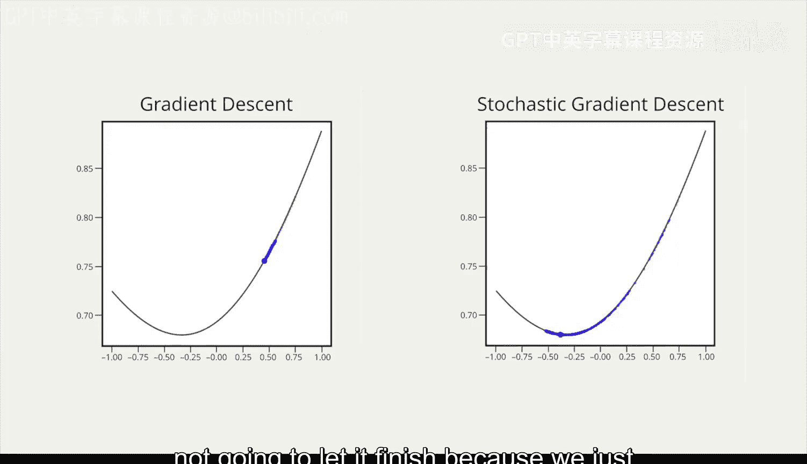

So why does this work and one of the reasons this works is that data is often redundant。

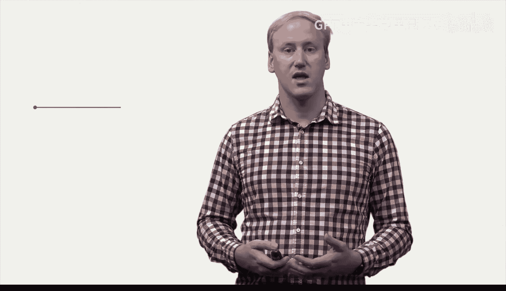

If we go back to this MIS example where we have this data set of handwritten digits。

 we have a bunch of people that have written zeros。We have a bunch of people that are written ones。

 twos， threes， fours， and so on， and we have 60，000 images。But in reality。

 we only have 10 different types of images， right there are a few different ways you can write a0。

 a few different types of ways you can write a4 and so on。

 but there's only so many different types of digits。 if we want to understand about a digit。

 do we have to look at every single digit to get an approximation to a gradient or do we just need to have a few in order to get an idea of what's going on in this data。

And。We can take advantage of this redundancy。

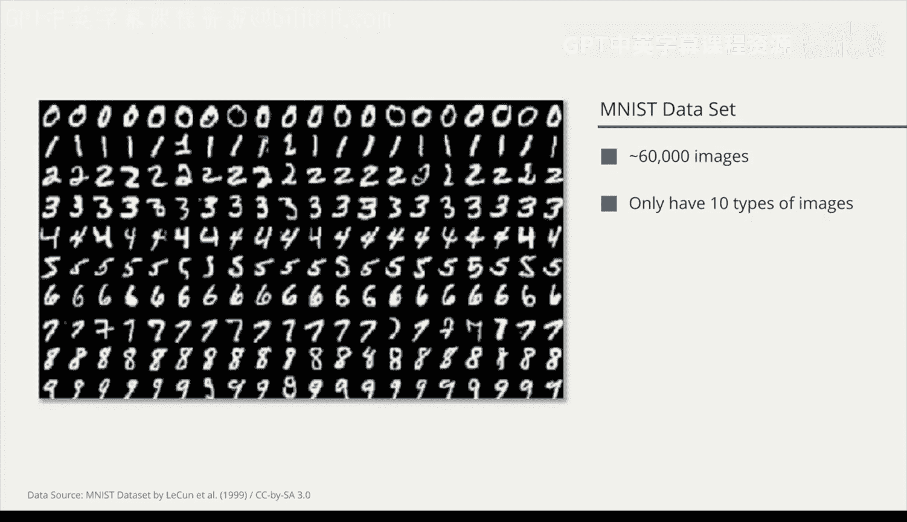

And just to talk about mathematically what's happening here。Is on the left。

 we're showing this gradient descent strategy。 This is the same mathematical description that we had in a previous video。

So we're going to start with an initial B0。 We're starting with an initial location of our parameters。

And we're going to calculate the gradient over all of the data。

And then we're just going to iteratively update， so we're going to take a step in the negative direction of the gradient。

And we're just going to repeat steps two to three until we're good enough。

And if we want to change this to stochastic gradient descent， we have something that's very。

 very similar， but much， much faster。 We're going to start with an initial value。😊。

And we're going to choose a data entry J。At random， we're just going to pick one data entry。

 and it's going to be chosen completely at random。We're going to estimate the gradient by this single data point。

 and we have a hat here over our gradient because it's now an estimate。

 and we're going to iteratively update。And I want to point out that the iterative update in stochastic gradient descent is exactly the same as the iterative update in gradient descent。

 The only thing that's changed is that we have a estimate of what our gradient is rather than our exact gradient。

 And now we're just going to repeat steps 2 to 4 until the solution is good enough。😊。

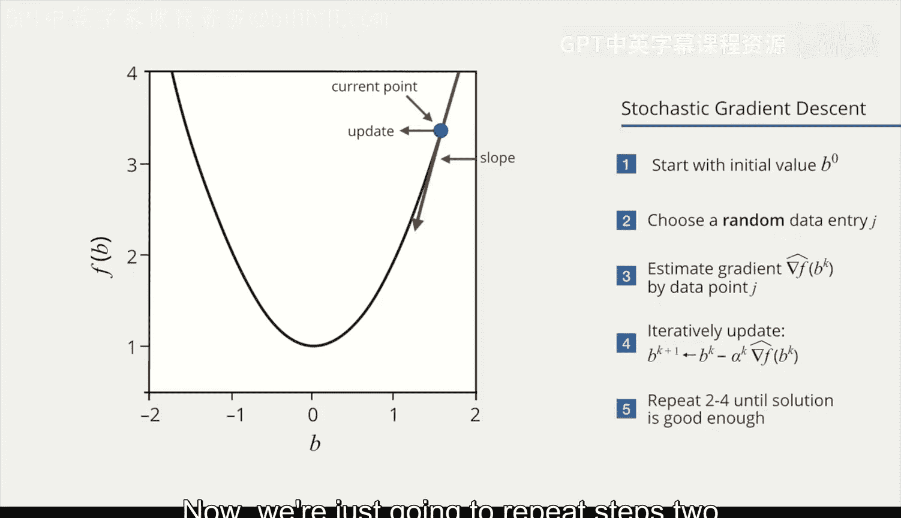

So let's step back and think about what's actually happening here。

 And let's start by noting that if we take the expectation。Over our gradient estimate。

 which is just our gradient of a single data point where we've chosen this data point completely at random。

That it's exactly equivalent in expectation to our true gradient where we've calculated it over every single data point。

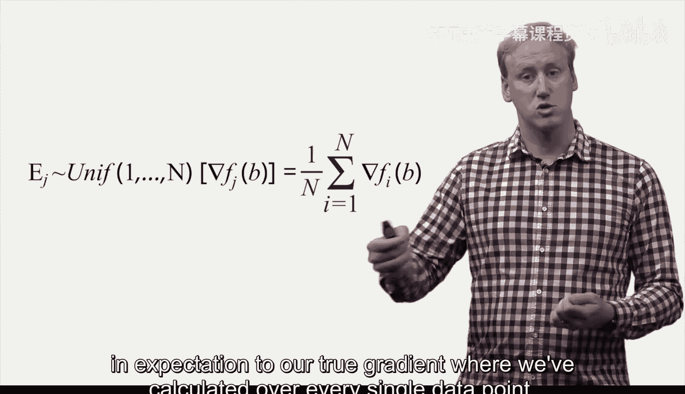

So。If we start gradient descent and stochastic gradient descent at the same place。

How do their updates vary and how do the expectations of their updates actually vary？

So if we think about what's happening in these updates， these updates。

They're going to go to the same place in expectations。

 So if we take our gradient descent update and we take our stochastic gradient descent update。

 they're going to be on average， going to the exact same spot。 So on average。

 there's no difference between them。But the difference is that gradient descent will go to the same spot every single time because we're calculating our gradient fullyley。

 whereas stochastic gradient descent， we're going to get a lot of variance in where we're moving to。

On average we're going to the same place as gradient descent。

 but we're actually going to have some variance， so sometimes we're going to move a little too far。

 sometimes we're going to move a little too small， sometimes we're actually going to move in the wrong direction。

 but on average we're going to do exactly the same thing。

And we can go back and think about this while we're doing these visualizations again。

 so we look at gradient descent very smooth。 No variances in our updates。

 We run gradient descent from the same starting point。

 every single time we're going to get the exact same result。

' going to be very smooth stochastic gradient descent。 once again。

 we're moving on average in the same way gradient descent is， but we're having a lot more variance。

 sometimes we move in the wrong direction， but that's okay because on average we're moving in the right direction and we can do this much。

 much faster than we ever could with gradient descent。😊，So just to recap。

 we have shown this figure in the schematic several times now about learning the model parameters。

 we have our training data。And we also have some sort of network or model that we want to learn。

And we said that we're going to combine our training data with this network in order to learn our parameters。

 and before we just said that we're going to do this through some sort of optimization。

 we're going to define our mathematical loss。But all we're going to do in practice is just use stochastic gradient descent。

 so this step where we're going to go from our network to our learn parameters。

 we're going to use stochastic gradient descent or an alternative stochastic gradient method。

 and this is what we do in practice on almost every single network。

So just some conclusions from this video today， just to reiterate。

 stochastic gradient descent can update many more times in gradient descent if we have 60。

000 data points， we can run 60，000 updates of stochastic gradient descent in about the same amount of time it takes to run a single update of gradient descent。

And we're going to get near the solution very， very quickly。

 And often all we need to do is get near the solution。 We don't need the exact solution。

 We just need to be very near it。And this is going to allow us to scale to big data。

 and the reason this is so helpful to scale to big data is that our update time doesn't increase with our data size。

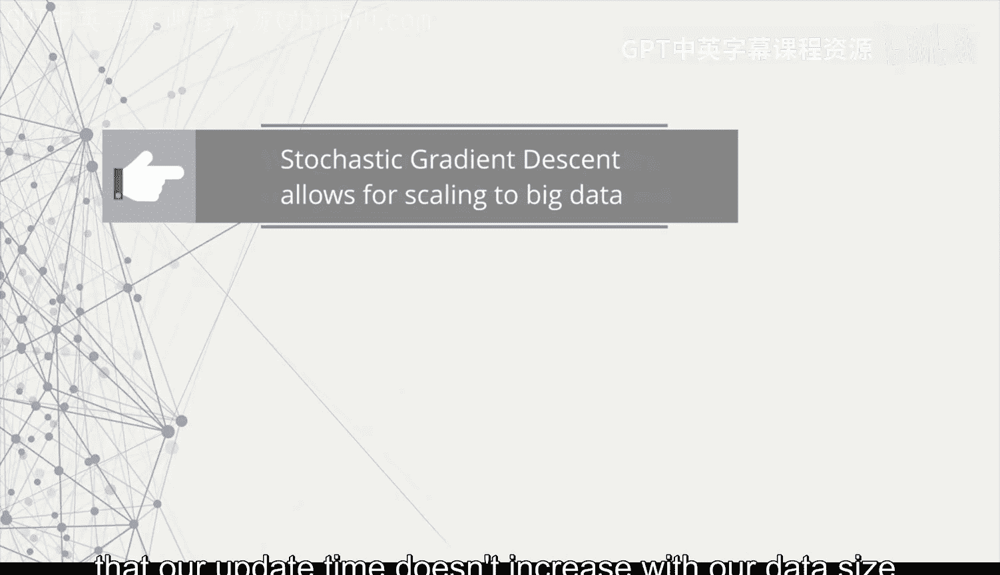

If we double the size of our data set， it's going to take about the same amount of time to run this optimization algorithm。

Whereas in a lot of classical optimization algorithms， such as gradient descent。

 it will take much longer。And in practice， we're also going to use a mini batch。

 which means that instead of using a single data example。

 we're going to run a few data examples to estimate the gradients。 and this will reduce variance。

But overall， stochastic gradient In is just going to allow us to scale to big data in a very simple way。

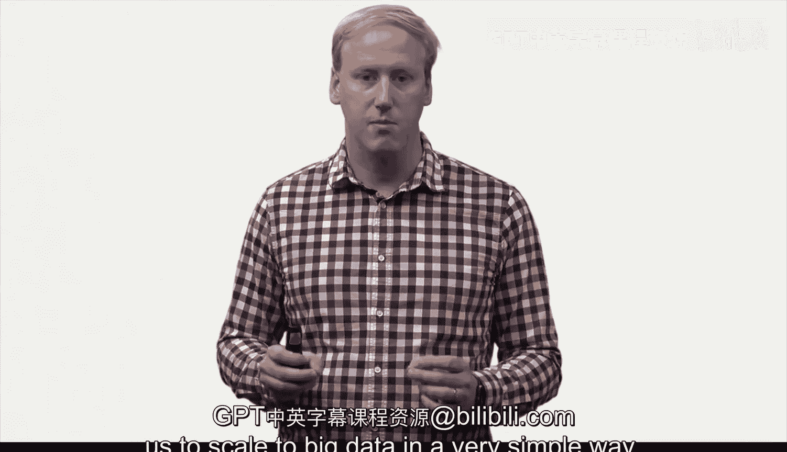

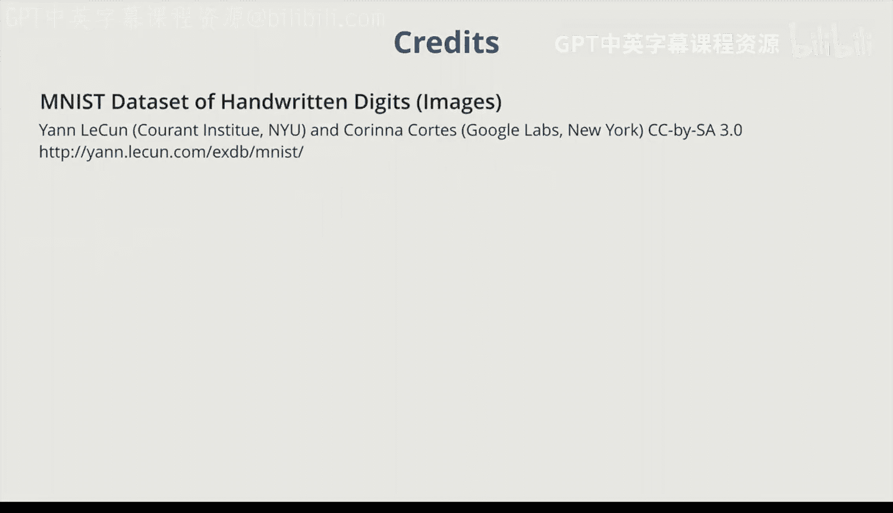