# 机器学习：27：如何处理大数据 🚀

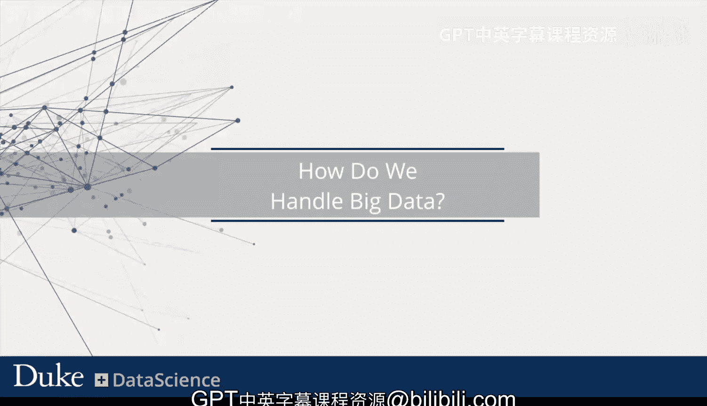

在本节课中，我们将要学习如何从优化算法的角度处理大规模数据集。我们将回顾梯度下降法，并探讨其在面对海量数据时的局限性，最终引出一种更高效的优化方法——随机梯度下降法。

## 梯度下降法的局限性

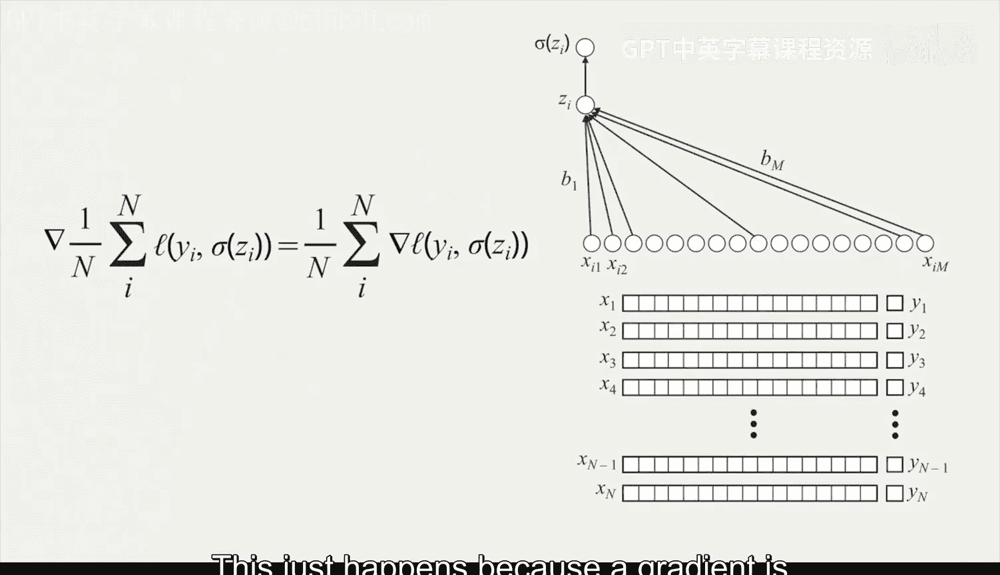

上一节我们介绍了梯度下降法，它是一种非常出色的优化算法。然而，当我们面对真正的大数据时，它会遇到麻烦。

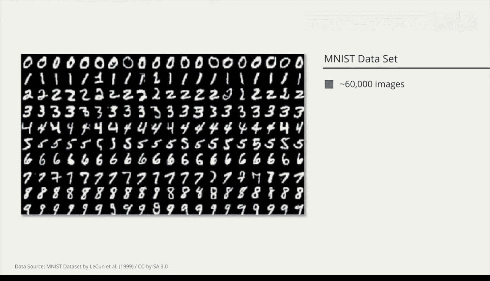

梯度下降法的目标是找到一组最优参数 **B***，使得在所有数据点上的平均损失函数最小化。其核心更新公式为：

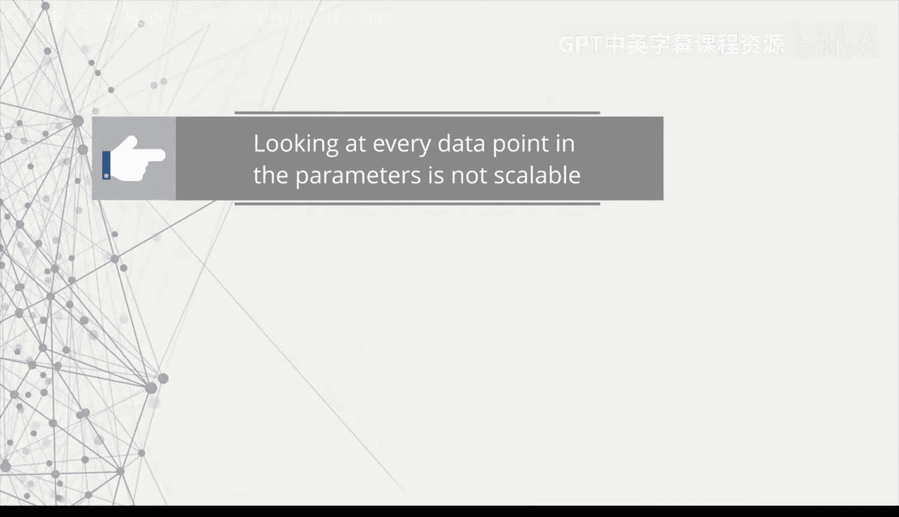

**B_{t+1} = B_t - η * ∇L(B_t)**

其中，**∇L(B_t)** 是损失函数在所有训练数据上的梯度。计算这个梯度需要遍历数据集中的每一个数据点。对于包含 **N** 个样本的数据集，梯度计算如下：

**∇L(B) = (1/N) * Σ_{i=1}^{N} ∇l_i(B)**

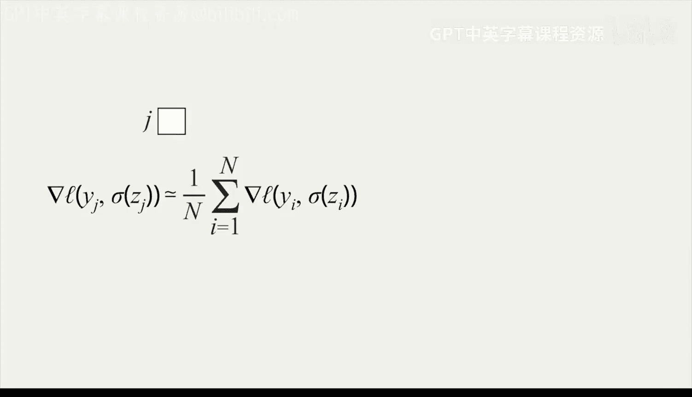

这里，**∇l_i(B)** 是单个数据点 **i** 的损失梯度。当 **N** 非常大时（例如百万甚至十亿级别），每次参数更新都需要完整扫描一遍数据集，这非常耗时且不可扩展。

## 引入随机梯度下降法

既然计算全部数据的梯度成本高昂，一个自然的想法是：我们能否用一部分数据来近似整个数据集的梯度？本节中，我们来看看随机梯度下降法是如何实现这一点的。

其核心思想是：在每次参数更新时，我们不计算所有数据点的梯度，而是随机选取一个数据点 **j**，并用这个数据点的梯度来近似整个数据集的平均梯度。更新公式变为：

**B_{t+1} = B_t - η * ∇l_j(B_t)**

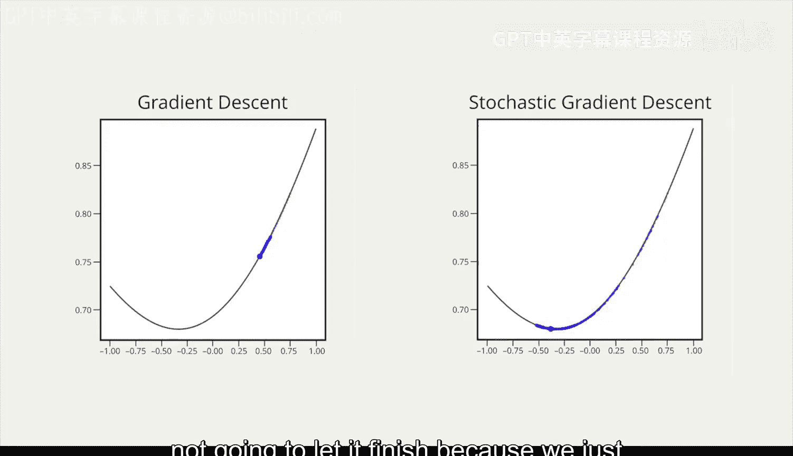

这里的 **∇l_j(B_t)** 是随机选出的单个样本 **j** 的梯度，它是对真实梯度 **∇L(B_t)** 的一个估计。

### 为什么这样做可行？

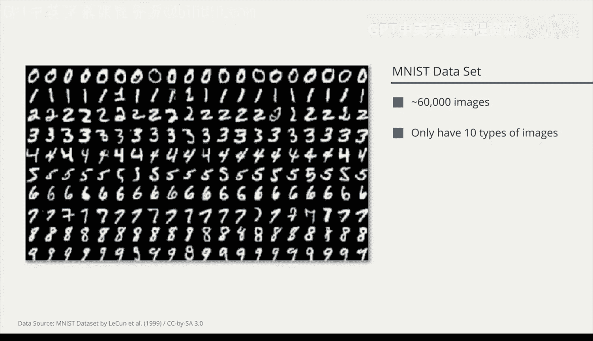

以下是随机梯度下降法可行的几个关键原因：

1.  **数据冗余性**：在许多实际数据集中，样本之间往往存在冗余。例如，在手写数字识别数据集（MNIST）中，虽然可能有6万个样本，但本质上只有0到9这10个类别，每个类别内的样本有相似特征。因此，看一个或几个样本的梯度，就能对整体数据分布有一个大致的了解。
2.  **期望一致性**：从数学期望上看，随机选取的单个样本梯度的期望值等于整个数据集的平均梯度。即：
    **E[∇l_j(B)] = ∇L(B)**
    这意味着，虽然每次更新方向有噪声，但平均来看，更新方向是正确的。
3.  **更新速度的巨大优势**：假设数据集有 **N** 个样本，随机梯度下降法进行一次参数更新的计算量仅为梯度下降法的 **1/N**。这意味着在相同时间内，随机梯度下降法可以进行更多次的参数更新。

## 算法对比与可视化

为了更直观地理解两者的区别，让我们对比一下梯度下降法和随机梯度下降法的算法流程。

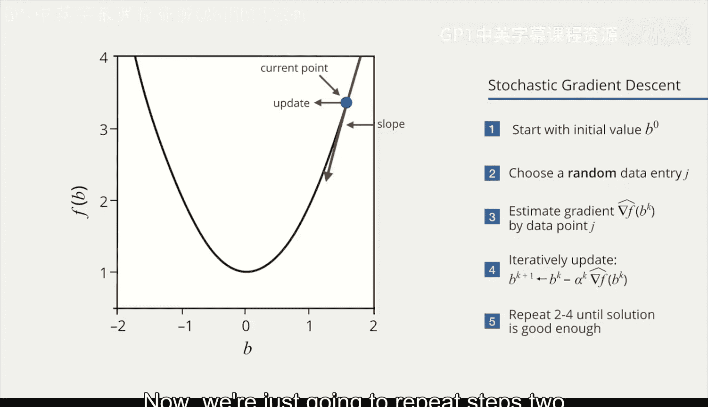

**梯度下降法流程：**
1.  初始化参数 **B_0**。
2.  计算损失函数在所有训练数据上的梯度 **∇L(B_t)**。
3.  按照公式 **B_{t+1} = B_t - η * ∇L(B_t)** 更新参数。
4.  重复步骤2和3，直到满足停止条件。

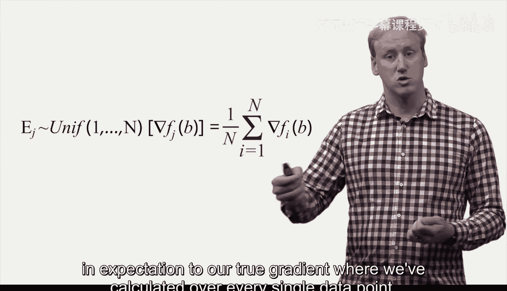

**随机梯度下降法流程：**
1.  初始化参数 **B_0**。
2.  从训练集中**随机**选择一个样本索引 **j**。
3.  计算该样本的损失梯度 **∇l_j(B_t)**，作为真实梯度的估计 **∇̂L(B_t)**。
4.  按照公式 **B_{t+1} = B_t - η * ∇l_j(B_t)** 更新参数。
5.  重复步骤2到4，直到满足停止条件。

通过可视化模拟可以发现，梯度下降法的优化路径非常平滑，稳步向最小值前进。而随机梯度下降法的路径则充满“噪声”，更新方向时对时错，但**在期望上**它朝着正确的方向快速前进，通常能以远快于梯度下降的速度接近最优解。

## 实践中的改进：小批量梯度下降

在实际应用中，我们通常采用一种折中的方法——**小批量梯度下降法**。它既不是使用全部数据，也不是使用单个数据，而是每次随机选取一小批（Mini-batch）数据（例如32、64或256个样本）来计算梯度估计。

其更新公式为：
**B_{t+1} = B_t - η * (1/m) * Σ_{k in Batch} ∇l_k(B_t)**
其中 **m** 是小批量的大小。

以下是采用小批量梯度下降法的优势：
*   **降低方差**：相比单样本，使用一批样本估计梯度可以减少更新方向的方差，使收敛过程更稳定。
*   **硬件效率**：现代计算硬件（如GPU）能高效并行处理批量数据，计算一批样本的梯度通常比逐个计算快得多。
*   在计算效率和收敛稳定性之间取得了良好平衡。

## 总结与核心优势

本节课中，我们一起学习了如何处理大数据下的优化问题。

我们首先指出了经典梯度下降法在大数据场景下的计算瓶颈：每次更新都需要遍历全部数据。接着，我们引入了**随机梯度下降法**，它通过每次随机使用一个样本来估计梯度，实现了计算复杂度的巨大降低。我们还讨论了其可行的数学基础（期望一致性）和现实基础（数据冗余性），并介绍了更常用的**小批量梯度下降法**作为实践中的最佳选择。

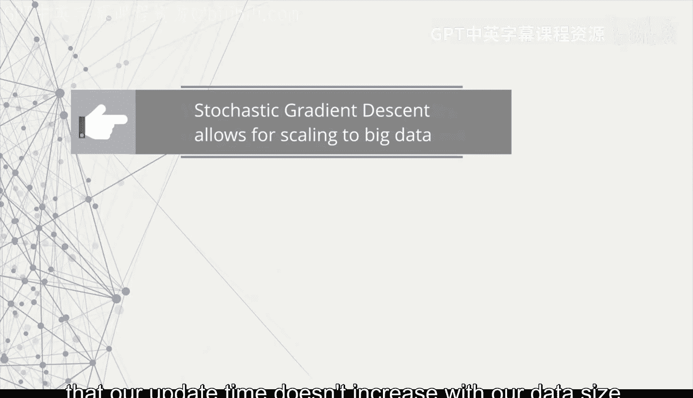

随机梯度下降法的核心优势在于其**卓越的可扩展性**：
*   **更新速度与数据量无关**：无论数据集大小是100万还是10亿，随机梯度下降法进行一次参数更新的时间基本是恒定的。这使得机器学习模型能够处理前所未有的大规模数据。
*   **快速接近解**：虽然不一定能找到精确的最优解，但随机梯度下降法通常能非常快速地找到一个足够好的近似解，这对于许多机器学习应用来说已经足够了。

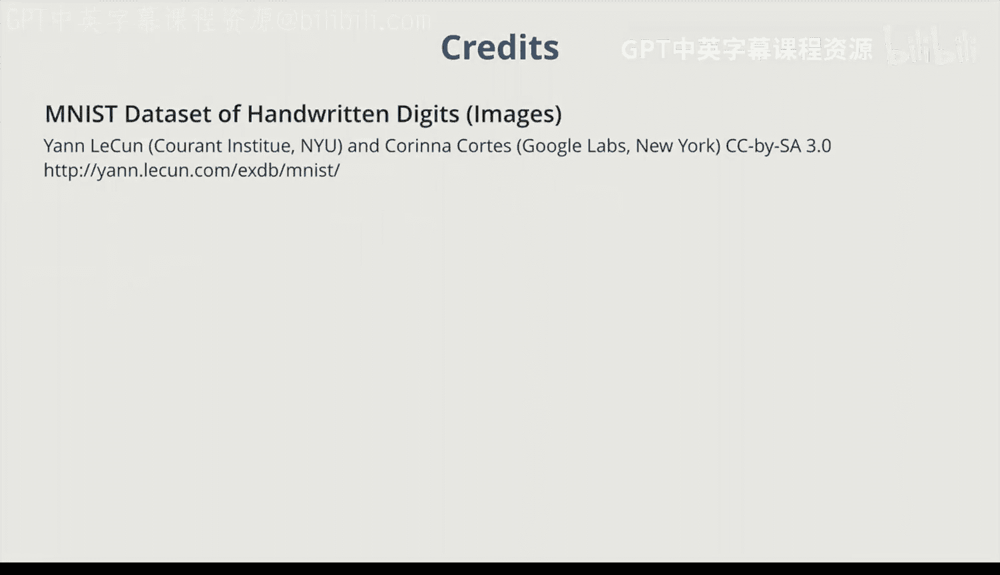

正是由于这些特性，随机梯度下降法及其变体成为了训练几乎所有现代深度学习模型的基础优化算法。