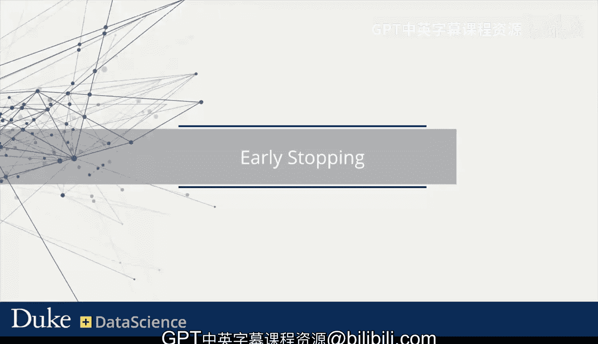
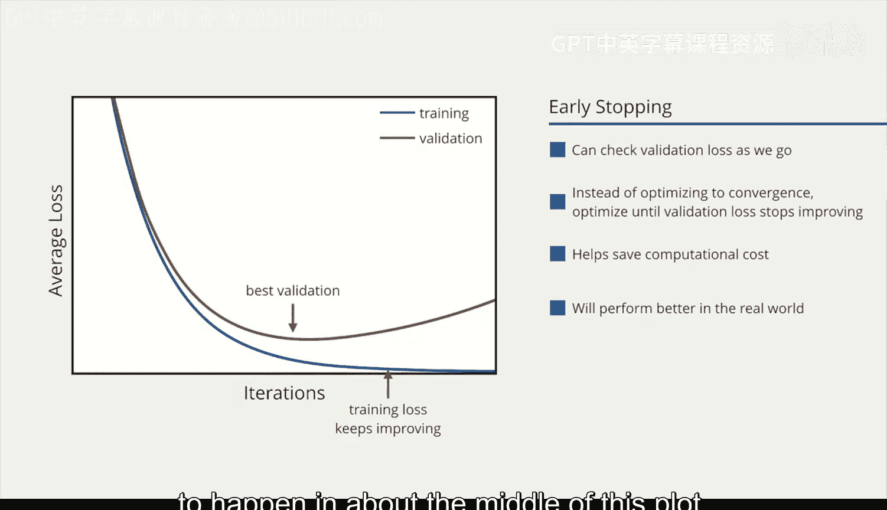
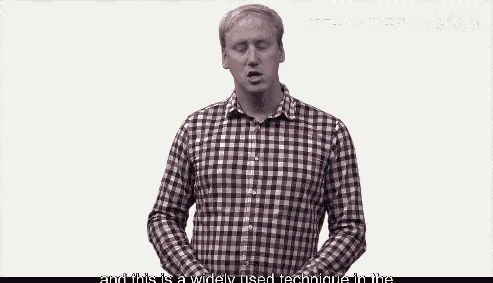

# 杜克大学《机器学习｜Introduction to Machine Learning》中英字幕 p28 28_02_03_早停法.zh_en -BV1yjvdBQEaU_p28-

So we have just talked about stochastic gradient descent。And。

We have previously talked about validation and so far。

 we haven't talked about the combination of how we can do validation with our optimization algorithms。

 but in practice we're often going to combine these and we're going to combine these through a technique called as early stopping。

The idea is that we want to run our validation during optimization。

 and so the idea is that if we want to maximize the generalization of the network。

 this is actually mismatched with our optimization goal。

 Our optimization goal says we want to do as well as possible on our training dataset set。😊。

But in practice， we're not actually trying to maximize our training data set performance。

 we're trying to maximize how well we do when we go out into the real world。

And so this becomes a bit of an issue because stochastic gradient descent is optimizing a mathematical goal that's mismatched with what we're actually trying to do。

And so there's a question where can we actually validate the model while running the optimization loop to address this problem？

So the idea in early stopping is that we can check the validation loss as we go。

And the idea is that we're going to run our training。

Loop where we're going to run stochastic gradient descent。

 and we're going to estimate what our average loss is on our training data set。And every so often。

 we're going to also estimate what the performance is on our validation data set。

 So we're not going to use a validation data set to do。The optimization or Gi our gradients。

 But we're going to use the validation data set to estimate our real world performance。

And the idea is that let's not optimize to convergence on our training goal。

 Let's optimize until the validation loss stops improving。

And this is going to be good for two reasons。 One， this is going to help save us computational cost。

 These algorithms can take a very long time to train on a computer。

 and we want to use the minimum amount of computation possible。

 The second and better reason is that it's actually going to perform better when we go out into the real world。

 And so what we're showing here on the right is that if you run this optimization algorithm。

 stochastic gradient descent。 We're going to keep improving our training loss as we run one and more iterations of stochastic gradient descent。

 we're going to keep getting a little bit better over time。

But our validation data set is actually going to get slightly worse as we overfit more and more。

 so we want to stop when our validation is minimum， not when our training loss is minimum。

 and so the best validation in generalization is going to happen and about the middle of this plot and this is a widely used technique in the field that can help us save computation and can also help us give the best performing network possible。

