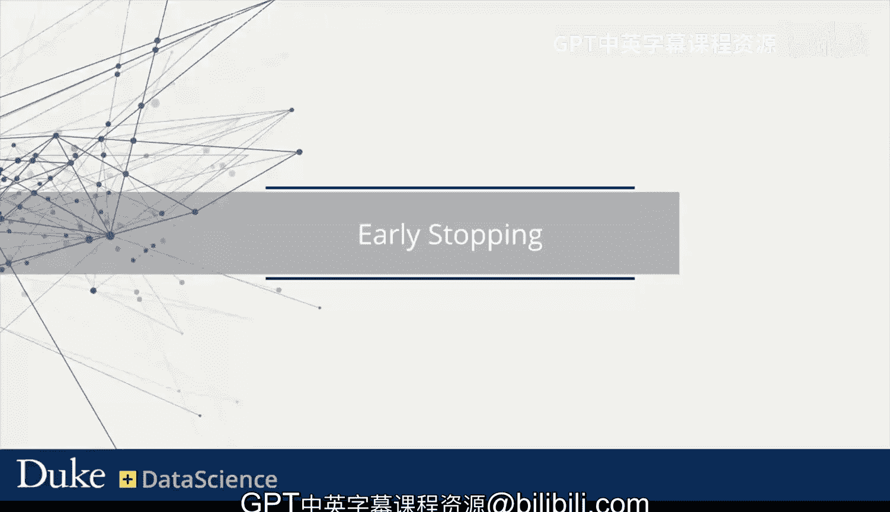
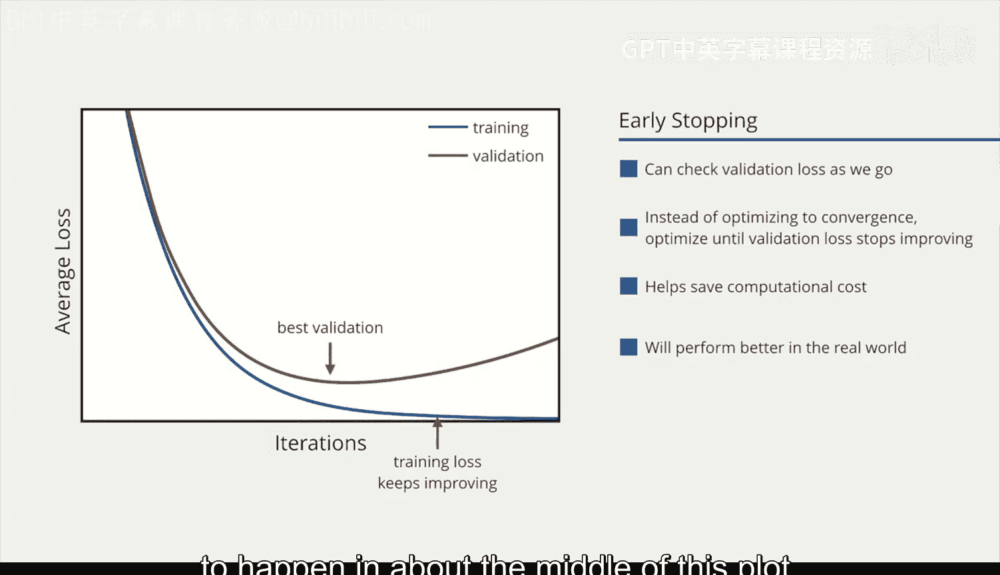
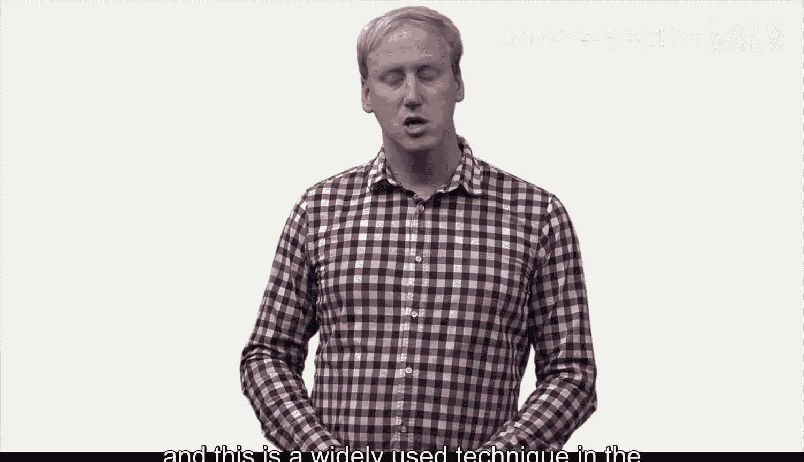

# 机器学习入门：28：早停法 🛑

在本节课中，我们将要学习一种结合了优化算法与验证集评估的技术——早停法。我们将探讨为何仅优化训练集性能可能并非最佳选择，以及如何利用验证集在训练过程中监控模型，从而在计算成本与泛化性能之间取得平衡。

---

## 优化目标与泛化目标的错位

上一节我们介绍了随机梯度下降。之前我们也讨论过验证集。到目前为止，我们尚未讨论如何将验证与我们的优化算法结合起来。但在实践中，我们经常通过一种称为“早停法”的技术来结合这两者。

其核心思想是，我们希望在优化过程中运行验证。如果我们希望最大化网络的泛化能力，这与我们的优化目标实际上是不匹配的。我们的优化目标是希望在训练数据集上表现得尽可能好。

但在实践中，我们并非试图最大化训练数据集的性能，而是试图最大化模型在真实世界中的表现。这就产生了一个问题，因为随机梯度下降正在优化的数学目标，与我们实际想做的事情并不一致。

因此，这里存在一个问题：我们能否在运行优化循环的过程中验证模型，以解决这个问题？

---

## 早停法的核心思想

早停法的想法是，我们可以在训练过程中检查验证损失。具体做法是，我们将运行训练循环，即运行随机梯度下降，并估计我们在训练数据集上的平均损失。每隔一段时间，我们也会估计在验证数据集上的性能。

我们不会使用验证数据集来进行优化或计算梯度，但我们会使用验证数据集来估计我们的真实世界性能。其理念是：我们不要优化到训练目标完全收敛，而是优化到验证损失不再改善为止。

---

## 早停法的两大优势

以下是早停法带来的两个主要好处：

1.  **节省计算成本**：这些算法在计算机上训练可能需要很长时间，我们希望使用尽可能少的计算量。
2.  **提升泛化性能**：更重要的是，它实际上能让模型在真实世界中表现得更好。

---

## 训练损失与验证损失的变化趋势

右侧的图表展示了这一过程。如果你运行这个优化算法（随机梯度下降），随着我们运行越来越多轮的随机梯度下降，我们的训练损失会持续改善，我们会随着时间的推移而变得更好。

但是，随着我们过度拟合的程度越来越深，我们的验证数据集性能实际上会逐渐变差。因此，我们希望在我们的验证损失最小时停止，而不是在训练损失最小时停止。

最佳的验证和泛化性能大约会出现在这张图的中间位置。这是该领域广泛使用的一种技术，它既能帮助我们节省计算，也能帮助我们获得性能尽可能好的网络。

---

## 总结

本节课中，我们一起学习了早停法。我们了解到，优化训练集损失与追求最佳泛化性能之间存在目标错位。通过定期在验证集上评估模型，并在验证损失不再改善时提前停止训练，我们不仅能够节省宝贵的计算资源，还能有效防止过拟合，从而获得在未知数据上表现更佳的模型。这是一种简单而强大的正则化技术。