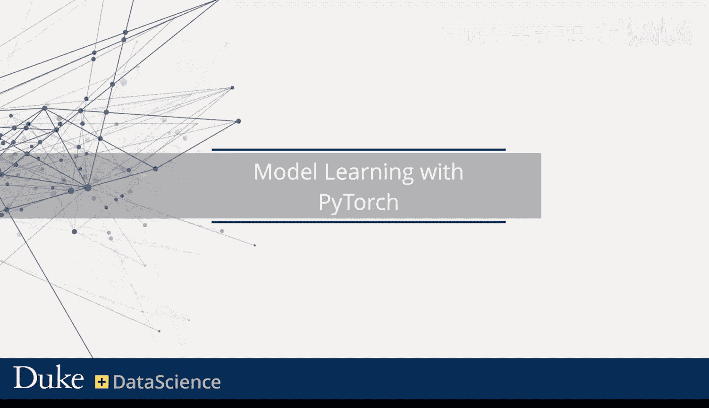
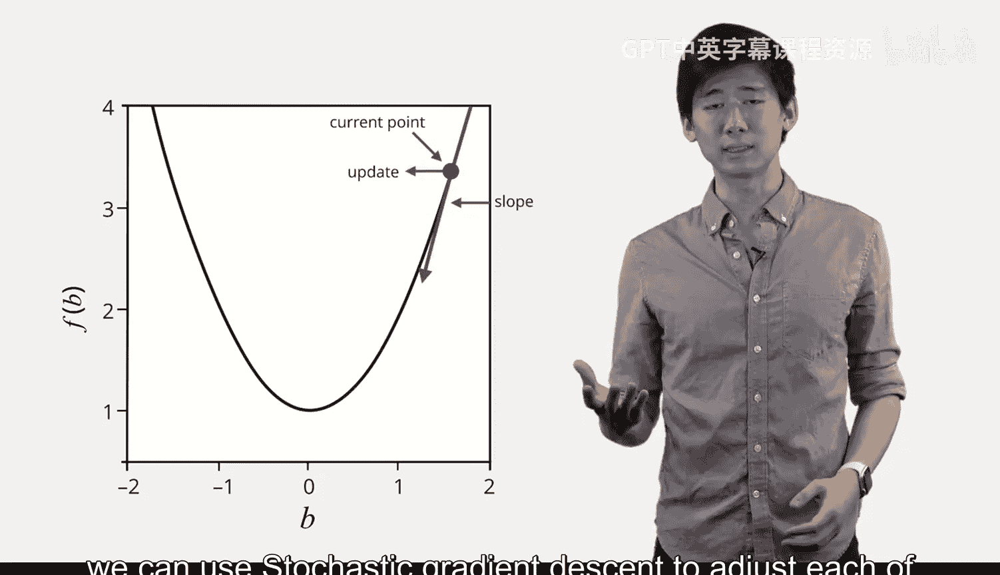
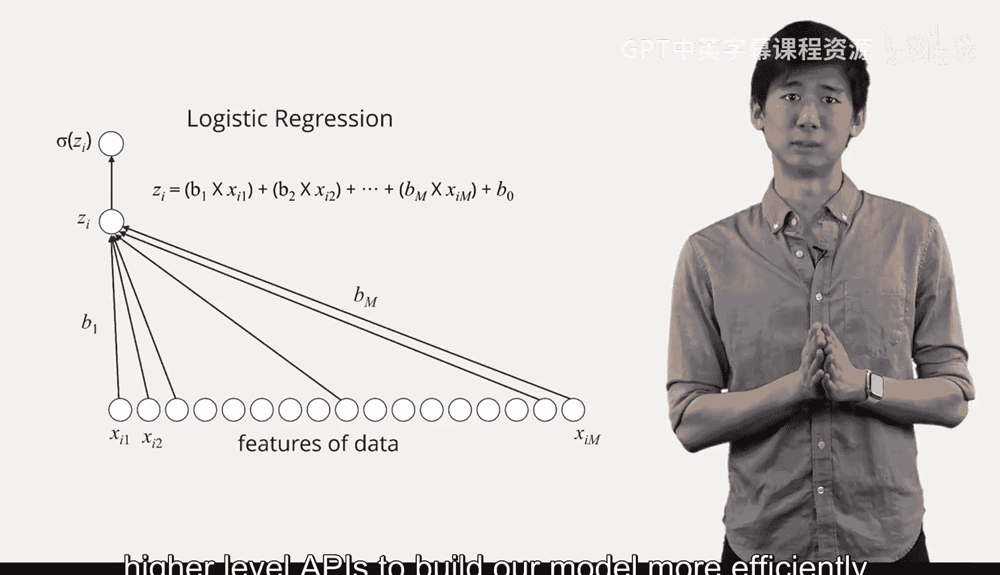

# 杜克大学《机器学习｜Introduction to Machine Learning》中英字幕 p29 29_02_01_使用PyTorch进行模型学习.zh_en -BV1yjvdBQEaU_p29-

嗯。In module 2， we learned about how a neural network learns from data by defining a loss function that quantlifies as a single number how poorly our model does。

 we can use stochastic gradient descent to adjust each of the parameters in our network to improve the model's performance。

Throughout module 2 logistic regression was used as a running example to illustrate these concepts in this section we're going to put these concepts to use and actually code a working model that uses logistic regression to classify the digits of the MIS data set。

Once we've trained it， we can evaluate our model performance and as an added bonus。

 visualize what it actually learned。We'll first write our code with basic low level Pythrarch operations。

 but we'll finish by seeing how we can rearrange our code in a more object or manner using higher level APIs to build our model more efficiently。

As an assignment， you'll be extending our logistic regression model to a multi layer perceptron。

Which was introduced in module 1。

You should find that it performs better than our simple logistic regression model。

