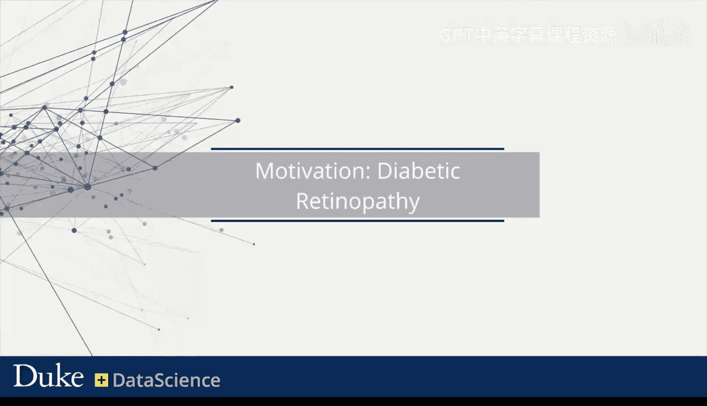
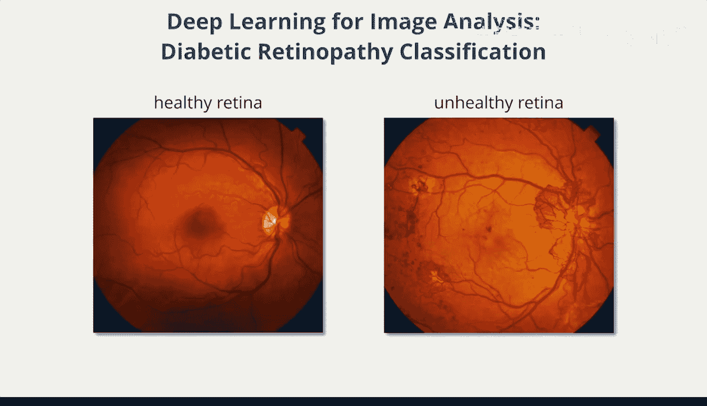
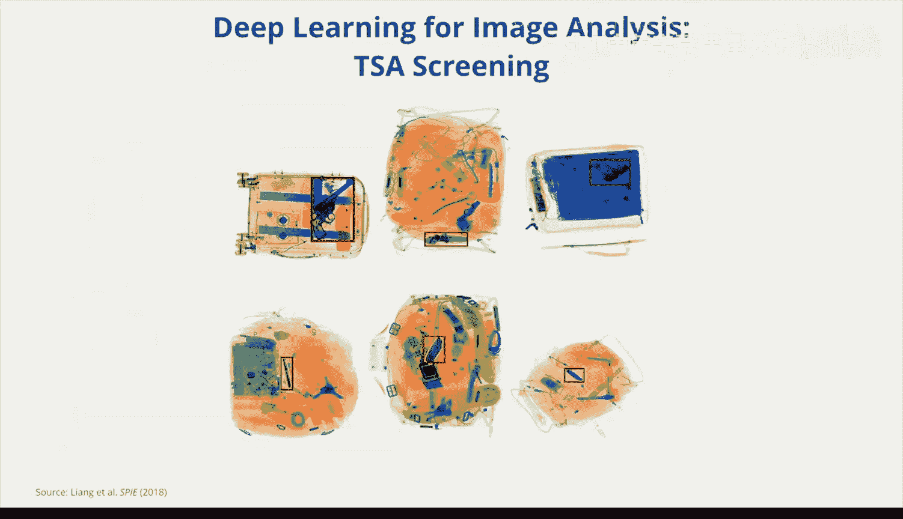
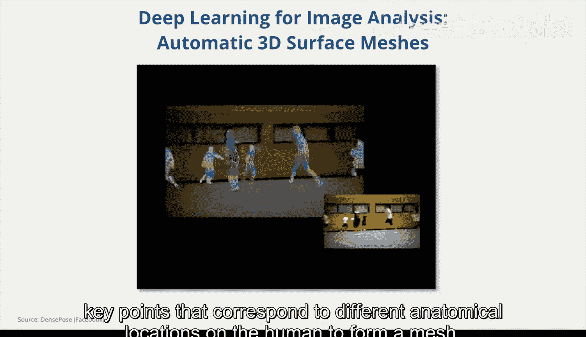
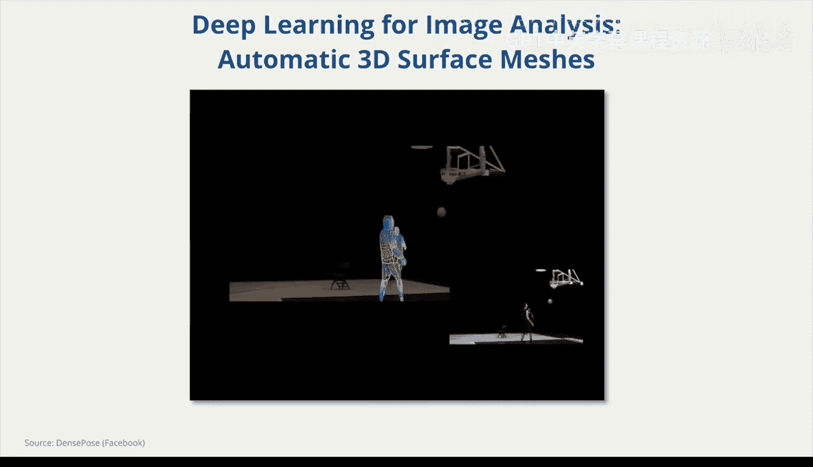
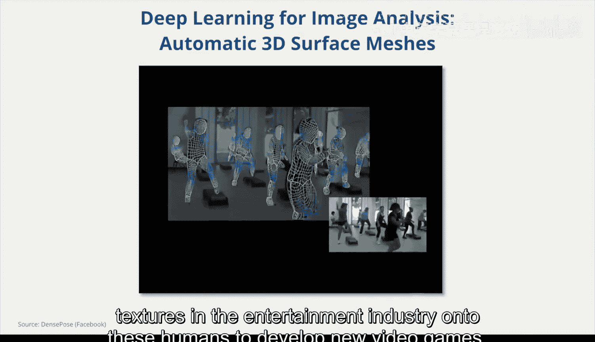
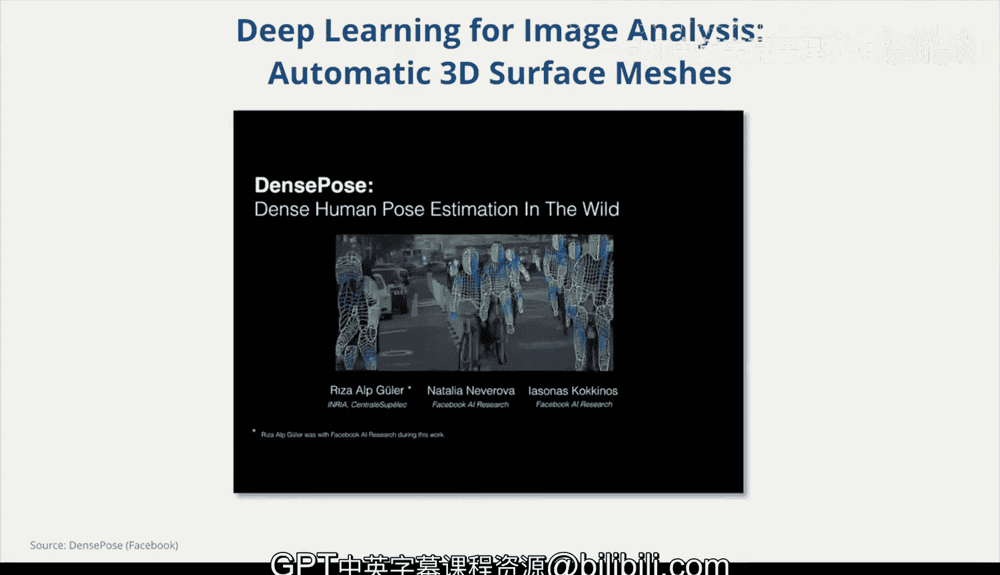
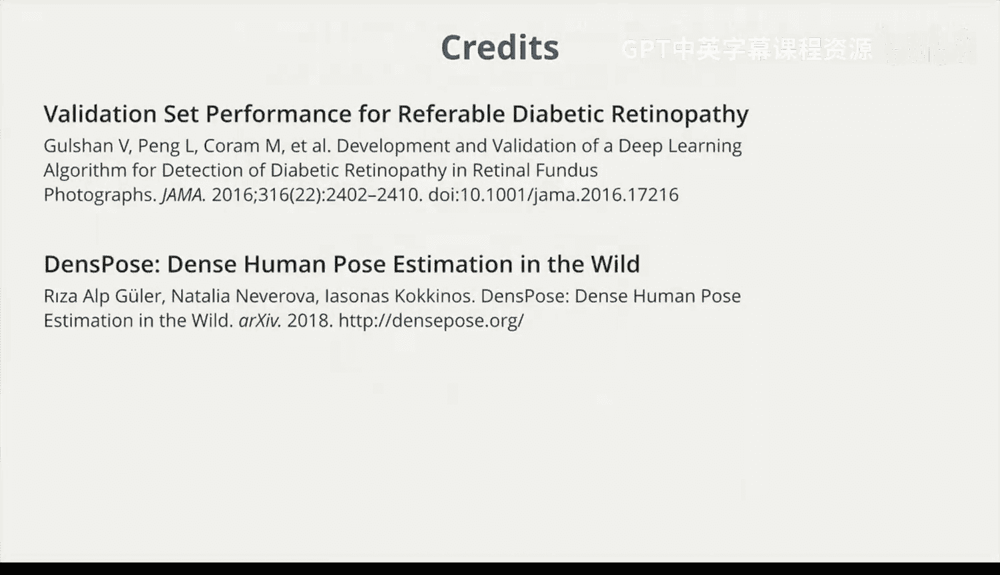

# 杜克大学《机器学习｜Introduction to Machine Learning》中英字幕 p30 30_03_01_糖尿病视网膜病变的动机.zh_en -BV1yjvdBQEaU_p30-

Okay， in this module， we'll be diving deeper into deep convolutional neural networks。

These networks are powerful tools for doing image analysis。

And have been very successful in real world applications， especially in medical image analysis。

I want to highlight here one very successful application of convolution neural networks to diabetic retinopathy classification。

Diabetic retinopathy is a disease that affects the retina of diabetic individuals。

Wherein the blood vessels deteriorate over time。Leading to。Blindness if left untreated。

But can be caught early if a trained ophthalmologist can find structure in the unhealthy retina。

That distinguishes the unhealthy retina from a healthy retina。So here on the left。

You see a healthy retina。 And on the right， you see an unhealthy retina in a patient with diabetic retinopathy。

 And I hope that you can see the differences between these two retina。 So on the。Right。

 in the unhealthy retina， you see little hemorrhagic spots on the left side of the retina。

 You see neovacularization close to the optic nerve， that bright spot on the right side of the image。

And together， those are telltale signs of this being an unhealthy retina that if left untreated。

 could eventually lead to blindness。Ophthalmologists are trained。

To distinguish this retina from the other。Trained with several years of experience in medical school and during residency。

They gained supervisory signals from their colleagues to help them formally distinguish these unhealthy retina and healthy retina between healthy and unhealthy patients。

But because these convolutional neural networks are so good at doing image classification。

They can learn the features that distinguish the unhealy retina from the healthy retina。

And thus have a machine perform this classification in a way that circumvents the need for a trained ophthalmologist。

So。There is a convolutional network that has been applied to this problem。

It has worked very well and was published in a study in the Journal of American Medical Association in 2016。

I just want to show you， show you here the。Money figure from their paper that's showing the results of a trained neural network doing this diabetic retinopathy classification。

 So trying to find a healthy retina。Versus an unhealthy retina。And to explain the results。

 I need to unpack the axes here。 So sensitivity on the left。

 the y axis and one minus specificity on the x axis on the bottom。 What do these figures mean。

 They're common metrics within the medical community。

Sensitivity is a quantity that helps define whether or not。

A doctor or a machine is doing well at finding the positive examples。In a data set。

 so an unhealthy retina， if we call that a positive。

 the name of the game is to try to find as many of the positives as possible out of a large data set of both positive unhealthy retina examples and negative healthy retina examples。

If a doctor comes through and labels a large set of images， healthy， unhealthy。

 we calculate the sensitivity。By looking at the number of true positives。

 the number of true unhealthy retina in that data the doctor was able to find。

And dividing that number by the total number of true positives in the data set。

 we want this quantity to be as high as possible。However。

 you can see you should be able to see how you can potentially cheat this metric。

If you just label all of the examples in the data set is positive。

You'll get a very high sensitivity score， but this will clearly result in a lot of false positives as the doctor is classifying all the healthy retina as unhealthy。

 So we need a complementary metric to help distinguish。😊。

These false positive rates from false negative rates。 and this is specificity。

So this is the complementary metric to sensitivity。 where within the label data set。

 where you're calling a retina healthy or unhealthy。

The true positives go to that sensitivity metric in the。

Labeled true negatives go to the specificity metric。 So you count the number of true negatives。

 the number of healthy retiny the doctor was able to correctly identify and divide that by the total number of true negatives in the data set。

So in theory， you want specificity to also be as high as possible。Together with sensitivity。

In this graph here on the left， we're plotting1 minus specificity。

 So because we want specificity to be high，1 minus specificity， we want to be low or closer to 0。😊。

This means that the best value for a classifier of these images is up in the top left corner of this plot。

 Okay， so now let's revisit this plot。 So the colored circles in this plot represent 8 individual ophthalmologists。

Who did this classification task in a large set of healthy and unhealthy retina？

And you can see this is a distribution。Of their ability to do this classification。

 So the purple doctor dot and the top left hand corner is probably the best ophthalmologist in this group。

 But there seems to be some variation in the ability in this tradeoff between sensitivity and specificity。

 So how well these doctors are doing the classification problem。So those color dots are the doctors。

 if you train the convolutional neural network， and we'll get to the details of how you do this later。

If you train this network to do the same task on a large set of training images with labels。

 you can get the machine to perform according to this black line here。

And because we just said that it's better to be up in that top left hand corner。

You can see that anytime that black line is closer to the top top end corner than those colored dots。

 the machine is beating。The doctor， the ophthalmologist。 And in this case。

 you should be able to see that the machine is beating 80% of the ophthalmologists on this particular task。

 And so that's a very powerful result。And we think for this particular task。

 machines may be aiding in the diagnosis of this disease。And it also promises。A few。

 a very promising future for these types of convolution networks and other types of medical image analysis tasks。

 including radiology and pathology。Okay， so in addition to。Image classification。

 So that was just an example of your' classifying the retina as unhealthy or healthy。

These convolutional neural networks can also be used to segment out particular features of an image that might be important for a downstream user。

 So imagine you're a TSA screening agent at the airport looking at images of x-rays through passenger baggage。

 and the goal is to find prohibited items。In these bags。

 But you've been sitting in front of these monitors for a very long time。 You're particularly tired。

 right It might help to have a machine highlight regions of interest that correspond to those prohibited items in those bags automatically。

And it turns out you can train very well the convolutional neural network to do this task。

 So in the top here， you're seeing the predicted positions in bounding boxes of guns in multiple different views of a particular bag。

 So those red boxes are highlighting a toy pistol in this case in some of these bags and the little yellow pixels。

 if you can see them around the gun are actually the sort of fine grain tracing of that object than the bag。

 in the bottom， you can see a similar analysis performed on pocket knives and other type of prohibited item。

It's not allowed through the T SA screening checkpoints。 So the composition neural network。

 because it's so good at extracting information from images。Can do this task， potentially。

Be employed by the TSA to help augment the job of these TSA agents。At the screening checkpoints。

 So this is another powerful application of this tool。

So in addition to。Those applications， this is maybe a segmentation task taken to the extreme。

 So this is a network that can read in a video。 So in the bottom right and corner of this video。

 So this is just a single camera taking a video of a scene。

And the goal of the network is to isolate all the humans in these videos。

 segment them out like kind of like the pistol in the previous example。

 But instead of just outlining the humans， a sign of a dense map of key points that correspond to different anatomical locations on the human。

To form a mesh， a 3D mesh that's specific for each of the humans in the video。 Okay。

 And so this is a very challenging task， especially in these single camera views。 And typically。

 these meshes are developed using very expensive motion capture technology in very awkward scenarios。

 okay。

The particular application of having such a mesh and why people use the current technology。

 which are these motion capture suits， is that you'd like to develop。

These message so that you can apply textures in the entertainment industry onto these humans to develop new video games and new CGI animations for movies。

And these meshes may also help interactions with new autonomous vehicles in robots and things like this in the future。

