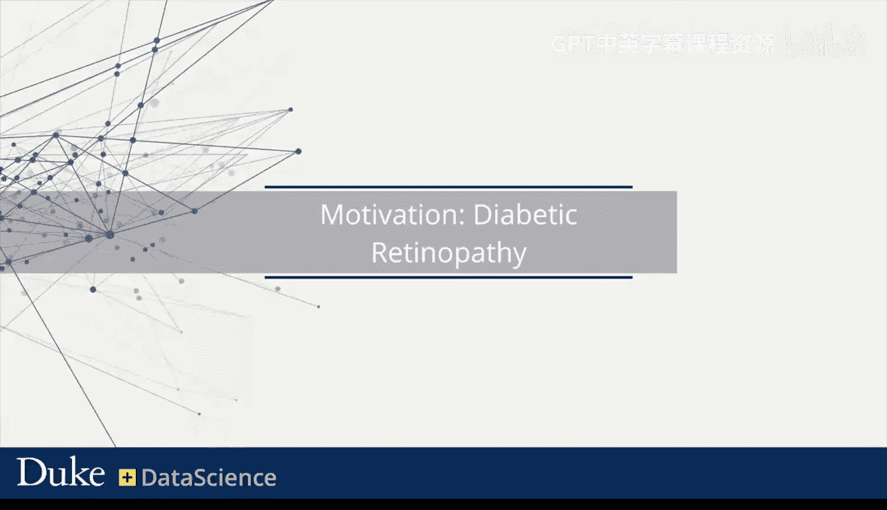
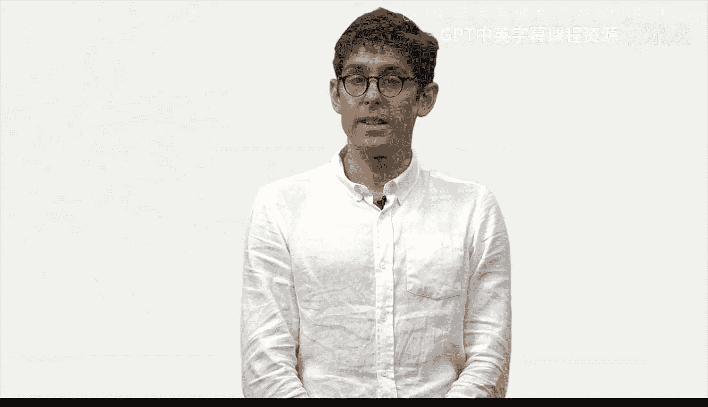
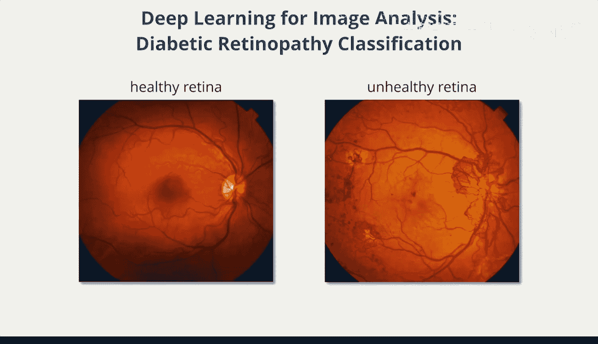
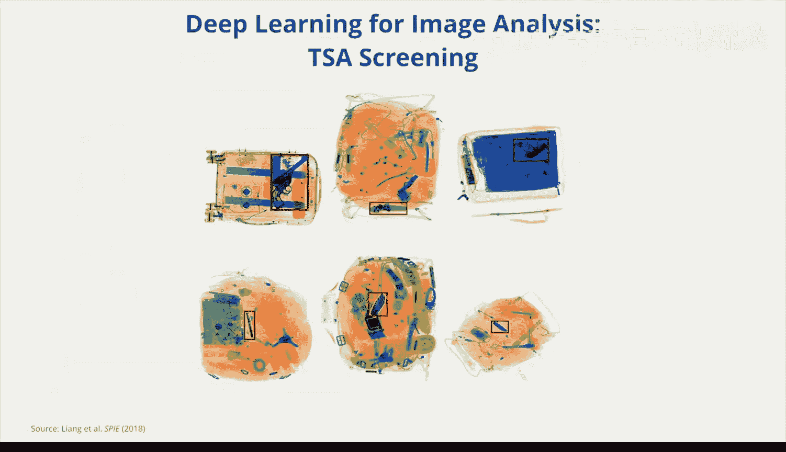
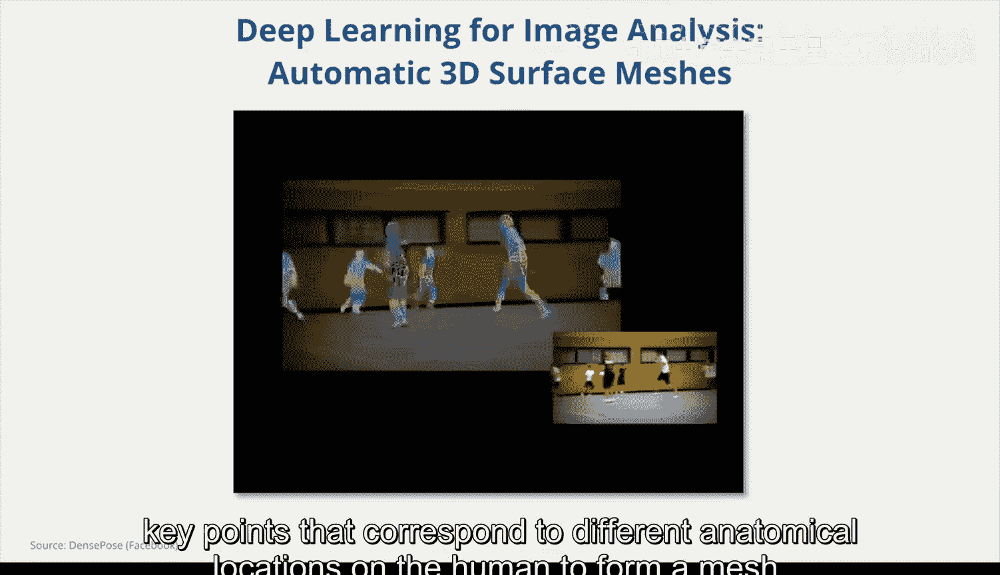
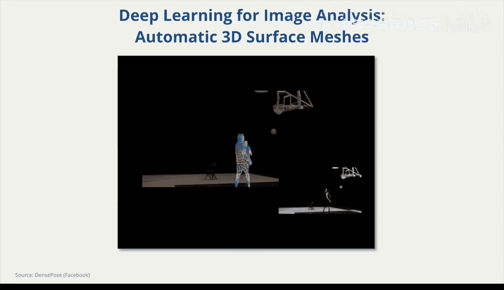
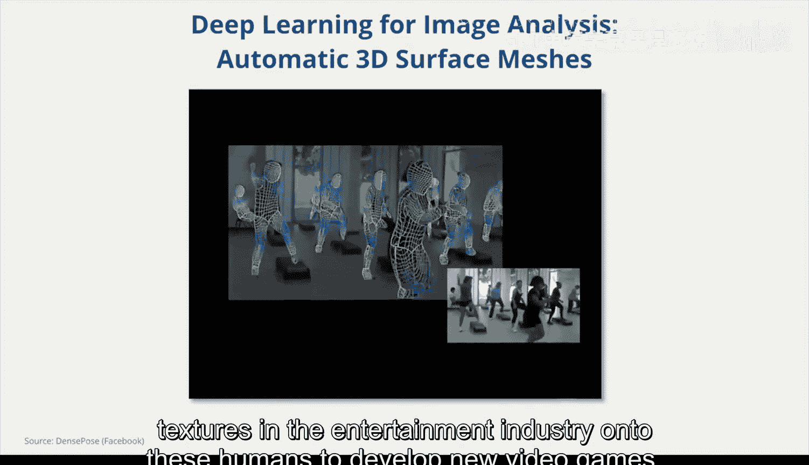
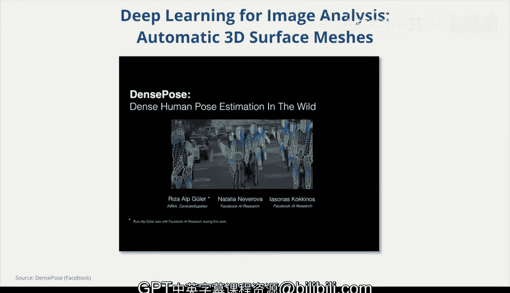
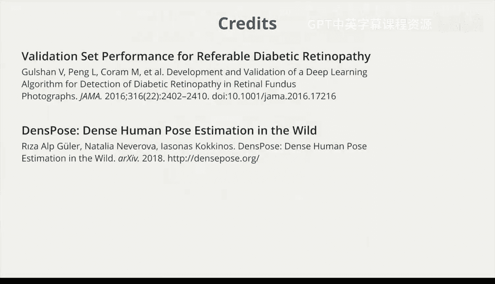

# 机器学习：30：糖尿病视网膜病变的动机 🩺

在本节课中，我们将深入探讨深度卷积神经网络。这些网络是进行图像分析的强大工具，在现实世界应用中取得了巨大成功，尤其是在医学图像分析领域。我们将重点介绍卷积神经网络在糖尿病视网膜病变分类中的一个非常成功的应用。

## 糖尿病视网膜病变简介

上一节我们介绍了卷积神经网络在图像分析中的强大能力，本节中我们来看看一个具体的医学应用实例。

糖尿病视网膜病变是一种影响糖尿病患者视网膜的疾病。其特点是血管会随着时间的推移而恶化。如果不加以治疗，将导致失明。但如果训练有素的眼科医生能在不健康的视网膜中发现特定结构，就可以及早发现该疾病。这种结构能将不健康的视网膜与健康的视网膜区分开来。

在左侧，您可以看到一个健康的视网膜。在右侧，您看到的是一位糖尿病视网膜病变患者的不健康视网膜。希望您能看到这两个视网膜之间的差异。在右侧不健康的视网膜中，您可以看到视网膜左侧有小的出血点。在图像右侧靠近视神经（图像中那个亮点）的地方，您可以看到新生血管。这些共同构成了视网膜不健康的迹象，如果不加以治疗，最终可能导致失明。

眼科医生经过培训，能够区分这种视网膜与另一种。他们在医学院和住院医师期间经过多年的经验积累，从同事那里获得监督信号，帮助他们正式区分不健康的视网膜和健康的视网膜，以及健康与不健康的患者。但由于卷积神经网络非常擅长进行图像分类，它们可以学习区分不健康视网膜与健康视网膜的特征。

## 机器辅助诊断的优势

因此，可以让机器以这种方式执行分类，从而绕开对训练有素的眼科医生的需求。有一个应用于此问题的卷积网络，它效果非常好，并于2016年发表在《美国医学会杂志》的一项研究中。这里展示的是他们论文中的关键结果图，显示了一个训练好的神经网络进行糖尿病视网膜病变分类的结果，即尝试区分健康视网膜与不健康视网膜。

为了解释结果，需要先理解这里的坐标轴。左侧的y轴是灵敏度，底部的x轴是1减去特异性。这些指标的含义是什么？它们是医学界常用的指标。

灵敏度是一个有助于定义医生或机器在数据集中发现阳性样本方面表现如何的量。如果我们称不健康的视网膜为阳性，那么目标就是尝试从包含阳性（不健康视网膜）和阴性（健康视网膜）样本的大型数据集中找出尽可能多的阳性样本。如果一位医生对大量图像进行标记（健康或不健康），我们通过计算医生能够找到的真正阳性（数据中真正不健康的视网膜）数量，除以数据集中真正的阳性总数，来计算灵敏度。我们希望这个值尽可能高。

然而，您应该能看到如何可能“作弊”这个指标。如果您只是将数据集中的所有样本都标记为阳性，您将获得非常高的灵敏度分数，但这显然会导致大量假阳性，因为医生将所有健康的视网膜都归类为不健康。因此，我们需要一个补充指标来帮助区分假阳性率和假阴性率，这就是特异性。

特异性是灵敏度的补充指标。在标记的数据集中，当您将视网膜标记为健康或不健康时，真正的阳性计入灵敏度指标，而真正的阴性则计入特异性指标。因此，您计算医生能够正确识别的真正阴性（健康视网膜）数量，除以数据集中真正的阴性总数。理论上，您希望特异性也尽可能高，与灵敏度一起。

在此图中，我们绘制的是1减去特异性。因为我们希望特异性高，所以1减去特异性我们希望它低或接近0。这意味着，这些图像分类器的最佳值位于此图的左上角。

## 结果解读：机器与医生的对比

现在让我们重新审视这个图。图中的彩色圆点代表8位独立眼科医生，他们在一个包含大量健康和不健康视网膜的数据集上执行了此分类任务。您可以看到这是他们执行此分类能力的分布。左上角的紫色医生点可能是该组中最好的眼科医生。但在灵敏度和特异性之间的权衡能力上似乎存在一些差异，这反映了这些医生在处理分类问题上的表现。

这些彩色圆点是医生。如果您训练一个卷积神经网络（我们稍后会详细介绍如何做到这一点），在一个带有标签的大型训练图像集上执行相同的任务，您可以让机器按照这里的黑线表现。因为我们刚刚说过，越靠近左上角越好，您可以看到，只要黑线比那些彩色圆点更靠近左上角，机器就击败了医生（眼科医生）。在这种情况下，您应该能看到，在此特定任务上，机器击败了80%的眼科医生。这是一个非常有力的结果。

我们认为，对于这个特定任务，机器可能有助于辅助诊断这种疾病。这也为这类卷积网络以及其他类型的医学图像分析任务（包括放射学和病理学）预示了一个非常有前景的未来。

## 超越分类：图像分割应用

除了图像分类（刚才只是将视网膜分类为不健康或健康的例子），这些卷积神经网络还可用于分割出图像中可能对下游用户很重要的特定特征。

想象一下，您是机场的运输安全管理局筛查员，正在查看乘客行李的X光图像，目标是发现行李中的违禁物品。但您已经在这些监视器前坐了很长时间，非常疲劳。如果有一台机器能自动高亮显示行李中与那些违禁物品对应的感兴趣区域，可能会有所帮助。事实证明，您可以很好地训练卷积神经网络来完成这项任务。

在上方，您可以看到在一个特定行李的多个不同视角中，对枪支位置的预测（以边界框形式）。这些红色框在此案例中高亮显示了某些行李中的玩具手枪。如果您能看到枪支周围那些微小的黄色像素，它们实际上是该物体在行李中的精细轮廓追踪。在下方，您可以看到对口袋刀和其他类型违禁物品进行的类似分析，这些物品不允许通过运输安全管理局的筛查点。

因此，卷积神经网络，因为它非常擅长从图像中提取信息，可以完成这项任务，并有可能被运输安全管理局采用，以帮助增强这些筛查点安检员的工作。这是该工具的另一个强大应用。

## 高级分割：从2D到3D姿态估计

除了这些应用，这可能是一个将分割任务推向极致的例子。这是一个可以读取视频的网络。在视频的右下角，这只是一个单一摄像头拍摄的场景视频。网络的目标是隔离视频中的所有人物，像前一个例子中的手枪一样将他们分割出来。但不仅仅是勾勒出人物的轮廓，而是生成一个密集的关键点图，这些关键点对应于人体上不同的解剖位置。

以形成一个网格，一个针对视频中每个人的特定3D网格。这是一项非常具有挑战性的任务，尤其是在这些单摄像头视图中。通常，这些网格是使用非常昂贵的动作捕捉技术在非常特殊的场景下开发的。

拥有这样一个网格的具体应用，以及人们使用当前技术（这些动作捕捉服）的原因，是希望开发这些网格，以便在娱乐行业中将纹理应用到这些人物上，从而开发新的视频游戏和电影的新CGI动画。

这些网格也可能有助于未来与新的自动驾驶汽车、机器人等的交互。

## 总结

本节课中，我们一起学习了卷积神经网络在医学图像分析（特别是糖尿病视网膜病变分类）中的强大应用。我们了解了机器如何通过学习区分特征来辅助甚至超越部分人类专家的诊断。此外，我们还探讨了卷积神经网络在图像分割领域的扩展应用，包括安检中的物体检测和视频中的人体3D姿态估计，展示了该技术在分类之外更广泛的潜力。这些实例共同说明了深度卷积神经网络在处理复杂视觉任务方面的有效性和多功能性。