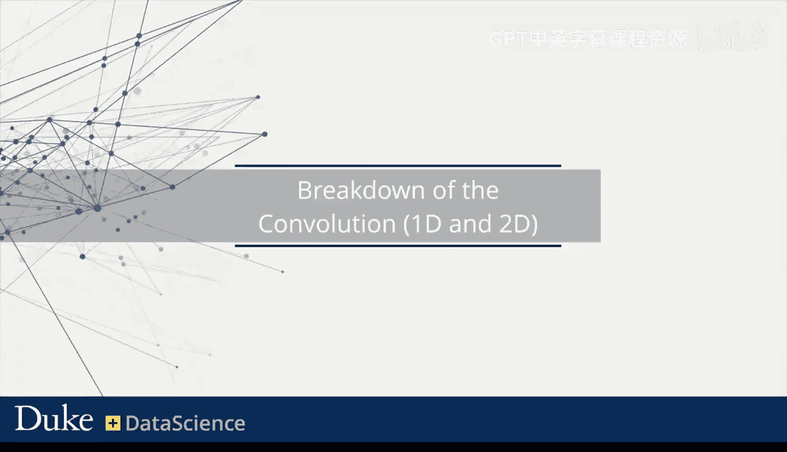
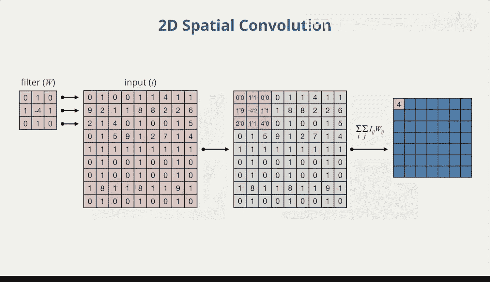
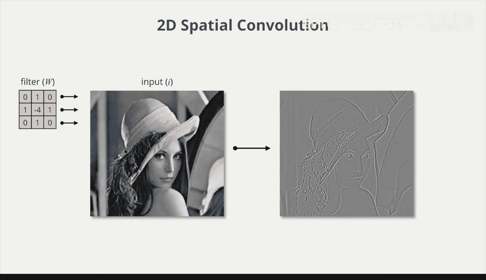
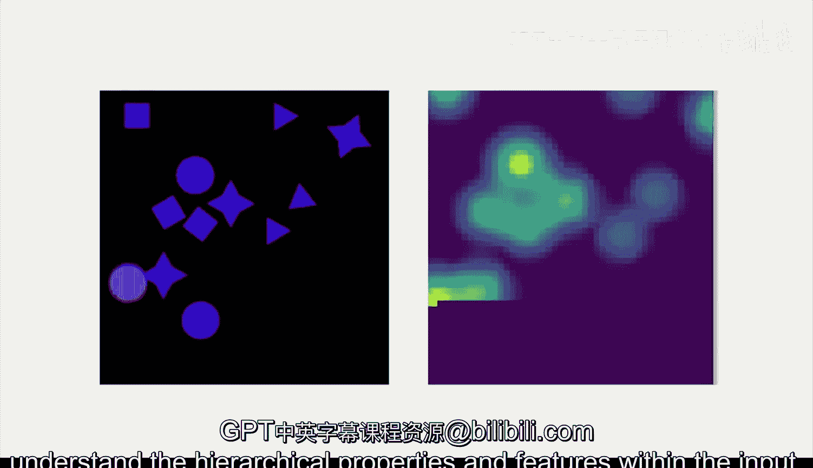

# 杜克大学《机器学习｜Introduction to Machine Learning》中英字幕 p31 31_03_02_一维与二维卷积分解.zh_en -BV1yjvdBQEaU_p31-

Okay， so let's break down the convolution operation itself。

 So just to remind you about the general architecture for a convolutional neural network。

The idea is that you have some sort of input image。There are filters。

 convolutional filters that are applied to this input image via a convolution operation。

 and that operation is repeated as future maps are built up over and over again to get to a high level representation of that image that can be fed to a classifier。

 So what exactly is that convolution operation。The convolution is essentially a sliding of two signals。

 one over another that helps search for particular features in a signal of interest。

 So I'm going introduce the convolution to you in one dimension。

 So now we have two signals here and 1 D， a signal F， a square wave and a signal G。

 which is sort of a single saw tooth and the mathematical definition of the convolution of F with G is given here at the bottom of the slide。

😊，And if you unpack the right side， you can see that the idea is that you multiply G times F at every position from minus infinity to infinity。

 and then you sum up。The result of that operation， basically taking the area under the curve of that resulting multiplication。

 and then assigning that sum to a single value of the convolution。

That operation is performed multiple times for various values of n。

 which end up being various lags or shifts of the signal G relative to F。

 And I'll just show you a few examples of how that's done in this one dimensional case。

So I'll add some reference values here， so we'll add an axis 0 minus 55。

If I plug in minus5 for n in that convolution equation。

 I assign minus5 to n on the right side as well。 and if I distribute that negative sign。

 what you'll see is now I have g minus5 plus M if you recall from algebra having an M plus 5。

 so f of x plus 5 shifts the function to the left by 5 and then that negative sign performs a so I'm showing here now the reflection。

That triangle relative to the blue by 5。 And then the negative sign performs a reflection along the midline of that signal of the red signal。

 Okay， so the result of that shift and then reflection is shown here。

If I multiply these two signals together and then sum up the result。I'm looking at the area。

 sort of the intersectional area between the red and blue curves。And so this is。

 this area is going to be the value of the convolution， which in this particular case is 15。Okay。

 so now I apply a different shift，0。 So I plug in 0 for n actually do not shift the red curve at all relative to the blue。

 but I do reflect it。 Okay， and then again， I multiply these signals， Take the sum of the result。

 And in this case， the area is shown here in yellow， which is slightly bigger than the area before。

 Okay， so that's why the result is 20。If I continue to shift this red curve over to the right more and more。

 I get different values of the convolution at different lags or shifts as I move G relative to F。

 So in this case， I've moved the red over by 10。 I've reflected it and then I've taken the area and I get a smaller value because the region of overlap is smaller between those two signals。

And of course， if I move this over substantially， such that there's no longer any overlap。

 all of the positive values of both of these functions are zeroed。 via a multiplication by0。

 and I get no resulting。Signal or area。 So the value of the convolution here is0 once there is no overlap。

Okay， so here's just an animation of a similar process here。

 just using two square waves that are moving G， the red one is moving across the blue1。

 And as the red curve is shifted from left to right， as it begins to overlap with the blue signal。

There's then an area under the the result of that multiplication。

 and that black line is now drawing out the value of that area。

 and that's the value of the convolution for that particular lack。 Okay， so that's。

 the whole convolution in 1 D。What this means is that the convolutional filter G in this case can be used to specifically pull out features an F that match it。

 Okay， so if you have a matched feature， you're gonna get a high value in the convolution。

 So here's an example of that here。 So if our filter were G and that a shift of 0 overlap perfectly with F。

 we see that the result of that convolution would be area accumulated in those two left lobes at the top。

 And then a substantial amount of value or area accumulated at the bottom where you have negative values of G multiplied by negative values of F。

But if we have this long square wave filter for G， when it's overlapping with F。At 0 lag。

 you do get positive values for the area on these two side lobes。

 But in the middle where previously you had negative times negative equals positive。

 You have positive times negative equals negative。 And so there's this very large negative area component that's subtracted from the yellow resulting in a lower value for the convolution with that mismatch filter than with the match filter on the left。

😊，Okay， so that's in 1D in the convolutional neural network we're trying to convolve in 2D image with a 2D filter。

 And so you basically do the same exact thing， except the filter as a 2D extent。

 So here in the top is a 3 by3 filter， it's being applied to a particular region of the image below。

 there's multiplication， just like in the 1D case and then a sum and the resulting value of that sum is the value of the convolution of that particular shift。

 And this filter is then moved along in the image until you finally have a convolution at every single point of the image with that filter。

Just to show you what that looks like with a particular pattern。

 imagine the filter where a cross and there was a crosslike feature in the resulting image as that filter with the cross is overlapped slightly with the feature in the image you get a positive value for the convolution。

 but as it overlaps perfectly with the underlying feature。

 you get a higher value here shown in darker purple and the resulting convolved image or feature map。

 and as it begins to slide off of the feature， you get lower and lower values of the convolved image。

 by the time you're done， you have a heat map in the one corner corresponding to where that feature was in the image that you were searching for with the respective filter。

😊，So just to show you now with numbers what this looks like， if you have a filter here， W。

 you apply it to the image。 Okay， this is just for one shift。

 So you apply it first into the top left hand corner。

 you do elementwise multiplication of all of those values。

 Then you take the sum over the rows and columns of that particular piece where the filters overlapping with the input。

And then you deposit the result of that sum in the corresponding location of the convolved feature map。

 in this case， value of  four as a result of that convolution。

So this filter here I'm showing you on the left is actually a real filter that people use to extract。

Features from real images。 And it actually is an edge detector。

 And just to show you how we can actually form a real meaningful map from running this filter over an image。

 I'm just showing here now a stock photo， black and white photo。

 I run this filter over the image with various shifts right So I just moved this filter and slide it all over this image and the result of that convolution operation is now an image in which I've detected the feature that filter was designed to detect In this case。

 the edges of the image。😊。

Okay， and just to wrap up， just to really hammer home this point。

 So what happens when I' we're doing this convolution in 2D to try to do feature extraction in the convolutional neural network。

A filter in this case， a circle in this example is moved over the image left， right， top to bottom。

And at the points where the filter overlaps with the feature。Corresponding to it， you get a big。

 high amplitude hot spot。 So when that red circle was overlapping with the blue circle。

 there was a lot of signal。 And so you see in the resulting heat map on the right。

 a high value for the convolution that point。Whereas when that circle is overlapping with shapes that are not matched to it。

 you get lower values of the convolution operation。 So you can see how this circle。

 as it's being passed over this image， is highlighting。

Particular features informing a feature map on the right that can be used by upstream layers of the network to understand the hierarchical properties and features。

Within the input。