# 杜克大学《机器学习｜Introduction to Machine Learning》中英字幕 p32 32_03_01_卷积层的核心组件.zh_en -BV1yjvdBQEaU_p32-

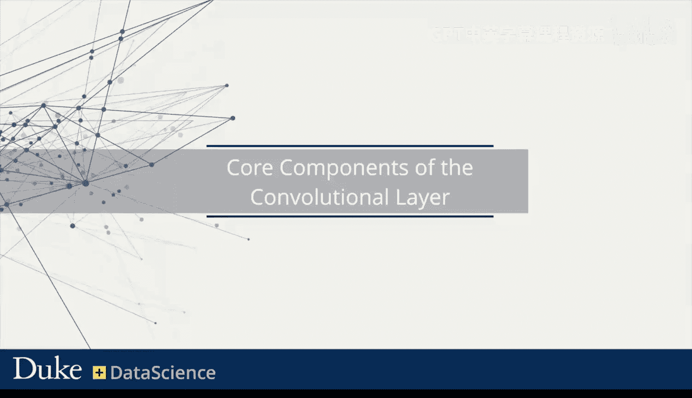

Okay， now we're gonna get in the nuts and bolts of various components of the convolution row network。

 the core elements of the system that allow it to extract， meaningful features from these images。

So we're going to walk through all of these convolutional layers， activation functions。

 pluming layers and fully connected layers。 And so let's start with。

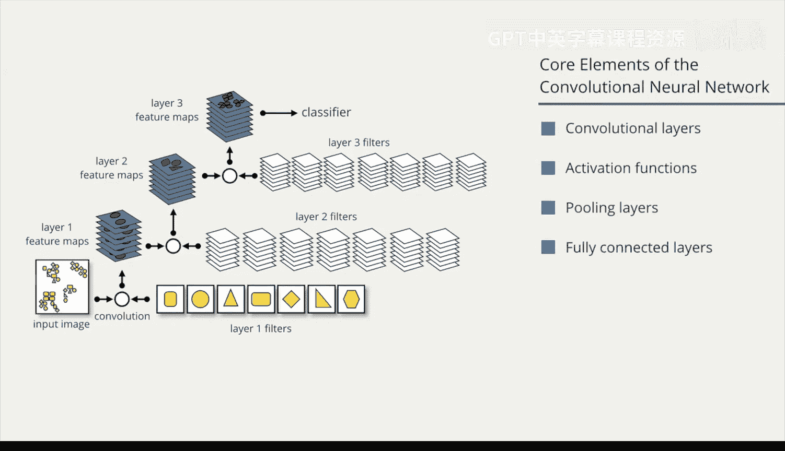

What goes on in the convolutional layer， you know about the convolution operation。

 but there are various features of the convolution that can be chosen by the user when designing the system。

That includes the convolutional filter size。The convolutional filter stride。

 which we'll define a minute in the convolutional filter number。

So the filter size as shown here is just what it sounds like。

 So I've been showing convolutions in a three by three configurations。 So the filter is 3 by three。

 and that filter is run over the image to result in a feature map。

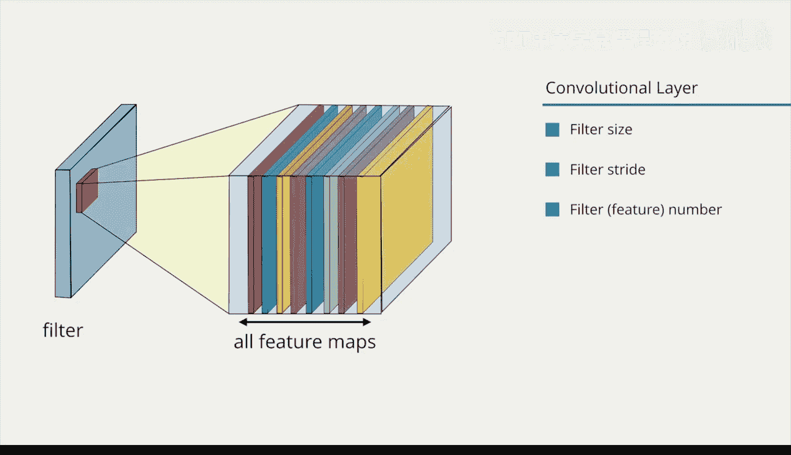

But you can also change the size of that filter。 So on the right， there's a filter that's5 by5。

And that results in a different feature map because the filter can potentially be bigger and contain more information about the feature that it's searching for。

OkayTypically， filters range from 3 by3 to 7 by 7， and the rule of thumb is that typically filters should be just large enough to capture small local features。

 for instance， edges in space， but not multiple of those。

 you don't want to have a filter that can look for a circle and a triangle together。

 You want to let that correspondence occur in higher layers of the network。

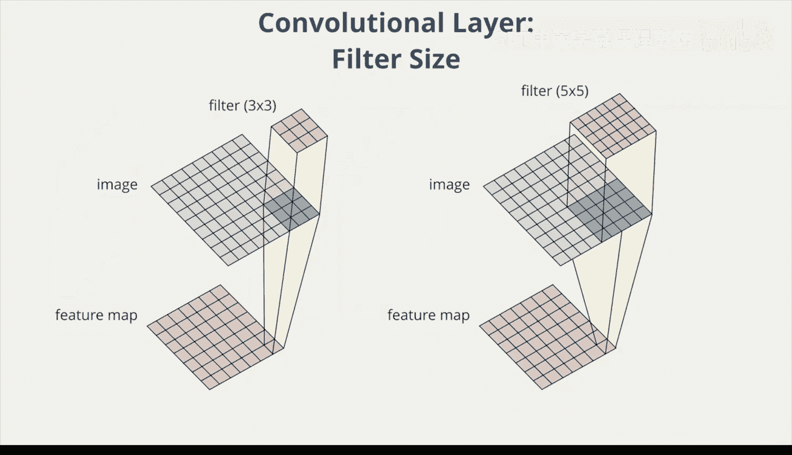

You can also define a filter stride， so a filter stride， I've been showing you a stride of one。

What that means is that every time the filter moves。

 it moves down one pixel at a time during the convolution。Resulting in a feature map。

 But if you increase the stride， you skip more pixels as you're moving the filter over the image。

 So for a stride of  two， as you see on the right。The filter is moving two pixels at a time as it's being slid over the image。

 And the result of that is a feature map that has been downsized。 right。

 So instead of the large feature map on the left， you get a smaller feature map on the right。

 And that's because you can't fit the。Filter as many times within the input image。

 So the stride helps reduce the computational load by down sampling the input。

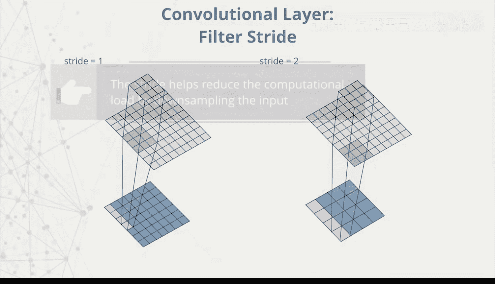

Typical strides that you would see in a neural network range from one to two。

 sometimes a little higher， but you really one to two is is very common。

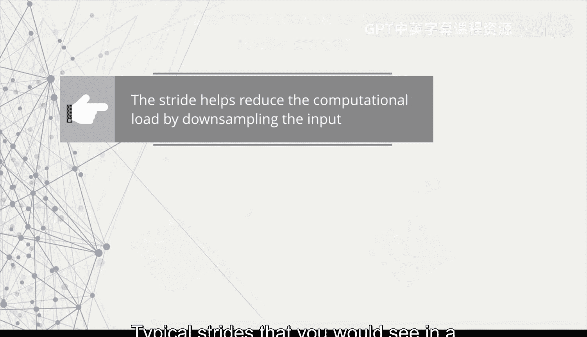

Okay， so filter number， we have。Potentially addressed before。

 So the idea here is that at each layer in the network。

 you can define the number of filters or the number of unique features that you're looking for in the input。

So in this particular case， I'm showing six elementary building blocks in a toy example where you might be looking for a hexagon。

 a rectangle， a circle， a triangle， square， or a diamond。

And to get all of those isolated in their own feature maps here shown as different colors。

 you need to have a filter for each one of those。 You can have many more than this。

 But the idea is that the filter number determines the number of unique feature detectors that operate on the inputs。

Okay， so those are the core components of the convolutional layer。

 I just want to turn it back on its side and show you how for each of the filters that we use。

 we develop a feature volume that's passed on to the higher layers of the network。

 So if we have a single filter here that's pulling out a particular feature in this case。

 a red feature map But if we have another filter right here shown in purple that operates on the input and has its own unique feature map and that continues for all the different filters that you have such that you're building up a volume of feature maps。

 a stack of feature maps that's fed on as input to the next layer in the network。😊。

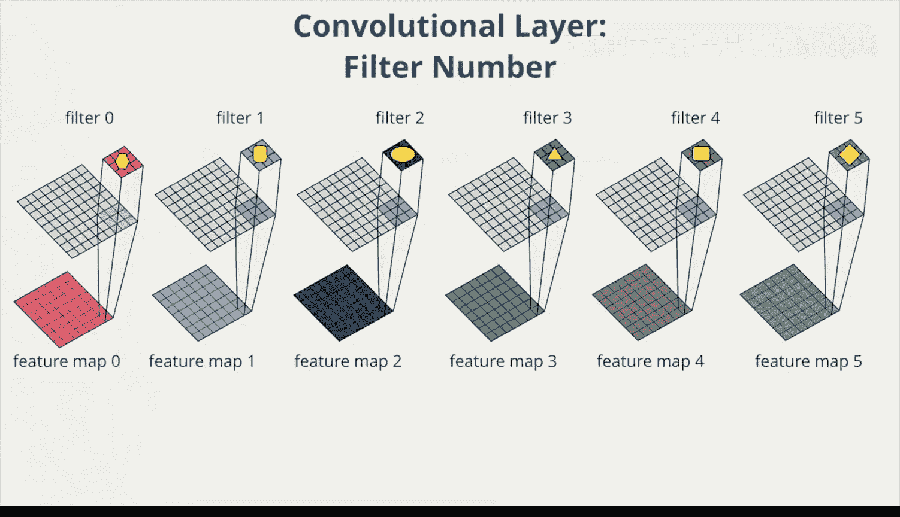

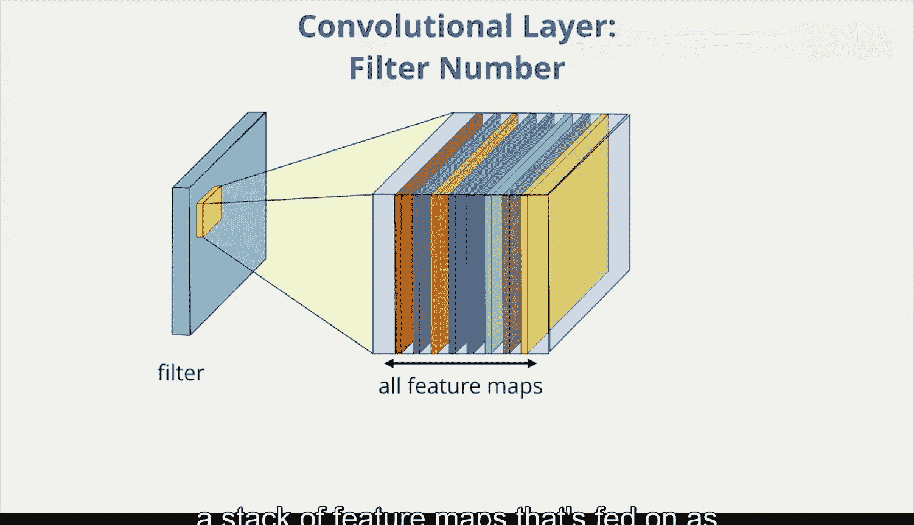

Recall from the toy example earlier that we had these layer  two filters that were operating on the future map。

 So the， the filters that then then need to operate on the stack of feature maps need to also have an extent。

In depth as well， such as they cover all of the feature maps that are that are being fed into that layer is input。

 Okay， and that's also true of the very first layer。

 So even though we've been treating the input image as just a single potentially gray scale image。

 images also actually have color。 where when they do have color， they have three channels。

 a red channel， a green channel and a blue channel。

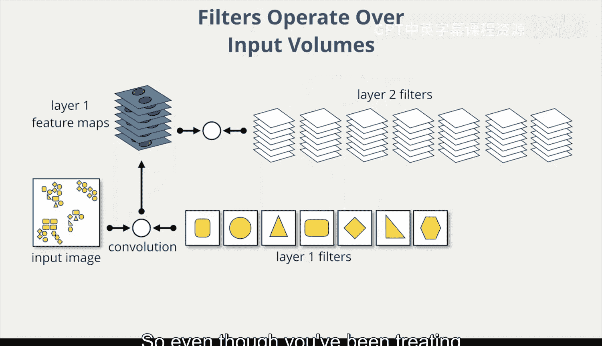

That help define the color at each pixel。 And the layer 1 filters paying attention to that input image need to have weights corresponding to each of those color channels。

 And so they have， you can essentially think of those filters as having a 2D extent in each。

Of the input channels such that there's a stack for each filter that goes down 3 for each of those channels。

 Okay， so in every case， these filters are operating over input volumes。Primarily or at every stage。

 So even when you're feeding in the original image input。

 but especially after you've done a convolution such you've built up a stack of feature maps。

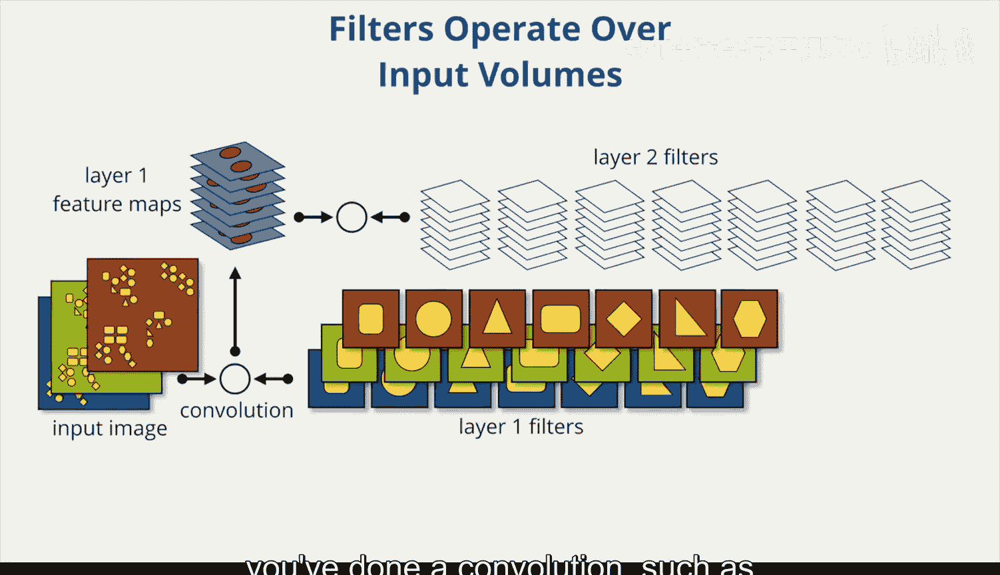

Okay， so just to put this back in the context of our original animation。

 what we're really doing when we're sliding this filter over is that we have a a small cube。

r a three by three now by three with weights corresponding to every single slice of the image input。

 every channel of the image input， which might be a9 by9 by3。Image input right。

 where that three corresponds to the three color channels。 And the result of that， though。

 because we're doing still doing element wise multiplication than a sum。

 I that we get a single 2D feature map for that particular filter。Okay。

 so this animation is now just summarizing everything that I've talked about for the operation。

 the convolutional layer。So on the left， you have an input volume that in this case has three slices。

 So you can think of this as being an input image that has a red channel。

 a green channel and a blue channel。 We're calling that input I。

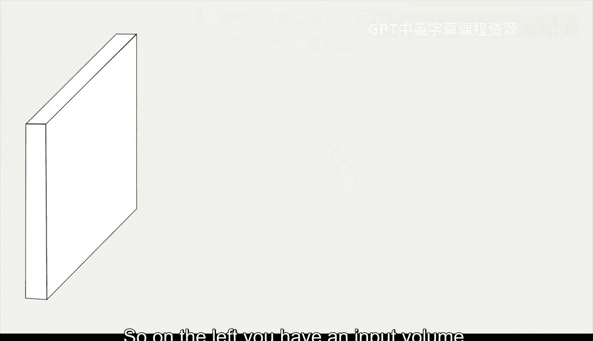

And we're using now array notation that you might find in Python。

To sort of index all of these slices。 So at the top， you have I colon colon 0。

 That just means all of the rows and all of the columns in the zero width。Or the zero index i。e。

 first。Slice of that input， which might be the red channel。 And then below it。

 we have I colon colon 1， which might be the green channel and an input and I colon 2。

 which might be the blue channel。 Okay， so that what I want you to take away from this is that the filter。

 right，0。 So that's a single filter， W 0。Has weights that correspond to spatial positions in all of the respective channels of the input。

Okay， so the。The filter is actually three dimensional。 Okay。

 it has a 2D extent and then an extent in depth。 Okay， but still。

 what you're doing is getting doing an elementwise multiplication between all the values in the filters and the respective values and the inputs summing those and depositing the result into a single value in the feature map corresponding to filter 0。

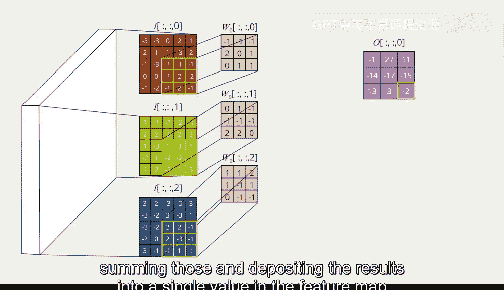

Okay， for filter 1， a second filter， you do exactly the same thing。

 But the result of that summation of that convolution is deposited。

At a respect position within a second feature map， future map 1。

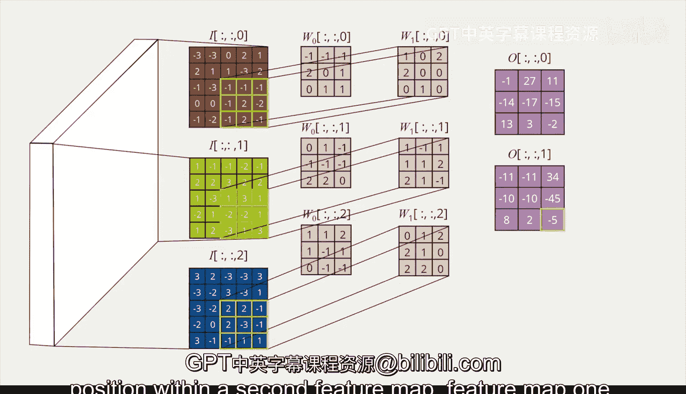