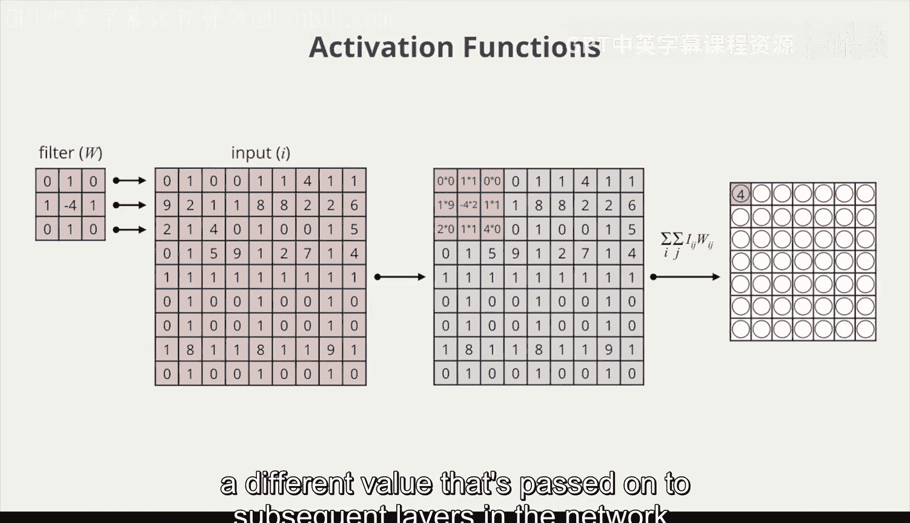
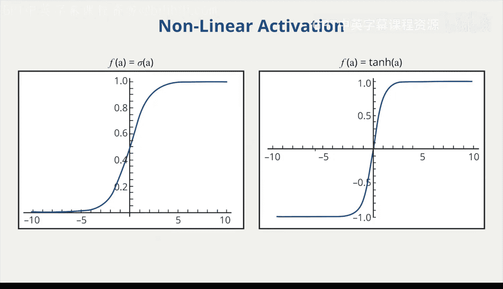
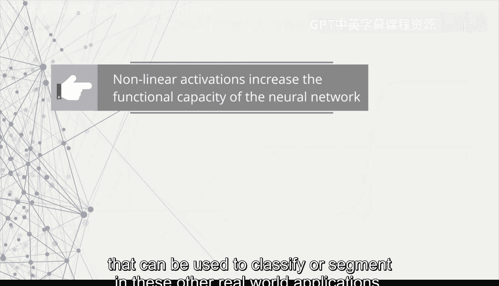
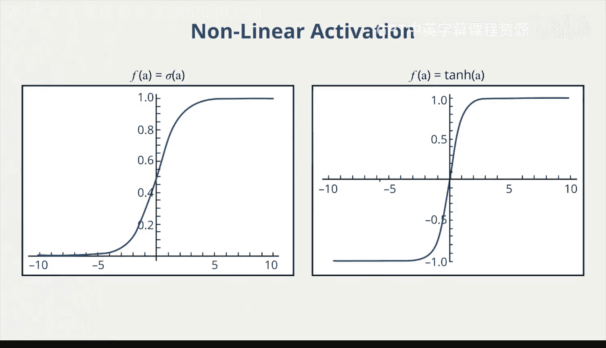
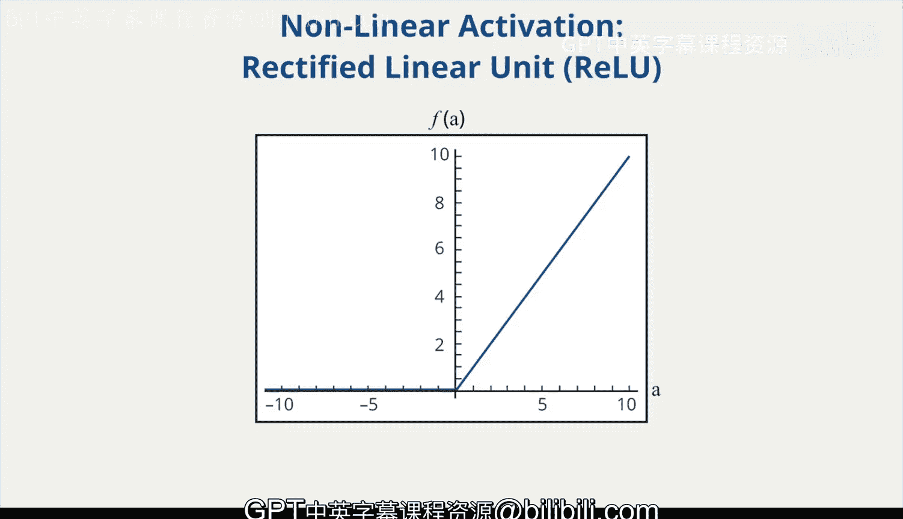

# 杜克大学《机器学习｜Introduction to Machine Learning》中英字幕 p33 33_03_02_激活函数.zh_en -BV1yjvdBQEaU_p33-

Okay， so the second core component that we're going to talk about are now activation functions。

So recall the example of a filter being applied to an image input。

You get element wise multiplication。 and then a sum。 that's the convolution operation。

 The result of that sum is deposited and a pixel in the resulting feature map。But really。

 what exists at every position in that feature map is a artificial neuron。

That's taking that input and potentially transforming it into a different value that's passed on to subsequent layers in the network。

So if we take one of those red circles。And blow it up， okay， so that's a single artificial neuron。

It's receiving some input。 right in this case， I'm just showing three input values， X1， x 2， x 3。

 And for each of those inputs， you have a respective weight， right。

 So those are weights in the convolution。 So W1 W2， W3。

And the result of convolving with those weights， that input is a sum A。

 which again is just the element Y multiplication。And then a sum over all of those multiplications。

But instead of just taking that A and passing it on to later layers in the network。

 there's typically a function that's applied to that input to result in a different type of output。

What do I mean by that， Here is it just a linear activation。

 And this is what I've been showing you the entire time when I've been showing you these convolution operations is that the result of taking that sum。

 the convolution and getting some value A。RightThen the result of a linear activation function applied to that value A would just be the value A again。

So thered be no transformation of the input to output。

 and that's a very simple linear activation function。But in reality。

 what we use when designing these neural networks are non nonlinear activation functions。

 And so you may have seen these before when going over logistic regression or going over the deep multi layer perceptionceptron。

These non nonlinear activation functions。 So when there's an input a to the artificial neuron rather than just spitting out the same value。

You transform that value A in a nonlinear way。 This increases the functional capacity of the neural network because it allows it。

To represent nonlinear relationships between features in the input， okay。

 which can be quite powerful if you're trying to digest those features in a way that can be used to classify or segment in these other real world applications。

 So here I'm showing you now on the left， a sigmoid function activation， which is commonly used。

 So for a given input value a。

You squash the result between 0 and one。 You can think of this as sort of forming a problem in the logistic regression case。

 You can think of that as forming a probabilistic output between 0 and 1。And on the right。

 you have a commonly used function called the hyperbolic tangent function。

 which takes in some value A and does a very similar squashing。As the sigmoid function， except it。

 it collapses the values between -1 and1。 So it squeezes all the values between 1 and 1 instead of 0 and1。

 But you can sort of think of it as almost the same thing。

So while these have been very powerful activation， nonlinear activation functions for neural networks。

😊，They have resulted in some problems。 So if you notice that at the either top or bottom of these plots。

 you see these very flat regions and in those regions you for very high variance in the value of the input A。

 you get very little change in the resulting output such that there's very little signal for the neural network as values are changing in dramatically different ways。

 and this results in a sort of stagnation occasionally when training these networks that's not particularly useful for learning the representations needed to do classification。

So people have begun to use a different type of nonlinear activation， in this case。

 a rectified linear unit， which happens to look a lot like the way a real neuron in a brain might respond to an input。

So it's a very simple function where for any negative value of a。

The result of the function applied to that input is 0。 So it passes on 0。

 If the total sum of the inputs is less than 0 or it returns a if the value of the input is greater than 0。

And so the nonlinear there is very， nonlinearity there is very simple。

 It's it's just a maximum value between the value they input a and 0。 But this linear nonlinearity。

 when introduced to all of the neurons in each layer of the network。

Increases dramatically the capacity of that network to represent information within the input。

