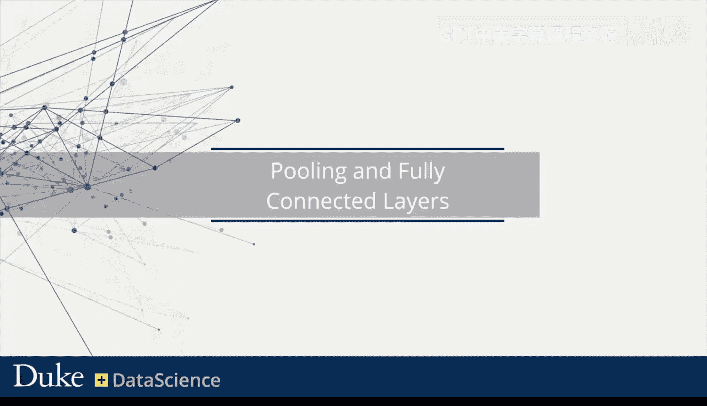
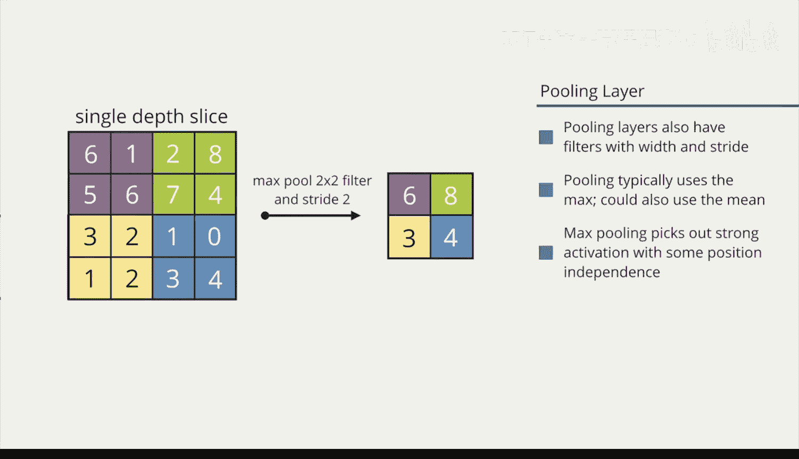
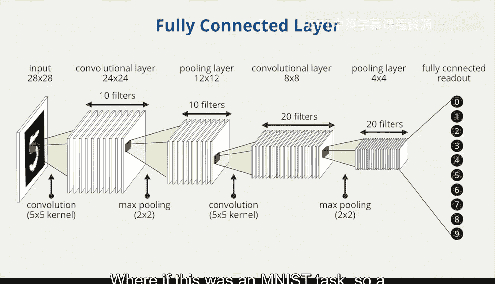
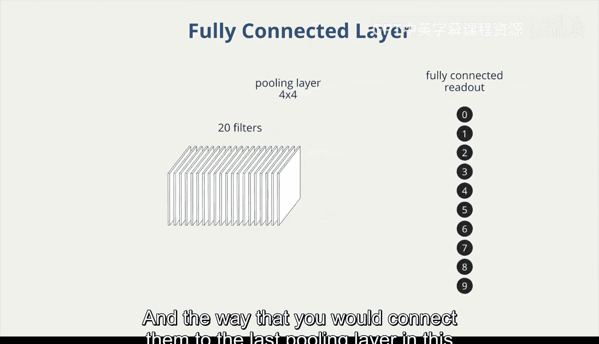
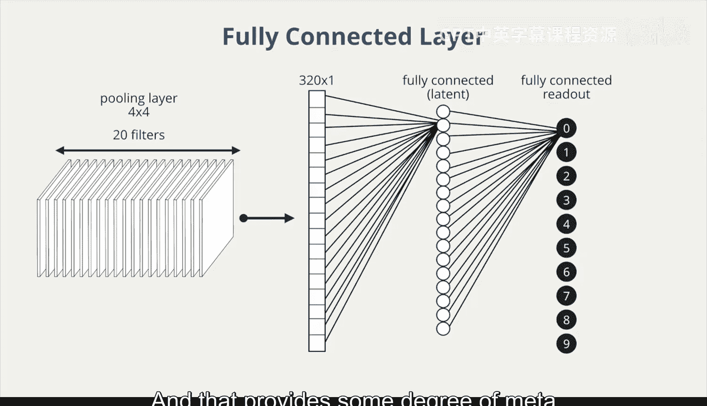

# 杜克大学《机器学习｜Introduction to Machine Learning》中英字幕 p34 34_03_03_池化层与全连接层.zh_en -BV1yjvdBQEaU_p34-

Okay， so the next core component of the convolutional neural network is called a pooling layer。

 and this is typically applied after the convolution and after the activation to reduce the size of the input that's passed up to subsequent layers of the network。

This pooling reduces the computational complexity of the overall network and makes it easier to train。

 It also combats overfitting and encourages some translational invariance by translational invariance。

 I mean。When you see a particular feature in one corner of an image。

 the neural network can still classify it。Its identity。

If it's in the top left of the top left hand corner or in the middle of the image or in the bottom right hand corner。

 So no matter where that particular thing is translated within the image。

 the neural network can still figure out its identity。 That's called translational invariance。

 So how does that occur？ Well， the pooling step， the pooling layer。Has also a filter。

 sort of like convolutional filter， except rather than doing convolution。

 It takes everything within the filter window and collapses it to a single value。

So a maximum pool would take in this particular case。

 if you have a window size of two by two and a stride of two。

 you would move a little two by two window over from the top left hand corner to the top right hand corner to the bottom left hand corner to the bottom right hand corner。

And in each of those windows， you would just take the max value and assign that max value to respect to position in the output。

 So that should be clear here。 So in the top left corner， the max is 6。 So 6 is moved over。

To the resulting output location， the max in the top right hand corner is an8。

 you move8 over3 and 4 respectively for the bottom corners。

You can also take an average to help do this down sampling， but typically the maximum is used。

And I mentioned that it provides some degree of translational invariance。 And you can see that。

If I actually add a six here in the top left hand corner， you can see that。

Independent of where the6 actually sits in the top left hand corner。

 the6 is relayed to the output such that the neural network doesn't necessarily need to care about whether or not the6 was in the top left of the top left corner or the bottom right of the top left hand corner。

 If that information is is potentially not useful for doing the ultimate classification。

 So the max pullinging picks out strong activations with some position In。

Okay， so in a typical neural network， we build on the things we've just gone over。

 So you have the convolutions and the convolutional layer to build up feature maps。

There's activations which aren't pictured here after those convolutions。

 And then there's a max pooling step， which down samples the the feature maps。

 And then there's subsequent convolutions and those those operations are stacked over and over again to build up high level representations of the features within the image。

 How are these high level features processed derived arrive at a final classification。

Well you just use a multi layerer perceptron akin to what you've learned before。

 And we call these layers fully connected layers。 The simplest version of this would be a fully connected readout layer。

 where if this was an Ms task。 So a digit classification， you'd have a single neuron for each of the。

Output classes that you wanted to classify。And the way that you would connect them to the last pooling layer in this network would be by first flattening or vectorizing the pooling layer。

 So in this case， taking a 4 by 4 by 20 volume。 Okay， the result of convolutions， activations。

 poolings， convolutions， activations， pooling。 But that final representation， vectorizing it。

Okay， and then having each neuron in the readout layer fully connected。

 so has weights now connected to all of the upstream elements in that vectorized representation of the pooling layer。

 And I'm just showing now connections for a single class of readout neuron for the zero。

 but the one has also connections to all of the upstream elements of that vectorized high level feature map。

 the result of that pooling layer。Just like in the multi layer perceptron。

You can also have multiple layers of fully connected neurons。So in this case。

 I'm just showing now an intermediate latent or hidden layer of neurons that are connected to the upstream elements in this pooling layer。

And then the fully connected readout， you know， class readout neurons are then fully connected to that latent layer and that provides some degree of meta featureature representations that can help for these classification problems。

