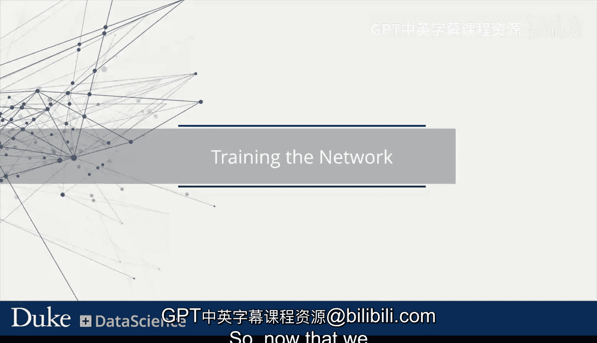
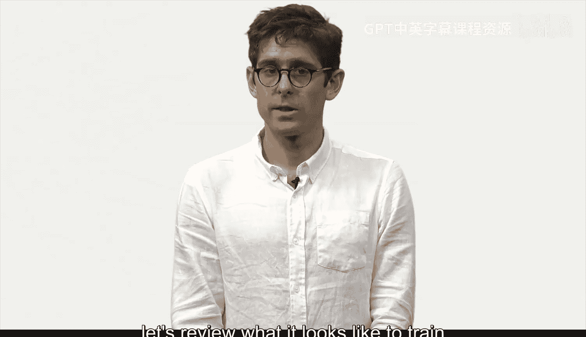
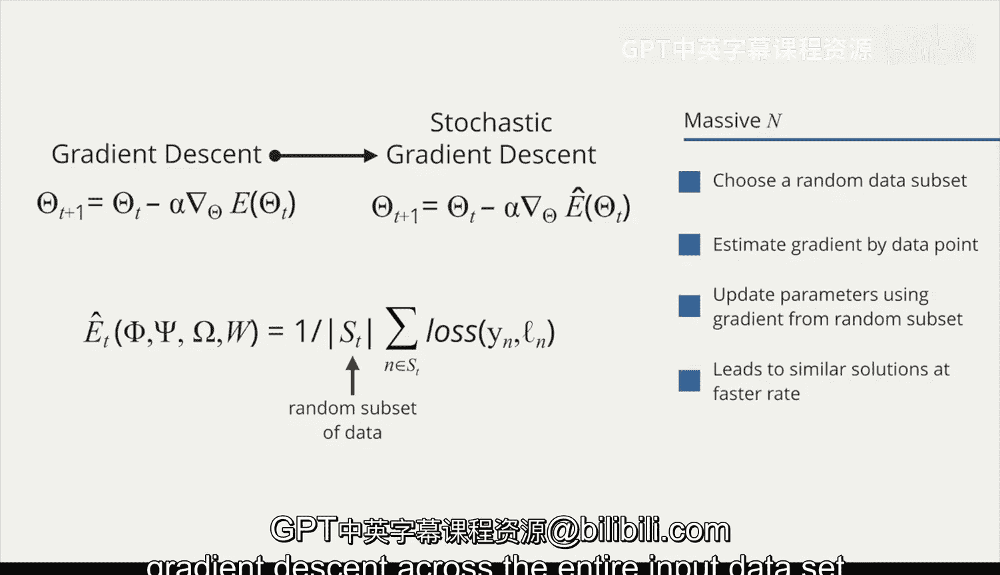

# 杜克大学《机器学习｜Introduction to Machine Learning》中英字幕 p35 35_03_01_网络训练.zh_en -BV1yjvdBQEaU_p35-

Okay， so now that we have an idea of what happens at each of these convolutional layers and at these pooling layers。

 let's review what it looks like to train such a network with gradient descent。

So we assume that we have a set of input images。Each of those input images has a respective ground truth label associated associated with it。

 So for a binary classification task， like diabetic retinopathy。

 you have a label plus one for an unhealthy retina and a label minus-1 for a healthy retina。

And for each of those input images， I N， right， So the nth input image。

We feed that input image through the convolutional neural network。

 The first thing that happens is there's a convolution operation that uses the filters of each of the。

Convolutional elements， right， each of the features that we want to extract from that input image。

 We have first have layer 1 filters。 So that's Phi 1，2 through Phi K。 If we have K different filters。

 K different features， we want to extract from that input image。

 Those are applied to the input image to result in a stack of feature maps。

Va the convolution function， which is represented here as F。 So that function F takes in as input。

 the I N， the nth input image， the filters， the convolutional filters in the output of that operation is M N。

 the stack of feature maps。That convolution operation happens again。

 but now with the layer 2 filters here represented a psi 1，2 through K。

In the convolution operation here， F takes in as input M N。

The layer1 feature maps and also the parameters of the layer2 filters。To give an output。

 the resulting stack of layer 2 future maps L N。 that's repeated one more time。

There's another convolution function here。You see at the top that takes in as input L N。

 the layer 2 feature maps， the layer 3 filters mega 1，2 through K。

 and results in the final layer 3 feature maps GN and these feature maps are then transformed one more time via these fully connected layers。

 which we're representing here as a function script L。That has a set of fully connected weights。

 a weight matrix W。Okay， and those weights determine how the layer 3 feature maps here。

 G N are transformed to result in the predicted label L N for that， that input image I N。Okay。

 so each input image I N via these operations results in a label prediction L， N。

And the whole idea is that we want to find the parameters that help。Match。

The predicted label to associated with that input image to the ground truth label。

 And the way that we do that is we set up some sort of loss function。

That compares how well the prediction matches the ground truth。

 That's typically something like the binary cross entropy function。

And we want to reduce and minimize the average loss across all of the input images I N。 Okay。

 and so that is that average loss is called the empirical risk function。

 which you see here on the right， that function E。And that function， of course。

 take is a function of all the layer  one filters and the final。

Fully connected weights in that classifier。Okay， in the name of the game is to find the is to learn。

The layer 1 filter parameters， the layer 2 filter parameters， layer 3 filter parameters。

 and the final readout weights in those fully of connected layers that minimize this loss function。

 and doing so。You've now developed a system that can take in an input image and then correctly predict whether or not it has diabetic retinopathy it or not。

Okay， so typically this cost function， this empirical risk function can be。Quite complicated。

 And it exists in this very high dimensional space。

And the way that we find the best fit parameters to reduce this loss function and best predict what's in these images。

 you need to use this thing called gradient descent。Graian descent is this。

Strategy in which you make a point estimate of the slope。

 the multidimensional slope or the gradient of this empirical risk function for a given set of parameters。

 Okay here we're just encapulating the entire set of parameters， these layer 1， layer 2。

 layer 3 filters and the fully connected weights as one single theta parameter。 Okay。

 so but imagine you have a value for each of those weights in the filters in in the readdot weights。

 Okay， we can get at that point。For those values of parameters in the risk function。

 we can now get the slope， the multidimensional slope of that risk function。And based on that slope。

 we can take a step with size alpha here in the gradient descent equation。

That can bring us closer to the minimum。Okay， and so that's what's shown here on the graph on the left。

 So imagine for some values of parameters， look at this positive slope point。

 for some initial starting point for our parameters that puts us at that region of the risk function。

 Okay， we calculate the slope。 It's positive slope。Right。

 so then we reverse the sign of that because we want to walk downwards to find the minimum。

 and then we take a step size here denoted by that black arrow。 Okay。

 and in multiplying now that step size by the negative of the slope。Right， we update our parameters。

 and that moves us down the hill to that next red spot。

 and we continue that process until we reach a green spot， the nearest local minimum in our function。

 Okay， and you see on the left， another alternative。

 we had started with the parameter values on the left underneath that word negative slope。

 We have also followed the gradient down to that local minimum。Okay， so in practice。

To calculate that gradient， we don't actually feed in all the input images。

 which would be required to get the actual slope of the entire risk function。 Instead。

 we use this thing called。Sttochastic gradient descent， but we make。

An estimate of the value of the risk function of the gradient of the risk function by taking a random subset of the data。

Okay， and getting the gradient。With respect to the current parameter values for that random subset。

Of data， right， the， the corresponding value of that risk function。

 And then we just update the parameters using。Those gradients from that random subset rather than the entire set of data。

 and in practice， that leads us to very similar solutions at a much faster rate than trying to calculate gradient descent across the entire input data set。

