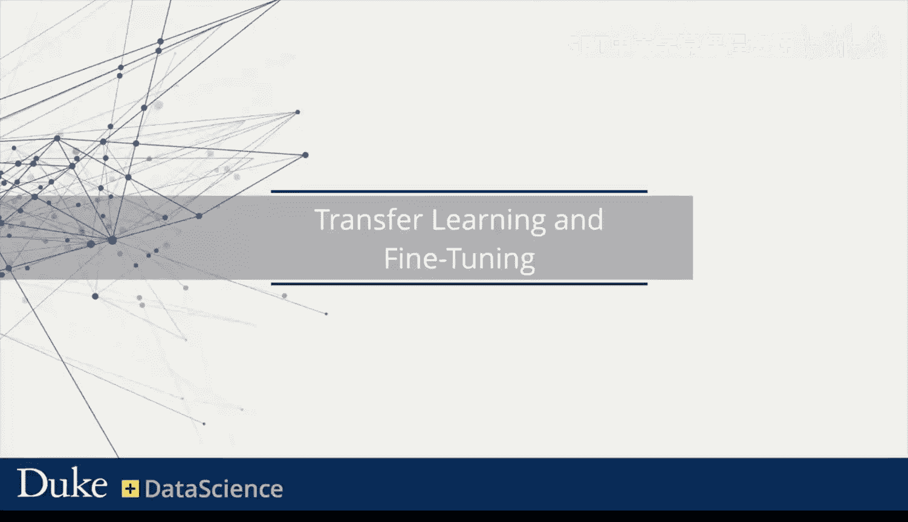
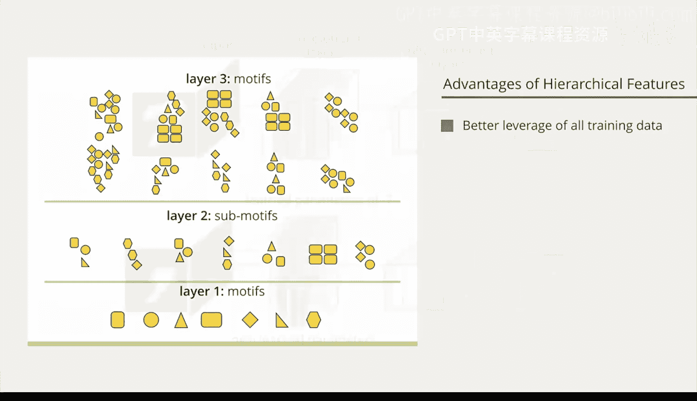
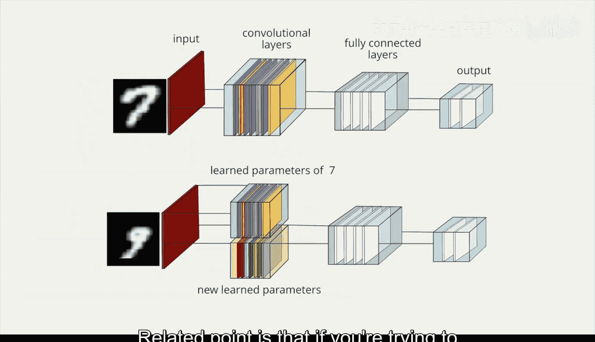
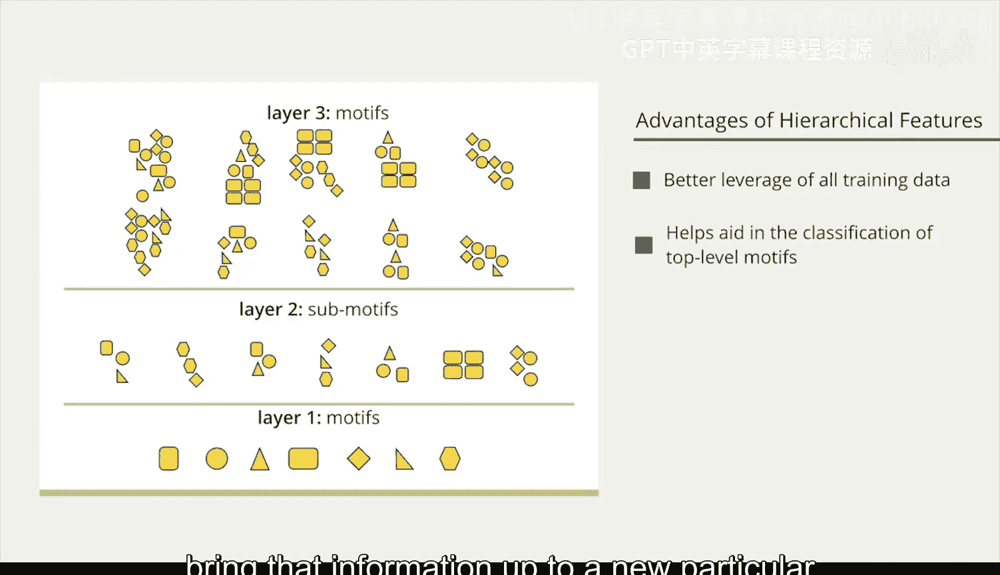
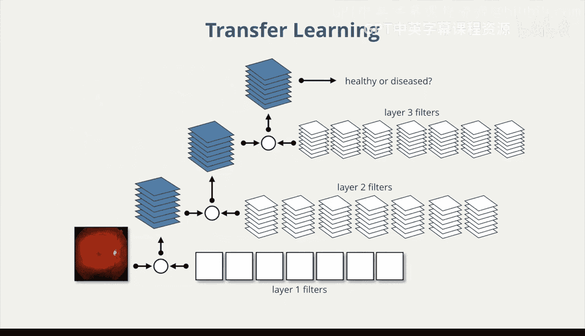
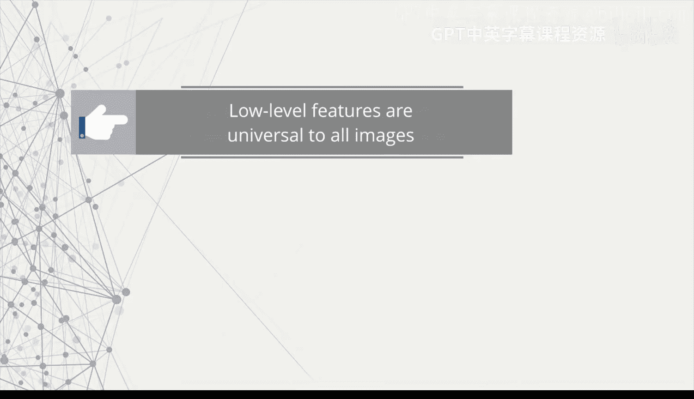
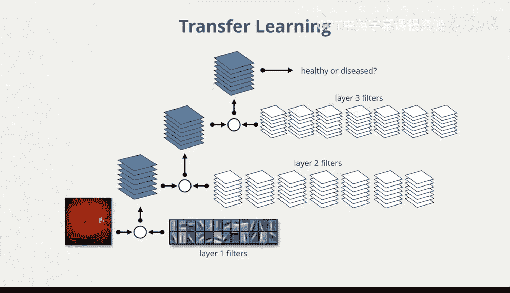
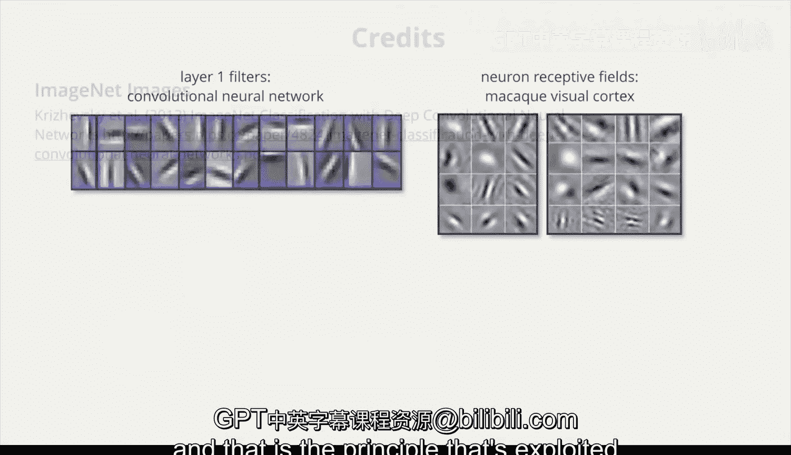

# 杜克大学《机器学习｜Introduction to Machine Learning》中英字幕 p36 36_03_02_迁移学习与微调.zh_en -BV1yjvdBQEaU_p36-

What is the advantage of having this hierarchical representation of image features？

That the convolutional neural network extracts in sequence。

Well， one big advantage is that by learning and sharing statistical similarity is within。

The high level pieces of the image within these high level motifs。

 we better leverage all the training data。 and what does that mean。That means that。

If you're doing， let's say an Ms class， building an Ms classification system。

 where you want to distinguish a 9 from a 7。Because the9 has low level elements that the7 also has。

 you can learn a little bit about the building blocks of the 9 from looking at the7 right so across the entire training set。

 you can learn a lot from the other examples to help you classify the example of interest。 Okay。

 so that's very powerful。A related point is that if you're trying to learn some high level filter on its own and reinventing the wheel。

Every single time， right， So having like a high level 7 feature， a high level 9 feature。

You don't when you bring in a new class that you might want to classify。

You don't get to use what you've learned about the low level features to aid you in building up a representation to help you identify and classify that new class。

 And that's a particularly powerful feature of the convolutional neural network。

 So being able to leverage what the network has learned at lower levels。

Bring that information up to a new particular application of the network。 Okay。

 and so what this is called is transfer learning。 And so I just want to go over this。

So in transfer learning， you take a network that's already been trained on a previous large database classification task。

So the image imagenet competition， for instance。And then you do additional training in the domain of interest。

 So for that diabetic retinopathy case。What happens is in the train neural network is that you take in an input image of a retina。

 Okay， that retina as image is digested and features are extracted throughout all the layers in the network。

 And then there's a classification decision at the top whether or not the retina is healthy or diseased。

 It turns out that。In this paper and most papers of this kind。They use pre initialitialized weights。

From a network that' been trained on the imagenet data and has drastically increases and improves performance。

The reason why is that the top level features， sometimes just in the classifier。

 those fully connected layers， those are the ones that are highly specialized for particular task。

 or for particular domain。But the low level features， right。

 these layer with these elementary building blocks are universal to all images。

 And so once you've learned them。From from a large data set。

 you don't need to necessarily learn them again because the retina image has low-le building blocks that are also reused in images of cats and of cars。

 etc cetera。 So you can speed up the entire training process by reusing a network by transferring what another network has learned on a different image a classification task to the classification task of interest。

 And that's called transfer learning。

Right， and so just to hammer this point home。 So the the low level features are universal to all images。

 And so on the left， I want to show you layer when filters from a convolutional neural network。

 So these are little edge detectors that are extracting edges at different orientations。 Okay。

 you see very similar receptive fields， or image features that activate single neurons in a real monkey visual cortex here on the right。

 Okay， so。😊。

A real mammalian visual system is also extracting these low level patterns to build up its own representation。

To proceed to， to build up a perception of the of the real world in a biological brain。 Okay。

 so there's， there's something very。Elemental and fundamental about these particular low level future extractors。

As you can see here and that is the principle that's that's。

That's exploited by this transfer learning process。

