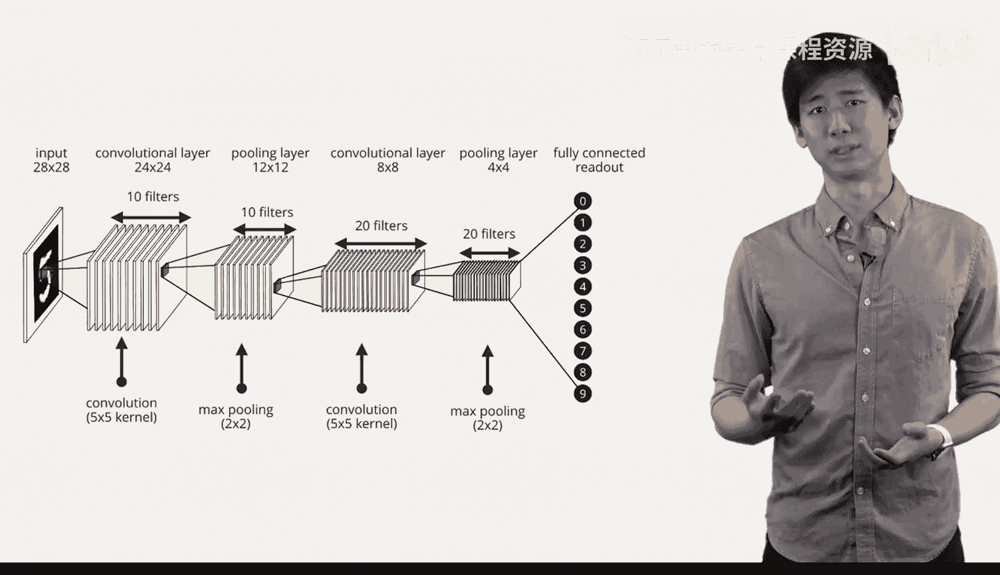

# 杜克大学《机器学习｜Introduction to Machine Learning》中英字幕 p37 37_03_01_使用PyTorch实现CNN.zh_en -BV1yjvdBQEaU_p37-

Computer visionsion is a domain where deep learning has achieved some of its biggest successes。

 with convolutional neural networks， commonly abbreviated SCNNs。

 constituting a major part of virtually every state of the art vision model。In this section。

 you'll get to see the major building blocks of a CNN in Pytororch。Finally。

 we'll take a brief look at Torch Vision， Py Torch's Vision Library with Torch Vision。

 we can easily load many of the state of the art CNNNs and the pretrained weights to use in your own applications。

For the assignment， you'll be building your own scenen。

You should see a slight increase in performance for the CNN versus a multi perceptron。

Play around with our architecture and see what you can achieve。

