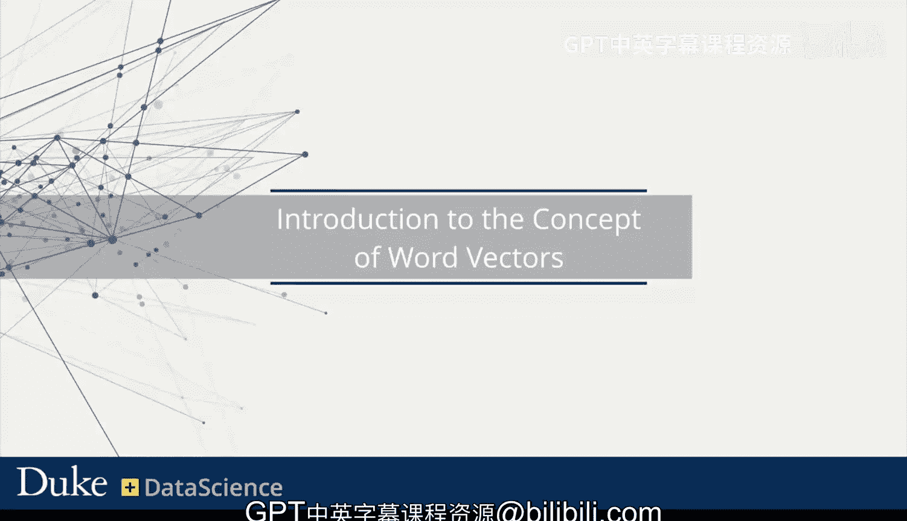
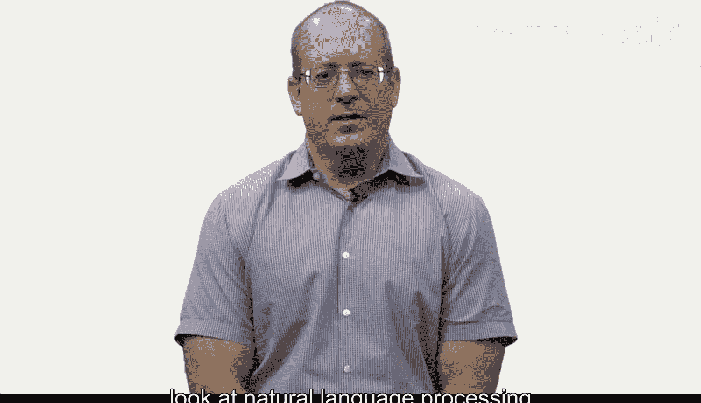
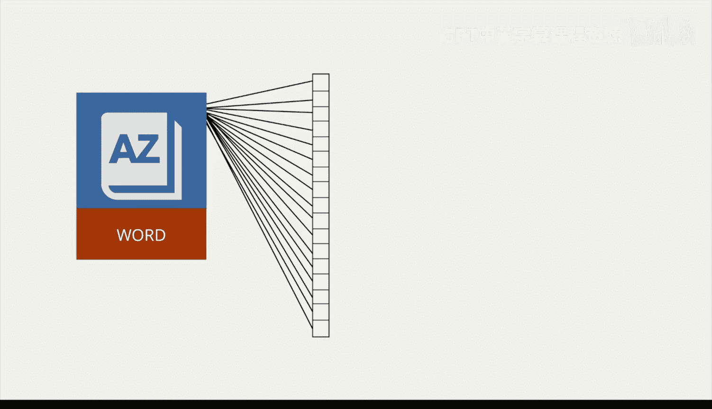
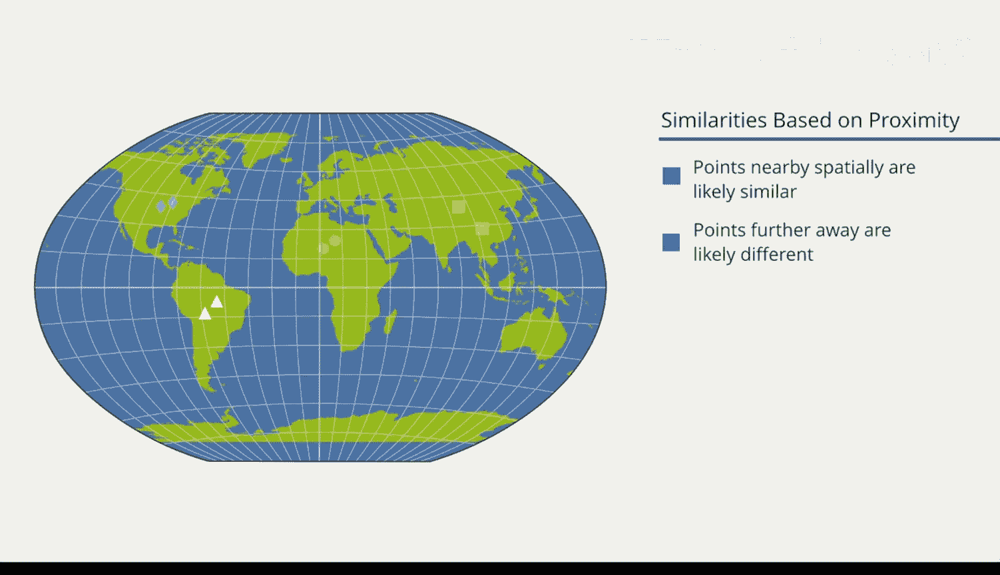
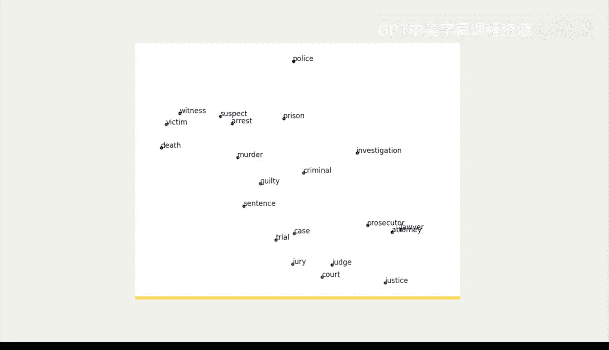
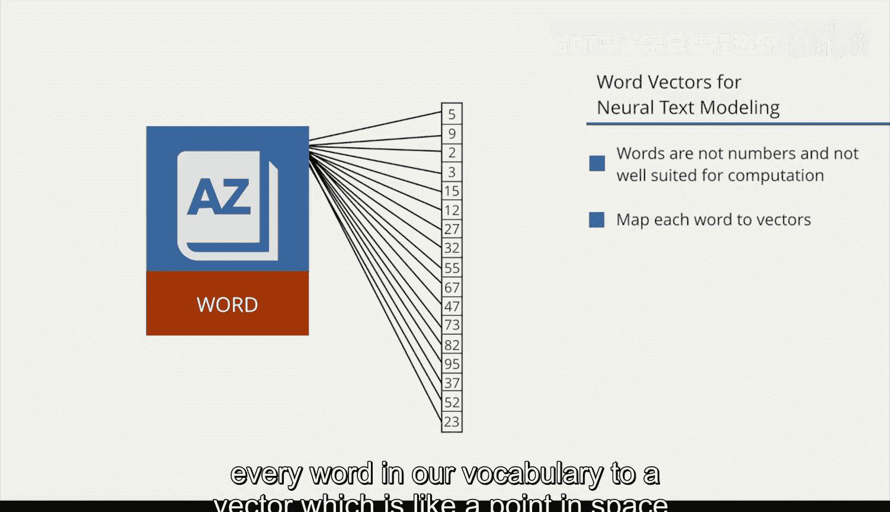
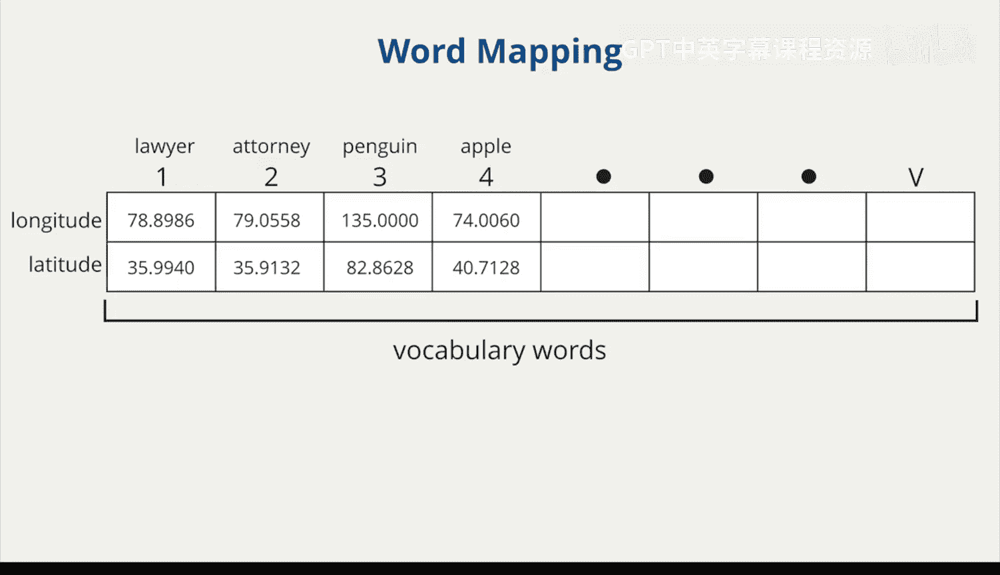

# 杜克大学《机器学习｜Introduction to Machine Learning》中英字幕 p38 38_04_01_词向量概念介绍.zh_en -BV1yjvdBQEaU_p38-

So as we now start to look at。Natural language processing， particularly。

With neural class models， one of the key concepts。That we're going to repeatedly utilize is this concept of word vectors。

 So what this means is is that every word。

In our vocabulary is going to be mapped to a vector。

And then we will do our analysis of natural language in the context of these word vectors。

 This is a fairly novel and perhaps unusual concept。

 And so before we dive too deep into the natural language processing。

I think itd be worthwhile to spend a little time just to get some deeper preparation or understanding for what we mean by word vectors。

So to try to understand this， let's just think about a map。

Of the globe。And so what I'm showing on this map are several different symbols。Squares， triangles。

 et cea。And the thing that I want to communicate。Through this， through those symbols is the idea。

That if two points。On the globe。or on this map are physically near by each other。

 so if two points on the globe are near by each other。

 we would expect that the characteristics of the associated regions are similar so for example you see the triangles in South America are near each other where the squares near Asia are near each other and so the idea is is that the regions。

Characerized by the two triangles， since they are physically near each other。

 we would expect that the characteristics of perhaps the people， the geography， the history。

 etc cetera， of the two triangles would be similar to each other and the squares。

Since they are physically proximate， would be similar to each other。

But very different from the regions characterized by the triangles。

 And so the concept here is that we can think about the globe。

As a break a breakdown into longitude and and latitude， two numbers， longitude and latitude。

 So we can think about this as a two dimensional space。

If two points in that space have similar longitude and latitude。

 we would expect that those regions on the globe are similar if the associated longitude and latitude of two points is very different。

 we would expect those regions to be different， so we have a concept of similarity manifested through proximity。

And so the way that we could think of this is that we're going to do a similar type of concept with words。

 so every word in our vocabulary is going to be mapped to a point in a 2D space。

And that the closer two words are in that mapping or in that twodimensal space。

 the more related or synonymous we would think the words are。

 the further apart two words are in this 2D space， the more dissimilar we would expect the words to be。

And so conceptually， this is purely conceptually， we could think of a situation where we have a vocabulary of V words。

 so we have word one， word two， word3。All the way up toward V。And then we can think about。Rapmapp。

Every word to a two dimensional space in longitude and latitude or lounge in la。

 analogous to the way that we were thinking about the globe。

And so the way that we would like to do this is that we would like to learn these twodial vectors of the words in such a way that if two words are similar or synonymous or related to each other。

 we would want their associated longitude and latitude positions to be near each other。

 if two words are very dissimilar or unrelated， we would like them to be far apart in longitude in latitude。

And this is the basic concept in the geography of this word vector or it called word to vector。

 so this is very difficult to read but if you look closely at the screen。

 you will see that every point in this twodisional space corresponds to a word and the words are actually written here and if you look closely you will see that words that are nearby each other are related and words that are far apart are not related。

And so the key- and this is a closer look， so this is now zooming in on that prior slide。

 and so that you can see that there is a relationship or a connection between words based upon their physical proximity。

And so this concept of mapping words to vectors is fundamental。

To how we're going to do the modeling of natural language。

 So the key thing to think about is that words are not numbers。 They're not in the form of numbers。

 And so whenever we do modeling。Of language， natural language。

 that modeling is usually done in terms of algorithms。

 and those algorithms like to work in terms of numbers。 And so therefore。

 what we need to achieve is a mapping。Of each word map to numbers。

 and then once we have achieved that。We can then do analysis and so the way that we're going to do this is that we're going to map or relate every word in our vocabulary to a vector which is like a point in space however and to motivate the concept we thought about two dimensional space much as we would think about the longitude and latitude of of the globe。

 but that is purely just conceptual to help one understand it in practice we do not limit ourselves to two dimensional vectors and so each word is represented by a vector that vector may be more than two dimensions。

 so in fact typically is larger than two dimensionmenal and the idea is is that when words are similar they should be nearby each other in this vector space whenever they are unrelated they should be far apart from each other in this vector space。

Within the context of learning。We are going to learn that we're going to learn the mapping of every word to a vector。

 So when we talk about natural language processing modeling。

 one of the key aspects of this is going to be learning the mapping of every word to a vector and and subsequently in our discussions。

 we will describe many different ways of doing that。 there are many ways that that can be achieved。

 So I underscore that we will learn how to achieve this word to vector mapping。 And as I said。

 this is not restricted to two dimensionmensional vectors。

 So usually the vectors will be larger than two dimensions larger than the two dimensionmensal。

 So in this discussion， all we wanted to do。

Wass to introduce this concept of mapping each word to a vector。

 and so in the subsequent discussions we're going to describe how that will be achieved。

 actually using many of the tools that we already know。

But before we get into those technical details， in this lesson。

 we wanted to first just introduce the concept of mapping words to vectors and so now as we move forward。

 we'll see how to achieve that mapping and then how we utilize it in natural language processing。

