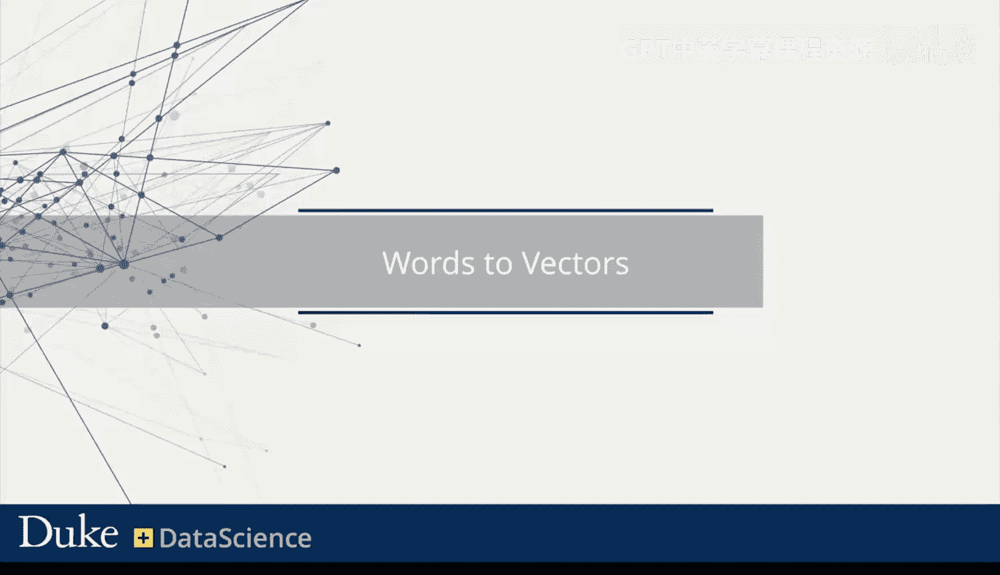
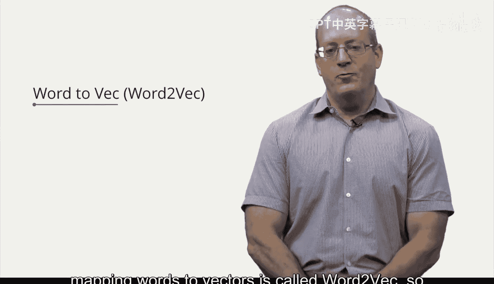
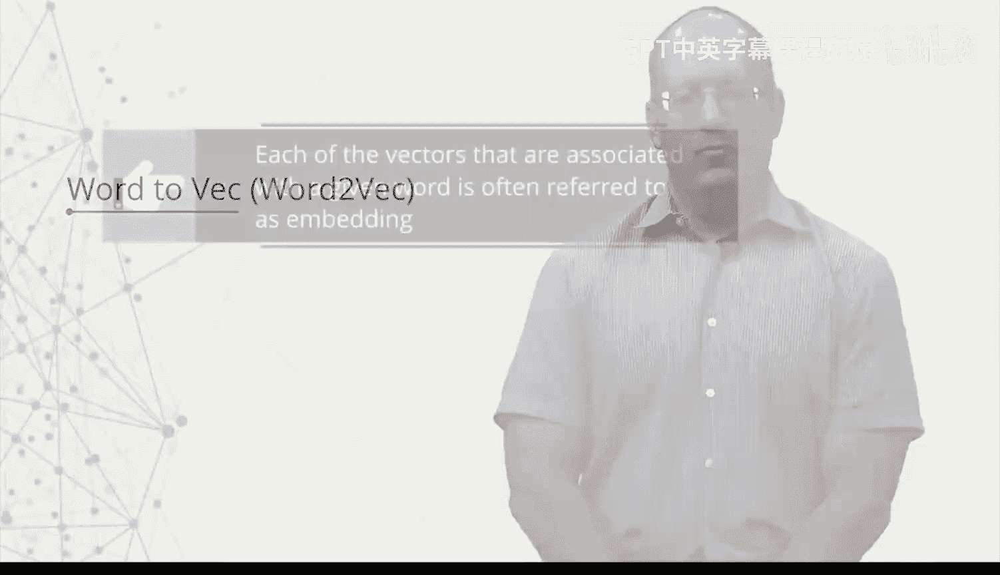
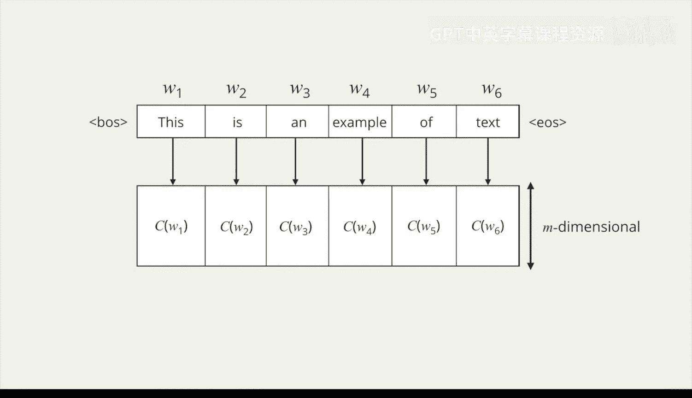
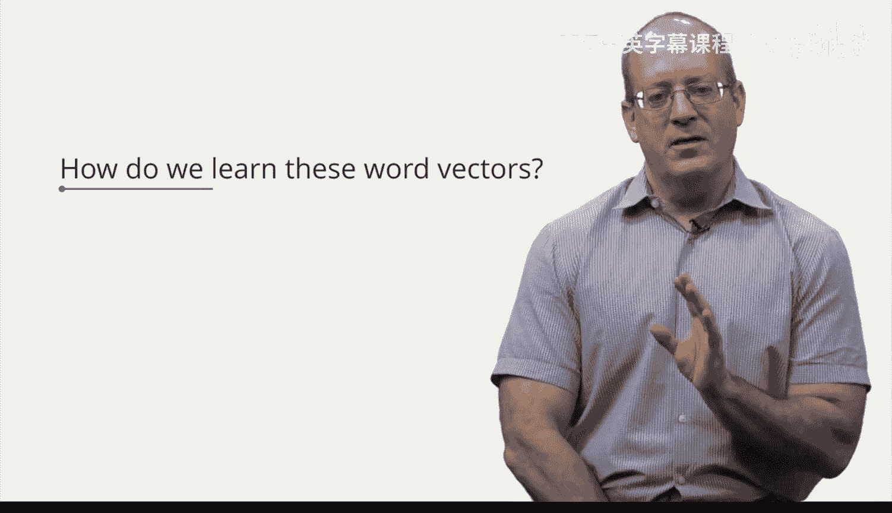
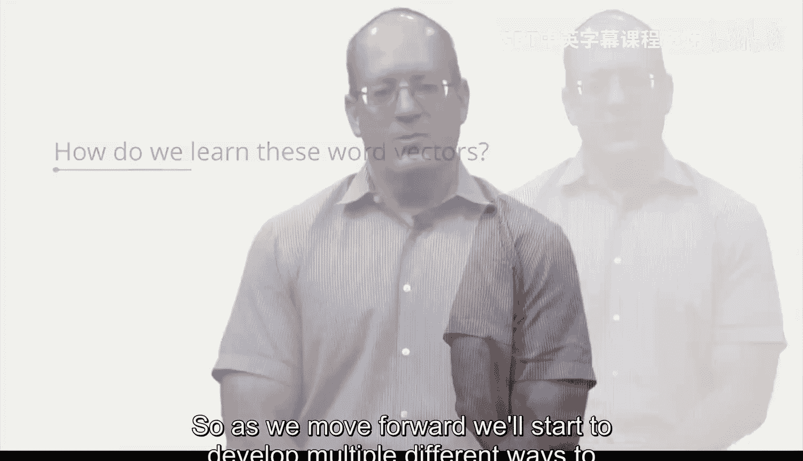

# 杜克大学《机器学习｜Introduction to Machine Learning》中英字幕 p39 39_04_02_从词到向量.zh_en -BV1yjvdBQEaU_p39-

So we've introduced the idea。Of mapping every word。To a vector。

And I just want to underscore that we really have to do something like this because words。

Are composed of letters or phomes， they are not numbers and to do analysis on a computer or with an algorithm。

 we have to have a way of mapping words to numbers with which we can analyze and so this concept of mapping every word to a vector is fundamental。

 So now what we would like to do is to look at this a little bit more deeply and provide some more details on this concept。

And so this idea of modeling words or mapping words to vectors is called word to V， so very natural。

 and so very widely termed word to V， each of those vectors。

That is associated with a given word is often sometimes called an embedding so this is just purely to introduce jargon or nomenclature that you might see as you read about this concept so the idea of mapping every word to a vector is related to the concept of mapping every word to an embedding and what this means is the idea of an embedding is to embed the word in some feature space so we think back to the globe。

 the picture of the map that we looked at previously that's a two-dimensional space and we're going to in that case take every word and embed it in a two-dimensional space so sometimes this word to vector concept is also sometimes called an embedding so let's let W subi correspond to a word so。

It just represents a particular word， it's just a symbol to represent a word。

 and let's let WI represent theIthe word in our vocabulary。And so the idea of this word embedding。

Is that we're going to take？That word， the Ih word and map it to in this case in M dimensional vector。

 so that's M numbers in the simple two dimensionmensal case where we were looking at the globe and a map M was equal to two but we do not have to restrict ourselves to that so typically M might be 100 or 200 it depends upon the problem we're trying to solve So the key idea in this word tove concept。

 mapping every word to a vector or achieving a so-called embedding is that we're going to map each word to an m dimensional vector。

 the value of M which means the dimensionality of that vector is dependent upon the particular problem that we choose and we can choose different values of M。

 so to think about this conceptually imagine that we have a vocabulary which is composed of V words。

And so W1 represents word 1。W2 represents word2 through WV， which represents the V word。

 this is our vocabulary。Whenever we do this word to Vc concept。

 what we're going to achieve is a mapping from every word in our vocabulary。

 W1 through WV is going to be mapped to a vector， which we'll call vector 1 will be C1。

 C1 is the vector associated with word1， C2。Is the vector associated with word2。

 etc ce these each of these vectors is m dimensional。

 so this is what we're going to achieve with the word to V concept Now at this point it's not clear how we would actually achieve this。

 how we would actually learn this relationship， we will consider that subsequently。

 but right now we're just trying to introduce the concept。

And so what we're going to do then is after we do this learning， we manifest what we call a codebook。

 which is a set of V vectors associated with each of the V words in our。In our vocabulary。

So each vector CI is associated with the wordWI and then the thing that we hope to achieve is that if two words are similar to each other。

 synonymous or related to each other， we want those words to have vectors that are similar or nearby each other in this M dimensionmensal space。

 and then we're going to learn。Those vectors c1 through CV。Based upon a large corpus of text。

 and so the idea through this learning process is to achieve this concept of proximity in this M dimensional vector space is connected to relatedness of the associated words。

So to give a little bit of an example。Consider the situation for which we have six words。

 so this is an example of text。typicallypically we consider a what we call BOS。

 which is beginning of sentence， we have a token， which represents the beginning of sentence。

 and then we have another token which represents the end of sentence just so that the natural language model knows when the sentence starts and when the sentence ends and then each whenever we have a situation in which we have in this case six words。

 those six words which are members of a vocabulary are now mapped to six codes where CW sub1 corresponds to the code for the first word and CW sub6 corresponds to the code for the six word in this example。

 and so once we have achieved this mapping where we can take the words。

 the actual words of a vocabulary and map them into numbers which are represented in this case。

By six m dimensional vectors， which of course are composed of numbers。

 once we have achieved this mapping， we're now prepared to do analysis on a computer。

Because now it's ready for mathematics。

So the question now that we need to think about is how would we actually learn these word vectors。

 how do we learn these word vectors such that they allow us to do the natural language processing which is our goal so as we move forward we'll start to develop multiple different ways to do this so in fact there's not one way to learn how to do this there's not one way to learn the relationship between words and vectors。

 there are multiple ways and these often they perform the multiple different ways often yield very similar results and so this is important because it implies that this concept is very robust it's not that dependent upon the particular methodology you use there are multiple methodologies that yield very effective results and so now as we step forward we'll start to dive in to the techniques to learn。

Word embeddings。