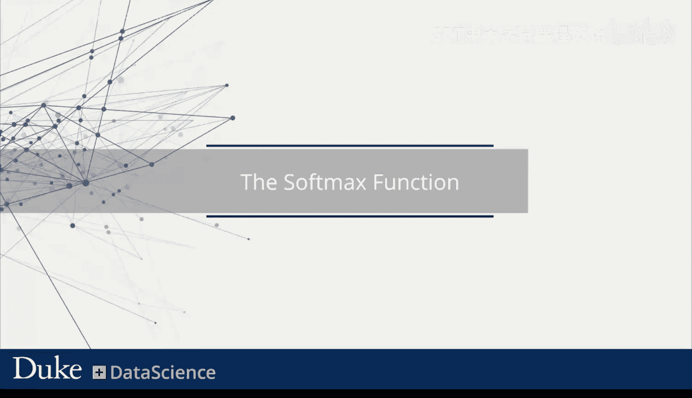
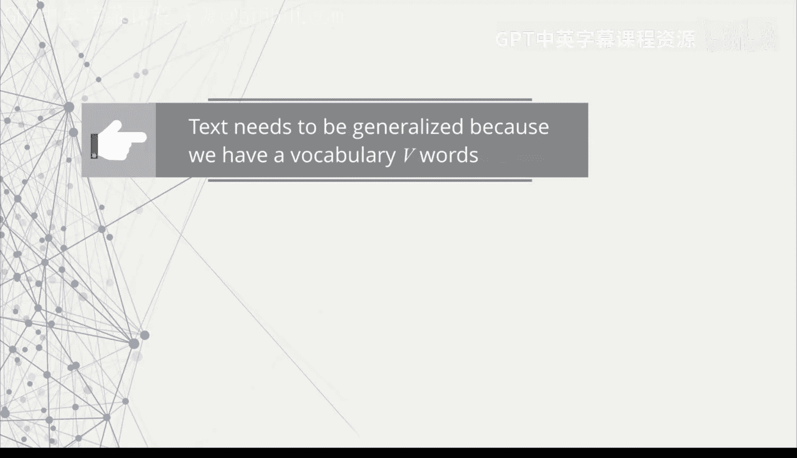
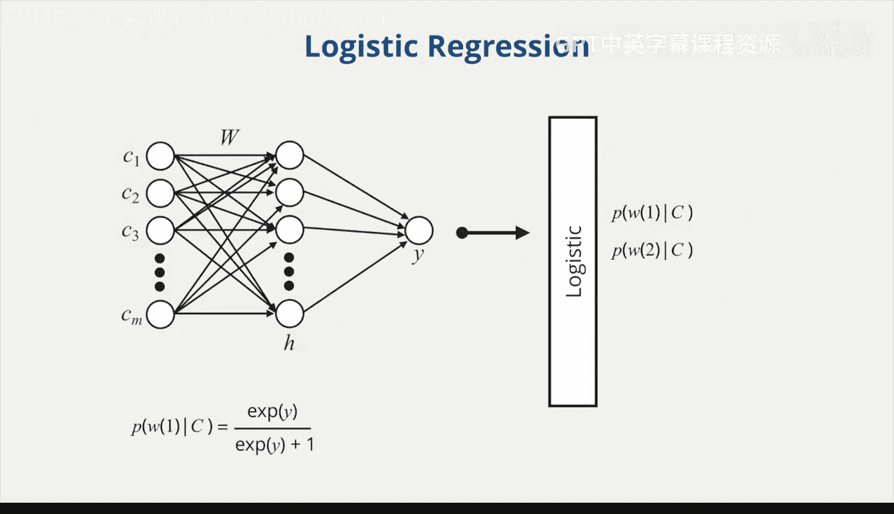
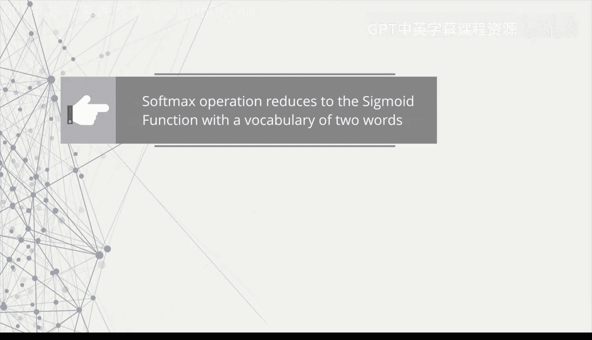
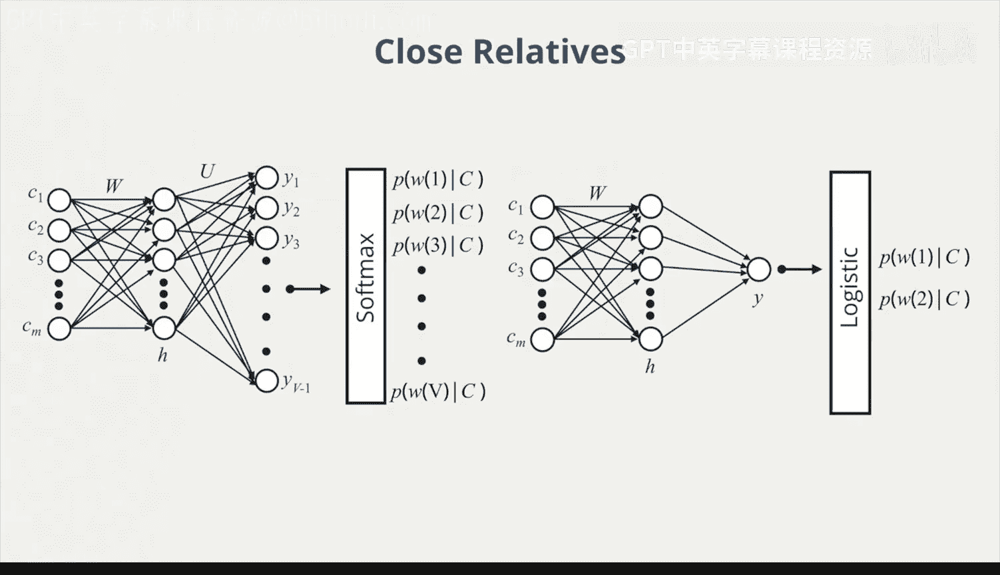

# 杜克大学《机器学习｜Introduction to Machine Learning》中英字幕 p42 42_04_02_Softmax函数.zh_en -BV1yjvdBQEaU_p42-

So in the previous lesson。We introduce this concept。Of a neural model of text。

And that neural model of text leveraged。The multi layer perceptron that we have studied previously。

However， within the context of our model of text。We introduced this new function called the softftmax。

 which we had previously not seen before in our discussion of the multi layer perceptron。

So this is a new tool， the softftmax， and it's probably worthwhile to take a few moments to talk about it and also to connect it to what we have done previously。

 you recall that when we introduced the logistic regression and when we originally introduced the multilay perceptron。

 we were talking about binary outcomes two dimensional outcomes。

With the text， we have to generalize that because we do not have just two words。

 we have a vocabulary of V words， and so we have to ask the question。

 what is the probability of the possible outcomes， not just binary outcome and the softm function allows us to do that。

However， I want to highlight that this softm function is not really that different conceptually from the logistic function that we looked at previously for binary outcomes。

 in fact， it is a generalization。

So here again is our model， our neural model of text， so just to remind you。

 we have a word which is represented by the Mdimenal vector C1 through CM。

 so what we're doing is we're taking a word and we're mapping it to a vector in that vector is represented by the M components C1 through CM W are the weights that give us the mapping from that input vector to our hidden units H in U is a matrix of weights that gives us the mapping from the hidden units H to the V minus1 outputs at the top or at the end of our neural network。

 and then those weights y1 y2 through y V minus1 are send through that function at the bottom which is called the softm。

 so this may look complicated it looks like something you know doesn't look like what we have seen。

Previously， that's called the softm， we're going to see in a moment that actually it's not as exotic as it might appear。

So with that softmax， we can then quantify the probability that word 1， word 2， word 3， word V。

 and our vocabulary， the probability that each of those V words would be in the proximity of the input word and the way that we're going to do this learning is by looking at text so with actual documents we will know the word and we'll know the words around it。

 so we'll know what the truth is and what we would like to do is to learn a model with this neural model of text。

 which is characterized by weight parameters W。NU and also the word vectors， the C vectors。

 those altogether together constitute our neural model of text。

And so what I want to do is to spend a few moments talking about the equation at the bottom thats softm。

So recall the softm and I just put it here again just for simplicity。

And let's remind ourselves that the way that we set up this offm is that we set y sub V。

Corresponding to the Vith word in our in our corpus， we the V word in in our vocabulary。

 we set that equal to0。 And so the softm is the equation at the bottom。 So I was just rewriting this。

 Let's consider the case in which we had a vocabulary。And that was composed of only two words。

 So imagine a very simple vocabulary where that was only composed of two words。

Under that circumstance。That。Arguably complicated equation at the top simplifies considerably。

 so we only have two output words， W1 and W2。And the probability of the first word， W1。

 given the code C。Is the logistic function or the sigmoid function。

 sigma y1 and the probability of word2 is 1 minus sigmoid to y1。

 which is one over exponential y1 plus1。 And so consequently， if we look at our neural model of text。

 in many ways， it's just a generalization of the logistic model。 So this is our neural model of text。

And this is the special case of that model when we have two words。

 and so the thing to notice is is that in many ways。

 this softmax operation is a generalization of the logistic function or the sigmoid function。

To the case in which we have a vocabulary of V words instead of just two words。

 but in the case of two words this directly reduces to the sigmoid function or well the sigmoid function that we're familiar with and so therefore we can think of the softmax which is introduced new here in the context of neural modeling of text and we look at the logistic regression that we are much more familiar with these are actually very close relatives they're actually intimately related and so the softm operation is simply a generalization of the of the logistic link function and so it will take a little bit of time to get comfortable or familiar with this softmax function but actually it is not a very fundamentally different concept from the logistic。

Regression concept that we already have and so now that we have the tools of this neural model of text with the softm。

 which is a generalization of the logistic function， we're now prepared to ask the question。

 how can we use this model to learn the word vectors。

 and then also simultaneously to learn the parameters W and U associated with the multilayer perceptron model of text。

 we're going to learn all of those together using a text corpus as we move forward in our lessons？

