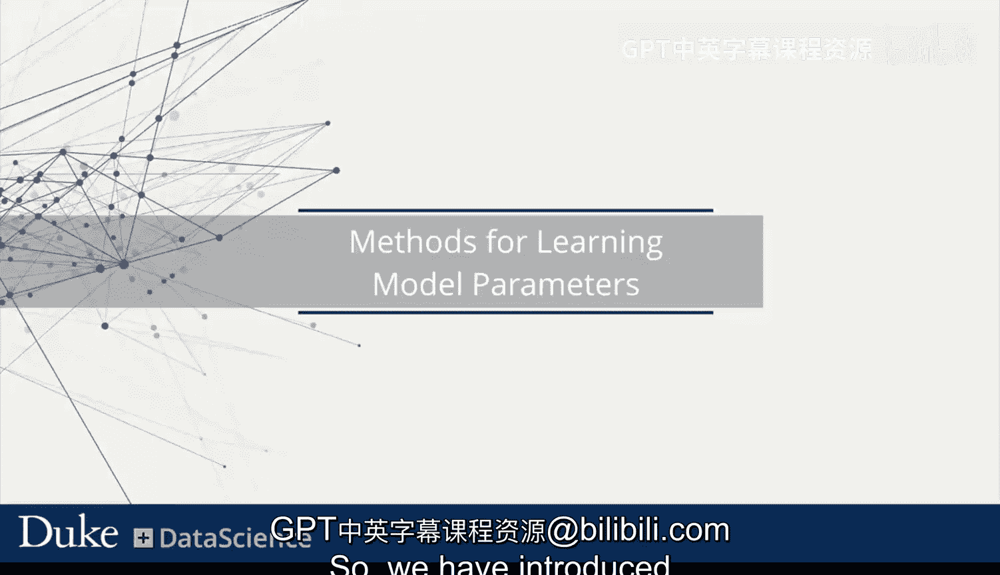
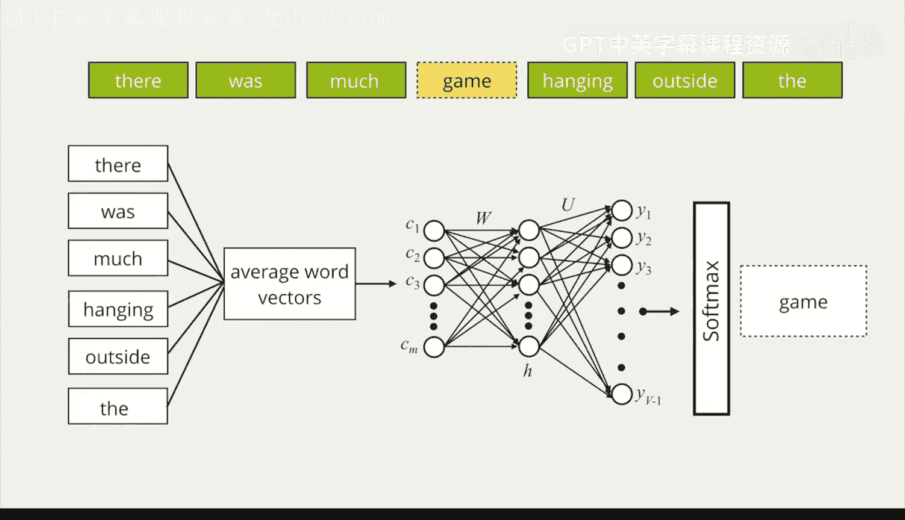
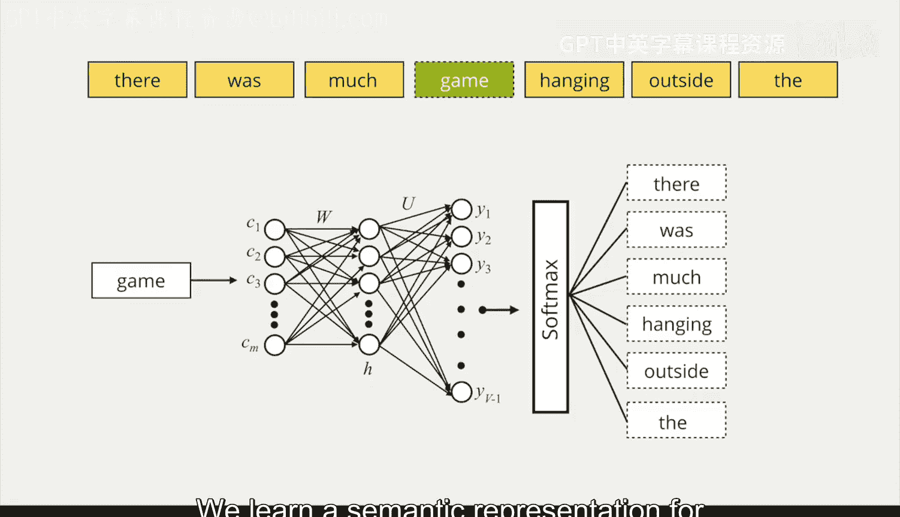
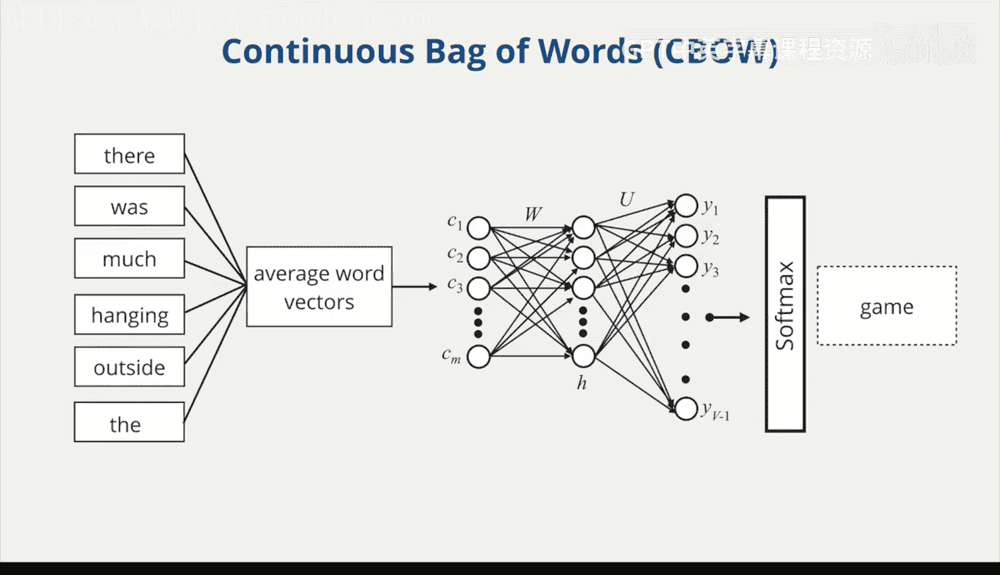
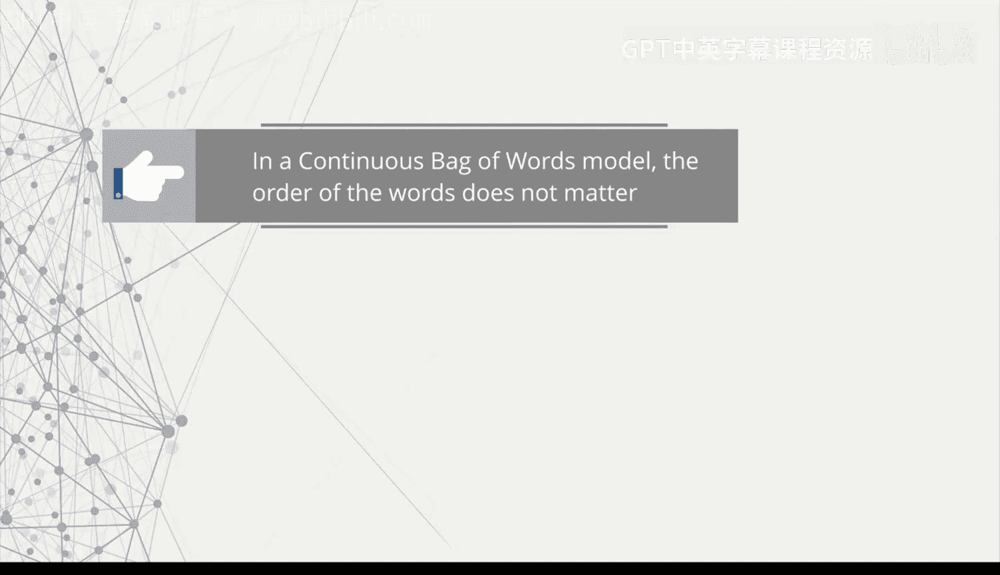
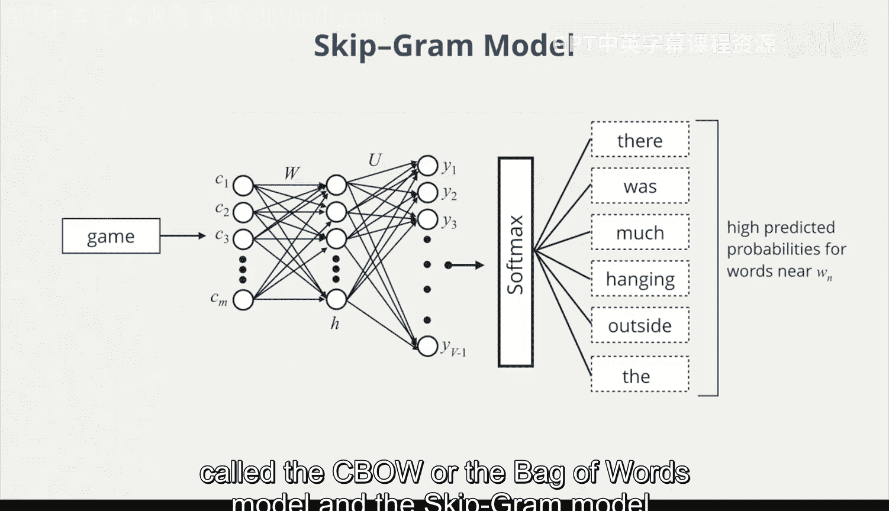
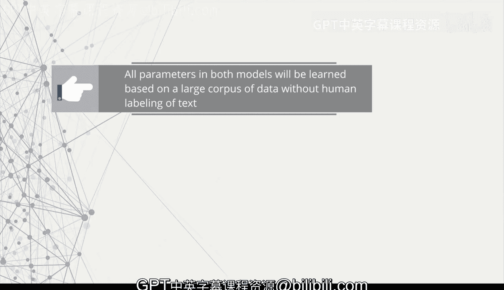

# 杜克大学《机器学习｜Introduction to Machine Learning》中英字幕 p43 43_04_03_模型参数学习方法.zh_en -BV1yjvdBQEaU_p43-

So we have introduced the concept。Of mapping each word in our vocabulary to a vector。

 where a vector is just a set of numbers。 And so every word in the vocabulary is mapped。to a vector。

 and so consequently every document， which is a series of words。

 is represented by a series of vectors and once we have that representation of a document in terms of vectors and numbers who are then prepared to do analysis。

But before we look into that analysis， the open question is how do we learn the word embedding or those word vectors themselves。

 and so we're going to spend a little time focusing on that。

 It turns out that there are many different ways to learn these word vectors and so we're going to go through several of these。

 so this is a very active area of research and continues to this day。

But there are several methods that are now widely used。

So let's let's try to see how this might be done。 So imagine a situation for which you have a document。

 the document is composed of a set of words。 and so let's imagine word N in a document。

 and what we would like to do is to predict。

What word n will be based upon the words in the neighborhood of it。 so。

 for example we might wish to predict what word n is based upon what word n minus2 n minus1 n plus1 and n plus2 are and so these are the two words before and the two words after word n and so what we'd like to do is to build a model that is capable of predicting what the n word is here based upon the two words before and the two words after and so what we're going to do is with understanding that our goal is to map each word to a vector what we're going to do is we're going to assume that we have the vectors。

Corresponding to the four words on in the neighborhood of the anward。 So assume that we have。

The word vectors for the two words before and the two words after。

 what we're going to do is simply average those word vectors。

And then we're going to send that vector of M。Numbers， so we're assuming an M dimensional vector。

 So this is an M dimensional vector that is manifested after averaging。

The four words in the neighborhood of the nth word。

 and then we're going to send it through our familiar multilayer perceptron。

 which is characterized by parameters W and U， and then at the end of that multilayer perceptron we've talked about the concept of a softm in a softm is a way for which we can quantify the probability of each of the V words in a vocabulary。

 and so what we have now is a model which is going to take two words before two words after the nth word we're going to average the word vectors。

 assuming we know what they are， those are going to be represented in terms of a code which is composed of the components C1 through C。

We send that to a multi layerer perceptron， and then at the end of that multi layerer perceptron。

 it goes through a softm， which tells us the probability that word n is each of the V possible words in our vocabulary。

And so this now allows us to build a predictive model for the probability of which word is our n word。

And so to give some more clarity on this， this is a piece of text that was written by Ernest Hemingway。

And what we're looking at is a situation now where I have a neighborhood of words in green。

 three words before and three words after， and what we would like to do is to predict the presence of the word game based upon the words there was much hanging outside du and so using our model we have the words there was much before and hanging outside D after we assume that each of those words is mapped to a vector。

 we average those vectors。 we then from that average get a single vector which has M components that we represent as c1 through C those components or those numbers are then sent through a multilayer perceptron at the top of that multilayer perceptron is a softm that tells us the probability of each of the V words in our vocabulary being the missing word here game and then what we would like。

ToDo is to build a model such that the parameters of the model。

 which are characterized by the parameters of the multilay perceptron。

 as well as the word vectors yield good predictions。 In other words。

 we want our model to be good in this case at predicting game as the missing word。

 If we can do this well effectively， we will have learned very good vector representations for each word。

 So for this to work， we have to learn good representation of each word in terms of a vector and that indeed。

 is our goal。

Another approach， which is kind of the complement is let's assume that the nth word is giving to us。

 and let's assume that the n word is represented by the vector with components C1 through CM we again send this vector through a multilayer perceptron at the top of the multi layerer perceptron again is the softm。

 and then now what we would like to do is predict via the softm。

That which words are in this case are two words prior to the n word and two words after。

 And so what we want our model to do is to understand what the n word is and then to be able to predict。

In this case， what the two words prior to and after the n word is。

 if we can build a model again that does this well。

 then implicitly we have learned good vector representations for every word， which is our goal。

AndSo again， to give some clarity on this， so in this case。

 the wordga is the input sent through the multi layer perceptron。At the top of which is this softmax。

 which tells us the probability of each of the V words。

 and we would like the model to understand or to predict that if the word game is present that then the words there was much hanging outside the that those are all words that are consistent with the word game and by doing this we effectively learn via the word vectors。

 we learn a semantic representation for every word in terms of the word vectors。

 So now to provide a little bit more details on this。 So this model。

 which is the first one I talked about is called a continuous bag of word model So continuous bag of words So Cbo and the reason it's called a bag of word model is because it actually really doesn't matter what the order of the words there was much hanging outside the because if if you。

Think about it。 what we're doing is we're taking those words and we're simply averaging them and then sending them into the multilayer perceptron。

 So therefore， the order is irrelevant。 And so when the order doesn't matter。

 it's kind of like taking the words and throwing them them in a bag。

 It doesn't really matter what the order is。 So this is in the nomenclature is called a bag of word model the other model this is called a skip gram here where we're looking at the word game and we're trying to pick the words around it。

 So this is called a skipgramm。 So the two models that we're talking about。

 which are two of the simplest are called the CBbo or the bag of words model and the skip gram model。

In both cases， what we're trying to learn are the set of vectors for each of the words which are represented by the matrix C。

 so the matrix C is the set of all vectors for every word in our vocabulary。

 we use the notation C because we think of this as a code。

 this is a codebook for all of the words in our vocabulary。

 and then we also would like to learn the parameters W and U of our multilab perceptron and their corresponding biases B and beta。

And so all of the parameters in this model。Either the skipcram model or the CBB model are going to be learned based upon a large corpus of data。

 The thing to notice about this or to think about is that we can learn this model based upon the text itself。

 We don't need any human labeling of the meaning of the text。

 We can just take the text and buy it via the skipcraram or CB model。

 we can directly learn these word vectors。

