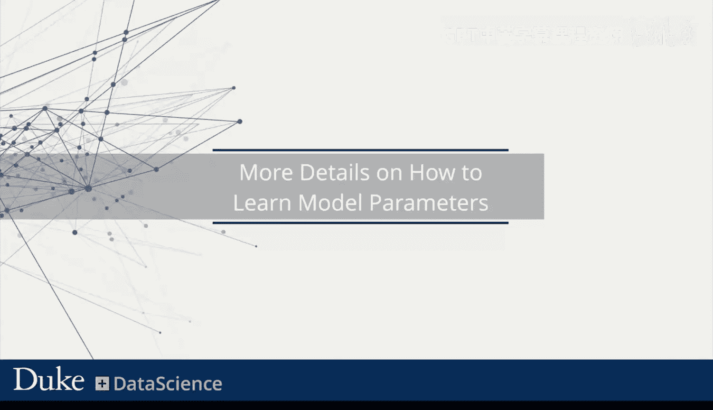
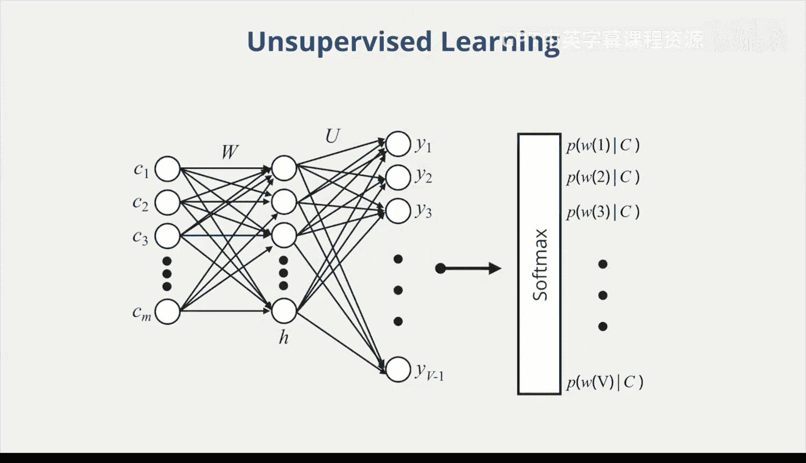
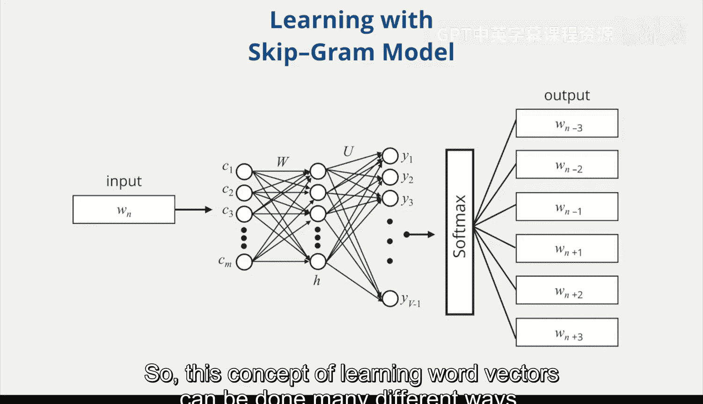
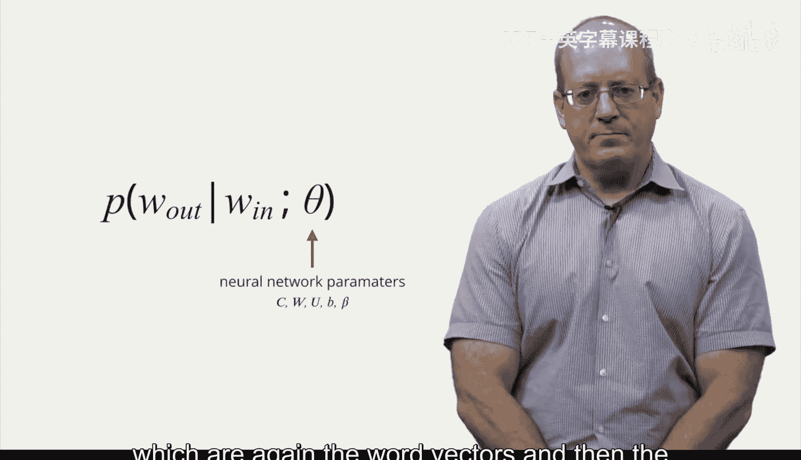
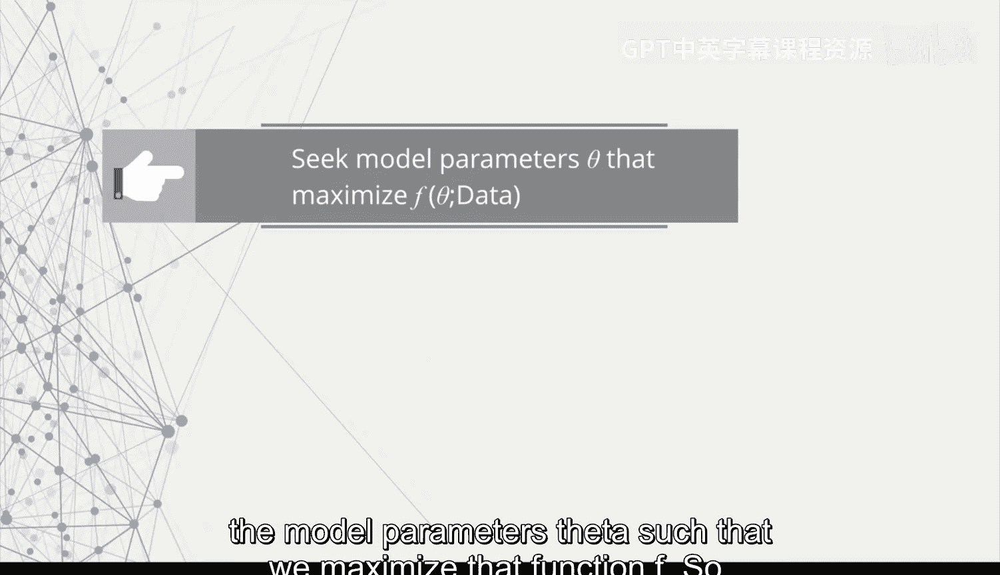

# 杜克大学《机器学习｜Introduction to Machine Learning》中英字幕 p44 44_04_04_模型参数学习细节.zh_en -BV1yjvdBQEaU_p44-

So now having introduced two of the simple forms of models for learning。

 the skip gram and the bag of Word model， I'd like to dive a little bit deeper into the concept of learning。

 So of course this whole subject is about machine learning and so we'd like to understand in more detail what that means So here our machine if we think about this as a machine learning。

 the machine is the algorithm or the model that we've developed for the text。

 which is here the principal concept is the idea of mapping each word to a vector。

And so now we want to dive a little bit deeper into what we mean by learning and so by learning what we mean is we're going to take a corpus of data So here a large set of documents and then based upon those documents we're going to try to learn the parameters of our model so this is called unsupervised learning and the reason that it's unsupervised is that what we mean is is that we're just going to take a corpus of documents and learn this predictive model we don't need any human to label the meaning of the documents and so the parameters of our model the model I want to emphasize and you'll see this repeatedly in different parts of the lectures or the lessons is this multilayer perceptron is a very fundamental concept So also called a neural network which is appearing in many places in what we're doing and we'll continue to appear in other aspects of the lessons and so the parameters that we seek to learn are the parameters of this。

So the model parameters are the set of vectors that represent each of the words which are represented by C。

 and then we have a set of parameters of the multilay perceptron represented by W and U and then based upon this softmax model。

 we can then predict based upon the input word C represented by C here。

 we can predict which of the V words are most likely to be present next。

 and that is represented via this softmax model。And so in this model we have an input and we have an output and what we would like to do is to build a model such that whenever we give the input here the input is represented by the vectors of the surrounding words。

 so here we have six surrounding words surrounding the nth word we're going to average the vectors associated with them。

 that will be our input， and then what we would like to do is to predict the output which is the presence of the nth word。

And so we could do this with the Sibo or the bag of words model。

 we can do this with the so-called skipcram model。 In both cases what we're trying to learn is basically the same thing。

 We're trying to learn the parameters of the multilayer perceptron and we're also trying to learn the word vectors。

 these two different models， the skipcram and the bag of word models are just two different ways of doing that。

 we will see other ways。 So this concept of learning word vectors can be done many different ways。

But no matter which way we use， our goal is to do is to do model learning。

 So now let's let's think about this a little more。

 So basically what we're trying to do is to predict the probability of words on the output。

 So if we think back to this softmax。And we think about this model， we think about to the right。

 what we're doing is that we have the probability of each of the V words based upon an input word C represented by the vector C。

And so this is a fundamental concept， whether we're using the bag of words or the skipcraram model。

 The parameters are represented by theta。 and so here。

 what we have is we have the probability of the output words represented by our neural network manifested via the softmax。

And then we have an input word which represents the contextual word or words。

That are defining the input to the neural network。 And then we're going to represent the input word or words by a vector。

 And then finally， we have parameters datata， which are， again。

The word vectors and then the parameters of the multilayop perceptron。

And so what we're assuming here when we do learning is that we assume that we're given M examples of pairs。

 and so if we look at the third line or the third bullet。

We're assuming that we have M examples in our corpus where for each example， the I example。

 we have an input W N W n， which is the input vector in the I means the I example and then W out is the output vector。

 again， the I examples， we have M of these examples。 this is what we call our training set M here。

 which is the number of examples if we think about the skip gram in the Cbo concept。

 this set of M examples of in and output can be manifested just by looking at a large corpus of documents and and in that setting。

 the number M， the number of examples can be quite large and then what we do is we set up something which is called a cost function and so then that's represented by F where F is is a function of the parameters theta。

And the data and the way that we represent this is simply the sum of the logs of those probabilities for all of the M examples。

 so that the last equation is simply the sum of the predictions of our models for all input output pairs in our training set and what we would like to do is to learn the parameters or seek the model parameters data。

 such that we maximize that function F。 And so if we can do this。

 and this is at the heart of the concept of learning if we can do this well。

 then that means that we have a model which is good at predicting the output words given the input words and here based upon M examples from our corpus。

