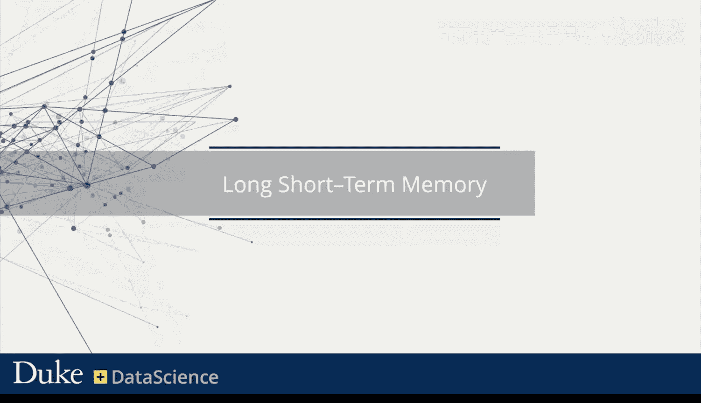
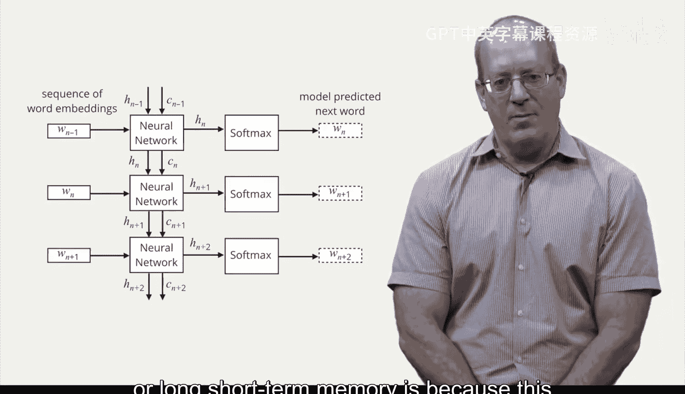
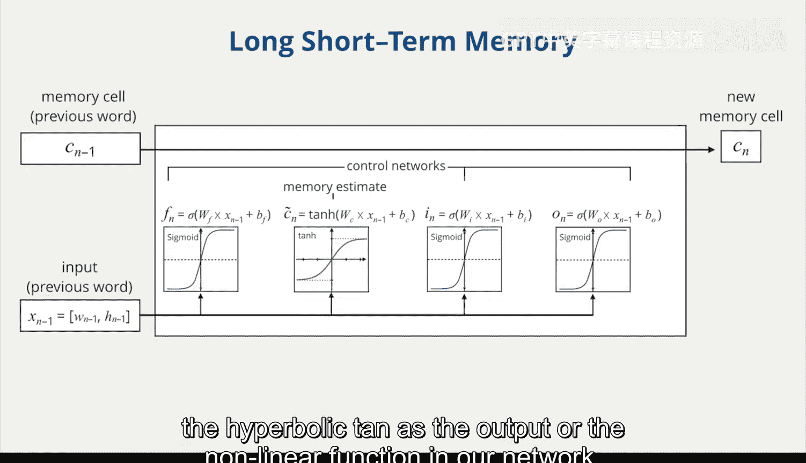
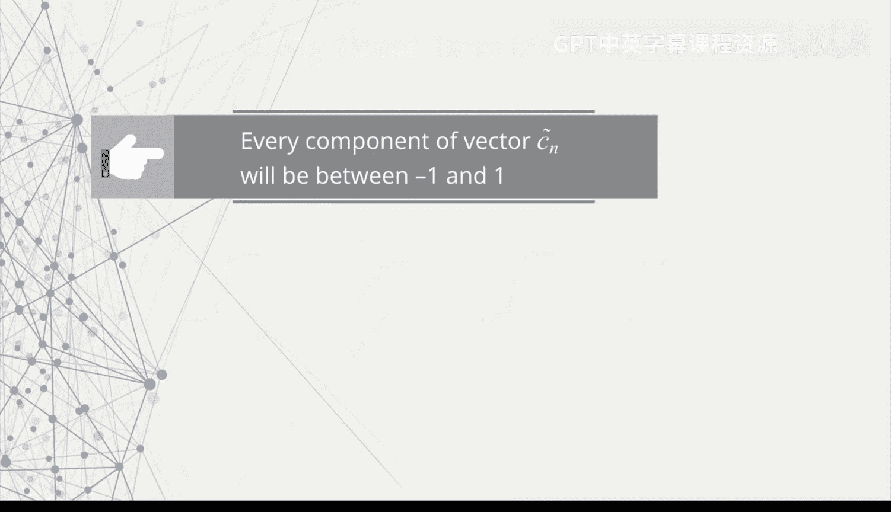
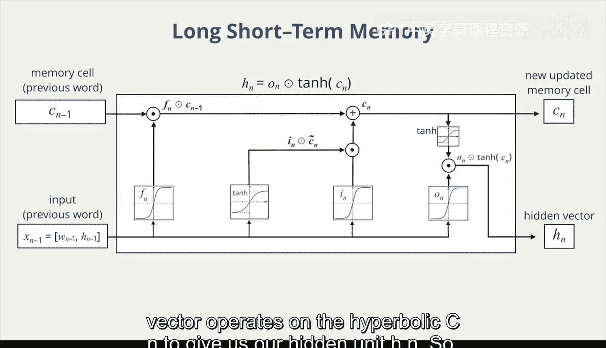

# 杜克大学《机器学习｜Introduction to Machine Learning》中英字幕 p46 46_04_02_长短期记忆网络.zh_en -BV1yjvdBQEaU_p46-

So we've introduced this concept。Of a recurrent neural network。And that recurrent neural network。

Is a very natural extension of the multi layer perceptron。 In fact。

 it is simply a repeated or recurrent usage of the basic。A multi layer perceptron。

So it's a very simple concept， it's also a very powerful concept。However。

It's been found that in the context of text， in the context of documents。

 the context of natural language， which is what we're trying to analyze here。

The recurrent neural network in its most simple form。

 which we've talked about in the previous lesson。Is not as effective as we would like it to be。

So now what we're going to do is we're going to introduce a new form or a more complicated form a recurrent neural network。

This is going to also build upon the concept of multi layer perceptron。

But in a far more sophisticated way。So I want to say at the start。

 this lesson is much more complicated than some of our other lessons。

 probably this is the most complicated， the reason I want to spend some time talking about this thing called LSTM or long shortterm memory is because this represents the state of the art in natural language processing today。

 so while the methodology is somewhat complicated it's worth studying and worth understanding because this technology is what's driving the recent revolution in natural language processing based upon neural modelsels。

 this technology is truly remarkable， we'll talk a little bit more about that as we go forward。

While this model is more complicated， I hope to demonstrate that it is understandable。

And perhaps not not so difficult to understand。 So again， we have the recurrent neural network。

 so we see a sequence of words， WN minus1， WN WN plus1， this corresponds to the n minus1。

 the n and the n plus one word in our sequence of a document。

 We again see the repeated use of the neural network and the repeated softm。

However， this model now has introduced some new things that we did not have in our previous simpler recurrent neural network and the most important of these are what we call memory cells。

 So notice that in our simple recurrent net are relatively simple recurrent net。

 What we did was we propagated the hidden units H from the previous word to the next word。

 So we had Hn minus-1， which was feeding into the prediction for HN which then predicted the n word。

 we've introduced something new， which is called a memory cell。

 we'll describe this in some detail as we go forward。 This is represented by C， the cell。

 C minus1 C and C N plus1 and Cn plus2。 So we'll drill down into that a little bit more。We again。

 as before， from the simple the simpler recurrent neural net， we still have these hidden units。

 So we retain those。 So the key thing that we've introduced that is new are these memory cells and and we'll drill down more deeply as we go forward。

 But the key thing to notice is is that this setup this recurrent neural network setup is basically the same。

 We again see the softmax， which allows us to predict the next word。

What's going to change here is what's in yellow。 The form of the recurrent net will change。

 So let's try to understand that。 So to do this， we need to kind of take a little bit of a step backwards and just kind of recall some notation because we'll need to use this notation as we go forward。

 So this is a bit of a review。 So we previously had a word vector。

 which we represent a word vector for the n minus1 word， and we had a hidden vector。

 which was representative of the n minus1 word。 we concatenated those。

 which means we just stuck them together。 Those two vectors。

 are stuck together after that concatenation process。 We call that cumulative vector X n -1。

That vector then goes into a neural network， which is characterized by parameters W。

 And and then we so basically we take the parameter。

 the components of the vector n minus X n minus-1。 We multiply them by the weights。

 We sum them together。 We get the outputs， which are we get the outputs。 We add a bias。

 and then that process is then sent through a nonlinear function F。

 which we'll talk about a little bit more。 And then from that we get our hidden units， HN。

 So this is the basic construct that we looked at previously。

So now what I'd like to do is to just spend a moment talking about the form。

Of that nonlinearar function。 So previously when we introduced the recurrent neural network。

 we used the hyperbolic tan or just 10 H。 there's a hyperbolic tangent。

 It's a widely used function in neural networks and it has a functional relationship which is shown in the figure。

 So the key thing to take away from that figure is that the recurrent sorry the hyperbolic tangent will always yield a number between minus1 and1。

 The output of the hyperbolic tangent here represented by y is always between one and minus1 and when the input is large positive when x is large and positive。

 the hyperbolic tangent tends towards one whenever X or the input is negative and large the output tends towards negative one。

 This is a hyperbolic tangent， this is one example of that nonlinearar function F。

to use multiple forms of that function F。 And so therefore。

 it's worth spending a few moments talking about them。 So one is the hyperbolic tangent。

 Another is another function that we have talked about elsewhere in our in our lectures。

 And that is the sigmoid function。 And so here， the sigmoid function is represented by the sigma that's called that Greek symbol。

Is called sigma。 And therefore， we choose it to represent the sigmoid function。

 the sigmoid function is shown in the figure。 So now notice， importantly。

 that the sigmoid function always lives between 0 and 1。

 the output of this sigmoid function is always between 0 and 1。 When the input is large and positive。

 the output of the sigmoid function tends towards one。

 When the input towards the sigmoid function is negative and large。

 it the sigmoid function has an output which tends towards 0。

 So it's important to notice that the hyperbolic tangent has an output， which is between  -1 and 1。

Where the sigmoid function has an output which is between zero and1。

 and those differences are going to be important as we move forward in our discussions。Okay。

 so let's go back to this model。 So this is now our recurrent neural network。

 and I want to spend a little bit of time。Walking through the neural network slowly and carefully。

 because this is somewhat complicated。But it is understandable。

 but we need to go slowly and think about it。 I also want to reiterate that this is the state of the art model for natural language processing。

 so it is certainly worth trying to understand。And so again。

 we're going to introduce the notation where x n minus1 is going to be the concatenation or the combination of the vector for word n minus1。

And the hidden unit， H n -1 from the previous step。 So this is the same as we did before。

 So X N X n -1， which is going to be the input to our model。

 is the word vector from the previous word and the hidden vector from the previous word。

Now what we're going to do。Is introduce not one neural network， but actually three neural networks。

 Okay， so this is where things start to get complicated previously in our recurrent neural network。

 we had one one neural network process。 Here we introduce three。 One of them is represented by I。

 the other represented by F and the other represented by O。 we'll explain what if F and O mean later。

 But if we look at what's going on here， this is not as wildly different as one might think from what we have done before。

 we take the input X and minus1 and we send it separately through three different neural networks。

The parameters of the neural network associated with the output I are W subi and B subi where B subi is the bias and W I。

A the weight parameters， we take the input， xn minus1， which is our concatenated vector。

 we multiply it by our weights， we sum them together， and then we get an output。

Which is then sent through a sigmoid function。We take the input X n minus1。

 we multiply it by the weights associated with w sub I， we add those together， we add the bias。

 we send those through the sigmoid function and we get an output I sub n。

 The thing I want to emphasize or I want you to think about is that sigmoid function。

Is operating on a vector。 So the outputs of W I times x n -1。 that is a vector。

 That is the it's like the hidden vector in our neural network。

 And so the sigmoid function is operating separately。On each of the components that are the output。

Of the neural network on the bottom left。 And so then for the neural network associated with F。

We have parameters， W F， and we have biases Bf， we play the same game with the neural network。

 But again now our again， our nonlinear function is the sigmaoid function Sigma and then finally the same thing for the output of the O which will be corresponding to an output。

 So the key thing to notice is is that we're now introducing three neural networks。

 The basic functional form of each of those neural networks is the same。

 The detailed parameters are different for each of those three neural networks。 And so again。

 I want to emphasize that the nonlinear function。Is the sigmoid function。

 which means that every component of the vector I。The vector F and the vector， O。

 those are each vector。 So I sub n is a vector。F sub n is a vector， and O sub n is a vector。

 These are kind of like the hidden vectors that we saw previously in the multilayer perceptron。

 The thing I want you to notice is because each component of the vector is going through a sigmoid function and because of the fact that the sigmoid function always has an output between 0 and1。

 we know that each component of the vector I， the component， the vector F and the vector O。

 each component of those vectors is always between 0 and 1 that will be important later。

And so these three neural networks which have outputs IF and O， are what we call control networks。

 control neural networks， they're characterized by the set of parameters， WO， WF， W I。

 so those are the set of weights， and then the set of biass， BO， BF and B。

 so basically each of those three neural networkss looks very much like what we've seen before in the multilayer perceptron。

 the three control neural networks that we represent here are going to be used to control the output of our neural network or control the output of our recurrent neural network as we'll see as we go forward。

Okay， so now we're going to introduce。A fourth neural network。 So with the LSTM or the long。

 short term memory， we're going to have four neural networks。

So three of the neural networks are shown。At those are three equations。

These are the basic multi layerer perceptron that we've seen before。

And now we're going to introduce a fourth。Which is going to give us a new estimate of our memory cell。

 which I'm going to represent as C sub n。 So this C is our memory cell and the subscript n means it's going to be for the nth one and the sququiiggle line on top of the C that's called a tilde is just a notation。

 So that that squiggle on top of the C is called a tilde。 So that's called tilde C N。

 And what we're going to be using here is the hyperbolic tan as the output or the nonlinearar function in our network。

 And so in this case， we know that every component of the vector C tilde n。

Is going to be between  -1 and1， as manifested by the properties of the hyperbolic tan。

And so now what we're going to do， the last step， which is a T step。

 which we'll go through slowly and we'。Try to really understand is we're going to update。

The memory cell， so remember that in this recurrent network， we have a hidden vector， HN。

 and we have a memory cell， CN。Okay， so let's now try to understand what this symbol So C this circle with a dot in it。

 So if you look at what we're doing here， we're saying that C N。

Which is the n realization of the memory cell。Is a combination of c n minus1。

 which was the memory cell from the previous time。And then C tillil the N。

 which is our updated representation of the memory cell。 And so C， N。

It's a combination of the previous memory cell， cn minus1。In a new estimate， which is C tilde N。

 and then C N -1 and C tilde n are are operated on by the outputs F N and I N from our control network。

 So right now， notation is very confusing。 So let's try to understand what this means。

So let's think about this F。Is the output of one of the control networks that we looked at previously。

And remember， F N。Is a vector where every component of that vector is a number between 0 and 1 because of the fact that the F n was manifested by going through the sigmoid function。

 So F n is a vector。 It's represented by each of the components in those in those rectangles。

 Those are the numbers。 And then C and -1。Is the memory cell from the previous times step stamp and minus1。

The symbol。Circle with a dot。 what this means is is that we're going to take every component of FN。

And multiply it by the corresponding component of c and-1。And then after we do this。

 we're going to manifest a new vector， which is the combination of Fn and c n minus1。

 So we take the vector Fn， which is a set of numbers， each of which is between 0 and1。

We multiply it by the respective component of the memory cell， C N-1。 And that gives us a new vector。

 That process， that operation is represented by Fn circle dot C N-1。

 So this is simply taking every component of Fn and multiplying it by the corresponding component of C N-1。

 So now you can start to see where this control process。Is， is manifested。 So if we go。

 if we go back and look at this， what， what the F N is doing is's controlling。

The contribution of the previous。Memory cell Cn minus1 in our update of the new memory cell CN。

And then the IN， which we'll talk about more in a moment， IN does a similar operation on C tilde n。

 and then we sum those two vectors together and then that gives us CN。

 so basically what's happening is is that memory cell CN is a combination of the previous memory cell。

 Cn minus1， and the new estimate of the memory cell， C tilde n， and then the vectors Fn in IN。

 which are each of which is themselves an output of a neural network。Are controlling。

The degree to which C n minus-1 and C tilde n contribute to the new updated cell。

 The final thing that we need to think about is how we manifest the hidden unit or the output HN which then goes into the softmax。

 this is now the third control network， which has an output O sub n。

 this is multiplied in the same way as before dot circle with the hyperbolic tangent of the memory cell。

 and so if you think about what is going on here。We have three。Control networks。

We're manifestifesting the output vectors ON。F， N and I N。

We have an updated estimate of our memory cell， C Tilde N， which also is represented by NeNe。

And then the three control networks。then operate on the memory cells to then and then the output O subN control vector operates on the hyperbolic CNN to give us our hidden unit HN so this is the basic construct of the long shortterm memory。

 this is as I've said， the state of the art method for natural language processing and for many types of sequential modeling。

 it is certainly more complicated than anything that we've looked at before。

 so what we're going to do in the next lesson is to walk through this model slowly part by part to try to understand more fully how it works。

