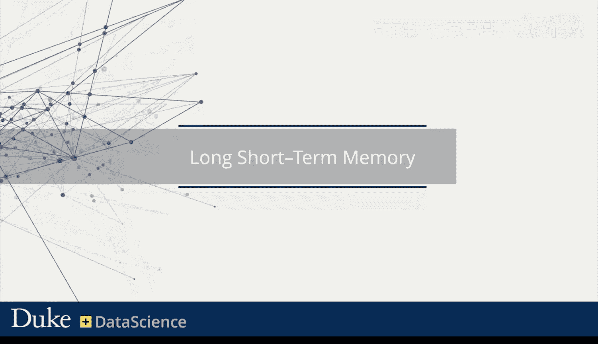
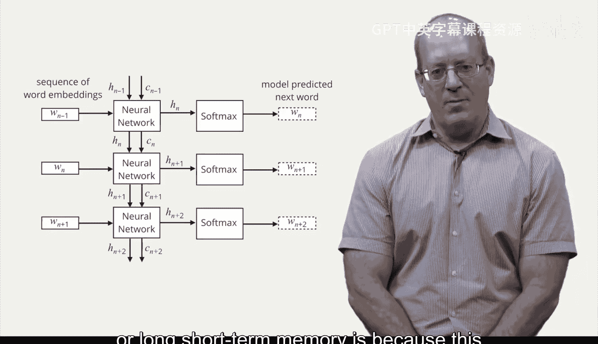
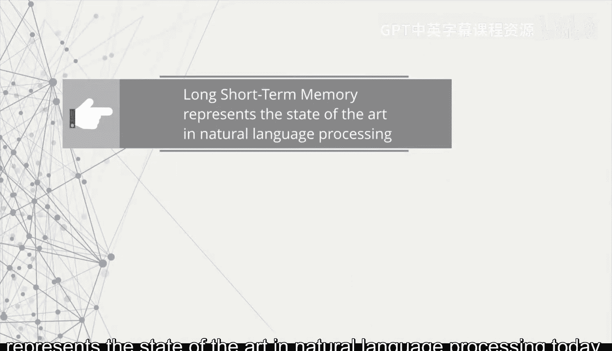
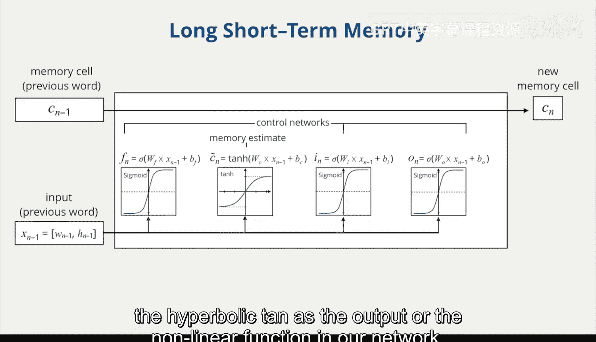
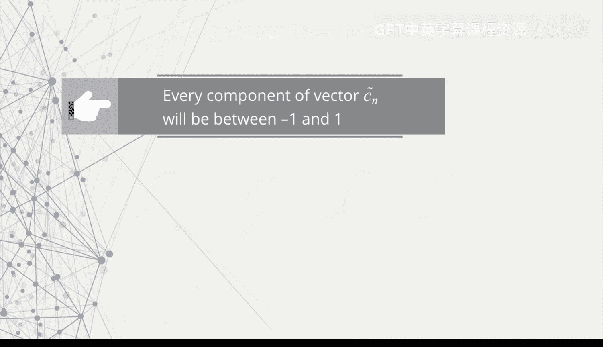
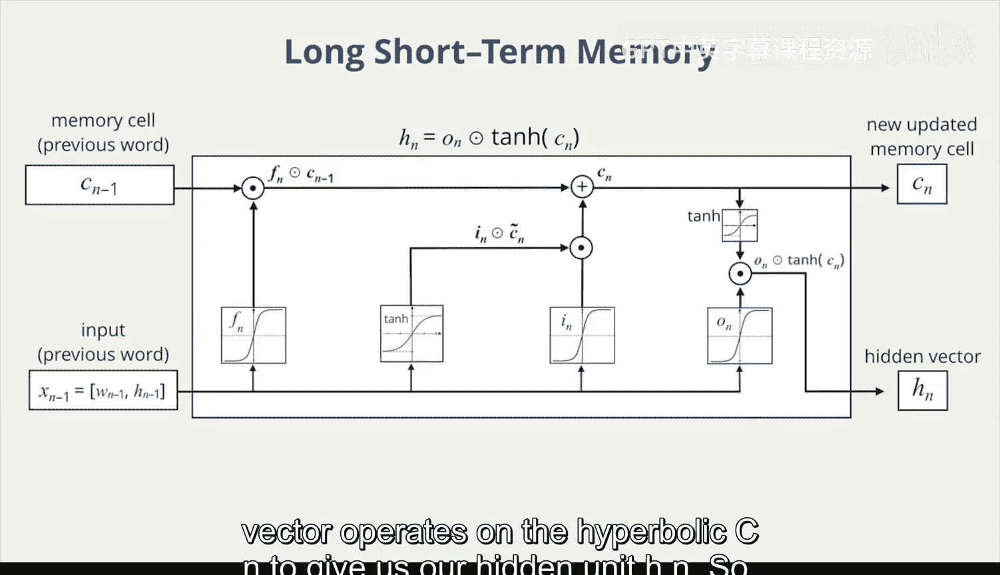

# 机器学习：46：长短期记忆网络 (LSTM) 🧠

## 概述
在本节课中，我们将要学习一种更复杂的循环神经网络变体——长短期记忆网络。上一节我们介绍了基础的循环神经网络，本节中我们来看看如何通过引入“记忆单元”和控制门机制，来解决基础RNN在处理长序列文本时可能遇到的困难。LSTM是当前自然语言处理领域最先进的技术之一，理解其工作原理至关重要。

---

## 从基础RNN到LSTM的演进

我们引入了循环神经网络的概念。循环神经网络是多层感知机的一种非常自然的扩展。实际上，它只是对基础多层感知机的重复或循环使用。这是一个非常简单的概念，也是一个非常强大的概念。

然而，人们发现，在我们试图分析的文本、文档和自然语言语境中，上一课中讨论的最简单形式的循环神经网络，其效果并不如我们所愿。

因此，我们现在要引入一种新的、更复杂形式的循环神经网络。它同样建立在多层感知机的概念之上，但方式要复杂得多。本节课的内容比我们其他一些课程要复杂得多，这可能是最复杂的一课。之所以要花时间讨论这个被称为LSTM或长短期记忆网络的技术，是因为它代表了当今自然语言处理领域的最先进水平。虽然方法有些复杂，但值得研究和理解，因为这项技术正在推动基于神经模型的自然语言处理领域最近的革命。这项技术确实非常出色，我们将在后续内容中进一步讨论。

虽然这个模型更复杂，但我希望展示它是可以理解的，或许理解起来并不那么困难。

---

## LSTM的基本架构

我们再次看到循环神经网络。我们看到一个单词序列 `W_{n-1}`, `W_n`, `W_{n+1}`，这对应于我们文档序列中的第 `n-1`、`n` 和 `n+1` 个单词。我们再次看到神经网络的重复使用和重复的Softmax层。

然而，这个模型现在引入了一些我们在之前更简单的循环神经网络中没有的新东西，其中最重要的是我们称之为**记忆单元**的东西。

请注意，在我们相对简单的循环网络中，我们所做的是将隐藏单元 `H` 从前一个单词传播到下一个单词。所以我们有 `H_{n-1}`，它被输入到对 `H_n` 的预测中，然后 `H_n` 预测第 `n` 个单词。

我们引入了一个新东西，叫做记忆单元。我们将在后续详细描述它。它由 `C`（单元）表示：`C_{n-1}`, `C_n`, `C_{n+1}`, `C_{n+2}`。我们将对此进行更深入的探讨。

和之前一样，在更简单的循环神经网络中，我们仍然有这些隐藏单元。所以我们保留了它们。我们引入的新关键点是这些记忆单元，我们将在后续深入探讨。但需要注意的关键是，这个循环神经网络的基本设置是相同的。我们再次看到Softmax层，它允许我们预测下一个单词。

这里将要改变的是黄色部分的内容。循环网络的形式将发生变化。

---

## 回顾基础概念与符号

为了理解这一点，我们需要稍微退一步，回顾一些符号，因为在后续内容中我们需要使用这些符号。这是一个复习。

我们之前有一个词向量，代表第 `n-1` 个单词的词向量，我们还有一个隐藏向量，代表第 `n-1` 个单词。我们将它们连接起来，这意味着我们只是将它们拼接在一起。这两个向量在连接过程之后被拼接在一起。我们称这个累积向量为 `X_{n-1}`。

该向量随后进入一个由参数 `W` 表征的神经网络。基本上，我们取向量 `X_{n-1}` 的分量，用权重乘以它们，将它们求和，得到输出。我们加上一个偏置 `b`，然后该过程通过一个非线性函数 `f` 发送，我们将对此进行更多讨论。然后我们从那里得到我们的隐藏单元 `H_n`。这是我们之前看过的基本结构。

---

## 非线性激活函数

现在我想花点时间讨论一下那个非线性函数 `f` 的形式。

之前当我们介绍循环神经网络时，我们使用了双曲正切函数 `tanh`。它是神经网络中广泛使用的函数，其函数关系如图所示。从该图中要理解的关键点是，双曲正切函数的输出 `y` 始终在 `-1` 和 `1` 之间。当输入 `x` 为正且很大时，双曲正切趋向于 `1`；当输入 `x` 为负且很大时，输出趋向于 `-1`。双曲正切是非线性函数 `f` 的一个例子。

我们将使用该函数 `f` 的多种形式。因此，值得花一些时间讨论它们。

一种是双曲正切函数。另一种是我们在课程其他地方讨论过的函数，即 **Sigmoid函数**。这里，Sigmoid函数用希腊符号 `σ` 表示。Sigmoid函数如图所示。

现在请注意，重要的是，Sigmoid函数的输出始终在 `0` 和 `1` 之间。当输入为正且很大时，Sigmoid函数的输出趋向于 `1`。当Sigmoid函数的输入为负且很大时，其输出趋向于 `0`。

因此，重要的是要注意，双曲正切函数的输出在 `-1` 和 `1` 之间，而Sigmoid函数的输出在 `0` 和 `1` 之间。这些差异在我们后续的讨论中很重要。

---

## LSTM的核心：三个控制网络

让我们回到这个模型。这是我们的循环神经网络，我想花点时间慢慢地、仔细地讲解这个神经网络，因为这有些复杂。但它是可以理解的，我们需要慢慢来并思考它。我还想重申，这是自然语言处理领域最先进的模型，因此绝对值得尝试理解。

我们再次引入符号，其中 `X_{n-1}` 将是第 `n-1` 个单词的向量与前一步的隐藏单元 `H_{n-1}` 的连接或组合。这和之前做的一样。所以 `X_{n-1}` 将是我们模型的输入，它来自前一个单词的词向量和前一个单词的隐藏向量。

现在我们要做的，不是引入一个神经网络，而是实际上引入**三个神经网络**。这就是事情开始变得复杂的地方。以前在我们的循环神经网络中，我们有一个神经网络处理过程。这里我们引入了三个。其中一个用 `I` 表示，另一个用 `F` 表示，另一个用 `O` 表示。我们稍后会解释 `I`、`F` 和 `O` 的含义。

但如果我们看看这里发生了什么，这与我们之前所做的并非天差地别。我们取输入 `X_{n-1}`，并分别将其通过三个不同的神经网络发送。

与输出 `I` 相关的神经网络的参数是 `W_i` 和 `b_i`，其中 `b_i` 是偏置，`W_i` 是权重参数。我们取输入 `X_{n-1}`（我们的连接向量），用权重乘以它，将它们求和，然后得到一个输出，该输出随后通过一个Sigmoid函数发送。

我们取输入 `X_{n-1}`，用与 `W_f` 相关的权重乘以它，将它们相加，加上偏置 `b_f`，将它们通过Sigmoid函数发送，然后得到输出 `F_n`。

对于与输出 `O` 相关的神经网络，我们做同样的事情，参数是 `W_o` 和 `b_o`，非线性函数同样是Sigmoid函数 `σ`。

需要注意的关键点是，我们现在引入了三个神经网络。每个神经网络的基本函数形式是相同的。这三个神经网络的具体参数各不相同。

我想再次强调，非线性函数是Sigmoid函数，这意味着向量 `I`、向量 `F` 和向量 `O` 的每个分量都是一个介于 `0` 和 `1` 之间的数字。这将在后面很重要。

这三个输出为 `I`、`F` 和 `O` 的神经网络，就是我们所说的**控制网络**。它们由参数集 `W_o`、`W_f`、`W_i`（权重）和偏置集 `b_o`、`b_f`、`b_i` 来表征。基本上，这三个控制神经网络中的每一个看起来都非常像我们在多层感知机中见过的样子。我们在这里表示的这三个控制神经网络将用于控制我们神经网络的输出，或者控制我们循环神经网络的输出，我们将在后续看到。

---

## 引入第四个网络与记忆单元更新

现在我们要引入**第四个神经网络**。在LSTM或长短期记忆中，我们将有四个神经网络。

其中三个神经网络由之前的方程表示。这些是我们之前见过的基本多层感知机。

现在我们将引入第四个，它将为我们提供记忆单元的新估计值，我将其表示为 `\tilde{C}_n`。这个 `C` 是我们的记忆单元，下标 `n` 表示它是第 `n` 个，`C` 上面的波浪线 `~` 只是一个符号，称为 `\tilde{C}_n`。

我们在这里将使用双曲正切 `tanh` 作为我们网络中的输出或非线性函数。在这种情况下，我们知道向量 `\tilde{C}_n` 的每个分量都将在 `-1` 和 `1` 之间，这由双曲正切的性质决定。

现在我们要做的最后一步，我们将慢慢进行并尝试真正理解，是更新记忆单元。请记住，在这个循环网络中，我们有一个隐藏向量 `H_n` 和一个记忆单元 `C_n`。

让我们尝试理解这个符号 `⊙`（圆圈中间有一个点）。我们在这里说的是，`C_n`（记忆单元的第 `n` 次实现）是 `C_{n-1}`（前一次的记忆单元）和 `\tilde{C}_n`（我们对记忆单元的新估计）的组合。

`C_n` 是前一个记忆单元 `C_{n-1}` 和一个新估计 `\tilde{C}_n` 的组合，然后 `C_{n-1}` 和 `\tilde{C}_n` 由来自我们控制网络的输出 `F_n` 和 `I_n` 进行操作。

符号 `⊙` 意味着我们将取 `F_n` 的每个分量，并将其乘以 `C_{n-1}` 的相应分量。完成此操作后，我们将生成一个新向量，它是 `F_n` 和 `C_{n-1}` 的组合。我们取向量 `F_n`（一组数字，每个数字都在 `0` 和 `1` 之间），将其乘以记忆单元 `C_{n-1}` 的相应分量。这给了我们一个新向量。该过程、该操作由 `F_n ⊙ C_{n-1}` 表示。这只是取 `F_n` 的每个分量并将其乘以 `C_{n-1}` 的相应分量。

现在你可以开始看到这个控制过程是如何体现的。`F_n` 所做的是控制前一个记忆单元 `C_{n-1}` 在我们更新新记忆单元 `C_n` 时的贡献。

然后 `I_n` 对 `\tilde{C}_n` 进行类似的操作，我们将这两个向量相加，就得到了 `C_n`。

基本上，发生的情况是，记忆单元 `C_n` 是前一个记忆单元 `C_{n-1}` 和记忆单元的新估计 `\tilde{C}_n` 的组合，然后向量 `F_n` 和 `I_n`（它们本身都是神经网络的输出）控制着 `C_{n-1}` 和 `\tilde{C}_n` 对新更新单元的贡献程度。

我们需要思考的最后一件事是如何生成隐藏单元或输出 `H_n`，然后它进入Softmax层。这是第三个控制网络，其输出为 `O_n`。这与之前相同的方式 `⊙` 与记忆单元的双曲正切相乘。

因此，如果你思考这里发生了什么：我们有三个控制网络，生成了输出向量 `O_n`、`F_n` 和 `I_n`。我们有一个记忆单元的更新估计 `\tilde{C}_n`，它也由神经网络表示。然后，三个控制网络对记忆单元进行操作，接着输出控制向量 `O_n` 对 `tanh(C_n)` 进行操作，给我们隐藏单元 `H_n`。

这就是长短期记忆网络的基本结构。正如我所说，这是自然语言处理和许多类型序列建模的最先进方法。它肯定比我们之前看过的任何东西都复杂。

---

## 总结

本节课中我们一起学习了长短期记忆网络的核心架构。我们了解到，LSTM通过引入**记忆单元**和三个**控制门**，有效地解决了基础RNN在长序列依赖上的不足。具体来说：
*   **输入门**控制新信息 `\tilde{C}_n` 的流入。
*   **遗忘门**控制旧记忆 `C_{n-1}` 的保留程度。
*   **输出门**控制当前记忆 `C_n` 对当前输出 `H_n` 的影响。

这些门机制均由Sigmoid函数实现，输出值在0到1之间，起到了“开关”或“调节器”的作用。记忆单元的更新则结合了经过门控筛选的旧记忆和新信息。虽然结构复杂，但LSTM通过这种精巧的设计，成为了处理序列数据的强大工具。在下一课中，我们将逐步剖析这个模型，以更全面地理解其工作原理。