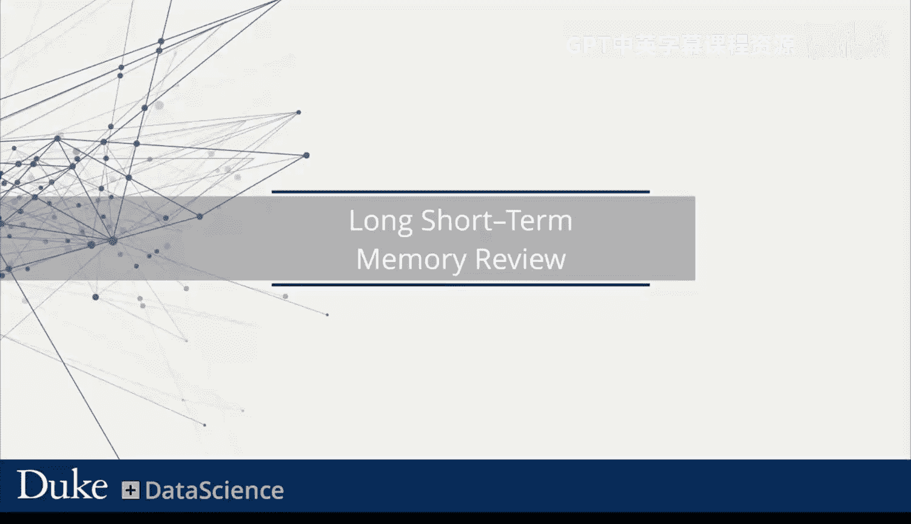
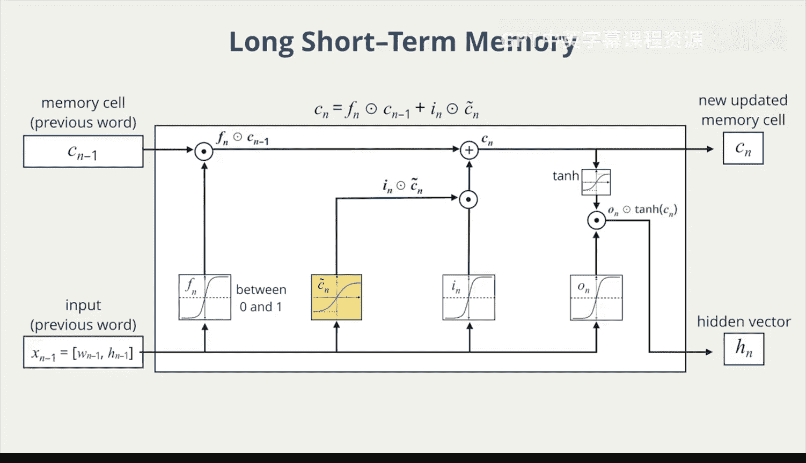
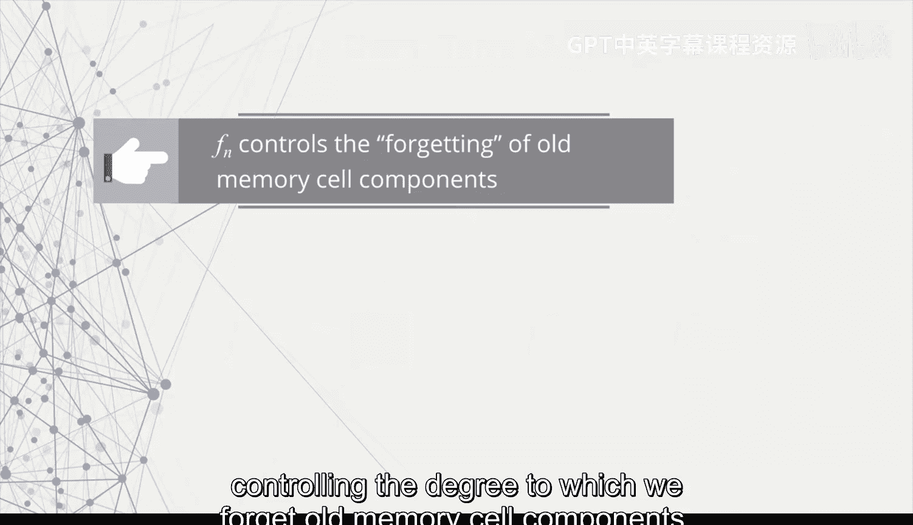
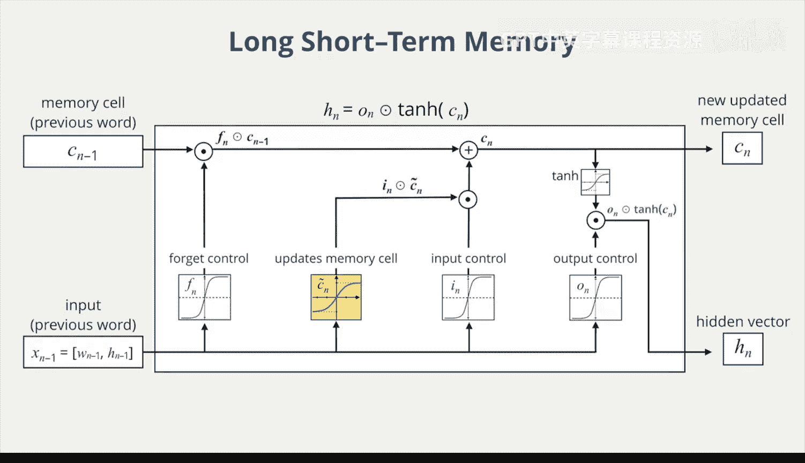
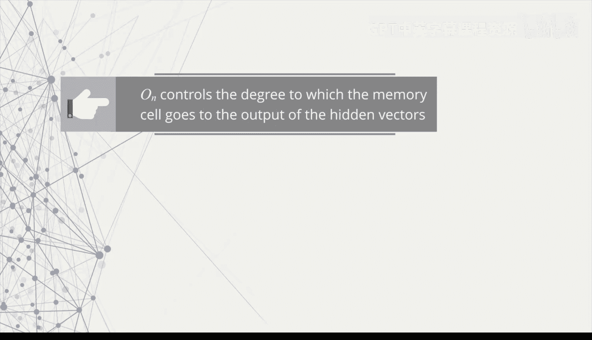
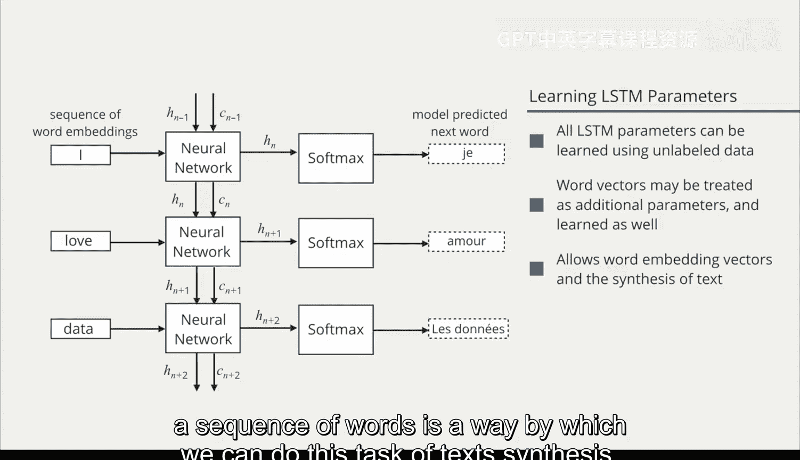

# 杜克大学《机器学习｜Introduction to Machine Learning》中英字幕 p47 47_04_03_长短期记忆网络回顾.zh_en -BV1yjvdBQEaU_p47-

We've introduced this concept of the long， short term memory。This is a recurrent neural network。

Which is used。For modeling of sequences of data。Language。

 which is represented by a sequence of words， is a natural， natural place for the long。

 short term memory to be applied within the context of natural language processing。

Each word in the sequence of words of a document is represented by a vector， and so therefore。

 in the context of documents， the long， short term memory is operating on a sequence of vectors associated。

With the words in the document。Now， the LSTM is the state of the art。

metethod for natural language processing today， and it has been used to achieve remarkable results in many settings。

 however， it is certainly more complicated than most anything else we've discussed in these lessons and so therefore it is probably worth taking a step back to review the LSTM understand and perhaps a little bit more deeply what the various components of the model are doing。

So let's recall the long short term memory， the LSTM。It's composed of three。Control neural networks。

Which have output vectors at time n in our sequence， O。Fn。And I am。

Each of those three neural networks have the same basic form in terms of essentially a multi layer perceptron。

And we notice that the nonlinear function for each of these control units is a sigmoid function。

 sigma。Which means that each of the components。Of the vectors， O， N， F，N and I。

 N are numbers between 0 and1。In the long， short term memory， we've introduced a new vector。

 in addition to the hidden vector H， we've introduced a memory cell， which is represented by C。

The memory cell is updated by yet a fourth neural network。

 which is which has a nonlinear function corresponding to the hyperbolic tangent。 Again。

 a multi layer perceptron， but then the nonlinear function is a hyperbolic tangent。

 which means that C tilde n。Has。Has components or has elements in the vector C t to n。

 which are each a number between 1 and1。Those four neural networks in the top。Block are then used。

To update the memory cell， CN。And to also update the hidden variable HN。

The way that this is done is by taking the control outputs from the F network and the I network to operate on the previous memory cell Cn minus1 and our new estimate C tilde n and then the output of that which is CNN。

 our new updated memory cell is then sent through a hyperbolic tangent and then is operated on by the output of the network with ON and that gives us the hidden unit。

 so lot going on here， let's try to understand this a little bit more。So looking at the output。

Of our update， of our memory cell， we noticed that what the。

The vector FN is doing it's controlling the degree to which we forget old memory cell components。

 So remember that that every component of the vector Fn is between0 and1 And so if the particular component of fn is near0。

 then the corresponding component of the memory cell cn minus-1 is multiplied by a number which is near0。

 which means it essentially forgets that memory cell output。

 So the fn controls or allows the model to forget or to erase previous memory cell output。

 So the reason we use the symbol F sub n is because this is a methodology for allowing the model to forget or。

To erase old memory cells。By contrast， the I N controls the input of our new estimate C tilde n。

 And so what we're doing is we're taking。The previous memory cells， which is a vector of numbers。

 cn minus1。We're multiplying them component by component。By the vector F N， which is telling us。

 And remember that each one of those outputs of F N is between 0 and one。

 If a component of F n is near 0， that means we're seeking to erase or forget the corresponding component of the memory cell。

 So F。Is called our forgetting。Control。I is called our input control because it's controlling the degree to which our new estimate C tilde n contributes to our estimate。

 Our new estimate of C N。 And so again， I， every component of I N is between 0 and 1。

 If the corresponding component of I N is near 0， then the corresponding component of C tilde n is not going to contribute significantly to our new。

Representation of the memory cell。 By contrast， if a component of I N is near one。

 then that means that the corresponding component of our new estimate C tillde N is going to contribute significantly to the memory。

 our new memory cell， C， N。 And so the forget。The forget control。

And the I or the input control are controlling the degree to which our previous memory cell and our new representation of the memory cell contribute to update the the memory cell C。

 N on the next time。Timetamp。And then， the O， N。Is the output control and what it's doing is is taking the memory cell C N。

 it's sending it through a nonlinearar functioned hyperbolic tan。

 which yields an output between -1 and 1。 and then the O N is also a vector of numbers。

Each of which is between 0 and1。And each of the components of ON are represented by the respective components of the output of the hyperbolic tan。

And then that product of the output by the hyperbolic tan of CNN controls the degree to which each of those components contribute to the next hidden vector HN。

 we then introduce a fourth neural network， which is our update of our memory cell。

 which is represented by C Tilde N。So the single recurrent net in the simple single neural network in the original recurrent neural network in the LSTM is controlled now by four neural networks。

 which allow the model to forget previous data in our sequence of data through the F through the F control。

 they allow the ability to input new data through the eye control。

 and then the O control controls the degree to which the memory cell goes to our output here。

 the hidden vectors， and so we've introduced the same basic concept of recurrent model because this basic construct that we see in the schematic repeats recurrently。

 this is why this is called a recurrent neural network。

However， it's got two outputs。It's got the hidden vector HN。

 and it's also got the update of the memory cell C。

All LSTM parameters can be learned using unlabeled data because basically what this is is a model that allows us to predict the next word based upon the previous word。

 and we can do this for a sequence of words in a document or corpus。

 and there's no need for human labeling of the document， so therefore we can apply this model。

To unlabeled data。The word vectors may be treated as additional parameters in the model。

 and they may be learned as well。And so this model， this LSTM model。

 is a model that allows us to learn the word the word embedding vectors。

 and it also learned allows us to learn a model which is capable of synthesizing text which we'll talk about more in a moment this ability to synthesize text is critical for applications like text translation so in that case the input text might be a sequence of English words。

 and then the output might be a sequence of French words。

 if we're going to translate from English to French we have to be able to synthesize language。

 and this LSTM which allows us to synthesize。A sequence of words is a way by which we can do this task of text synthesis This model。

 the LSTM， is undoubtedly complicated but it's built up of basic construct constructs that we have seen before。

 the multilayer perceptron， it's a complicated model。

 but the reality is that it works very well in practice providing state of the art results for many applications including translation in a moment in our next lesson will show another application where the LSTM has proven to be very effective for text synthesis。

