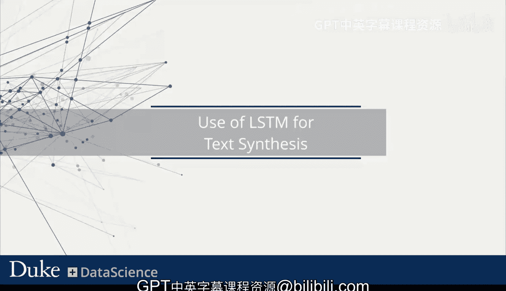
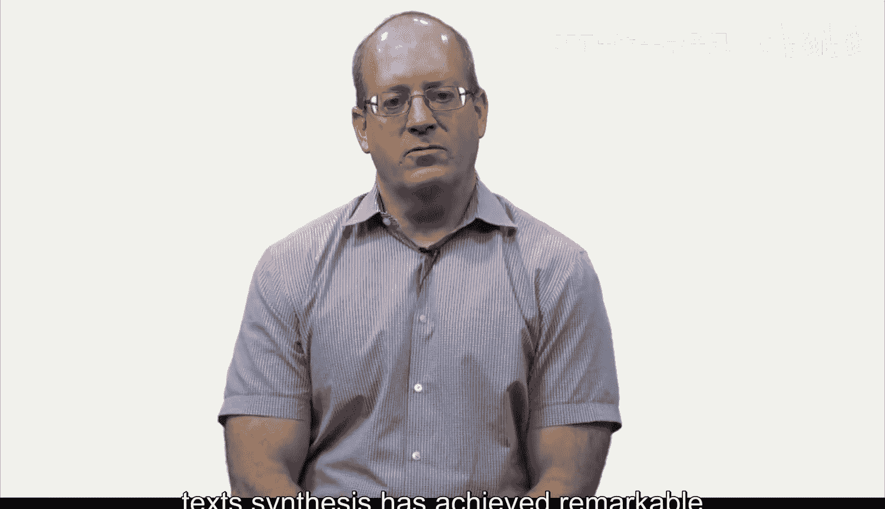
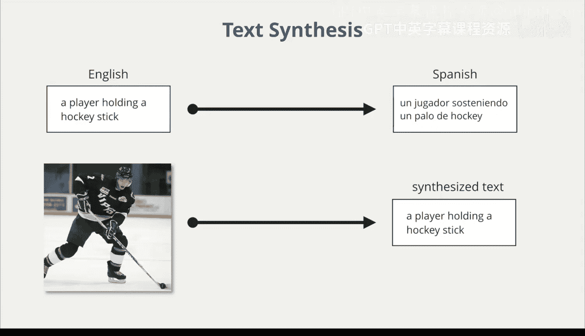
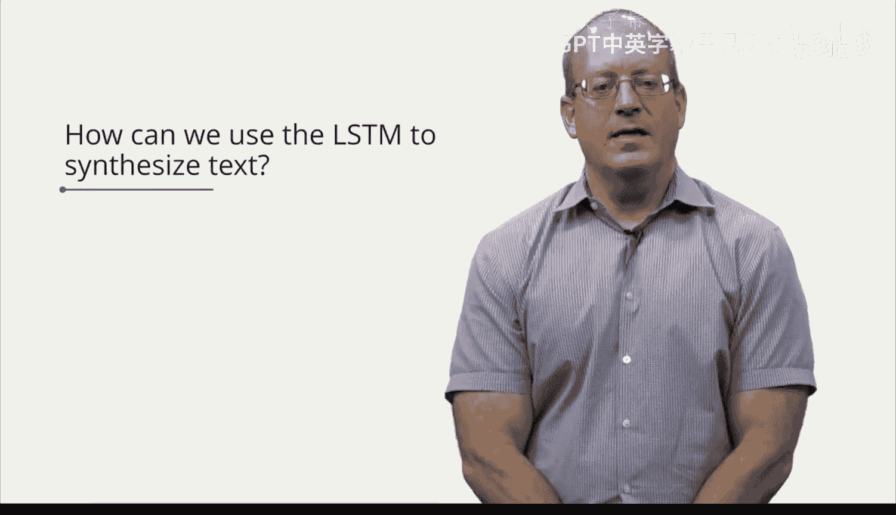
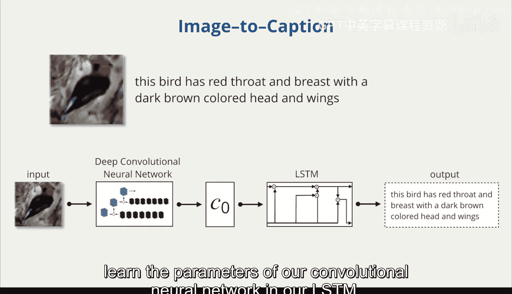
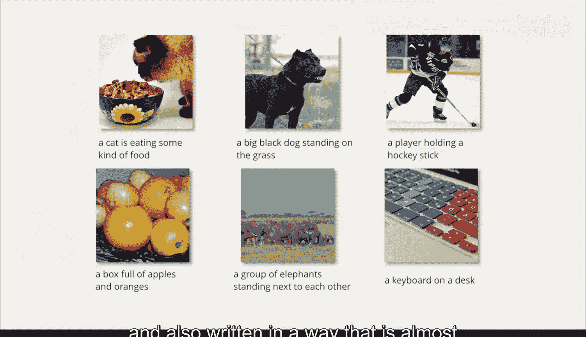
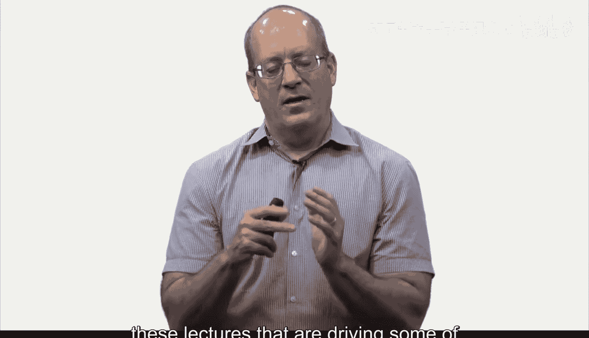
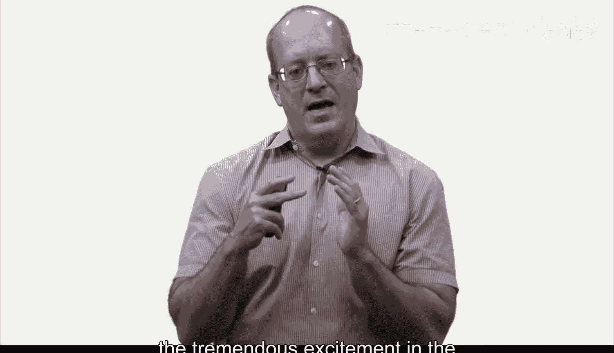
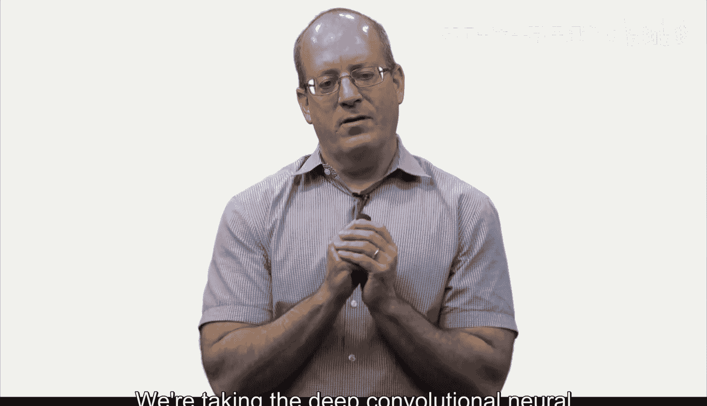
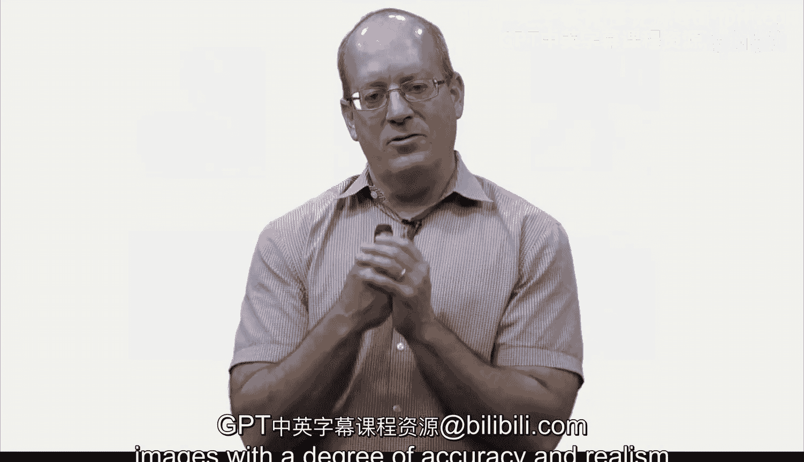

# 杜克大学《机器学习｜Introduction to Machine Learning》中英字幕 p48 48_04_04_LSTM用于文本生成.zh_en -BV1yjvdBQEaU_p48-

So now that we have introduced。

This concept。Of long， short term memory。Or the Alice T。

It'd be worthwhile to spend a few moments to understand how this model is used in text synthesis and as has been discussed。

 this basic framework for text synthesis that achieved remarkable results across multiple applications。

 one is text translation from language A to language B。

 another application is in the automatic captioning of images。

 so the idea would be that you're given an image and then the machine can automatically look at the image or analyze the image and then synthesize text that is in proper language that can describe the image。

 so we're going to talk a little bit about that in this lesson。

So。So let's assume that we have learned the LSTM parameters based upon a large document corpus。

 a large set of documents。 So how can we use the LSTM to synthesize text。

 So remember that the basic construct is a neural network。

Which has as input， the hidden units。H in the memory cell C from the previous step， those are inputs。

The next， the previous word。Is an input， and then out comes the next hidden unit。

 which predicts the next word， and then we also update the memory cell and then the updated memory cell in the updated hidden units go to the next neural network。

So the way that we are going to do this is that we're going to repeatedly apply or in a recurrent manner。

 apply this basic construct， and this is， of course why it's called a recurrent neural network。

This B O symbol that I'm showing here， that means beginning of sentence。

 And so whenever we initialize， whenever we initialize the process of synthesizing text。

 we tell the model through the symbol B O that we're beginning the sentence。

 so it understands we're at the beginning， and then the model will automatically end the sentence。

 the model will end the sentence through an EOS or end of sentence symbol。

 So we have a beginning of sentence symbol and an end of sentence symbol EOS。

 each of which are represented by vectors which are also learned those vectors are analogous or basically that play the same role。

As the word vectors that we've talked about previously。

And then the hidden units are sent through a softm and then through that soft max。

 remember we get a probability on the next word， so in this case， the first word W1。

The softm tells us the probability of which word is first。

So what we could do is we can select that word， which is most likely。As manifested by the softmax。

 and then we'll say that that word is W1。 The hidden units are updated to H1。

 The memory cell is updated to C1。 that then goes into the next network。

The next LSTM network what we do then is we take the word W1， which we've already predicted。

 and we use it as the input to the next step in our recurrent neural network。

 and so we first predict the first word W1， we then take the vector associated with W1 and that is used as an input to the next neural network。

 the next layer in this recurrent process， then the updated hidden unit H2 is again sent through a softmax。

 we then again take the word that is most likely that has the most highest probability out of the softmax。

 we call that W2。W2 is then sent down to be the input to the next layer。

 So then we take the vector associated with W2。 We take H1， we take C1， we send it into our LSTM。

 and we do the same process。 We get H3， softmax， Take the most likely word。 That's W3。And repeat。

 so we could see that through this recurrent neural network。

 we can sequentially synthesize text and as I'll show in a moment。

 the quality of this synthesis is truly remarkable。

 almost equivalent to what one might expect of a human。So whenever we do this。

We have to initialize the hidden units H knot and CN。And so， typically。We in real applications。

 we're going to initialize H not and C not to be consistent with some task。

 and so what I'm going to do is I'm going to give the example of the automatic captioning。Of。

 of a picture。So let's look at this example， so we see a picture of a bird。

And we see some text that describes the bird。The thing I want you to recognize is that this text。

 this bird has red throat。And brass with a dark， brown colored head and wings。

That sentence was generated automatically by a machine。

 So that that sentence was not produced by a human。 That sentence was produced by a machine。

So how is this done， so elsewhere in our lessons？We have learned about the deep convolutional neural network。

 The deep convolutional neural network is a framework by which we can analyze images such as this bird here。

So what is done is that the picture。Is thennce is first sent through a deep neural network。

And then it manifests at the top of that neural network。

 it manifests a set of features which are characteristic of the image Those features are then used to initialize the parameters of our long short term memory so they initialize the memory cell C subzero。

 that initialized memory that initialized memory cell C not is then sent through a long shortter memory to synthesize a sentence which I showed you before so this is a so-called end to end method by which we can train a model to analyze images and then synthesized text simultaneously by taking two of the key components that we have discussed in our lectures。

 the deep convolutional neural network for analysis of images is。

Used to extract features which predict the initialization of our LSTM with that initialization。

 the LSTM then synthesizes text。 So the input。Is the image。The output is the text。

 And so to learn a model like this， which is a combination of a deep neural network。

Deep convolutional neural network in a long shortterm memory。

 recurrent neural network What we do is we give the model examples of inputs of images and outputs of text that were generated by humans。

 we have many examples of images and text and then we learn the parameters we use that data to learn the parameters of our convolutional neural network and our LSTM。

 Here are some examples that you can look at each of these are manifested by the machine。

 So what is shown here are six examples of images and then the text underneath that was generated automatically through the long short termm memory machine So if you look at these it's remarkable I think that the quality of the sentence is excellent grammatically correct and also if you look at the photograph。

 And if you look at the sentence it's remarkable I believe。

It is remarkable the machine's ability to analyze the image and then to represent that image in English words that are meaningful and also written in a way that is almost indistinguishable from what a human might do this example now brings together two of the key concepts that we have discussed in these lectures that that are driving some of the tremendous excitement in the opportunities for machine learning。

 we're taking the deep convolutional neural network for analysis of images in the LSTM。

 which is a state of the art method for synthesizing text we're bringing these together automatically caption images with a degree of accuracy and realism that is comparable to what a human might do。

