# 机器学习：48：LSTM用于文本生成 🧠📝

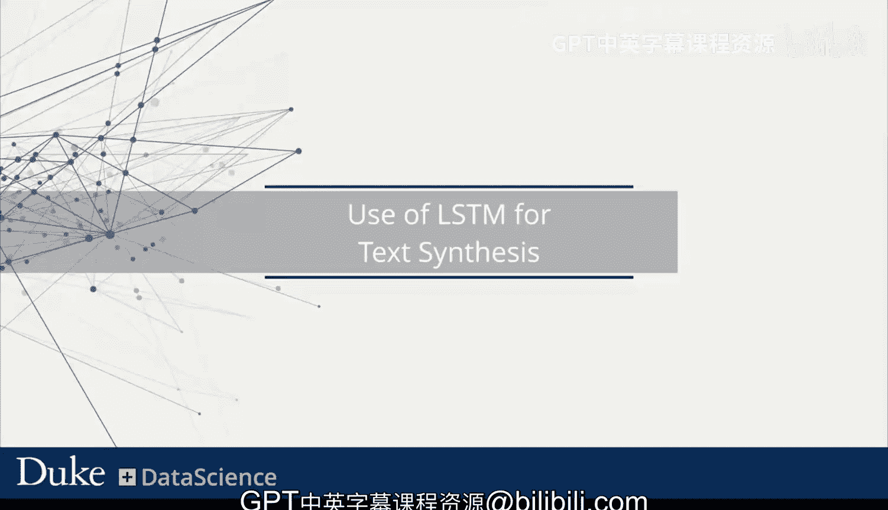

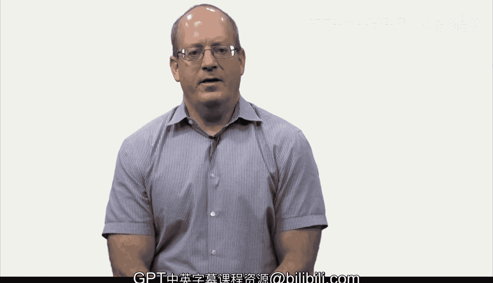

在本节课中，我们将学习长短期记忆网络在文本生成任务中的应用。我们将了解其基本工作原理，并探讨一个结合了图像分析与文本生成的端到端应用实例——自动图像描述。

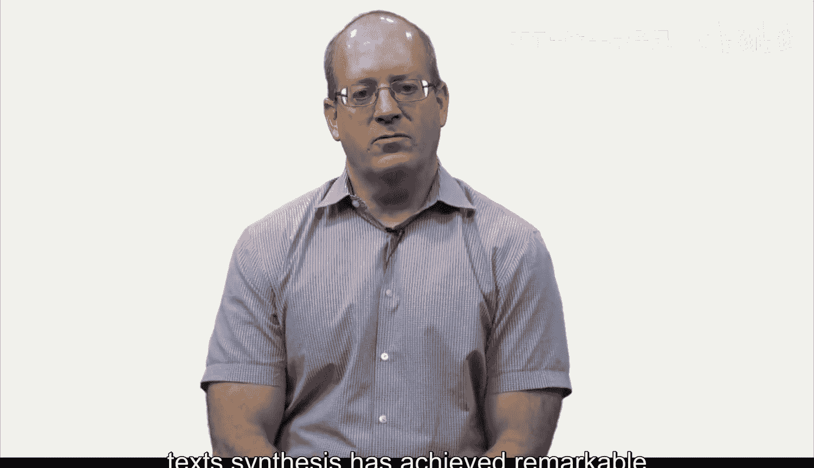

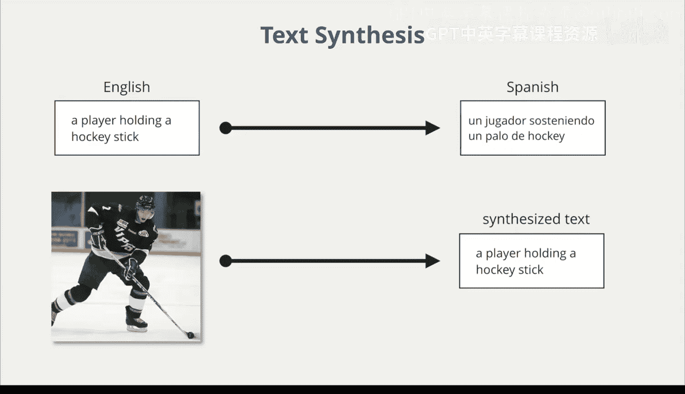

---

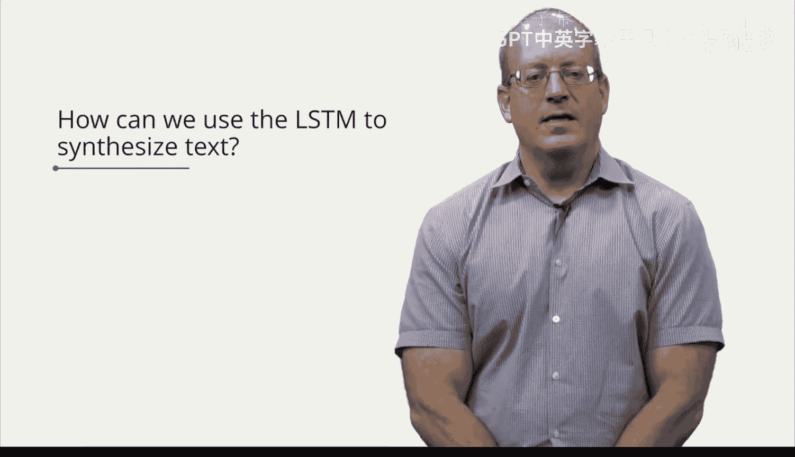

上一节我们介绍了长短期记忆网络的基本概念。本节中，我们来看看如何将LSTM模型应用于文本合成。这种基本框架已在多个应用中取得了显著成果，例如语言翻译和图像自动描述。

## 文本生成的基本流程

假设我们已经基于一个大型文档语料库学习了LSTM的参数。那么，如何使用LSTM来合成文本呢？

LSTM的基本结构是一个神经网络。其输入包括：
*   来自前一步的隐藏单元 `H` 和记忆细胞 `C`。
*   前一个单词。

其输出是：
*   下一个隐藏单元，用于预测下一个单词。
*   更新后的记忆细胞。

更新后的记忆细胞和隐藏单元将传递到下一个神经网络单元。我们将以循环的方式反复应用这个基本结构，因此它被称为循环神经网络。

以下是文本生成的具体步骤：

1.  **初始化**：我们使用一个“句子开始”符号 `BOS` 来初始化文本生成过程。同时，我们初始化隐藏单元 `H0` 和记忆细胞 `C0`。
2.  **预测第一个单词**：将 `BOS`、`H0` 和 `C0` 输入LSTM单元。输出的隐藏单元 `H1` 会通过一个 `softmax` 层，该层会给出词汇表中每个单词作为下一个单词（即第一个单词 `W1`）的概率。我们通常选择概率最高的单词作为 `W1`。
3.  **循环生成**：将预测出的单词 `W1` 的向量表示，连同更新后的 `H1` 和 `C1`，一起作为输入送入下一个LSTM单元。该单元输出 `H2`，再经过 `softmax` 得到第二个单词 `W2` 的概率分布，并选择最可能的单词。此过程不断重复。
4.  **结束生成**：当模型输出“句子结束”符号 `EOS` 时，生成过程终止。

通过这种循环神经网络，我们可以顺序地合成文本。接下来，我们将看到一个结合了图像分析的强大应用。

## 应用实例：自动图像描述 🖼️

在真实应用中，我们通常需要根据特定任务来初始化 `H0` 和 `C0`。自动为图片生成描述就是一个很好的例子。

观察这张鸟的图片及其描述文本：“这只鸟有着红色的喉咙和胸部，头部和翅膀是深棕色的”。重要的是，这个句子是由机器自动生成的，而非人类撰写。

这是如何实现的呢？它结合了我们课程中讨论过的两个关键概念：

1.  **深度卷积神经网络**：用于分析图像。图片首先通过一个DCNN，网络顶层的输出是一组能表征图像的特征。
2.  **长短期记忆网络**：用于合成文本。上一步提取的图像特征被用来初始化LSTM的记忆细胞 `C0`。

这个端到端的方法，通过将用于图像分析的DCNN和用于文本合成的LSTM结合在一起，训练出一个能够同时分析图像并生成描述文字的模型。模型的输入是图像，输出是文本。

为了学习这样一个组合模型，我们需要为模型提供大量由人类标注的“图像-文本”配对示例。利用这些数据，我们可以同时学习卷积神经网络和LSTM的参数。

以下是机器生成的一些描述示例。可以看到，这些句子语法正确，并且对图像内容的描述相当准确和真实，其质量令人印象深刻。

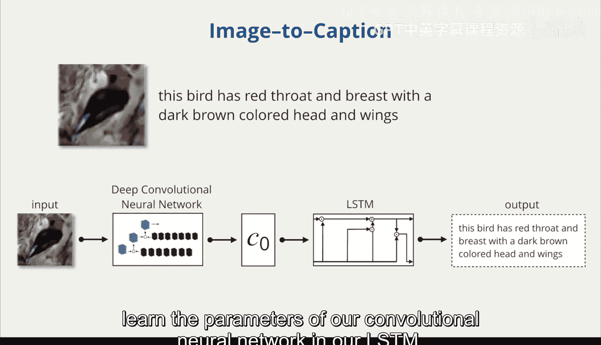

*   一只棕白相间的小狗躺在沙发上。
*   一个穿着黑色西装的男人正在弹吉他。
*   一群长颈鹿站在一棵树旁边。
*   一盘食物放在桌子上。
*   一辆公共汽车行驶在城市的街道上。
*   一个小孩在公园里玩飞盘。

这个例子展示了机器学习领域的巨大潜力：我们将用于图像分析的先进技术（深度卷积神经网络）与用于文本合成的先进技术（LSTM）相结合，实现了对图像的自动描述，其准确性和真实感已接近人类水平。

---

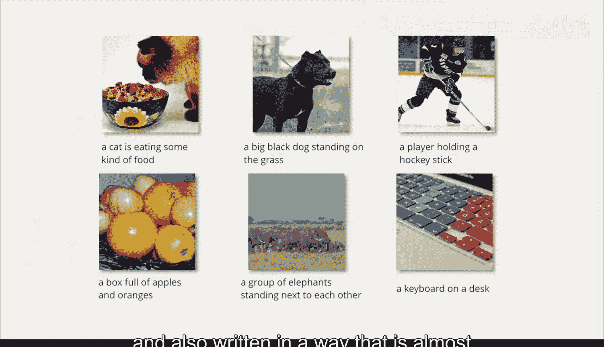

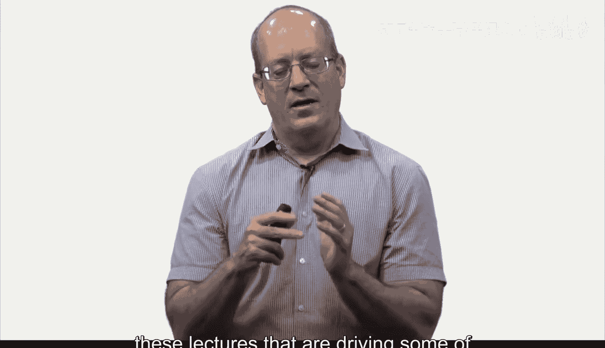

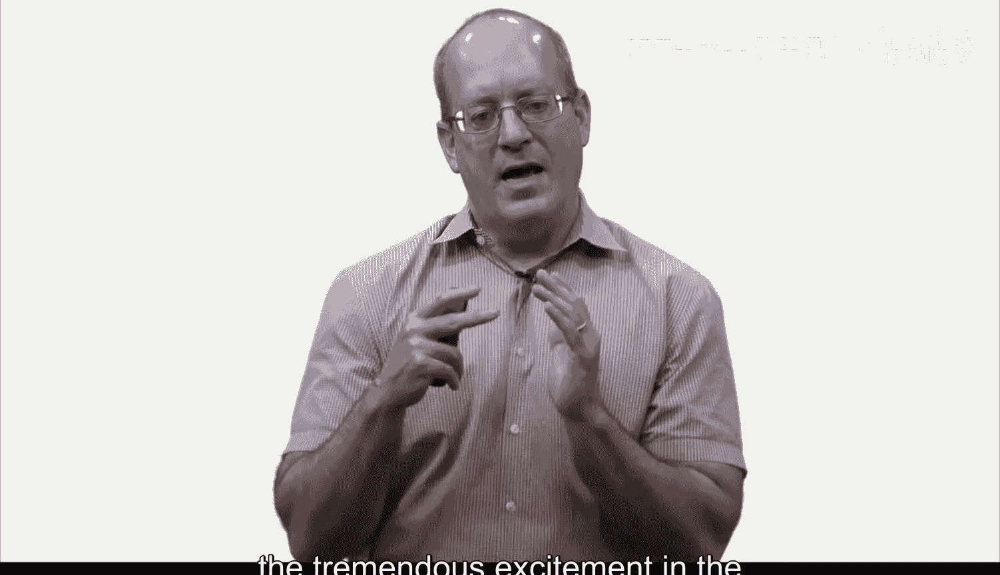

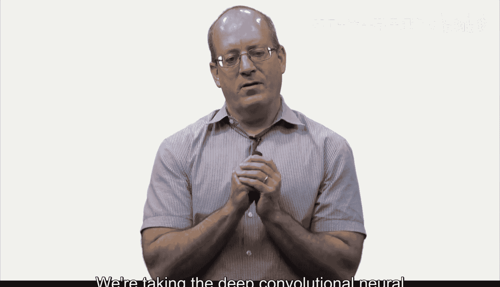

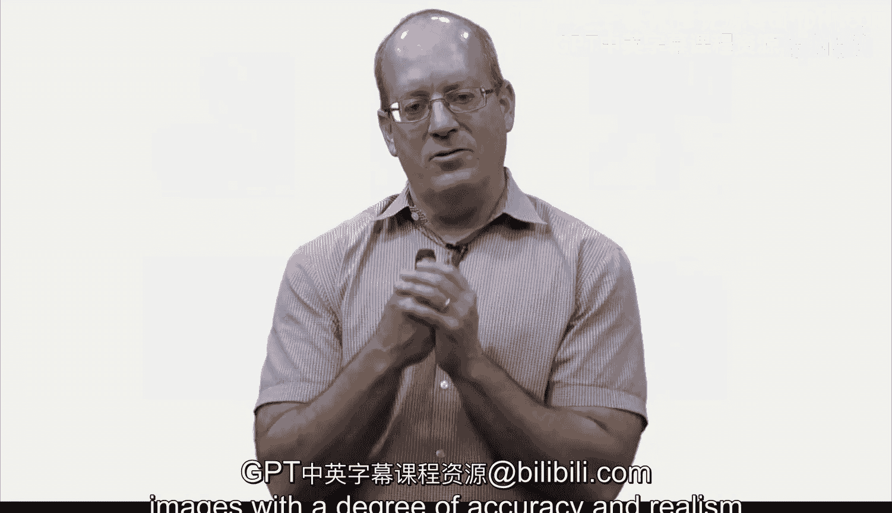

本节课中，我们一起学习了LSTM用于文本生成的基本流程，并深入探讨了其在自动图像描述任务中的端到端应用。我们看到了如何将图像特征作为LSTM的初始状态，从而引导模型生成与图像内容相关的连贯文本。这体现了现代机器学习系统整合多种技术以解决复杂任务的能力。