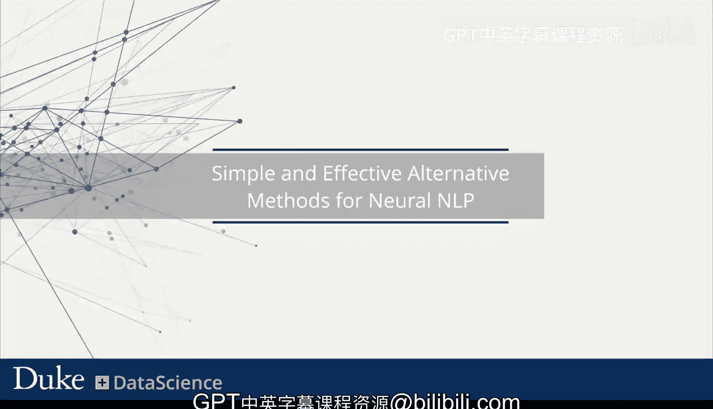
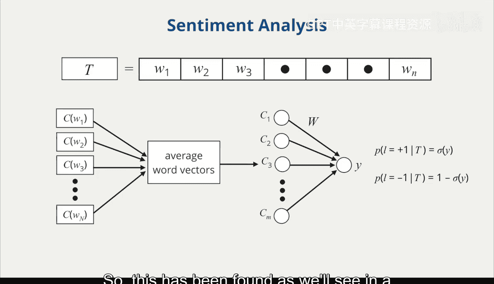
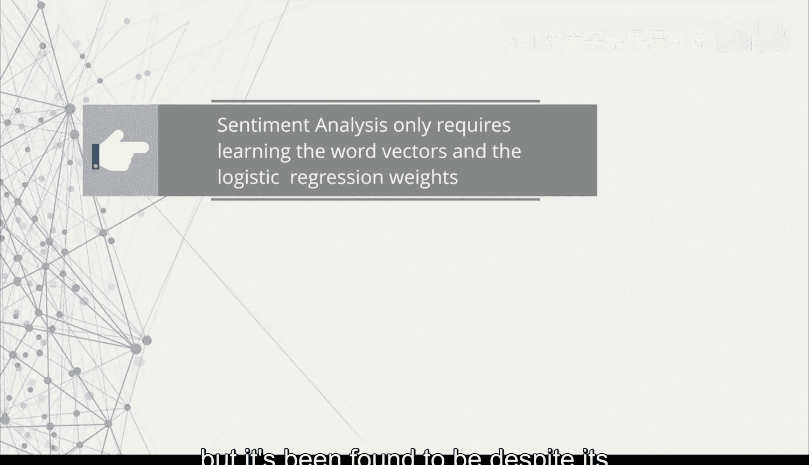
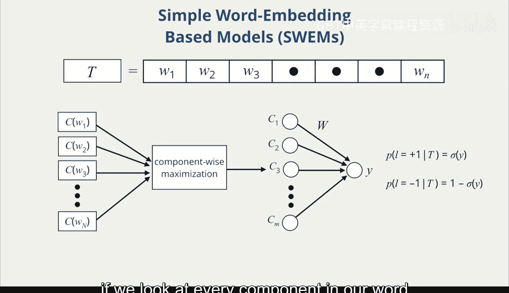
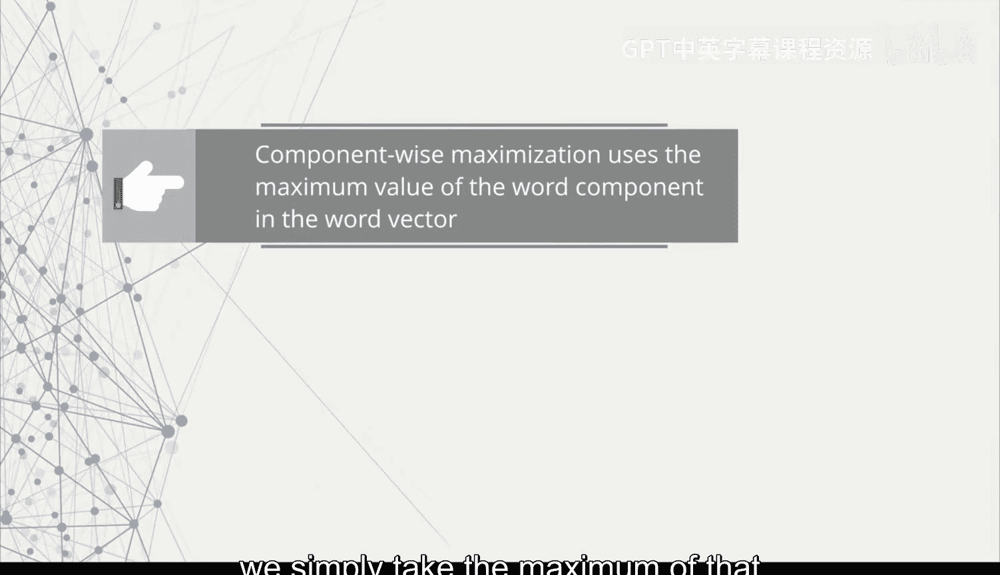
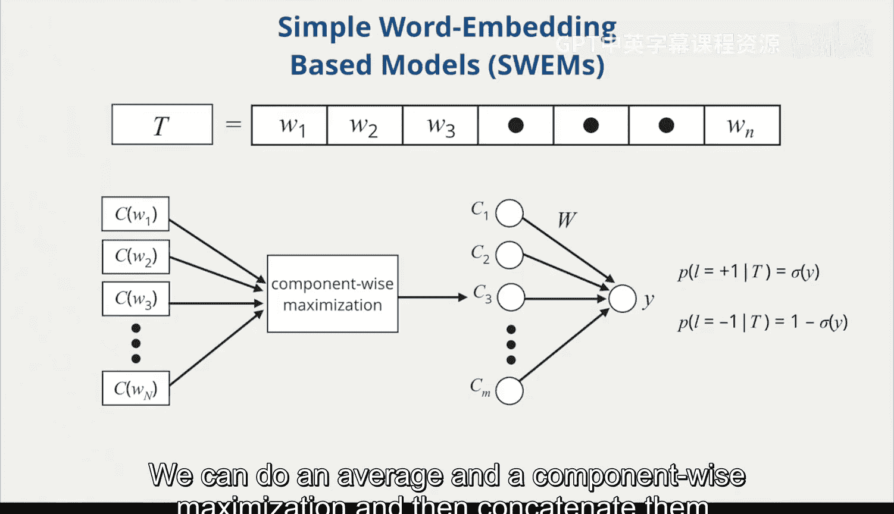
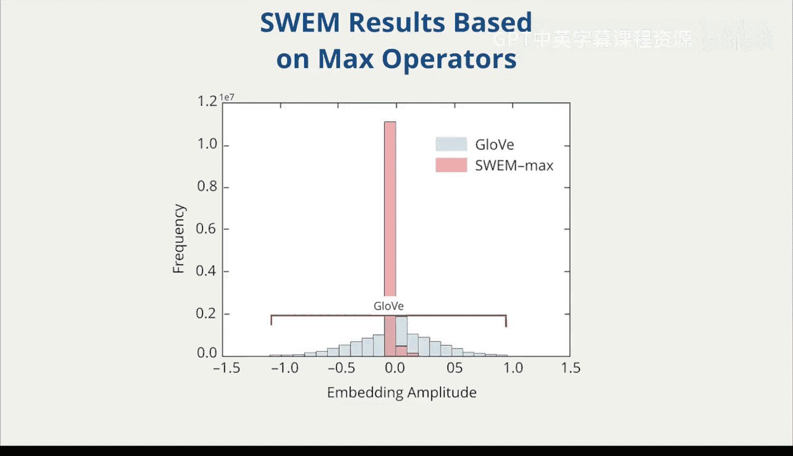
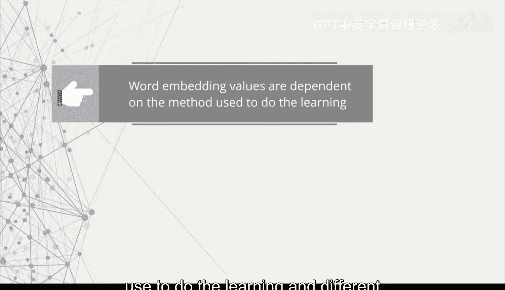
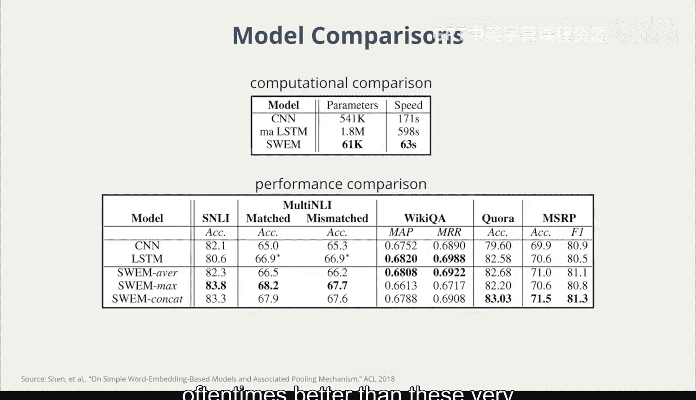
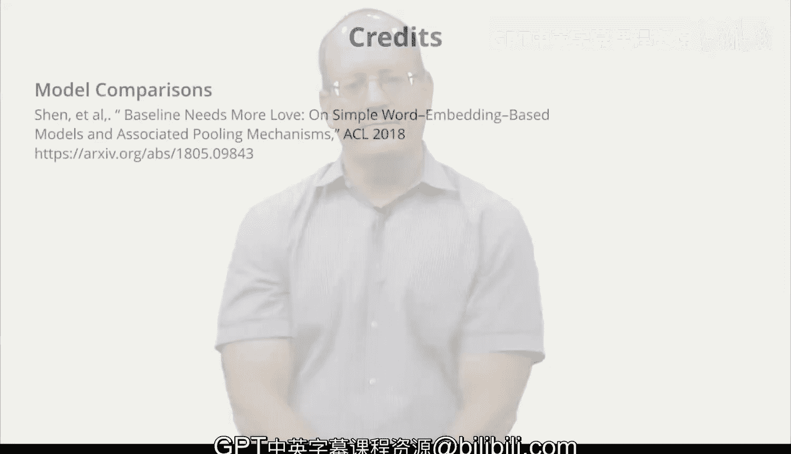

# 杜克大学《机器学习｜Introduction to Machine Learning》中英字幕 p49 49_04_01_神经NLP的简单有效替代方法.zh_en -BV1yjvdBQEaU_p49-

So we've introduced several different methods。For analyzing text。

 so we introduced the skipgramm and the bag of words model for learning word embedding vectors。

 We've also introduced the LSTM model， which is particularly effective at synthesizing text。

At generating text。What's been recognized over the last several years？

Is that while these complicated models， particularly the LSTM， are useful for many tasks and in fact。

 are required， for example， for synthesis。It's been recognized that oftentimes very simple models work well for many tasks。

 so the last example I want to give on the natural language processing discussions is to just try to demonstrate that for many natural language processing tasks。

Very simple models， much simpler than the LSTM， and also the convolutional neural network。

 which we've discussed elsewhere。

Much simpler models than those can often yield state of the art results。

And so let's consider the problem of sentiment analysis。

 So sentiment analysis is characterized by the situation in which were given text， given a document。

Which will represent the I example of a document where we represented T subi。

 so T subi is a set of words associated with the text from the I document。

And then we're also given a label。For example， minus-1 plus1 where-1 may mean that the sentiment is negative and plus one may mean that the sentiment is is positive。

 Here we're considering a binary example， but we can consider other than binary。

 So this is a very common problem。 We would like to build a model that can a machine that can read the text represented by capital T。

And then it can predict the sentiment。And so the question is。

 can we do this task using relatively simple models。

 models that are much simpler than the LSTM and the CNN？And the answer is that we can。

 And so I like to just spend a few moments to demonstrate that。 And。

 and this kind of underscores that for many many tasks in natural language processing。

Simple models work very well。 So let's consider text T。Which is represented by N words， W1。

 W2 through WN。And what we would like to do is a very， very simple model。

 So CW1 is the code or the vector for word 1。CW2 is the code or the vector for word W2。

 And C WN is the code or the vector for word。WN， those are the codes of the vectors representing the words in our document。

Let's do something really simple， let's just average those words。

Just take the average of the word vectors across all n documents in our in our take average the word vectors for all n words in our document。

 So we get a single vector after we do that。 And then let's just send this into a very simple logistic regression classifier。

 So here。The inputs to the model are is the average of the vectors which will be represented by C1。

 C2 through CM。 Those are the M components of the average of the output of the average of our vectors we're going to send that into a logistic regression which is characterized by the parameters W and then we're going to represent the probability that the label is plus one in terms of the sigmoid function。

 soid or sigmoid of y or the logistic of y and the probability of class label minus1 as one minus that this is a very。

 very simple model simple logistic regression So this is bringing together several concepts that we've talked about elsewhere in these lectures。

 this is logistic regression classifier characterized by parameters W and we're using the concept of word vectors or word embeddings for each of the words in our document built。

A very simple model， take the average of the word vectors， send it to the logistic regression。

 predict the sentiment， and so that logistic regression is represented or the sigmoid。

 the sigma function is represented by this sigmoid function that we've seen elsewhere in our discussions。

So this has been found， as we'll see in a moment， to be very effective in practice。

 the only parameters that we need to learn here。

Are the word vectors？For each of the Vword in our vocabulary and the weights of the logistic regression。

 this is clearly much simpler model than the LSTM。 It's much simpler than any of the recurrent neural networks much simpler than the convolutional neural network but it's been found to be despite its simplicity to be very effective in practice So the question that we would ask is how could such a simple model work well。

 how could this work well Now the question the problem that we're solving here is actually a fairly straightforward one。

 Our objective is simply to analyze the sentiment of a document。

And so。The model to underscore the simplicity， if we look at what we're doing is we're taking the average of the word vectors for each word in our document。

So that means that we're not using the word order at all because if you change the order of the documents。

 if you change the order of the words in the document， the average doesn't change。

 So how how can this work。So what must be happening and we'll see in a moment what is happening？

Is that the model will assign near zero values to the embeddings or the vectors for all words that are not informative for the task of sentiment analysis so remember that we're learning word vectors for every every word in our vocabulary if a word in a vocabulary。

 is not important for sentiment analysis， what this model will do is it effectively it will implicitly and in practice set all words that are unimportant to the sentiment analysis task to an embedding vector of near zero。

 which means that the contribution to the average of all words that are unimportant for sentiment analysis。

 their contribution will be zero， and so therefore what this model is doing is it's inferring the key words of importance to the sentiment analysis。

I'll notice I will also note that using the average。

Of the word vectors is not the only thing one can do。Alternatively。

 what you can do is you could do a component wise maximization。

 And so therefore what I mean by that is， is that if we look at every。Component in our word vector。

Across all the words in our document， we simply take the maximum。

Of that value across all words in the document。 So a document is characterized by a set of word vectors associated with each of the words in a document。

 What we're going to do is for each component of the vector。

 we're simply going to ask which word in our document has the largest value for that component。

 And then we'll just， we'll just use that。 So this is what we call componentwise maximization。

 After we do that， we again get a vector。 That vector goes into our logistic model with parameters W。

 And again， we make a prediction。 So is a very simple model。

 So these are called simple word embedding models or Sw。

And so that， the average。We can we can either do an average or a component wise maximization。

 and we can do both。 actually， we can do a average and a component wise maximization and then concatenate them。

 And so what I said。

Was that for this to work conceptually， for this to work。Implicitly。

 what must be going on is that the model learns。

That most words are not important to sentiment analysis。 And consequently。

 the associated vectors of those words are mapped to a0 embedding。

 and then only the relatively small number of words， which are important for。

For the classification， the sentiment classification task。

 only those relatively small important words have non-zero embeddings and so what I'm showing here is is these are real results on sentiment analysis of a large corpus Swm remember is our simple model。

 we're showing Swm max which means that we're doing maximization of the components of the word vectors across the document what we're showing is the frequency of each value in the word embedding and so what you notice is is that in the Swm model almost all components。

Of the word embeddings are 0。 So notice that we're just showing a histogram of the value of the word embeddings。

 And for the Swm model， almost all words have word embeddings near 0。

 So you can see that they're almost all near0。 And there's only a relatively small number of words that have nonzero value。

 And those are the words that contribute to the sentiment analysis。 G。

Is a different method for learning word embeddings， which is different than what we're showing here。

 it is not based upon this swam construct and here you notice that the glove results has a much more broad distribution of values of the word embedding so one thing to take away from this is that the values of the word embeddings or the values of the vectors associated with the words in our vocabulary those vectors depend upon the method you use to do the learning and different methods will learn different vectors and so when you use this swambased idea。

 this simple idea which tends to map all of the or most of the words or the unimportant words to a zero embedding you get a highly concentrated set of embeddings near zero where another approach using a different methodology。

You hear glove， yields are very different。Very different set of word vectors。

 so this is a very detailed plot not to this slide is just to give a sense of things。

 we have previously talked about a CNN or convolutional neural network based model for text analysis we've talked about the LSTM model for text and so what I just want to give you and then I've talked about the SwM。

 which is the very simple model and so I just want to give you a sense of the complexity of these different models to underscore that there are many different ways of doing natural language processing based upon these neural models。

And depending upon what you choose to use， there's very different levels of complexity。

 So you notice that the CNN has about 540000 parameters。 The long short term memory has 1。

8 million parameters， and then this very simple swam model has only 61000。Parameterters。

 we look at computational speed， we also notice that that complexity of the CNN and LSTM also translates into computational time。

 So we just notice the speed is not important。 what exact task we're doing here。

 the key thing to notice is the relative number of parameters in the relative computational speed。

 And then on the bottom table， this is， again， not something to spend too much time looking at。

 But what we're showing is results of the CNN in the LSTM based models。

 So these are are very complicated models。On the accuracy of predicting the sentiment and then other other metrics across the horizontal。

 the SNL1， the multi NL1， WikiQA， Qa MSRP， those are different data sets and different natural language processing tasks I give the reference in the figure so you can go take a look at this if you want。

 the key thing to notice here， is that the Swm based model， which is a very simple model。

Oftentimes performs as well。Oftentimes better than these very complicated CNN and LSTM models。

 And so the key thing to take away is that。

This concept。Of learning embeddings or vectors for each of the words is a very powerful One can be used across many different types of models。

 CNN， LSTM， Swm。

And others that we've looked at。

And oftentimes。We find。

Fortunately， that very simple models like SWM can do very well on complicated but interesting tasks such as sentiment analysis。

 and so as we consider various problems in natural language processing。

 we need to pay careful attention to examine the appropriate level of model complexity and to make sure that that model complexity is matched to the problem。

 oftentimes very simple models can perform very well。

