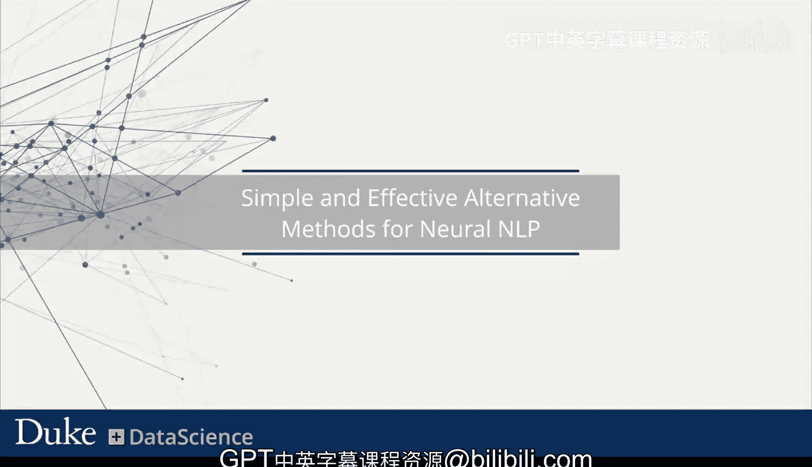
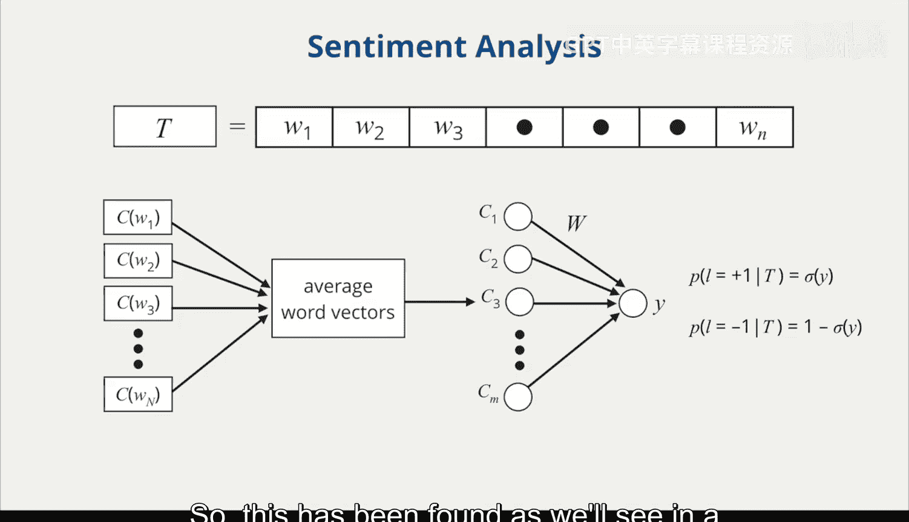
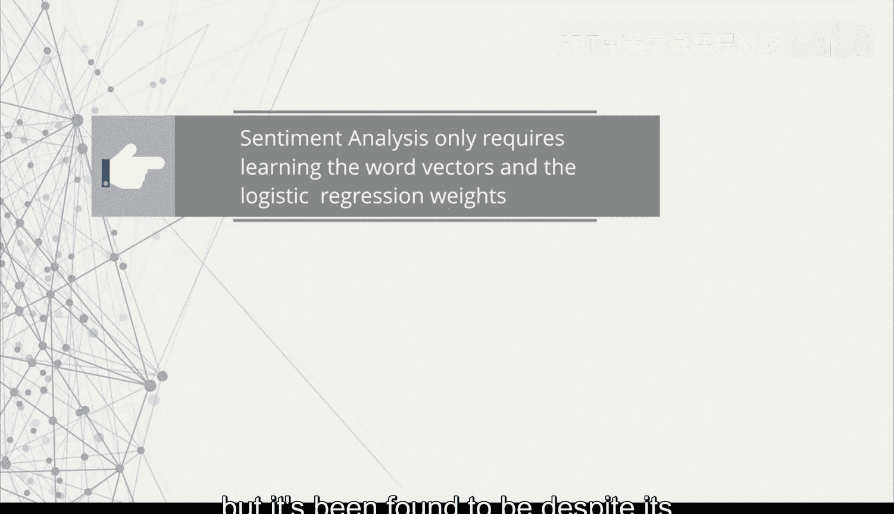
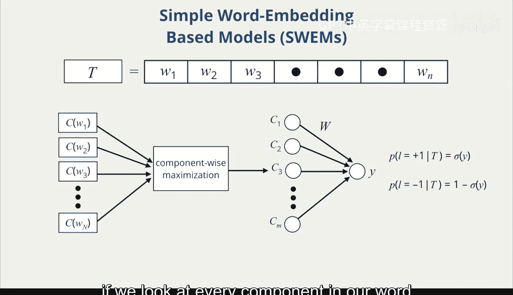
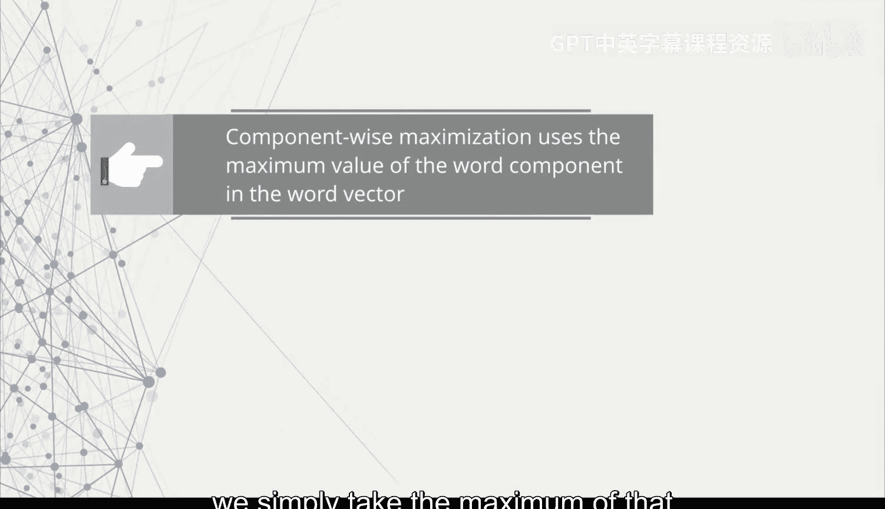
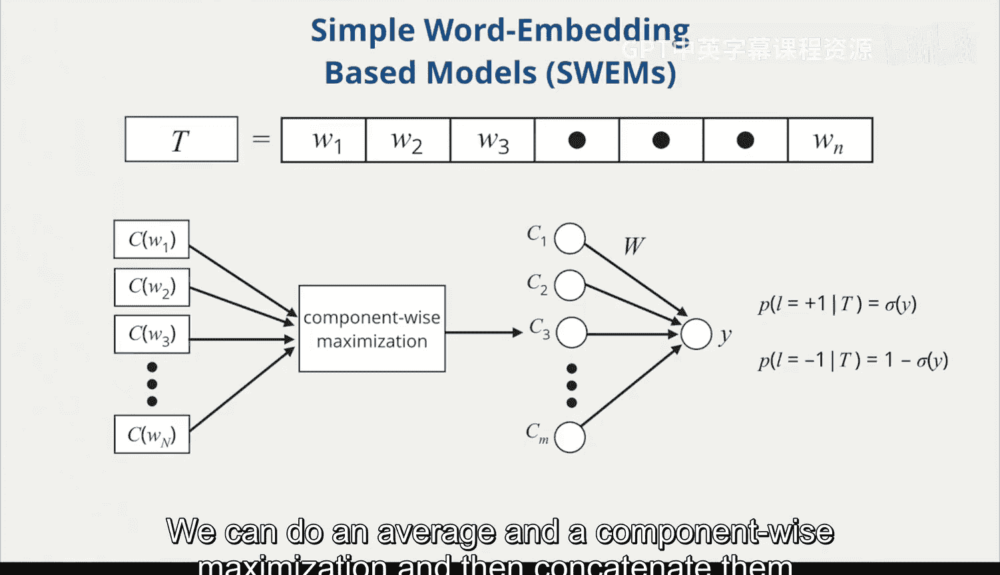
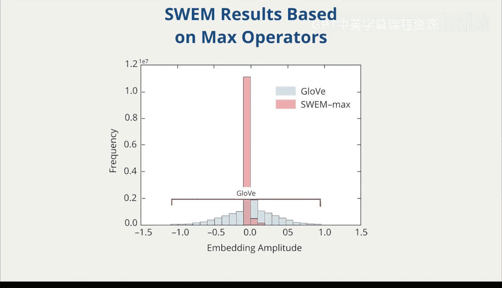
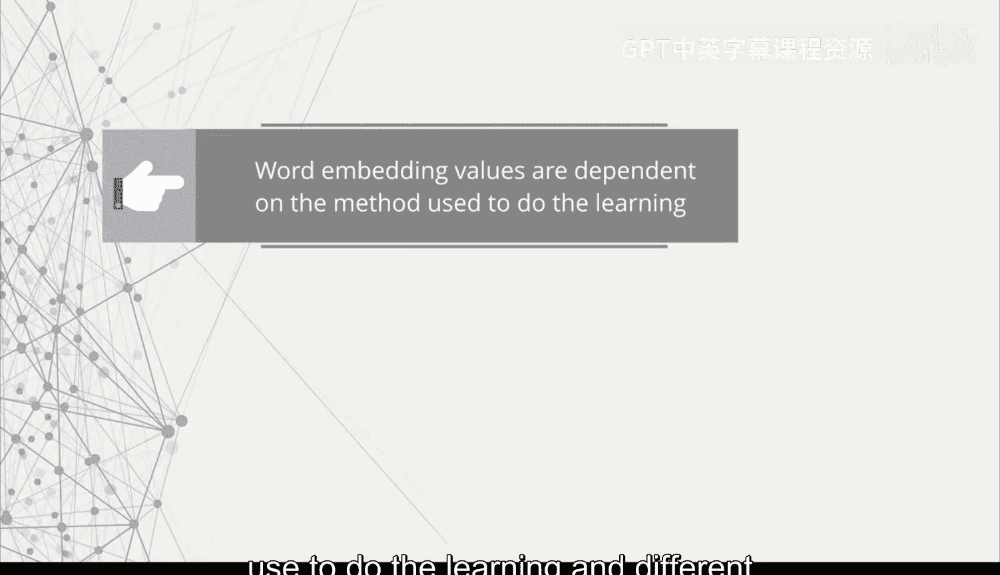
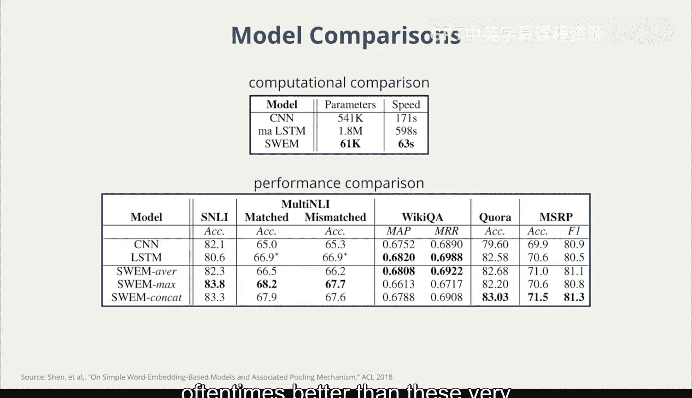

# 机器学习：49：神经NLP的简单有效替代方法 🧠➡️📄

在本节课中，我们将要学习一种用于自然语言处理任务的、极其简单却非常有效的模型。我们将以情感分析任务为例，探讨如何通过简单的词向量平均或最大化操作，结合逻辑回归分类器，达到与复杂模型（如LSTM和CNN）相媲美的性能。

---

## 概述

我们已经介绍了几种不同的文本分析方法，包括用于学习词嵌入向量的Skip-gram和词袋模型，以及特别擅长文本生成的长短期记忆网络模型。然而，近年来人们认识到，对于许多任务，非常简单的模型往往也能取得出色的效果。本节我们将通过情感分析任务来演示这一点。

---

## 问题定义：情感分析

上一节我们介绍了复杂的序列模型，本节中我们来看看一个更简单的替代方案。首先，我们明确要解决的问题：情感分析。

情感分析任务通常定义为：给定一个文本文档（用 \( T_i \) 表示第 \(i\) 个文档的单词集合），以及一个标签（例如，-1 表示负面情感，+1 表示正面情感），目标是构建一个模型来预测文本的情感倾向。

---

## 构建简单模型：词向量平均

以下是构建简单模型的核心步骤。我们将采用一种忽略词序的直观方法。

1.  **获取词向量**：对于文档中的每个单词 \( W_j \)，我们有其对应的词向量（或嵌入向量） \( C_{W_j} \)。
2.  **计算平均向量**：我们简单地计算文档中所有 \( N \) 个词向量的平均值：
    \[
    \text{平均向量} = \frac{1}{N} \sum_{j=1}^{N} C_{W_j}
    \]
3.  **输入分类器**：将这个平均向量输入一个简单的逻辑回归分类器。逻辑回归由参数 \( W \) 定义，并使用Sigmoid函数（\( \sigma \)）来预测标签为+1的概率：
    \[
    P(\text{标签} = +1) = \sigma(W^T \cdot (\text{平均向量}))
    \]
    \[
    P(\text{标签} = -1) = 1 - P(\text{标签} = +1)
    \]

这个模型需要学习的参数仅仅是所有词汇的词向量和逻辑回归的权重 \( W \)。它比LSTM或CNN要简单得多。

---

## 模型为何有效？

你可能会问：这个模型完全忽略了单词的顺序，它怎么可能有效呢？关键在于模型的学习过程。

在训练过程中，模型会**自动学习**将那些对情感分析任务不重要的单词的词向量调整到接近零值。因此，在计算平均值时，这些“不重要”的单词贡献几乎为零。最终，模型的预测主要依赖于少数对情感有显著贡献的关键词的词向量。这相当于模型自动进行了特征选择。

---

## 扩展：分量最大化方法

除了取平均值，我们还可以采用另一种简单的聚合方法：分量最大化。

以下是分量最大化方法的操作流程：

1.  对于一个包含 \( N \) 个单词的文档，我们拥有 \( N \) 个词向量。
2.  对于词向量的每一个维度（分量），我们找出该维度在所有 \( N \) 个词向量中的最大值。
3.  用这些最大值组成一个新的向量，作为文档的表示。
4.  同样，将这个新向量输入逻辑回归分类器进行预测。

我们甚至可以将“平均向量”和“最大化向量”连接起来，形成一个更丰富的文档表示，再送入分类器。这类模型统称为**简单词嵌入模型**。

---

## 实证结果与模型对比

为了直观展示简单模型的效果，我们将其与复杂模型进行对比。

*   **参数数量与速度**：
    *   **卷积神经网络**：约54万个参数。
    *   **长短期记忆网络**：约180万个参数。
    *   **简单词嵌入模型**：仅约6.1万个参数。
    *   参数量的巨大差异直接体现在计算速度上，简单模型要快得多。

*   **性能表现**：在多个不同的自然语言处理数据集和任务（如SNLI、MultiNLI等）上，简单的SWM模型在情感分析等任务上的准确率**常常与复杂的CNN和LSTM模型相当，有时甚至更好**。

*   **词向量分布**：通过SWM方法学习到的词向量有一个显著特点：绝大多数单词的向量值都集中在0附近，只有少数重要单词拥有非零值。这与GloVe等其他方法学习到的、值分布更广泛的词向量形成鲜明对比。这印证了模型“聚焦关键信息”的工作原理。

---

## 总结

本节课中我们一起学习了自然语言处理中一种强大而简单的范式。我们了解到，**学习单词的嵌入向量是一个核心且强大的概念**，它可以应用于从极其简单的模型到非常复杂的模型。

关键在于，对于许多实际任务（如情感分析），我们应仔细评估问题所需的模型复杂度。事实证明，匹配任务复杂度的简单模型往往能提供最佳的性能与效率平衡。因此，在着手解决NLP问题时，不妨先从像SWM这样的简单模型开始尝试。