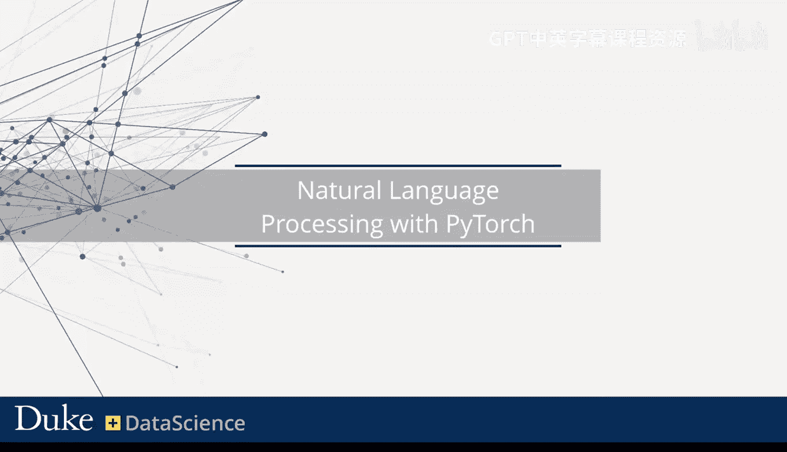
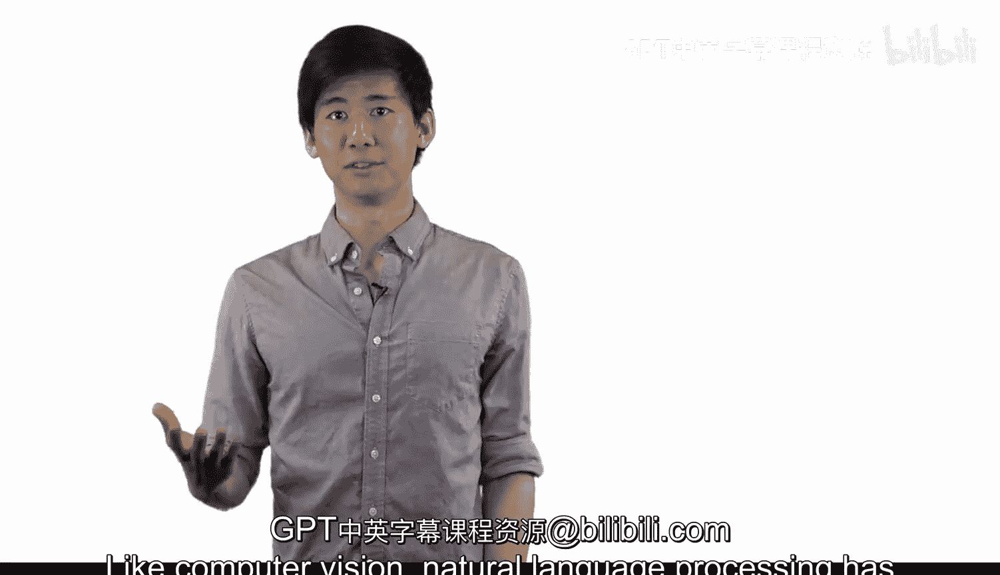
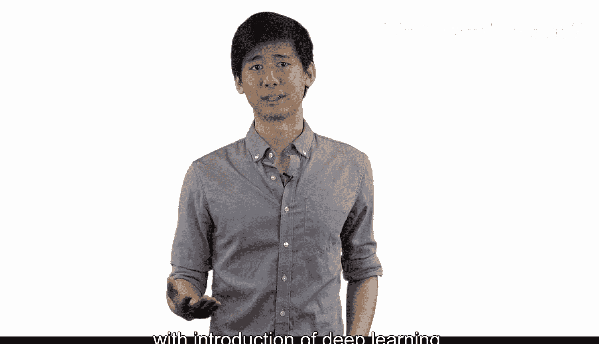
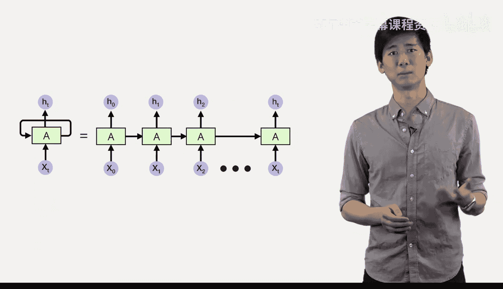
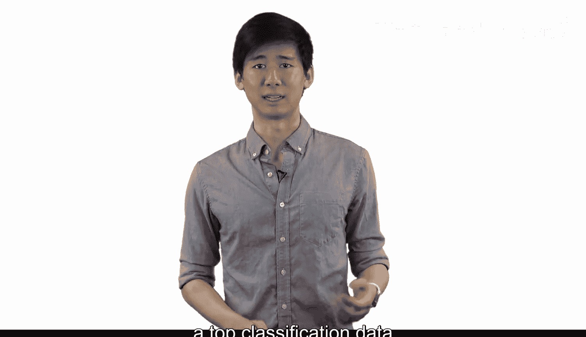

# 杜克大学《机器学习｜Introduction to Machine Learning》中英字幕 p50 50_04_01_使用PyTorch进行自然语言处理.zh_en -BV1yjvdBQEaU_p50-

嗯。Like computer vision， natural language processing has undergone a significant transformation with the introduction of deep learning。

Here， we'll introduce a few of the relevant concepts。In particular。

 module 4 introduced the concept of a word embedding。Which is a vectorized representation of a word。

 that carry some meaning。Here， we'll have some fun with some pretrained word embedding and see how we can use them to find similar words and solve word analogies。

😊，We'll also train a very simple neural network model that learns how to use word embeddings to predict the sentiment of some movie reviews。

We'll conclude with a brief overview of recurrent neural networks in Pytorch。For the assignment。

 you'll train a few different types of models on a top classification data set and compare the performance。

