# 杜克大学《机器学习｜Introduction to Machine Learning》中英字幕 p51 51_05_01_词向量及其解读.zh_en -BV1yjvdBQEaU_p51-

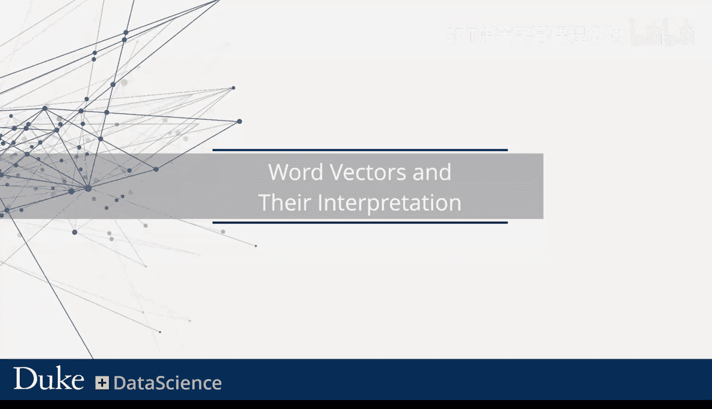

In previous parts of this class， we have talked about the word to Vc concept in the context of natural language processing。

 so the key idea here is that each word in the vocabulary will be mapped to a vector and these vectors are also sometimes called embeddings so if WI represents the Ih word in a vocabulary。

 what we're going to do is map it to a D dimensionional vector。

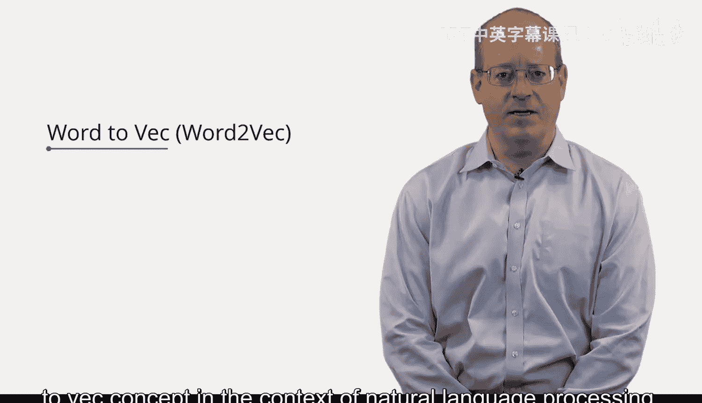

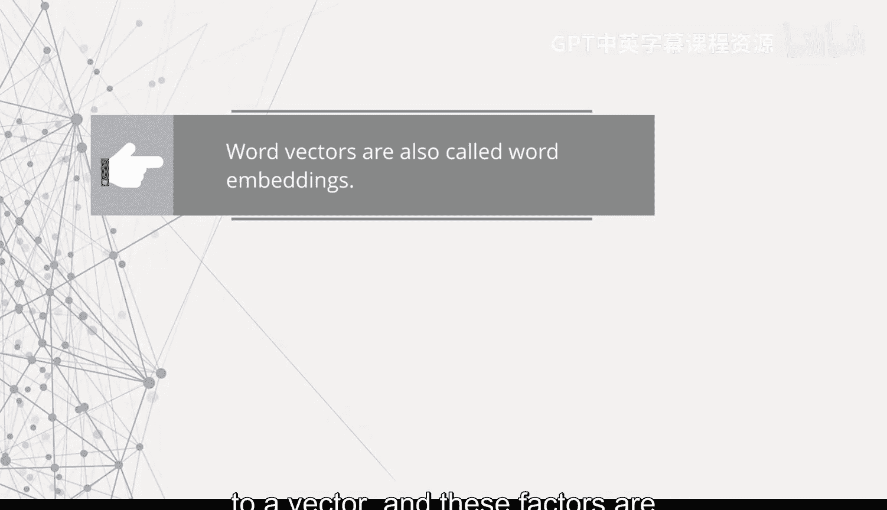

And we're going to do that for every word in our vocabulary。

We've talked about this in the context of the long short termm memory for natural languageness processing。

 we're now going to extend this concept to what's called the transformformer network or a attentionbased network。

 and in so doing the hope will be that will gain some further insight into what these word embeddings or word vectors represent。

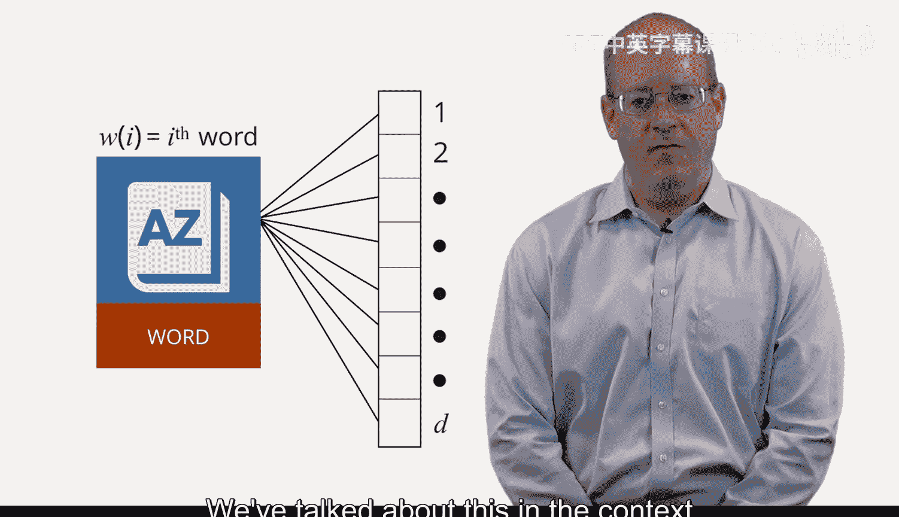

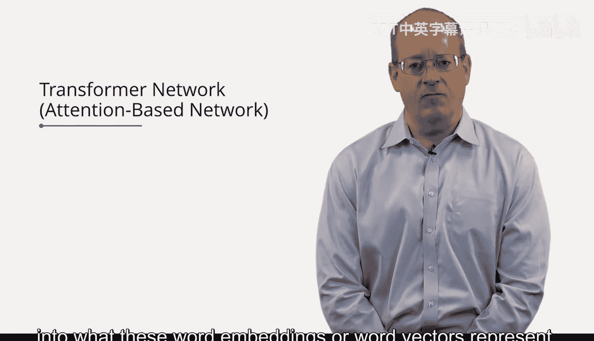

So the key idea of this word to Vc。Mapping， so word to vector。

 word to V mapping is we're going to take our vocabulary， which is composed of here V words。

And we're going to map it to a collection of corresponding vectors or codes。

 so we use the notation C for code， and so if we have V words in over our vocabulary。

 we now have V codes， each one of those codes is a D dimensional vector。So after doing this。

 we represent our vocabulary of words by a codebook， and again。

 a codebook is a collection of the D dimensional vectors for each of the words in a vocabulary。

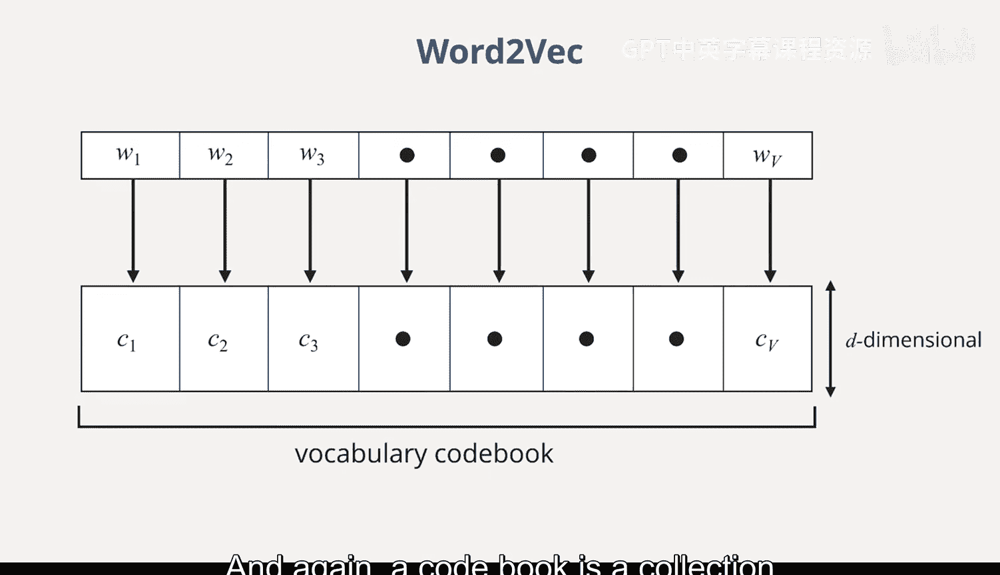

So there are many ways to learn these vectors， these code vectors。

 and in fact we have talked about those different ways of learning in other parts of this class。

 including long shortterm memory， and we're going to as I said earlier。

 we're going to extend this to a new type of model， the transformer。

 the key idea in all of these methods is that for each word and a given document。

 we should be able to predict the next or surrounding words。

 so the idea is is that the words have meaning， that meaning implies that a given word should indicate that a particular other word might be present with high probability。

 these word vectors which we're going to learn are meant to preserve or to achieve that concept。

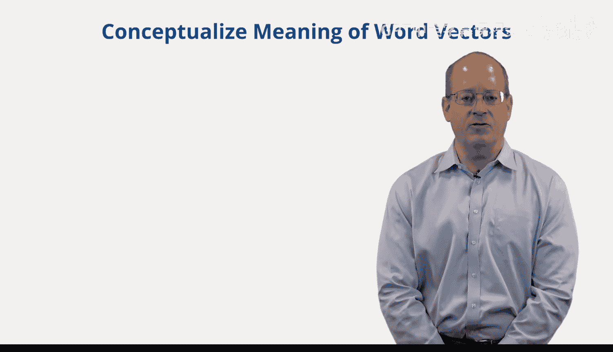

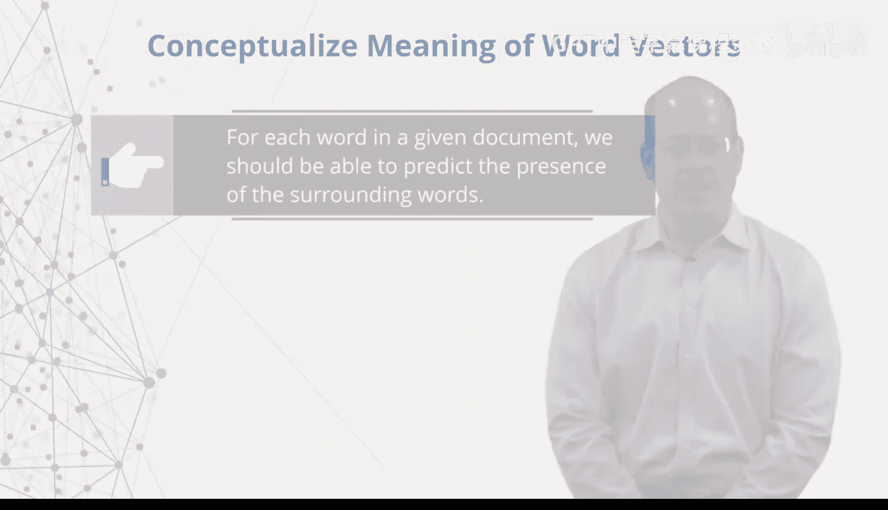

So what we want to do now is to try to achieve a further understanding of what these vectors mean。

 this will help motivate the model that we're going to talk about subsequently so just to simplify the the discussion let's assume that each of these word vectors is 10 dimensional just for simplicity and so in this figure each of those boxes represents a number。

 10 numbers corresponding to the10 components of this vector and so the idea that we want to kind of think about is that they're underlying topics associated with each of these 10 numbers and are 10-disional word vector each of these topics represent characteristics of words or what what one might be trying to represent with words so。

If a given word is aligned with， say the caseith topic。

 then we would expect or what we expect that the corresponding component in our vector will be positive。

 will be a positive number because it aligns with that word if the case topic is not connect to the word or does not align with the word。

 then we would expect the value of the ca element to be negative。

 and we'll see this further as we proceed。

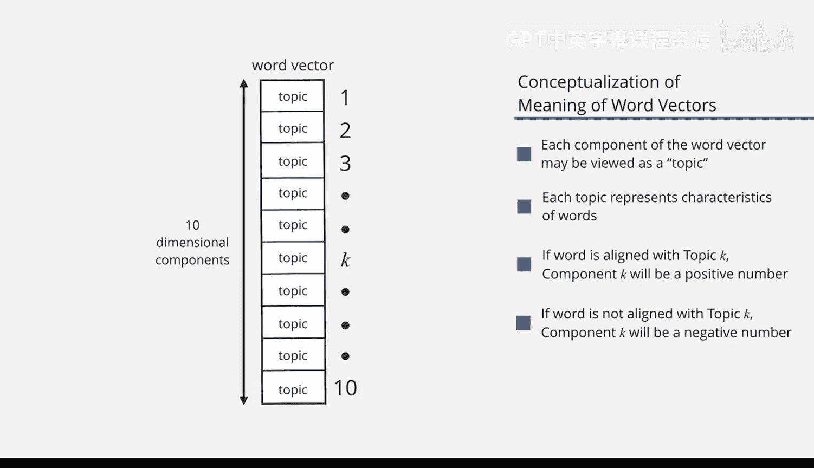

And so just notionally， let's look at a particular word here， Paris just as an example。

 and what I'm doing here is assigning themes or topics with each of the components of that 1-dimensional vector these themes or topics will be learned in the context of our machine learning。

 the assignment of particular names to these here sports politics history。

 this is notional we don't explicitly do that， but it's meant to give some understanding of the underlying concepts associated with this word vector so if we look at the word Paris historically Paris has played an important role it's the capital of France。

 it has played an important role in politics so we see that notally here the second component of that vector is positive which means that Paris is positively aligned with。

poliolitics also Paris as a consequence of its being the capital city of an important country。

 France， it has a very important role in history， so historically Paris is important。

 so we see that the third component which corresponds to history is positive。

The the next or the fourth component notally corresponds to action or a verb。 Well。

 Paris is a proper noun。 It doesn't have much explicitly to do with action。

 so we see that the action component is negative。 Paris is a name， It's a name of a city。

 So the next component which corresponds to names is positive。

 And so the idea that we're trying to reflect here。

 is that the underlying components of the word vector have some topical or thematic meaning。

 We don't explicitly have to know what that meaning is。

 but it is uncovered through the machine learning And so the idea that we want to gather from this is that what that word vector is doing is representing component by component as to with the component either being positive if it's aligned with the topic or negative if it's not aligned is providing the underlying thematic。

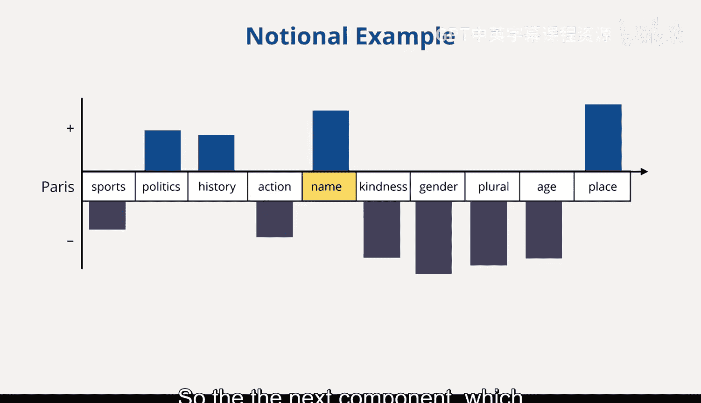

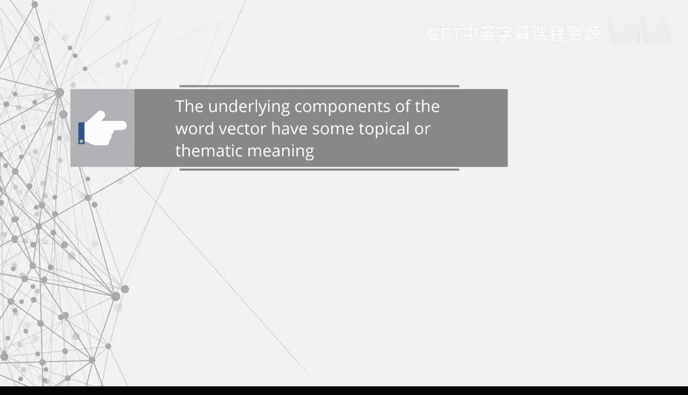

Meaning of the word that's what this word to V concept is meant to reflect。

 Now what we're going to do next is take this idea of some meaning or association of what this word vector is actually doing and use it to constitute a new form of machine learning for natural language for natural language and this is a natural language processing model。

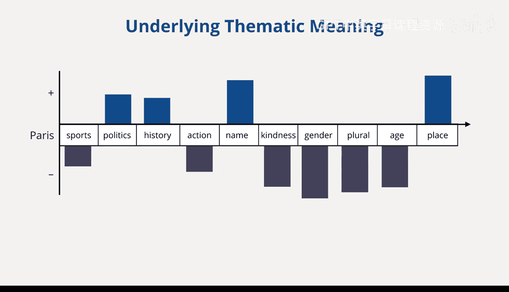

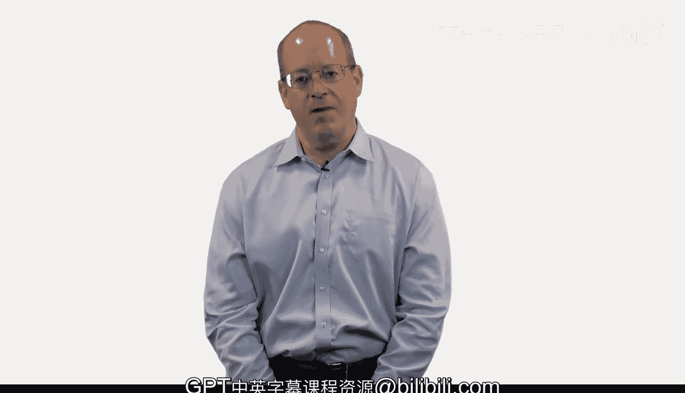