# 机器学习：51：词向量及其解读 🧠

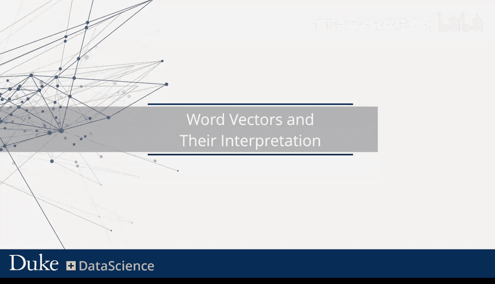

在本节课中，我们将要学习自然语言处理中的一个核心概念——词向量。我们将探讨词向量的基本思想、其数学表示，并尝试理解这些向量所蕴含的语义信息。这为后续学习更复杂的模型（如Transformer）奠定了基础。

---

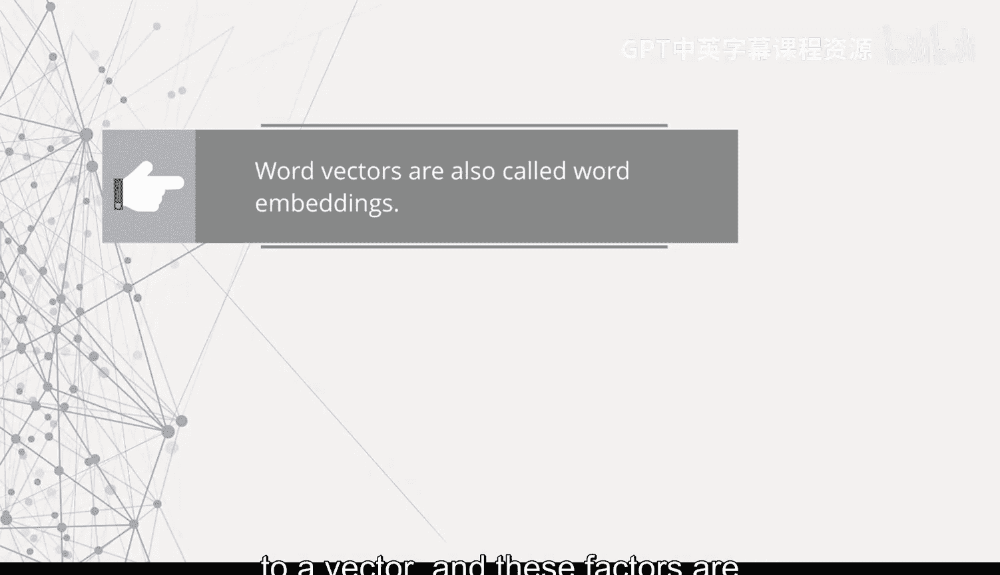

在课程的前面部分，我们已经在自然语言处理的背景下讨论过词向量（Word to Vector）的概念。

核心思想是，词汇表中的每个单词都将被映射到一个向量，这些向量有时也被称为嵌入。如果 **w_i** 表示词汇表中的第 **i** 个单词，我们要做的就是将其映射到一个 **D** 维向量。

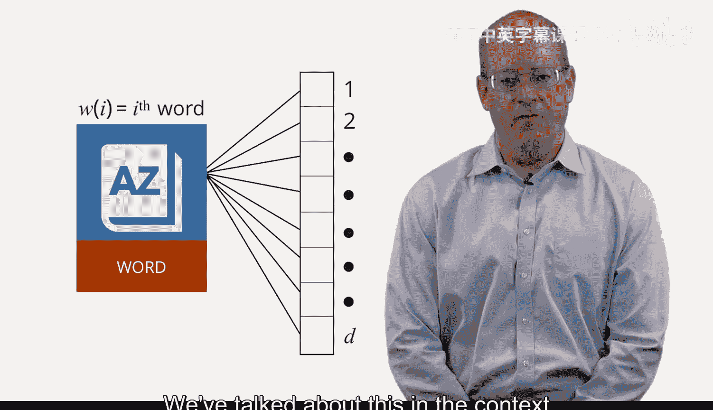

我们将对词汇表中的每个单词都进行这种映射。

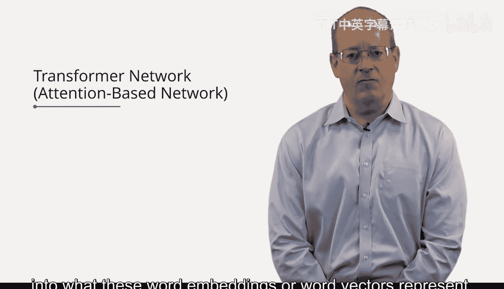

我们曾在长短期记忆网络的背景下讨论过这个概念。现在，我们将把这个概念扩展到所谓的Transformer网络或基于注意力的网络。这样做，是希望我们能进一步理解这些词嵌入或词向量所代表的意义。

---

## 词向量映射的核心思想

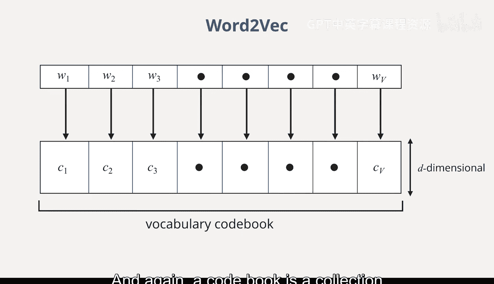

词向量映射（Word to Vector Mapping）的关键思想是：我们将由 **V** 个单词组成的词汇表，映射为一组对应的向量或编码。

我们使用符号 **C** 表示编码。因此，如果我们的词汇表有 **V** 个单词，我们现在就有 **V** 个编码，每个编码都是一个 **D** 维向量。

完成此映射后，我们通过一个“码本”来表示我们的词汇表。码本就是词汇表中每个单词对应的 **D** 维向量的集合。

---

## 如何学习词向量

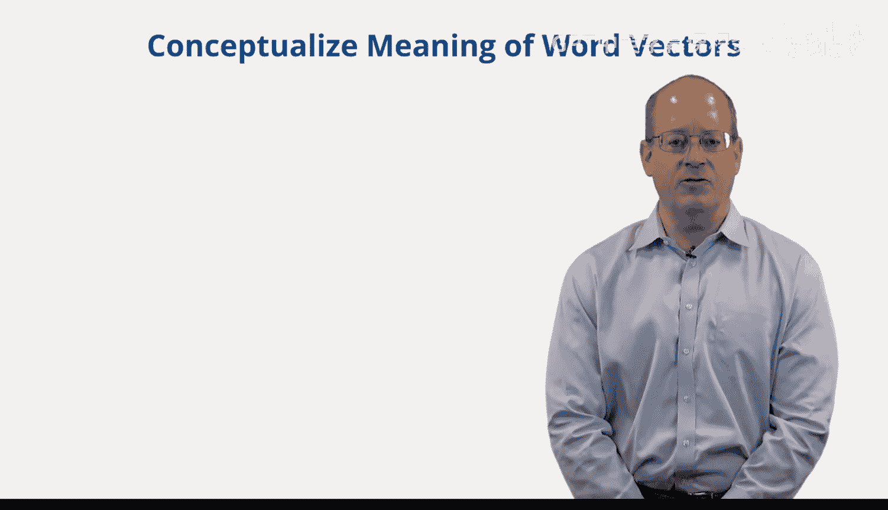

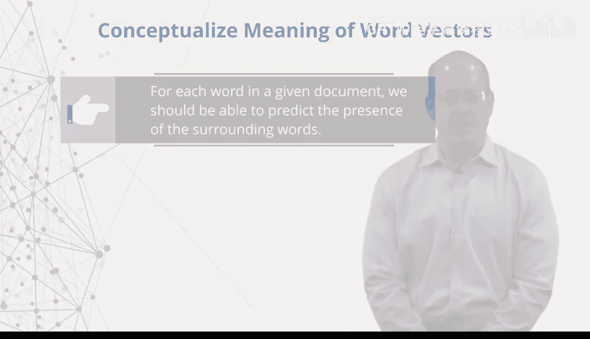

学习这些向量（编码向量）的方法有很多种。事实上，我们在课程的其他部分已经讨论过这些不同的学习方法，包括长短期记忆网络。正如之前所说，我们将把这个概念扩展到一种新模型——Transformer。

所有这些方法的关键思想是：对于给定文档中的每个单词，我们应该能够预测其下一个或周围的单词。其理念是，单词具有意义，这种意义意味着一个给定的单词应该能以高概率暗示另一个特定单词的存在。我们要学习的这些词向量，就是为了保留或实现这个概念。

---

## 理解词向量的含义

我们现在要做的是，尝试进一步理解这些向量意味着什么。这将有助于激发我们接下来要讨论的模型。

为了简化讨论，我们假设每个词向量都是10维的。在这个图示中，每个方框代表一个数字，10个数字对应这个向量的10个分量。

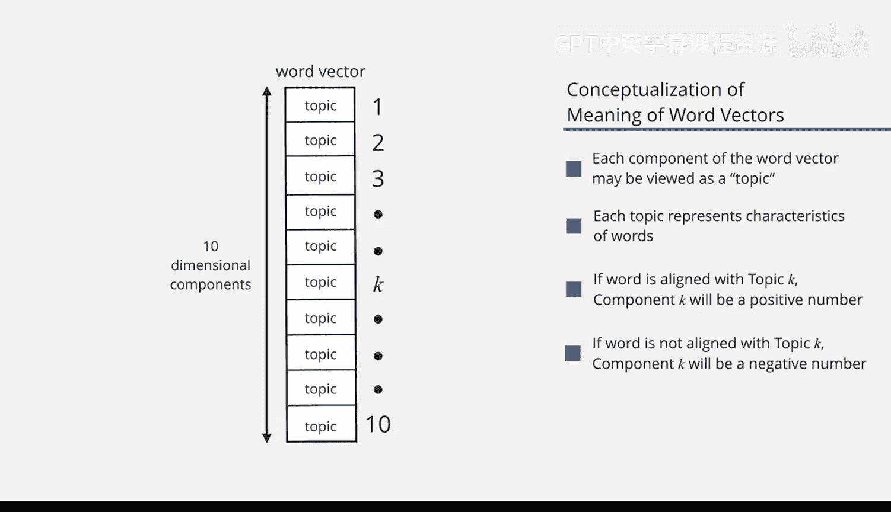

我们想要思考的理念是，这10个数字中的每一个都关联着一个潜在的主题。这个10维词向量中的每个主题都代表了单词的特征，或者人们试图用单词表达的东西。

因此，如果一个给定的单词与第 **i** 个主题对齐，那么我们期望向量中对应的分量将是正数，因为它与该单词对齐。如果第 **i** 个主题与单词无关或不对齐，那么我们期望该分量的值为负数。随着我们继续深入，会进一步看到这一点。

---

## 示例：解读“Paris”的词向量

让我们概念性地看一个特定的单词，例如“Paris”。我在这里做的是，为这个10维向量的每个分量分配主题或主题。这些主题或主题将在我们的机器学习过程中被学习。

为这些主题分配特定的名称（如体育、政治、历史）是概念性的，我们并不明确这样做。但这是为了帮助理解与这个词向量相关的底层概念。

如果我们看“Paris”这个词：
*   从历史上看，巴黎扮演了重要角色，它是法国的首都。
*   它在政治上也扮演了重要角色。因此，我们概念性地看到该向量的第二个分量（对应政治）是正的，这意味着巴黎与政治正相关。
*   同样，由于巴黎是一个重要国家（法国）的首都，它在历史上具有非常重要的作用。因此，我们看到第三个分量（对应历史）是正的。
*   第四个分量概念上对应动作或动词。巴黎是一个专有名词，与动作没有太多明确关系。因此，我们看到动作分量为负。
*   巴黎是一个城市的名字。因此，下一个对应名称的分量是正的。

我们试图在这里反映的理念是：词向量的底层分量具有某种主题或语义上的意义。我们不需要明确知道这种意义是什么，但它会通过机器学习被揭示出来。

因此，我们想从中得出的结论是：词向量所做的是，按分量表示该单词是否与某个主题对齐。如果对齐，则分量为正；如果不对齐，则分量为负。这提供了单词的底层语义含义。这就是词向量概念所要反映的。

---

## 迈向新模型

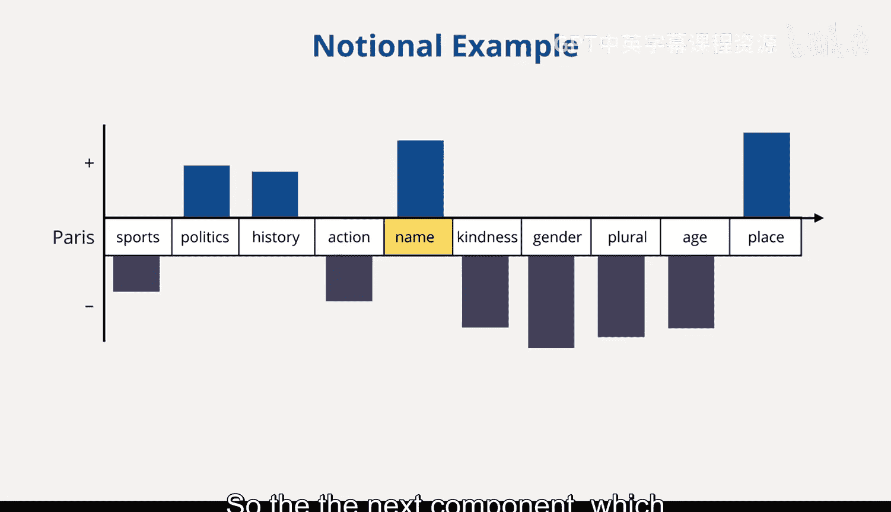

接下来，我们将利用词向量所代表的这种意义或关联性的理念，来构建一种用于自然语言处理的新形式的机器学习模型。

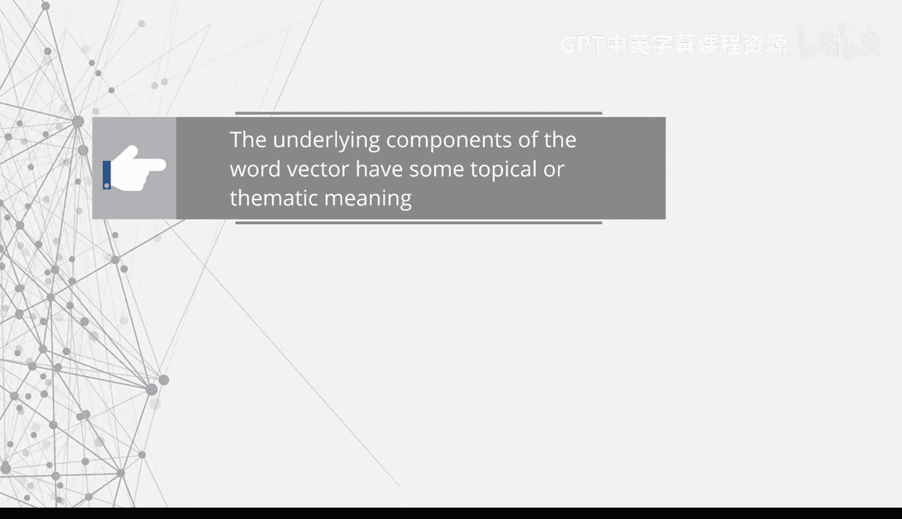

---

## 总结

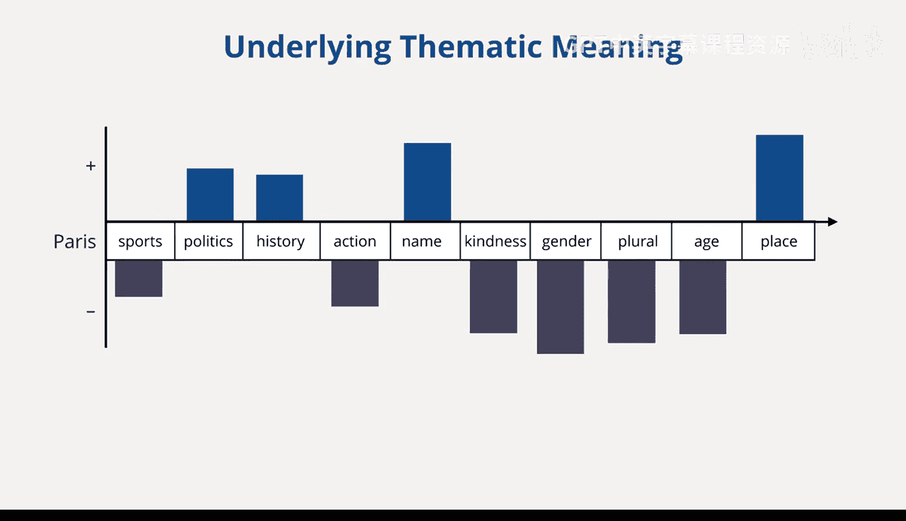

本节课中，我们一起学习了词向量的核心概念。我们了解到，词向量是将词汇映射到高维空间向量的技术，其目标是捕捉单词的语义信息。每个向量分量可以概念性地理解为与某个潜在主题的对齐程度（正值为对齐，负值为不对齐）。这种表示方法为理解单词的深层含义和构建更强大的自然语言处理模型（如Transformer）提供了基础。