# 杜克大学《机器学习｜Introduction to Machine Learning》中英字幕 p52 52_05_02_词向量间的关系.zh_en -BV1yjvdBQEaU_p52-

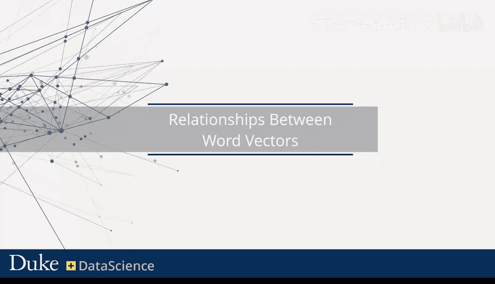

Okay so let's try to understand a little bit more about what these word vectors mean。

 so again each component of the word vector corresponds to an underlying topic or theme associated with things that we assign words to and so here what I'm showing are pairs of words which have very similar meaning but also key differences so if we look at the word king in queen。

 these are royal positions they're very similar except for the king is usually always a male and the queen is a female and so the idea that I'm trying to show here is that the vector associated with the word king and with the word queen are essentially the same everywhere except for one one component which I。

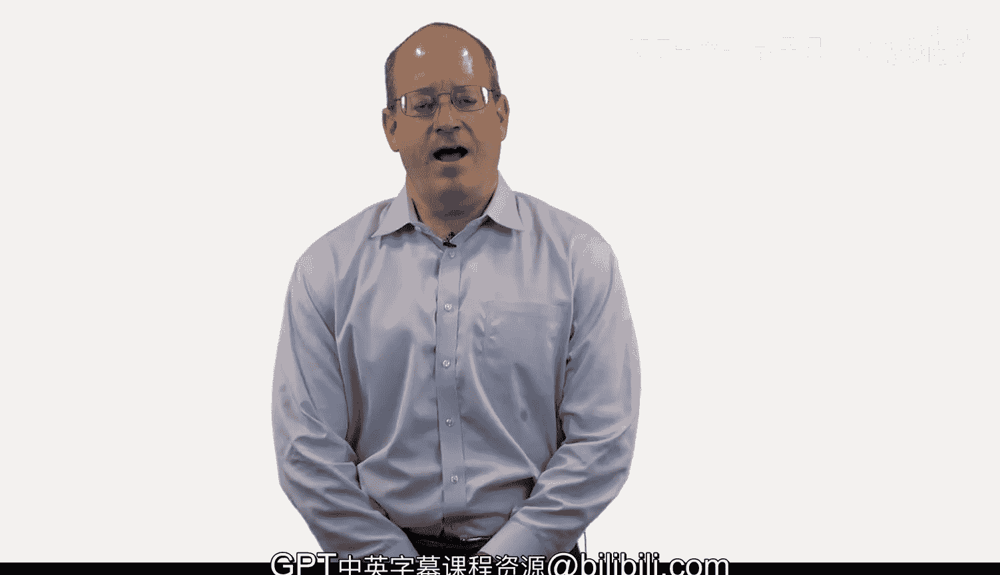

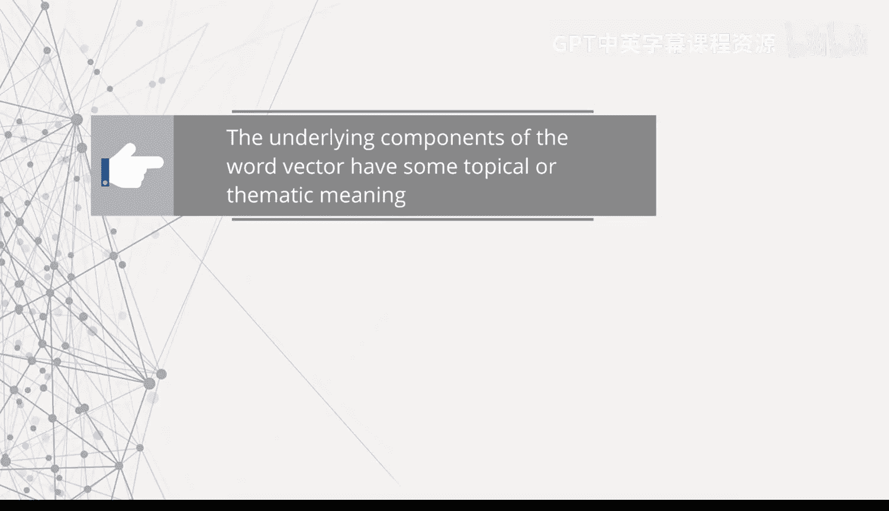

With the ellipse and notice that for the component， which is highlighted by the ellipse。

 the respective component is positive。Positive for king and negative for queen。

 and so what we're supposed to infer from this is that component must represent gender。

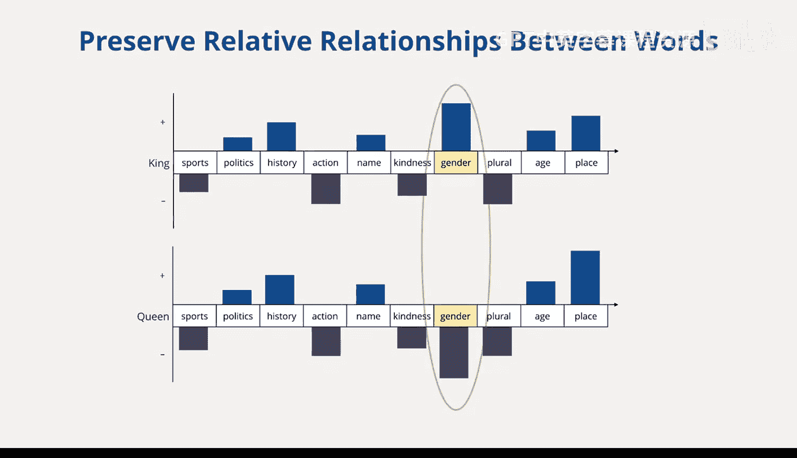

If we now look at the second example to the right， uncle and aunt。

 those two words have essentially the same meaning with respect to a young person often except for the fact that a uncle is generally a male and the aunt is a female and so the idea to notice is that the word uncle and the wordant。

 the vectors associated with them are virtually the same for every component except for one and in that one component they are flipped and the context of uncle it is positive in the context of an it is negative。

 we infer from that， that that component must correspond to gender and that component is consistently different between uncle and aunt and king and queen so from this simple example we get a sense of what。

The word vectors mean and so this gives us some ideas as to the underlying mechanisms that are captured by these word vectors。

 another example is king and kings and queen and queens。

 these are the same words except for the fact that one is singular the other is plural。

 so the thing I want you to notice is that king and kings。

 the vectors are essentially the same for every component except for one component。

And in the context of king， it is positive and in the context of kings， it is negative。

 so that component must represent singularity of a word。

 how singular it is and so in the context of king， it is positive in the context of kings。

 which is plural， it is not singular。 So it is negative。

 and this relationship holds for king and kings as well as for queen and queens。

 I also want you to notice with the arrow that I have highlighted that that component is consistent between king and kings。

 and it's consistent between queen and queens， but it differs between king and queens。

 So that component with the arrow must represent gender。

 And so the idea is is that if we can learn these word vectors in ways that we will talk about。

 And if we look at pairs of words， which we know are basically the same except for perhaps one。

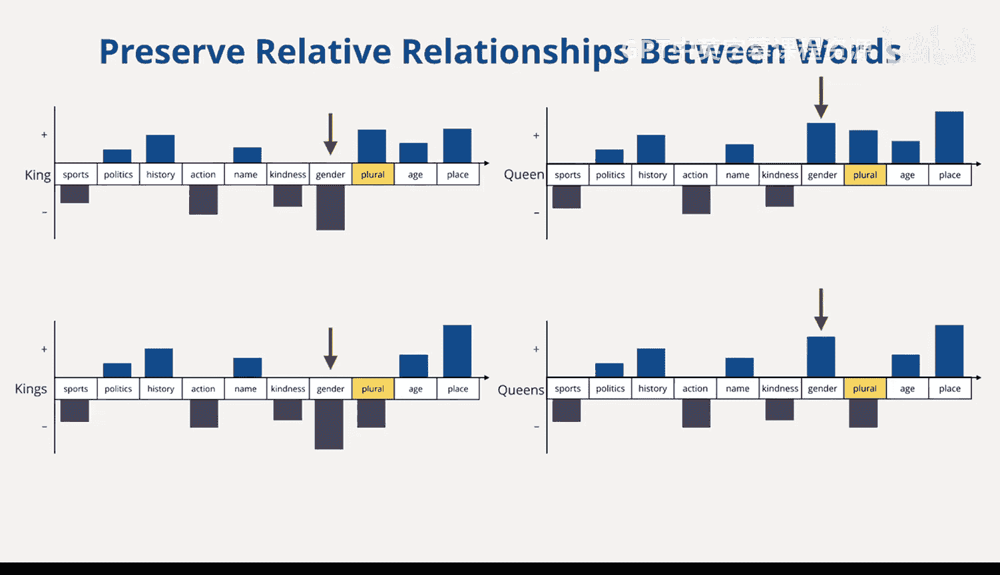

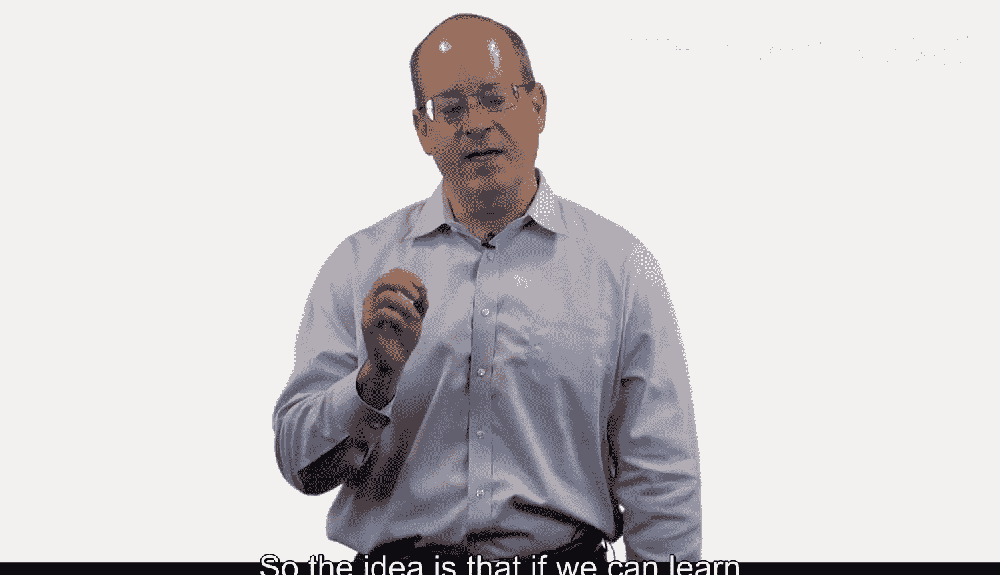

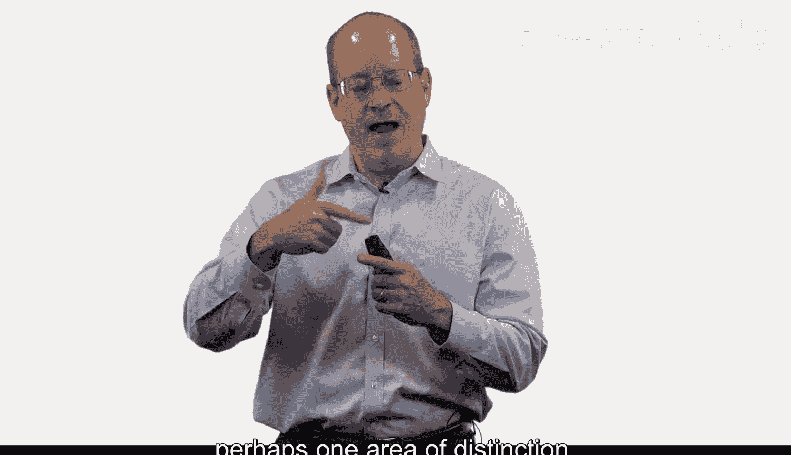

Area of distinction， we can then look at the word vectors， see what is similar between them。

 see what is different and from that we can uncover some underlying meaning associated with these word vectors。

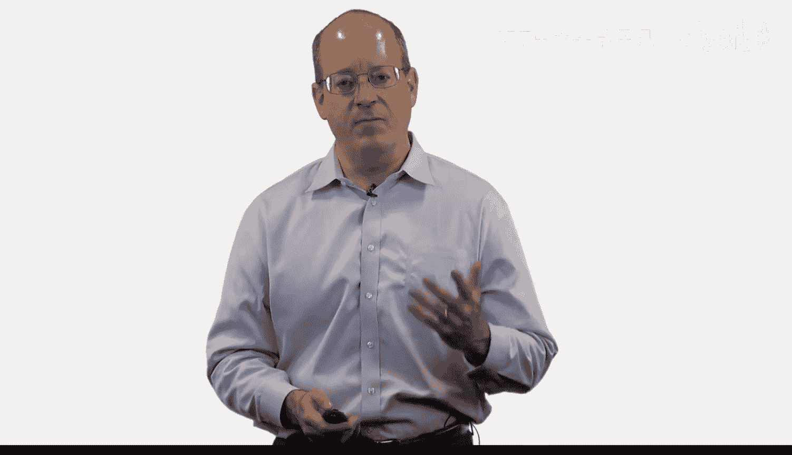

And so earlier in another part of the course， we showed this relationship。

 and so what we're meaning to represent here is that each。

wordord that you see corresponds to an embedding or a word vector here in twodimenal space and so the idea is is that man is to woman as uncle is to aunt。

 as king is to queen， and so if this relationship that we are talking about here is true。

 which means that king is to kings as queen is to queens。

 even though king and queen are different words。

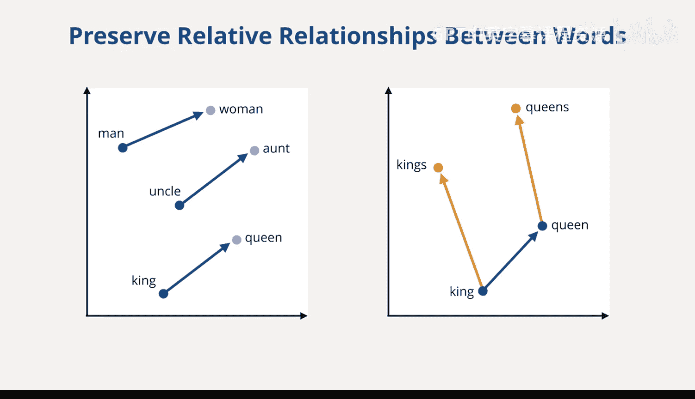

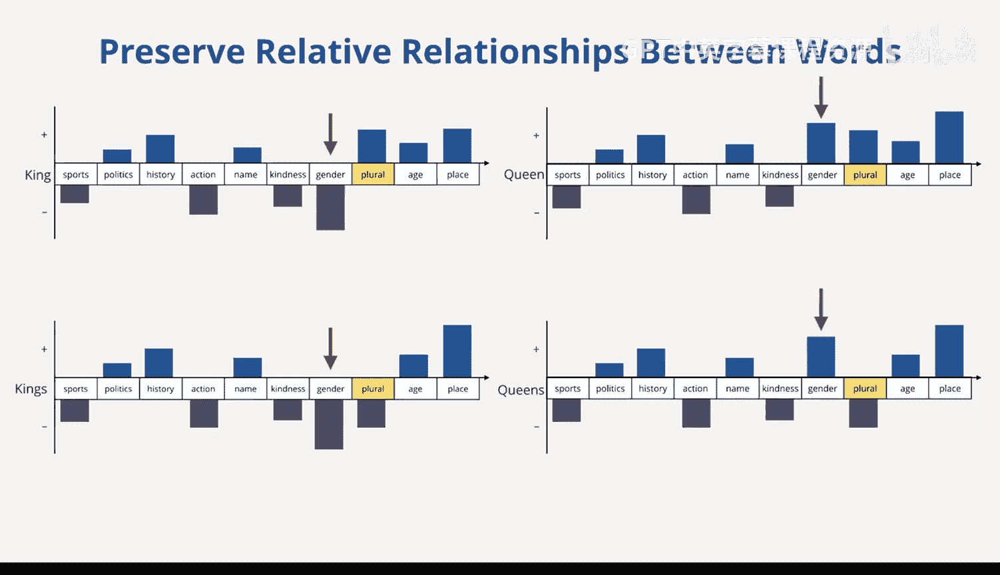

Different types of words。 We would expect a consistency in the relationship between these word embeddings or these word vectors in the d dimensionmensional space in which they are represented。

 And here we see on the right， king is kings as queen is to queens。

 This is a concept of geometry that we expect to uncover in these word in vectors based upon their underlying meaning。

 and this relationship gives us some underlying intuition into what these word vectors actually mean。

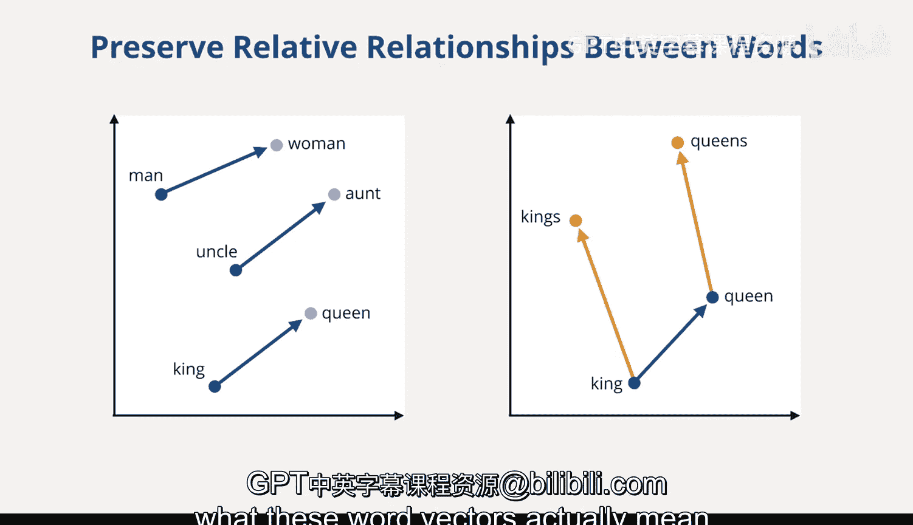