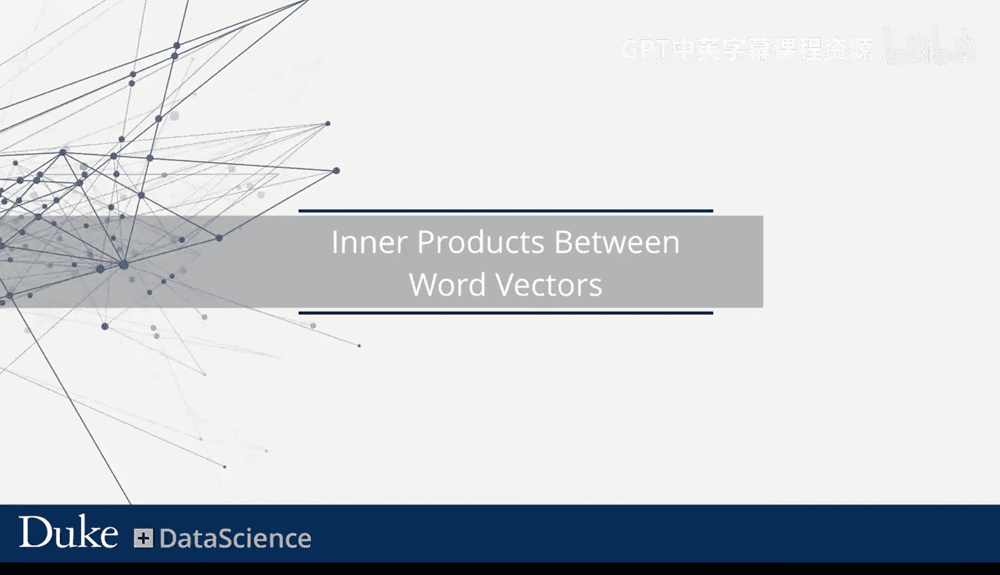
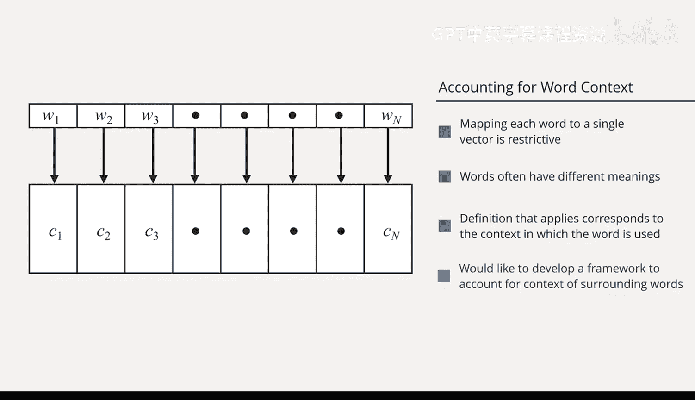
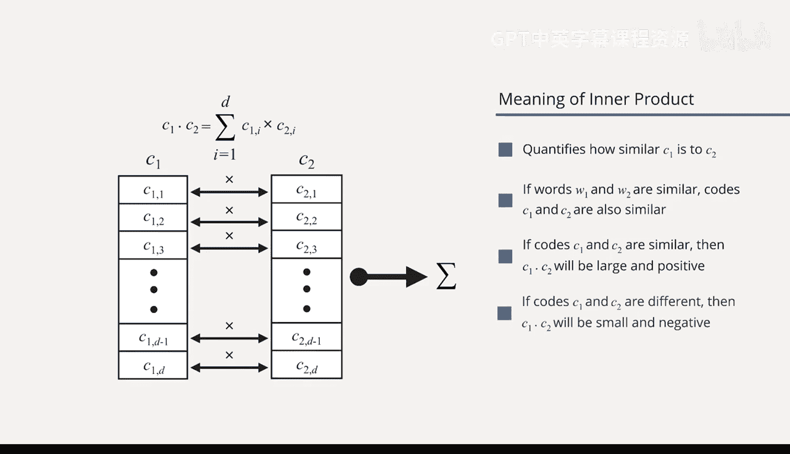
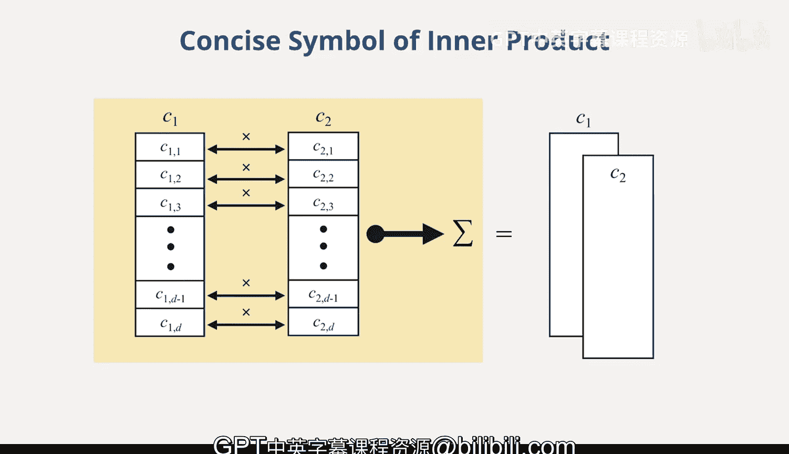

# 杜克大学《机器学习｜Introduction to Machine Learning》中英字幕 p53 53_05_03_词向量的内积.zh_en -BV1yjvdBQEaU_p53-

So now we have reintroduced ourselves to this concept of mapping a word to a vector。

 we have gained some further insight into what this mapping it represents。

 so now let's move forward and actually start to model sequences of words or sentences or documents。

 so let's consider a situation where we have n words which are represented as W1 W2 through WN。

 those correspond to the n words for example， in a sentence or document based upon the understanding that we now have every one of those words will be mapped to a D dimensionmenional vector or code。

 C1 corresponds to the code associated with W1 C2 with the code associated with W2 and CNN with the word WN。

One of the things that might bother you at this point is that this concept of mapping each word to a single vector to one vector is restrictive in the sense that if you look at a word in the dictionary。

 it has multiple definitions， and the definition that applies corresponds to the context in which the word is used。

 and so this idea of mapping each word to a single vector。

 which implies a single type of meaning for that word in the sense that we talked about earlier。

 seems restrictive because it does not take into account the context of the surrounding words。

And so what we would like to do now is develop a framework by which we can modify these word vectors in a way that takes into account the meaning implied by the surrounding words。

And so to do that we need to introduce this concept of an inner product between two word vectors this is a new concept that we haven't talked about very much thus far。

 we're going to try to introduce it in a relatively simple way。

 so again we have an n words W1 through WN， those n words are mapped to n codes， C1， C2 through CNN。

Those mappings are true， in other words， the word W1 is mapped to the code C1 independent of all of the surrounding words。

 so in the sense that we talked about earlier this is problematic。

 we're going to extend that to do that we need to introduce a little bit of notation so again C1 corresponds to the code associated with word1。

 it has D components。Little D components and so in this figure what we're meaning to represent is the d components of that word vector。

 C11 is the first component of word of code1， C12 is the second component code C1 and C1 D is the D component of that code。

And what we're going to do now is introduce the concept of an inner product between two codes so let's consider code C1 and C2 associated with word1 and word2 and we want to quantify the relationship between those two codes the way that we do this is with something called an inner product also called a dot product the reason it's called a dot product is notally we see C1 dot C2 so this is an inner product or dot product and the figure that you see at the bottom is meant to depict what that equation is saying and hopefully the picture makes the equation meaningful so now what we're going to do is we have two codes C1 C2 each one of which has decomps using the notation that we talked about before。

 what we're going to do is we're going to take the first component of code1 and the first component。

Of code2 and we're going to multiply them together。

 we're going to take the second component of code1， the second component of code2。

 and we're going to multiply them together。 the third component of code1。

 third component of code2 multiply them to do together we do that for each of the D component。

 So what we do is we take code1 code2 we take each component one by one D of those components and we multiply them together and then we take each of those products。

 those d products and we sum them together。 That's that symbol that sigma sign means summation and so this process of multiplication and then summing which is represented by the equation in the middle is called an inner product for reasons that we're going to talk about subsequently what the inner product is going to do is to quantify how similar code1 is to code2 through this inner product。

And of course， if we can do this for code1 and code2。

 we can do this for any two codes in our vocabulary。And so if words1 words W1 and W2 are similar。

 then we would expect that code C1 and C22 also be similar because remember in the sense that we talked about earlier。

 these codes， the components of those codes represent the underlying meaning of the words。

 if word1 and word2 are similar， we would expect that the corresponding codes C1 and C2 are also similar and in the sense that we're going to talk about in a moment。

 if code C1 and C2 are similar then this dot product。

 C1 dot C2 should be large and positive in the sense that we'll talk about in a second。

 if code C1 and C2 are different， which means that the corresponding words W1 in W2 are dissimilar。

 then we would expect that that inner product will be small or negative and we'll see this in a moment。

 but this idea。Of the inner product which quantifies the similarity between words is fundamental to what is going to come subsequently and to underscore this point。

 if words W1 and W2 are similar the inner product C1。

 C2 will be positive and we'll see this in a moment， if two words are dissimilar。

 that inner product C1， C2 will tend to be negative and this will become more clear as we proceed。

 this concept of inner product and this concept of using the inner product to quantify similarity of words through their word vectors is fundamental to the the neural processing that we're going to do subsequently for natural language processing。

And so this inner product is something that we're going to be using repeatedly in the discussion that follows so in the highlighted block that is the same expression that I showed before。

 it is a lot to carry around and so what we're going to do is we're going to introduce a concise notation for the inner product。

 So the inner product between code C1 and C2 visually henceforth is going to be represented as you see it on the right。

 So this is going to be a representation of an inner product and again。

 what this means is if I take code1 and code2， I take each of the d components of those codes and multiply them one by one and then we sum it together。

