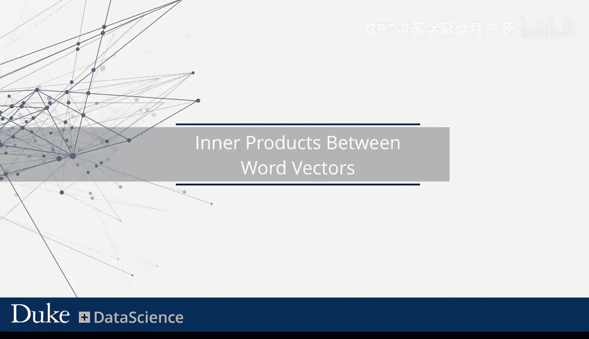
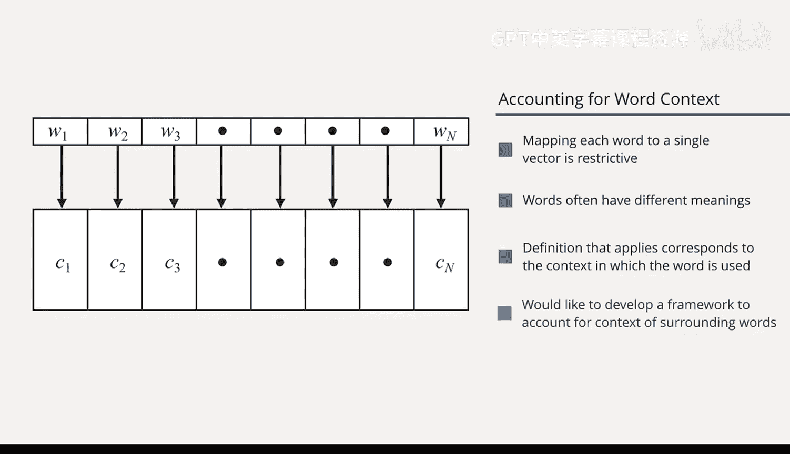
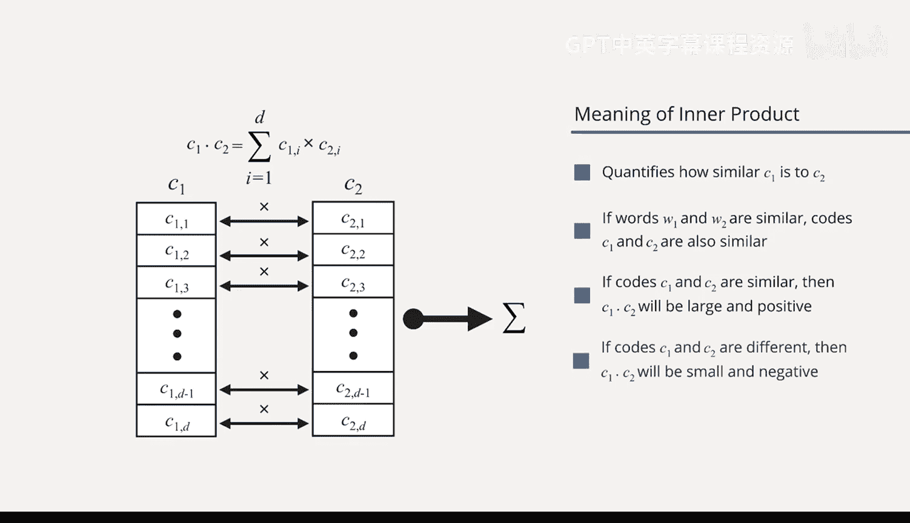
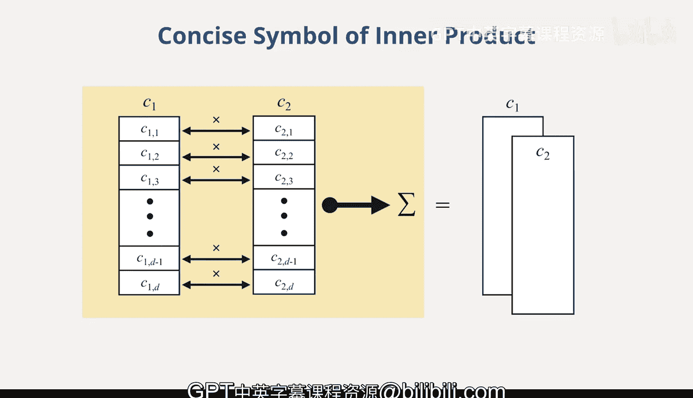

# 机器学习：53：词向量的内积

在本节课中，我们将学习如何将单词映射为向量，并引入一个核心概念——**内积**（也称为点积）。我们将探讨如何使用内积来量化两个词向量之间的相似性，这是后续构建更复杂自然语言处理模型的基础。

## 从单词到向量

上一节我们介绍了将单词映射为向量的概念。现在，我们进一步理解这种映射所代表的含义，并开始向前推进，着手对单词序列、句子或文档进行建模。

考虑一个包含 N 个单词的序列，表示为 W1, W2, ..., WN。这可以是一个句子或文档中的单词。基于我们目前的理解，每个单词都将被映射到一个 D 维的向量或编码。例如，单词 W1 对应编码 C1，W2 对应 C2，以此类推，WN 对应 CN。

## 单一向量映射的局限性

此时，你可能会意识到一个潜在问题：将每个单词映射到**单一**向量的概念存在限制。因为字典中的一个单词通常有多个定义，具体使用哪个定义取决于该词所处的上下文环境。因此，为每个单词分配一个固定向量（意味着该词只有一种我们之前讨论过的“含义”），显得过于局限，因为它没有考虑周围单词提供的语境信息。

因此，我们现在希望建立一个框架，能够根据周围单词所暗示的含义来调整这些词向量。

## 引入内积概念

为了实现上述目标，我们需要引入**两个词向量之间的内积**这一新概念。我们将以一种相对简单的方式来介绍它。

再次强调，我们有 N 个单词 W1 到 WN，它们被映射到 N 个编码 C1, C2, ..., CN。每个编码 C 都是一个 D 维向量。例如，C1 有 D 个分量，可以表示为 C11（第一个分量），C12（第二个分量），...，C1D（第 D 个分量）。

现在，我们引入两个编码之间的内积概念。以单词 W1 和 W2 对应的编码 C1 和 C2 为例，我们希望通过一种方式量化这两个编码之间的关系。这种方式就是**内积**，也称为**点积**。记作 **C1 · C2**。

以下是计算内积的具体步骤：

1.  取 C1 的第一个分量和 C2 的第一个分量，将它们相乘。
2.  取 C1 的第二个分量和 C2 的第二个分量，将它们相乘。
3.  以此类推，对 D 个分量中的每一个都执行此操作。
4.  最后，将所有 D 个乘积结果相加。

用公式表示如下：
`C1 · C2 = Σ (C1_i * C2_i)`，其中 i 从 1 到 D。

这个相乘然后求和的过程，就是内积运算。内积的作用是量化 C1 与 C2 的相似程度。

我们可以对词汇表中的任意两个编码进行此操作。如果单词 W1 和 W2 含义相似，那么根据我们之前的讨论，代表其含义的编码 C1 和 C2 也应该相似。如果 C1 和 C2 相似，那么它们的点积 **C1 · C2** 将会是一个较大的正数。反之，如果单词 W1 和 W2 不相似，对应的编码也不同，那么它们的内积往往会较小甚至是负数。

**核心要点**：使用内积来通过词向量量化单词之间的相似性，是后续神经网络处理自然语言任务的基础。

## 内积的简洁表示法

内积是我们后续讨论中会反复使用的工具。为了书写方便，我们将引入一个简洁的表示法。

从今往后，编码 C1 和 C2 之间的内积将用以下简洁形式表示：
`<C1, C2>`

这个符号 `< , >` 就代表我们之前定义的内积运算：将两个向量的对应分量相乘，然后求和。

## 总结

本节课中，我们一起学习了：

1.  回顾了将单词映射为向量的模型。
2.  指出了为每个单词分配单一固定向量的局限性，因为它忽略了上下文信息。
3.  引入了**内积（点积）** 这一核心概念，其公式为 `<C1, C2> = Σ (C1_i * C2_i)`。
4.  理解了内积可以**量化两个词向量的相似性**：相似单词的向量内积倾向于为正且较大，不相似单词的向量内积则较小或为负。
5.  掌握了内积的简洁表示法 `< , >`。

内积是连接词向量与语义相似度的桥梁，为接下来构建能够理解上下文的神经网络语言模型奠定了重要的数学基础。