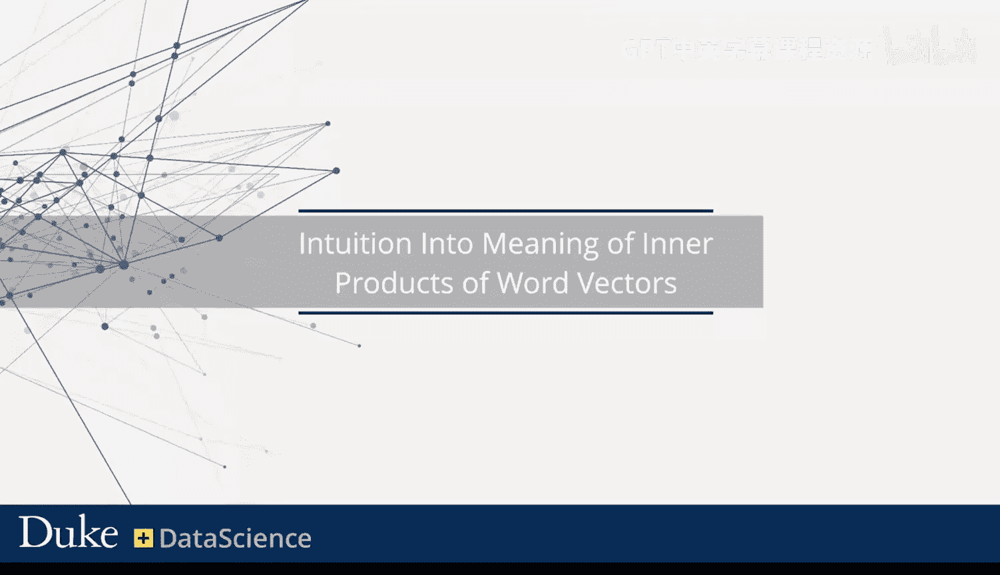
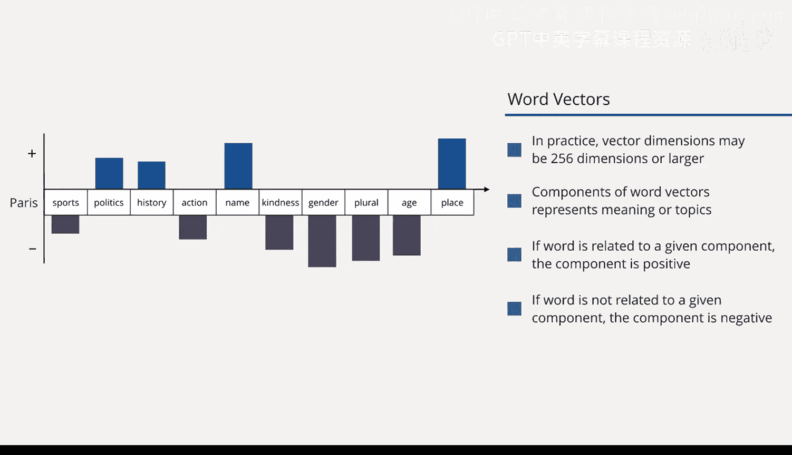
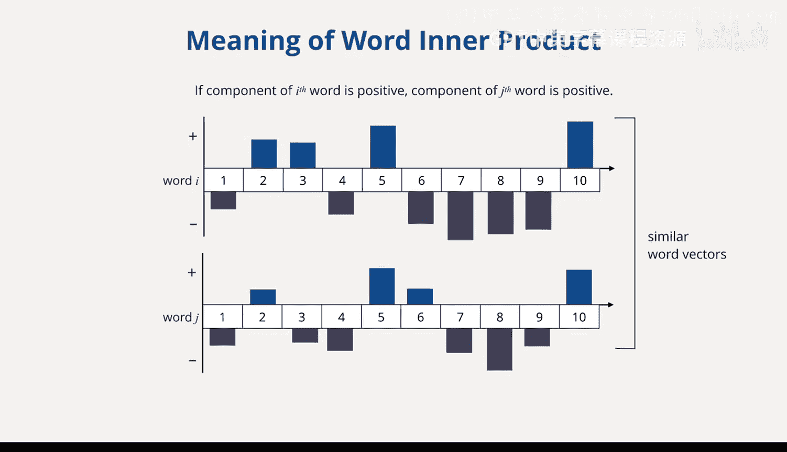
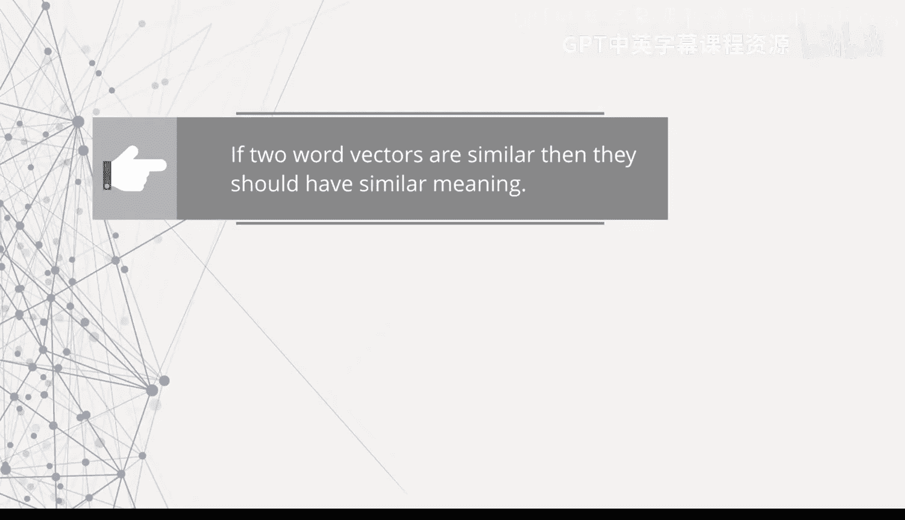
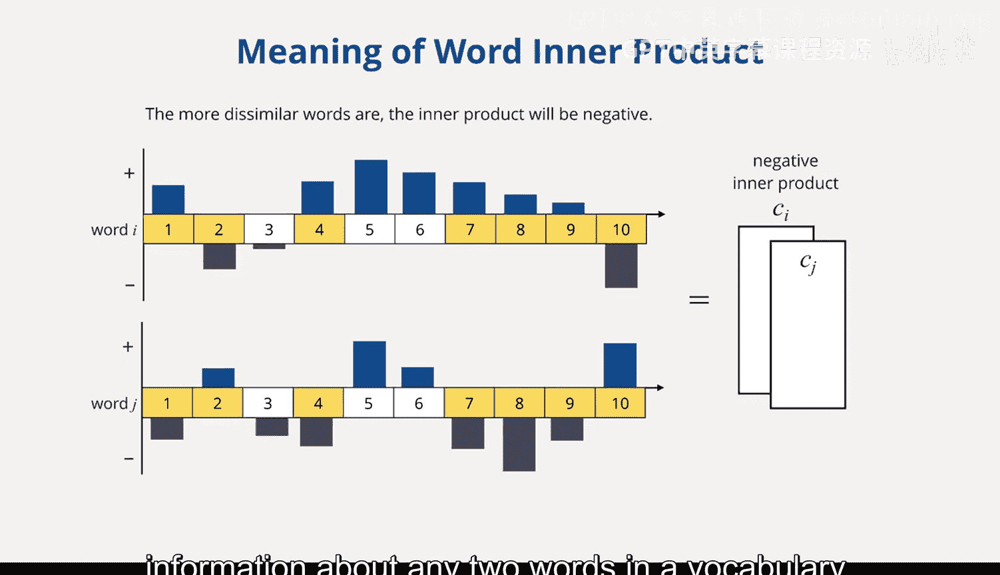
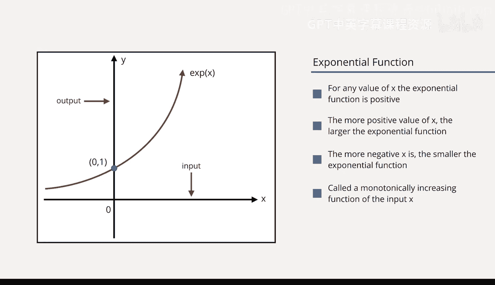
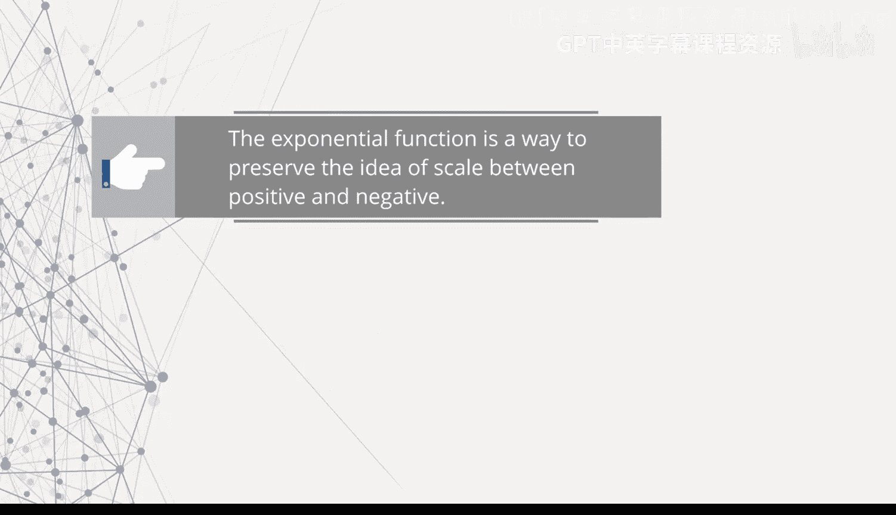
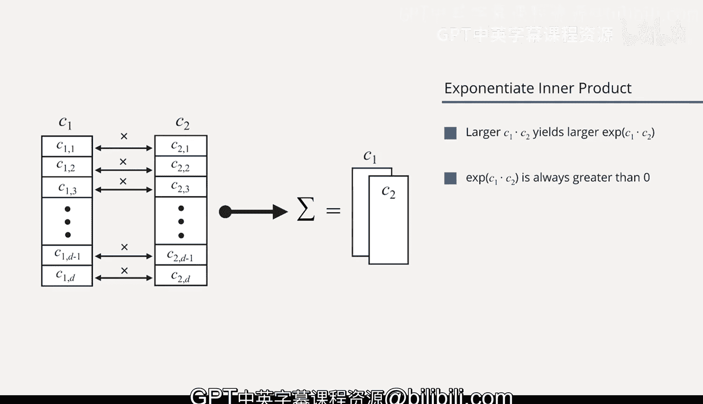

# 杜克大学《机器学习｜Introduction to Machine Learning》中英字幕 p54 54_05_04_词向量内积意义的直观理解.zh_en -BV1yjvdBQEaU_p54-

So let's continue this discussion of the word of the concept of in a product to try to gain further understanding of what it means and how it can be used So again。

 let's look at our 10dial highly simplified representation of word vector。

 we're doing it in10 dimensions here simply because it's easy for us to show visually here。

 but I want to underscore that in practice when we actually do machine learning on natural language processing。

 the dimension of these word vectors can be on the order of 256 or 512 so generally much larger than 10。

 we're using 10 here just for visualization Furthermoremore。

 this is back to the example that we considered earlier。

 the word Paris and I'm attributing meaning to each of the 10 components in the way that we talked about earlier where we looked at pairs of words which are similar we can uncover this。

Meaning，Remember we talked about gender， we talked about plurality， a word being plural。

AndSo we have these various components。 And so the word Paris notionally is represented by a D here。

 a 10 dimensionmenal vector。 If par is positively associated with a given topic。

 which is represented by each of the D or 10 dimensions。

 it is positive and if it's not related it is negative。

 let's use this concept now to try to gain some further insight into what this inner product is doing。

 So let's look at word I and word J from our vocabulary。

 So the Ih word and the j word from our V dimensional vocabulary。

 these are just two arbitrary words and what I'm showing you here in 10 dimensions dis notionally is are the word vectors between those associated with those two words and the thing I want you to notice is that almost always for each of the10 components。

 if the Ih word is positive。

The J word is positive。 That component is positive。 So for example。

 if you look at the last component， the10th component of word I and word J。

 it is positive in both cases， if you look at the first component of word I and word J it is negative。

 and so the thing I want you to notice is that these word vectors are similar and the sense that for almost all of the 10 dimensions。

 the s positive or negative is the same for each of the components and with this understanding that each of the components represent some underlying meaning associated with the words。

 we would infer that since these word vectors are similar that these two words should have similar meaning。

And so the thing that I want you to notice is is that if you multiply a negative number by a negative number。

 you get a positive number。 so if and remember that the inner product is taking component by component multiplication and so if we look at。

 for example， the 10th component of this vector， it's positive in both cases。

 positive number multiply by positive number will give me a positive number。

 if we look at the first component， it's negative in both cases and negative number by a negative number。

Will give me a positive number。 and so the idea is。

 is that if the Ith and jth words share almost always the same sign for here for each of the 10 components。

 when we take those multiplications， they will almost always be positive and when we sum them up to constitute the final inner product。

 that inner product will be positive。 and so we see that if words have similar meaning。

 which means that they have similar word vectors， then the associated inner product will be positive。

 the more similar the words are the more positive that inner product will be。In contrast。

 if we look at these two words， word I and word J， and we look at， for example， the 10th。Component。

 the right most component， word I is negative。 word J is positive。

 So we see that those are inconsistent with each other。 If we look at the first component。

 word I is positive。 word J is negative。 And so since the s of each of the components of word I and word J is almost always opposite。

 The s is opposite when we take the product， that product will be negative。

 Most of the components of that inner product will be negative when we sum them all together。

We would expect that we will get a negative inner product。

 a negative inner product implies that the Ith and the Jith words are dissimilar。

 they do not have the same meaning， and so the key concept that we're trying to get through this inner product is that each of the components of the d dimensionmensional vectors associated words with words have underlying meaning if two words are dissimilar。

 they will in general have different signs on the respective d components and the inner product will be negative if two words are aligned。

 the signs of each of the d components will mostly aligned in the inner product will be positive and so therefore this inner product through the s of the inner product。

 positive being similar negative being dissimilar tells us information about any two words in a vocabulary。

Now， for the reasons that will become clear in a moment。

 it is not very convenient to have to work with inner products that are sometimes negative and sometimes positive so this idea of a negative inner product and positive inner product tells us a lot about the relationships of the words。

 however when we actually do the machine learning， it will be more convenient to only work with positive numbers。

 and so to do that we're going to remind ourselves of the exponential function。

 so here the X axis represents the input and the vertical represents the output of a function。

 here the function is the exponential function， EXP of X and notice that when x is equal to0。

 the of zero is one， the most important thing to notice from this representation of the exp。

ial function is that for every input for any value of x， the exponential function is positive。

 However， there other functions we could choose that would still that would always be positive the reason that we use the exponential function is that the larger the more positive x is the larger the exponential function is the more negative x is the smaller the exponential function is so the exponential function is called a monotonically increasing function of the input X。

 and remember that the inner product positive or large represents words that are aligned。

 negative represents words that are not aligned or are different。

 we want to preserve this idea of scale between positive and negative。

 and so this exponential function is a way of doing it。

outputput of the exponential function is always larger if the input is larger。

 so if you give me two values of x， one negative and one positive。

 the exponential function of the positive input will always be larger than then the exponential function of the negative input。

 and so the exponential function preserves the meaning of positive and negative input but it has an output in output。

 the output of the exponential function is always positive。

 so this is a convenient function for reasons that we will see in a moment， so as I said before。

 the exponential function for all x is always positive and then as I was alluding to the exponential function is a monotonically increasing function of the input X here in the context of what we're going to do。

 the x is going to correspond to the inner product。We'll see in a moment。

And so if we then go back and kind of wrap this up on the top left is that in a product。

 I'm now spelling it out and it's all of its detail， but remember to the right is our notation。

Of an inner product， the inner product is represented as a dot product again。

 the reason we use that notation is because inner product is between C1 and C2 is just notally C1 dot C2。

 If C1 and C2 is large， then the exponential function because it's a monotonically increasing function will always be large。

 will also be large。And the other thing is for all inputs for any inner product C1 C2。

 it is always positive， but it preserves this monotonically increasing nature which will be important because it therefore preserves this concept of similarity between words。

 if two words are similar， then the exponentialoniation of the inner product between those two words will be large。

 if the inner product between two words C1 and C2 is small or negative。

 the exponential function will be small and so the idea through this exponentialonentiation is we preserve the meaning of words as represented by their inner productss we choose to use the exponential function because it's always positive。

 as we will discuss in a moment is very convenient for the model that we're going to develop。

