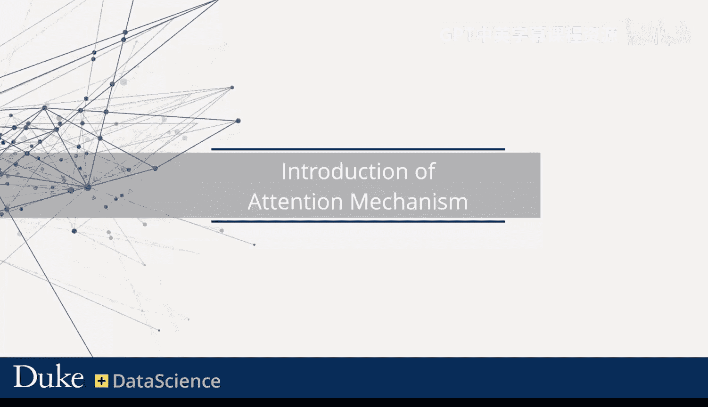
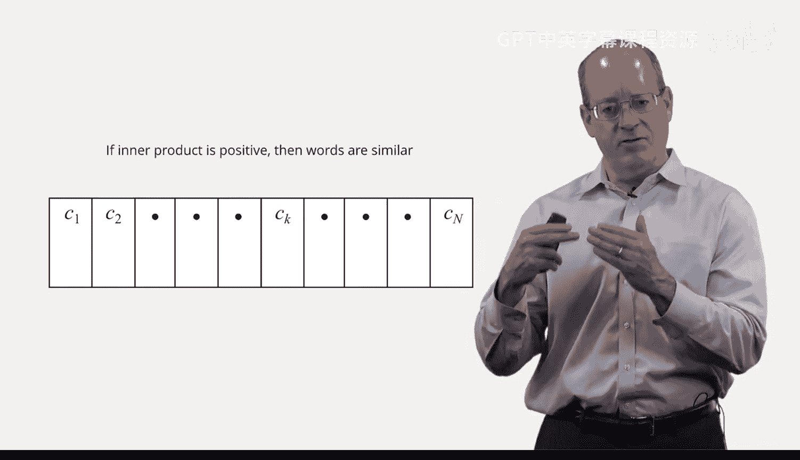
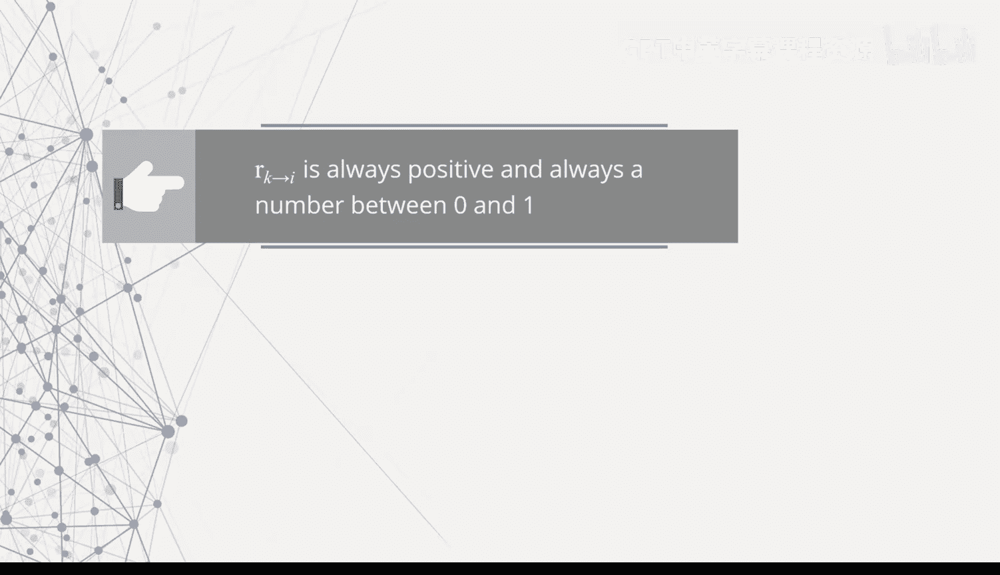
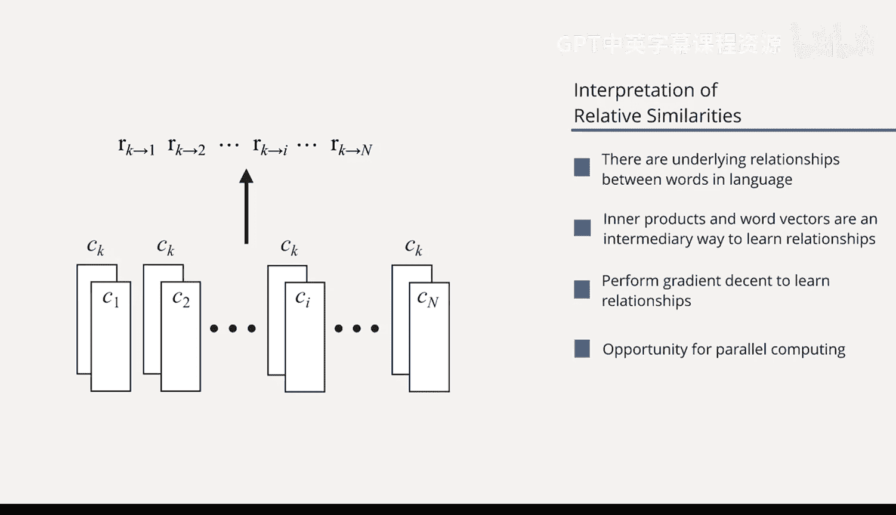
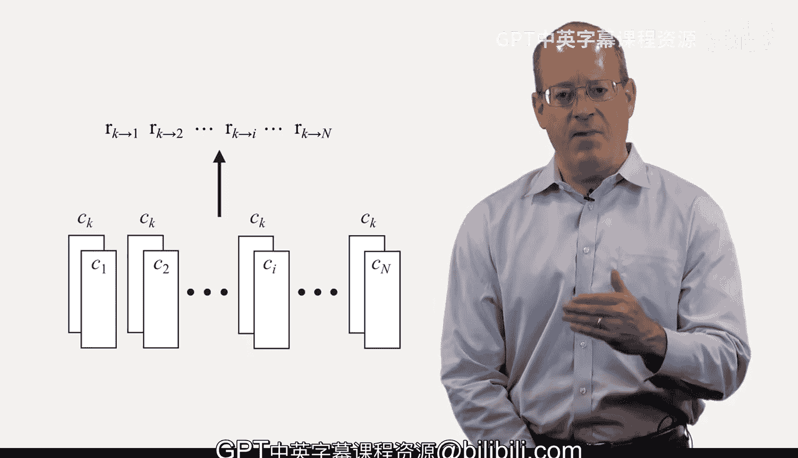

# 杜克大学《机器学习｜Introduction to Machine Learning》中英字幕 p55 55_05_01_注意力机制介绍.zh_en -BV1yjvdBQEaU_p55-

Okay， so let's now try to put this all together。So what we would like to do is assume。

 as we have before， that we have n words。And let's say an N， a sentence of length。

 n or a document of length， N， and those n words are represented as C1， C2， C K， and then CN。

 we now have this idea that the inner product is a measure of similarity between two word vectors。

 if the inner product is positive， those word vectors are similar， if the inner product is negative。

Those words are dissimilar。 So what we're going to do is we're going to quantify how similar each of the n words in our sequence is to the k word And so the caseword in our vocabulary。

 So to do that， based upon our understanding that the inner product is a measure of similarity。

 we're going to take the inner product between C and C1 C and C2 C and C and C and C for each of the n words in a vocabulary。

 So the first step is take the K word and perform an inner product with each of the n words。

 And so we denote that as the dot products above each of those symbols。

 Now those inner products could be positive and negative。 if two words are similar， they're positive。

 two words are dissimilar， they're negative。As we'll see。

 it's somewhat inconvenient to have to deal with both positive and negative numbers。

 so we now know that the exponential function always will have a positive output and it will preserve the meaning of the inner product from the standpoint that the exponential function is a monotonically increasing function So what we're going to do is we take the inner product of the case word with each of the n words。

We then expentiate those inner products so that we make them positive and then the last step。

 which is above the top arrow， is we're going to get a relative representation for the strength of the inner product and so R K I。

 so R arrow I represents the relationship of the K word to the I word。

 this represents the relative similarity of word K to word I and what we mean by when I say relative it means how similar is the kith word to the Ih word。

 relative to all of the other nword in this n dimensionmenal sequence。

 and so the way that we calculate this relative relationship of the K word to the Ithe word is that we take the exponentiated inner product between CK and C。

 and then we divide that by the sum of the。exponentiation of CK to all of the other words。

 and so that is shown at the first equation and then the bottom equation with the sigma is just a simplified representation。

 Now the thing that I would like you to notice is that R K arrow I， which is the relationship。

Or how similar the relative relationship or relative similarity of the K word to the Ih word is always positive because the exponentiation is always positive。

 and it's always a number between0 and one。 And so this is where this is why we call it a relative relationship between word K and all of the other words。

 So now if we kind of summarize what we're doing here。

 So the first step at the bottom is we take an inner product with the k word with all n words。

 So we're quantifying how similar the K word is to all n words where the similarity we now compute via the inner product because we recognize that it is a measure of similarity。

The next step is we expent， we do this because we want to make it positive and because of the fact that the exponential function is monotonically increasing。

 we preserve order of strength of in a product。And then finally， we normalize。

 and so the final result of this is we're able to quantify the relative degree to which the K word is related to each of the n words in that n dimensional sequence。

 I again remind you that the R， this relational I call R here， this relation。

 the relation of R of word K to any of the other words， that R is always positive。

Because of the exponentiation at the bottom。And secondly， if we sum each of those R's， they sum to1。

 and so the more related word K is to any of the words in that sequence， the more it's related。

 the stronger that R will be， if it's not related， it will be small and 10 towards zero。

 so this concept of inner a product exponentiation and normalization is a key construct that we're going to be using repeatedly in the natural language processing framework that we're going to be talking about as we proceed。

And so this thing that I show on the left， this process of in a product， exponentiation。

 normalization is a lot to carry around symbolically， and what we're going to do as we proceed。

 we're just going to summarize that but by what you see at the right。

 and so again inner products at the bottom， and then we're going to map that to relative relationship of word K to all of the other n words and the representation to the right is meant to apply every imply everything that you see at the left。

So the interpretation that we have is what we've discussed。

 the R Karrow I quantifies the relationship to word from word K， between word K and word I。

 the larger R is， the more they're related or or the more they're correlated， the smaller。

 R is the less related they are， there is an underlying grammatical relationship between words in a vocabulary。

 and so we，Are seeing that this R is a mathematical way of quantifying the relationship between words and those relationships between words are characteristic of language itself。

And so in the context of machine learning we are going to learn or infer these word vectors。

 those word vectors will be learned to preserve the relationships between the words and so now we're starting to see how natural language processing in the context of machine learning and this concept of R。

 which is a relationship between words， there are underlying relationship between words in a language and that those relationships are going to dictate how words are going to unfold in a document。

 and so the machine is going to use these inner products and these word vectors as an intermediary way of representing these relationships between words and these word vectors are going to be learned the way that we're going to do the learning is with gradient descent。

talkedalked about that in other parts of the course。 where're also when we have large data。

 the number of words we have to learn word vectors we have to learn could be large。

 so we will use stochastic gradient descent。And the final thing that I want to point out is that when we do these inner productss between take the inner product between the Kith word and the n word or we take the inner product between the Kword in each of the n words in a sequence those inner products can be done in parallel what that means is is that they can all be done simultaneously because they are not related to each other。

 they can be done independently， this is different from the long shortterm memory recurrent neural network that we talked about elsewhere in this course。

 the recurrent neural network operates sequentially one step after the other and so therefore it is not well suited for parallel computing because each of the steps has to be done sequentially one of the really nice aspects of。

This framework that we're talking about here is that the underlying inner product between word K and all of the other ends and words in our sequence can all be performed in parallel that is particularly important because modern computing platforms in particular the graphical processor unit or GPU is particularly well suited for parallel computation and so this framework of taking inner productss between here the Kword in all n other words in our sequence is particularly attractive from a computational perspective。

 there's a significant opportunity with GPUs to markedly increase the computational efficiency by leveraging this concept of parallelism。

