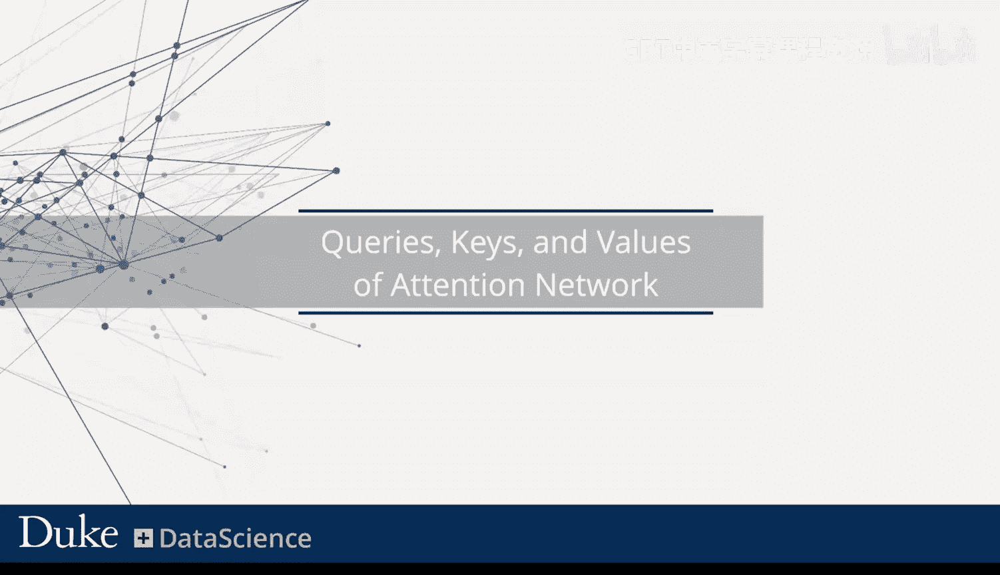
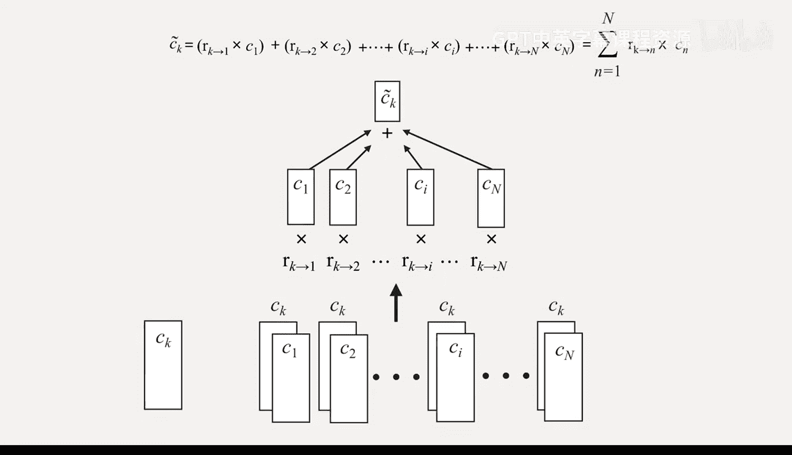
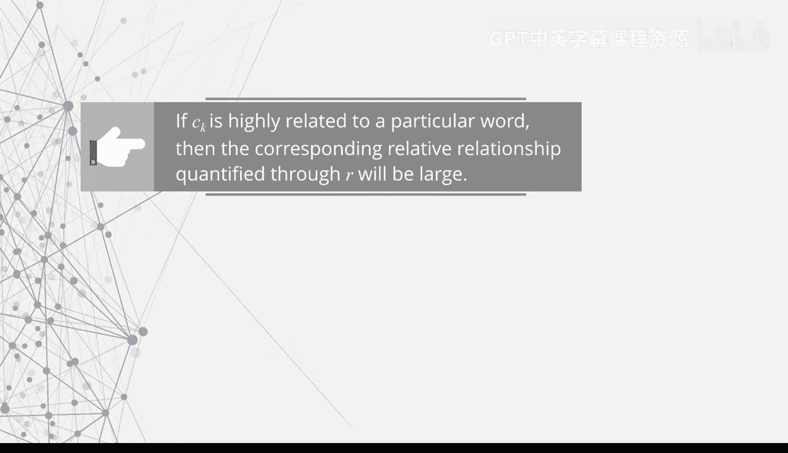
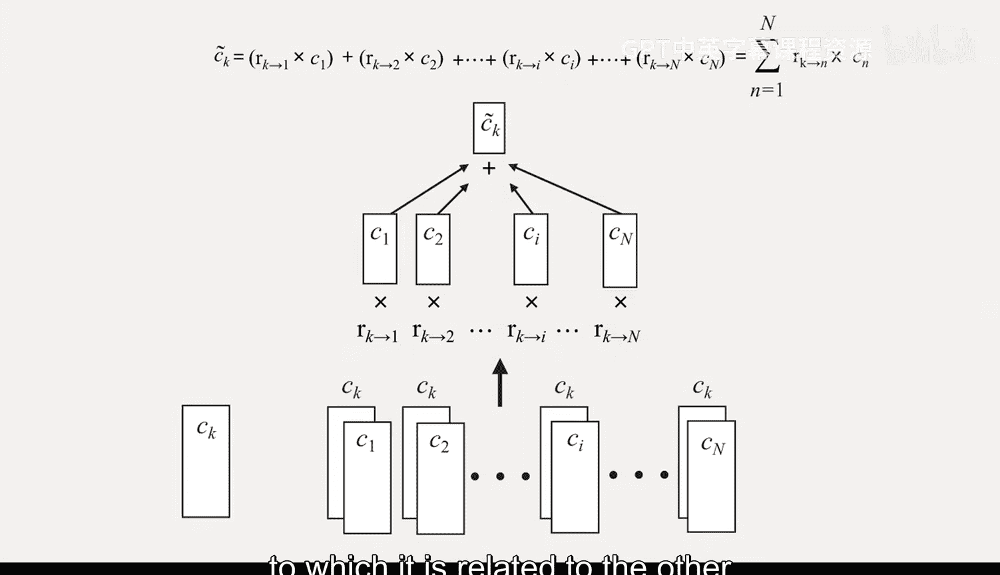
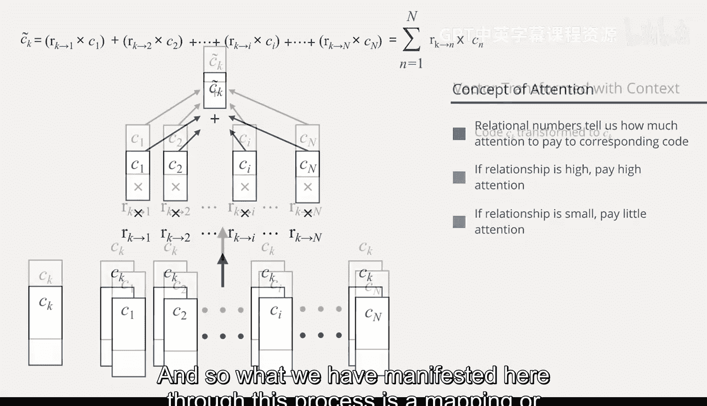
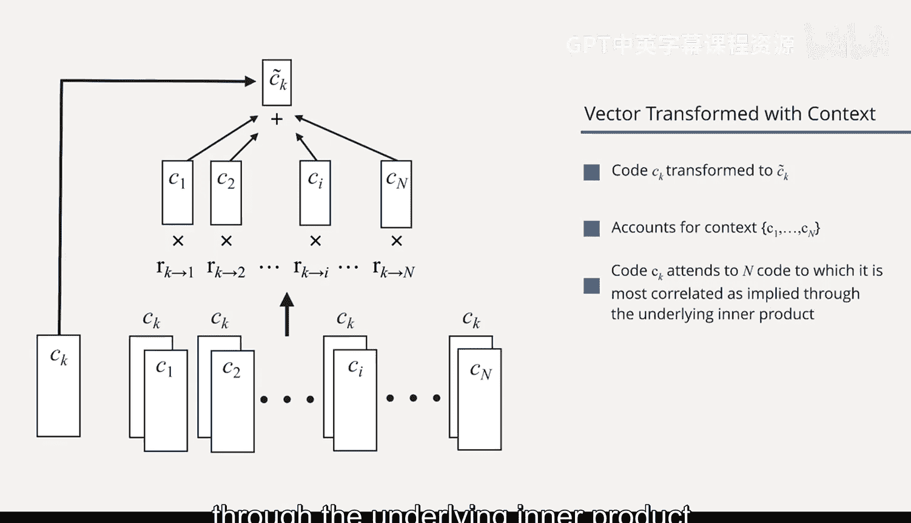
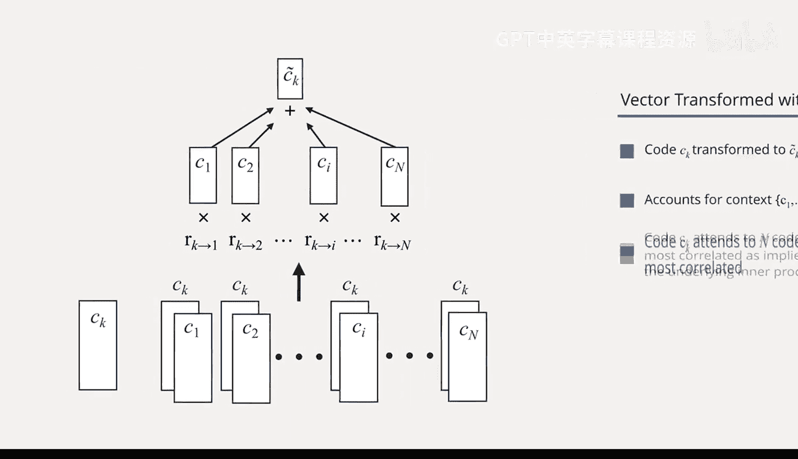
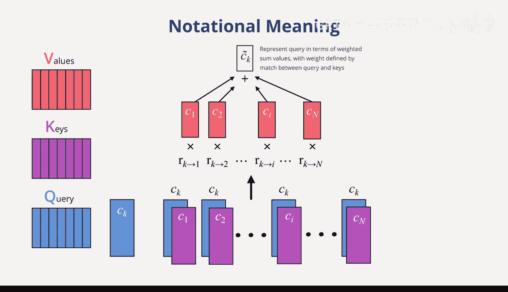

# 杜克大学《机器学习｜Introduction to Machine Learning》中英字幕 p56 56_05_02_注意力网络的查询、键与值.zh_en -BV1yjvdBQEaU_p56-

Okay， so let's。Think about what we have talked about。We have a sequence of words， W1 through WN。

 we map each one of those words to an associated code， C1， C2 through CNN。

We want to quantify how similar a kith word， C K here represented by a code C K is to each of the n words in that sequence。

 The way that we do that is through inner product。 If two words are similar。

 the inner product tends to be positive。 If two words are dissimilar。

 the inner product tends to be negative。We then。Quantify this relative relationship between word K and each of the n words by exponentiating and normalizing and we get these R values。

 R K， arrow I represents how similar or the relative relationship between word K and word I。

What we want to do now is to revise or refine the word vector for CK。

 so the thing that I want you to recall is that the mapping from the case word to the case code CK。

Is done independent of the context in which that case word is used。

 So now this case word C K could be the case word in our sequence of length N and what we would like to do。

Is to modify the word vector for word K or the code for word K to take into account the context of the surrounding words the way that we're going to do this is we now know that R K1 Rarrow1 represents the relative relationship of word K to word1 R2 represents the relative relationship of word K to word2 and RN represents the relative relationship of word K to word n Each of those R's is positive and they sum to1 we're going to use this idea to try to manifest a refined code for the k word that takes into the account the context in which it is placed here the context is in terms of the n word C1 through cN。

 So what we're going to do is we're going to take，R K 1， R Karrow1。

 and we're going to multiply it by code C 1。 We're going to take R K 2 and multiply it by code C 2。

 and then we're going to take R K， N and multiply it by code C， N。

And then we're going to add these all together。And we're going to get a new representation for the kith word C squiggly K。

 that squiggly is called a tilde， that squiggly line above the C is called a tilde。

 this is C tilde K。The thing that I want you to notice here is we have a sequence of n words which are represented by the code C1 through CN。

 We have the K word， which is represented by the code CK。

 That code is independent that CK is not informed by the context in which that word appears here。

 that context is represented by the n word C1 through CN。

 we compute the relative relationship of word K to all of the n words， which is the R K arrow I RK I。

 which is the relationship of word K to word I for I1 to N。

 we then multiply those relative degrees by which the K word is related to each of the words。

 we multiply them by the corresponding code， So R K1 is multiply by C1 R K2 by C2。RK， N by C。

 And so then we add them up。 We sum them。And then we get a new code C， K。

 The thing that I want you to notice here is that if C， K。

Is highly related to a particular word in our sequence of n。

 Then the corresponding relative relationship quantified through R will be large because it's highly related That large R is then multiied by multiplied by the associated code。

 And therefore， that highly related word will contribute significantly to the revised version of the of the code for word K。

 C tillde K。 And so by doing this。

We are revising or refining。The code for word K。But we're doing it in a way that takes into account its contextual relative relationship to each of the n words in our n dimensional sequence of words。

 and so this is a way in which we can revise or refine the code vector associated with any word。

Taking into account。The degree to which it is related to the other n words in this case。

 in our sequence。

The thing that I want you to kind of think about is these these relational numbers R K1， RKarrow1。

Tells us how much。Attention。Whenever we do this mapping to C tilde K。

 how much attention we should pay to code C1 R K2 represents how much attention we should pay to code C2 R KN quantifies how much attention we should pay to code CN。

 how much attention we should pay when we get the new mapping C tilde K。

 and so this concept whereby the relative numbers， the RK I， R arrow I。

 which is the relative relationship between word K and word I tells us how much attention we should pay to word I or code I when we constitute this new representation of the K word。

 if the relationship is high， if R is large then we should pay high attention to that word if R is small。

And implying that that word K is not highly related to that word。

 then we should pay little attention。 So this concept。

 this concept that we're looking here is called attention for reasons that I've hopefully articulated this representation is called attention and neural network processing for natural language processing。

 It tells us how much attention as quantified， implicit through through the inner product should be paid between word K and word I。

For constituting the new representation of the word CK。

 which is taking into account the contextual relationship of surrounding words。

And so what we have manifested here through this process is a mapping or a transformation of the original code vector CK。

 which is a mapping of a vector for every word here， the case word。

 independent of the surrounding words， through this attention mechanism， we now get a C tilde K。

 which takes into account the surrounding context of all other words。

And I talked about this concept of attention when we do this mapping from CK each to CK Tilde。

 the code CK attends to of those end codes to which it is most correlated as implied through the underlying inter producting。

And so I now want to introduce a little bit of notation because this attention network is going to be fundamental to what we are going to do with these attention based networks for natural language processing。

So， the code。CK that we're going to examine all of the other n words with respect to is called a query。

 and so what we're going to do is we're going to query how related the query CK is to each of n words。

The n words， the vectors associated with those n words are called keys。

 and so the degree to which the query CK is related to the keys through the inner product will quantify how much attention should be put on the corresponding vector when we constitute the updated version of our code C tilde K。

And then finally， the values are what the relative weightings are Karrow I for the relationship between word K and word I。

 those numbers， those relational numbers， which are always positive and always sum to one。

 they're multiplied by what we call values which here are the original code vectors in that n dimensional sequence。

 and so we have queries， we have keys and we have values。

And so the way this works is we have a query， the query then is computed through the inner product through each of the n keys。

 relative weighting which is manifested through that process。

 is then multiplied by the values and then finally for the query， we get a new representation。

 C tilde K， which takes into account the context in which that K word is manifested。

 and that context is constituted in terms of the sequence of n words here represented by the n codes。

 C1， C2 through CNN。

