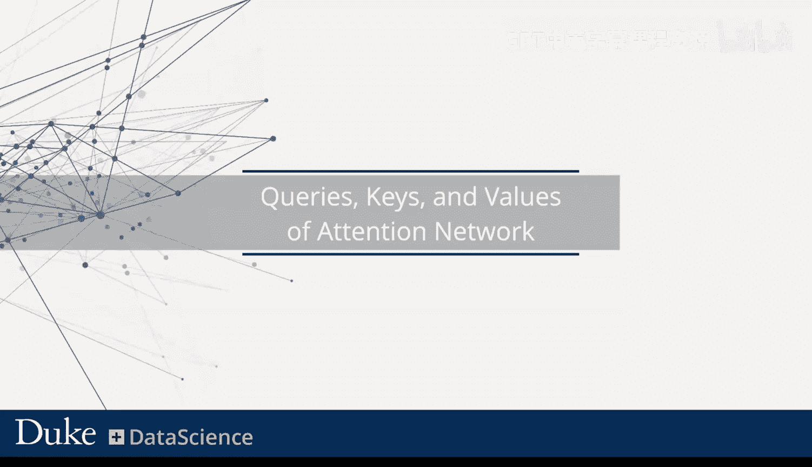
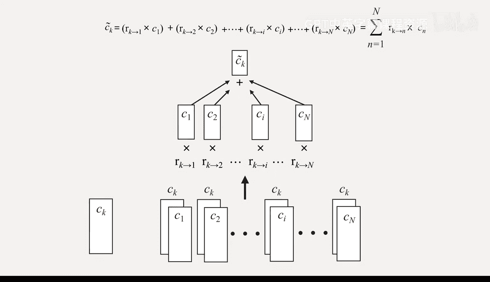
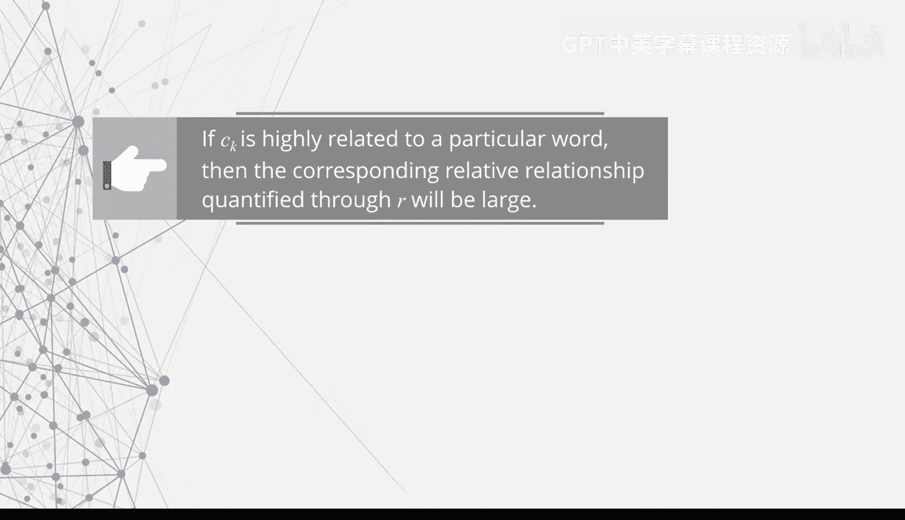
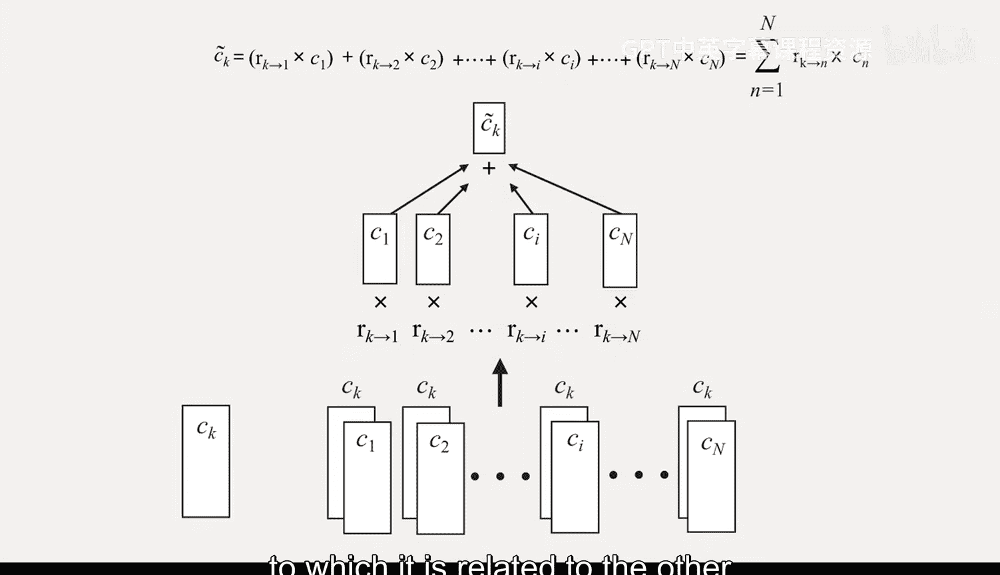
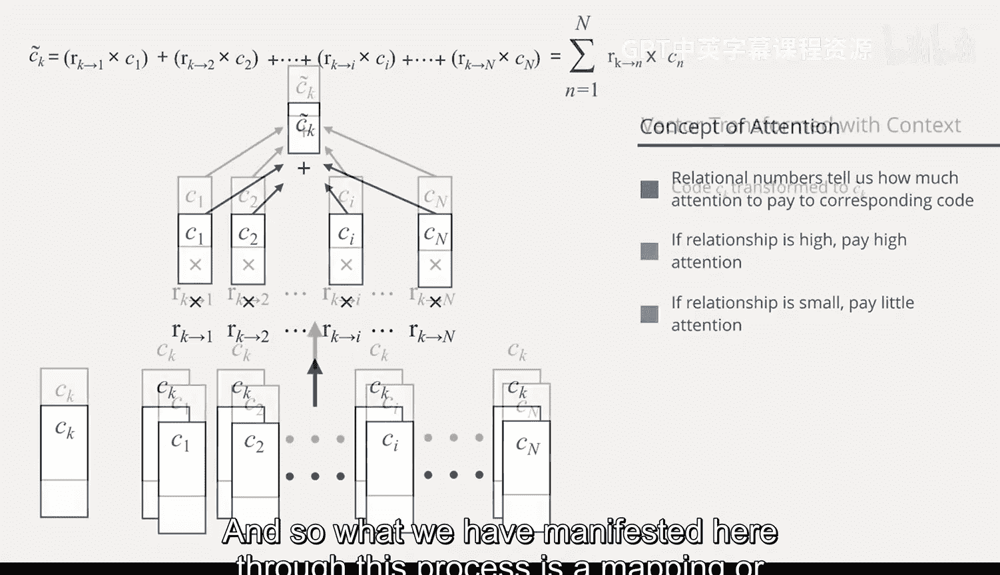
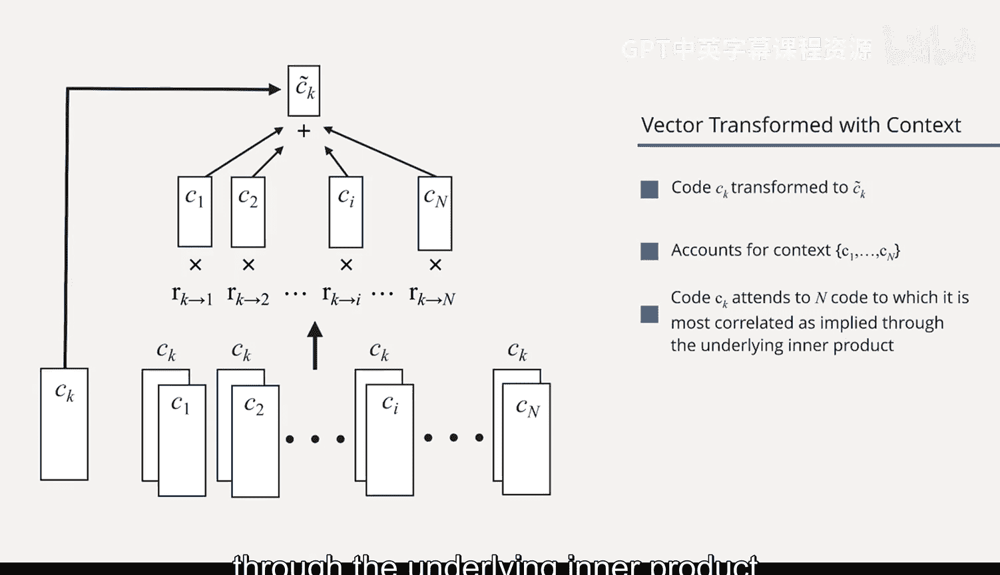
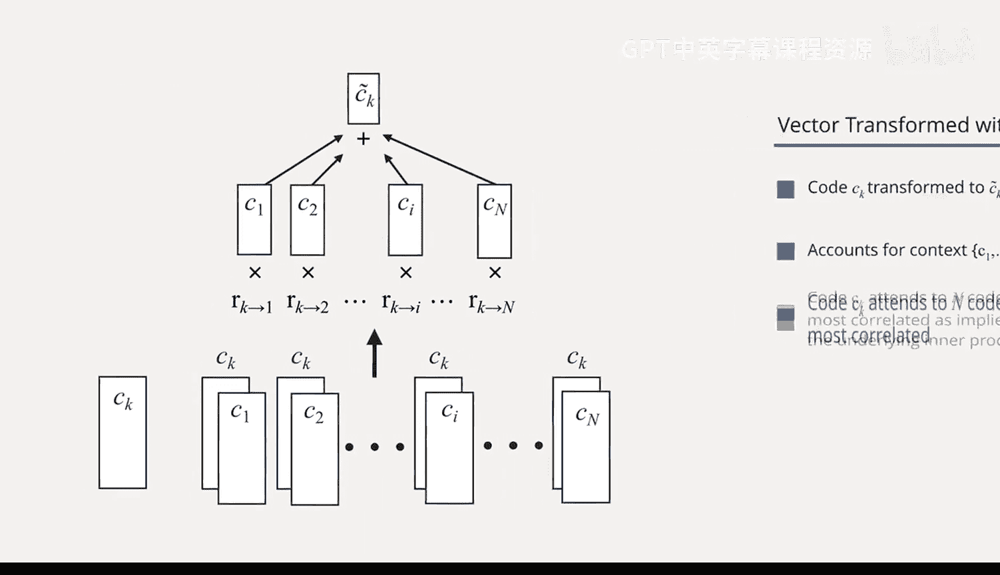
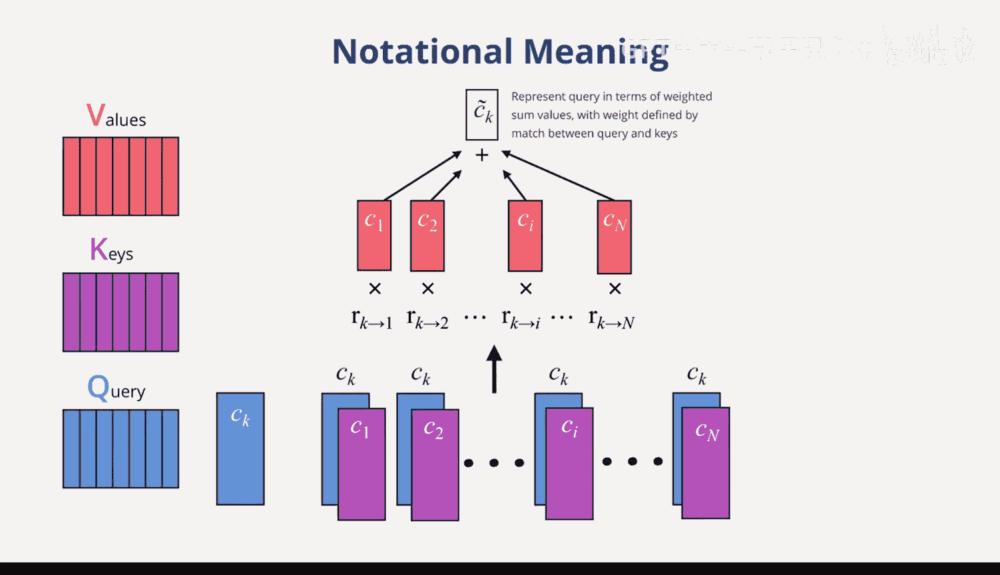

# 机器学习：56：注意力网络的查询、键与值 🧠

在本节课中，我们将学习注意力机制的核心概念，特别是如何通过查询、键和值来构建一个能够理解上下文的新词向量表示。我们将从回顾之前的内容开始，逐步引入这些新概念。

---

上一节我们讨论了如何通过内积和归一化来计算词与词之间的相对关系。本节中，我们来看看如何利用这种关系来“精炼”一个词的向量表示，使其包含上下文信息。

我们有一个由 N 个词组成的序列，每个词 `Wi` 都映射到一个对应的编码 `Ci`。对于序列中的第 K 个词（其编码为 `CK`），我们想量化它与序列中其他每个词的相似度。我们通过计算内积来实现这一点。如果两个词相似，内积倾向于为正；如果不相似，则倾向于为负。

接着，我们通过指数化和归一化来量化词 K 与每个词 I 之间的相对关系，得到一组 `R` 值。`R_{K->I}` 代表了词 K 与词 I 之间的相对关系。

现在，我们的目标是修订或精炼词 K 的向量 `CK`。需要记住的是，从词 K 到编码 `CK` 的映射是独立于该词的使用语境的。因此，我们希望修改词 K 的向量或编码，以考虑其周围词语构成的上下文。

我们已知 `R_{K->1}` 代表词 K 与词 1 的相对关系，`R_{K->2}` 代表与词 2 的关系，依此类推。每个 `R` 值都是正数，且它们的总和为 1。我们将利用这个想法，为词 K 生成一个考虑了其所在上下文（即 N 个词 `C1` 到 `CN`）的精炼编码。

以下是具体步骤：
1.  我们将 `R_{K->1}` 乘以编码 `C1`。
2.  将 `R_{K->2}` 乘以编码 `C2`。
3.  以此类推，直到将 `R_{K->N}` 乘以编码 `CN`。
4.  最后，将所有乘积相加。

这样，我们就得到了词 K 的一个新表示 `\tilde{C}_K`（波浪线符号称为“tilde”）。

这个过程的关键在于：如果词 K 与序列中的某个特定词高度相关，那么对应的 `R` 值就会很大。这个大的 `R` 值会乘以相关的编码，从而使这个高度相关的词对精炼后的编码 `\tilde{C}_K` 做出显著贡献。通过这种方式，我们根据词 K 与序列中其他 N 个词的上下文相对关系，修订了它的编码向量。

---

这些关系数 `R_{K->I}` 告诉我们，在进行到 `\tilde{C}_K` 的映射时，我们应该对编码 `CI` 给予多少**注意力**。如果关系度高（`R` 值大），我们就应该高度关注那个词；如果关系度低（`R` 值小），则意味着词 K 与该词关联不大，我们应该给予较少关注。

因此，这个概念被称为**注意力**。在自然语言处理的神经网络中，它量化了在构建词 K 的新表示时，应该给予词 I 多少关注（通过内积隐含地量化）。这样，我们通过注意力机制，将原始的、独立于上下文的编码向量 `CK`，转换成了考虑了所有其他词语上下文的新向量 `\tilde{C}_K`。

---

现在，我想引入一些标准符号，因为这种注意力网络将成为我们后续构建基于注意力的自然语言处理网络的基础。

*   **查询**：我们正在考察的编码 `CK` 被称为**查询**。我们用这个查询来探究它与序列中其他 N 个词的关系。
*   **键**：序列中其他 N 个词对应的向量被称为**键**。查询 `CK` 与每个键通过内积计算出的相关度，量化了在构建更新版编码 `\tilde{C}_K` 时，应对对应向量给予多少注意力。
*   **值**：关系权重 `R_{K->I}` 所乘的对象被称为**值**。在这里，值就是原始序列中的 N 个编码向量本身。

因此，整个过程可以概括为：我们有一个**查询**，它通过与每个**键**计算内积来获得相对权重，这些权重再与对应的**值**相乘，最终为查询生成一个考虑了上下文（由 N 个编码 `C1` 到 `CN` 构成）的新表示 `\tilde{C}_K`。

---

本节课中，我们一起学习了注意力机制的核心运作原理。我们了解到，通过将目标词作为**查询**，序列中其他词作为**键**和**值**，可以计算出一组注意力权重。这些权重决定了在生成目标词的新上下文相关表示时，应如何加权组合其他词的信息。这为理解更复杂的 Transformer 等模型奠定了重要基础。