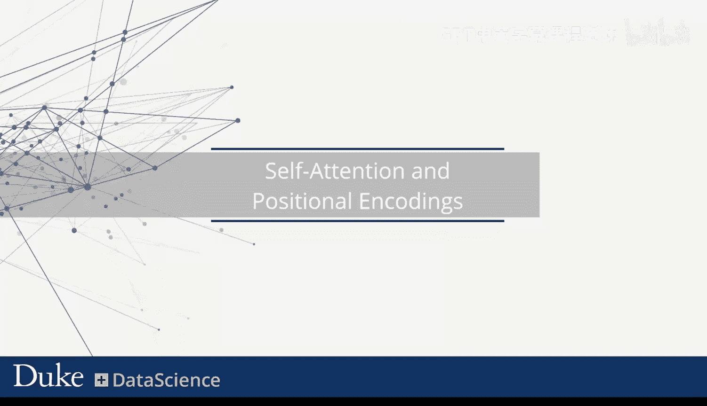
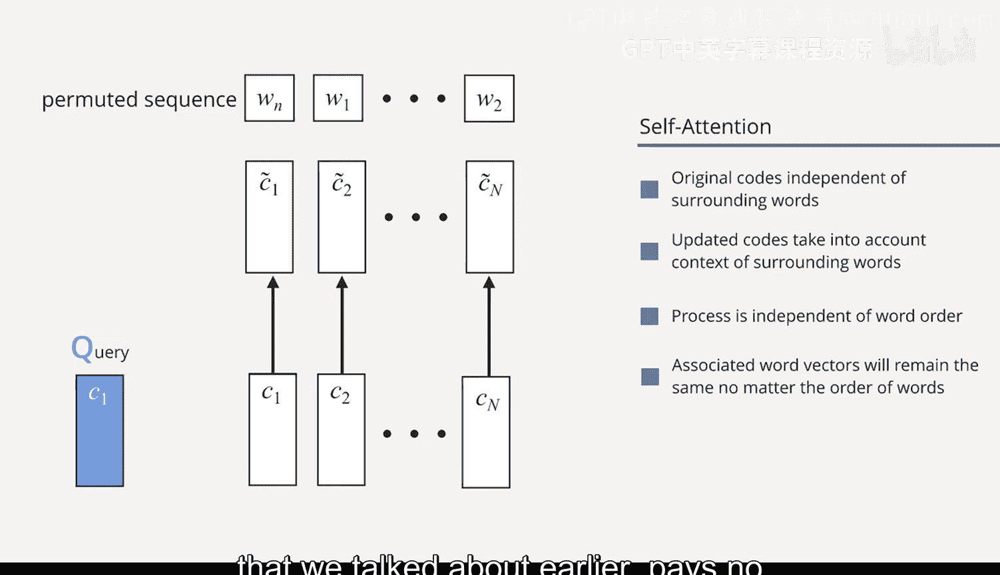
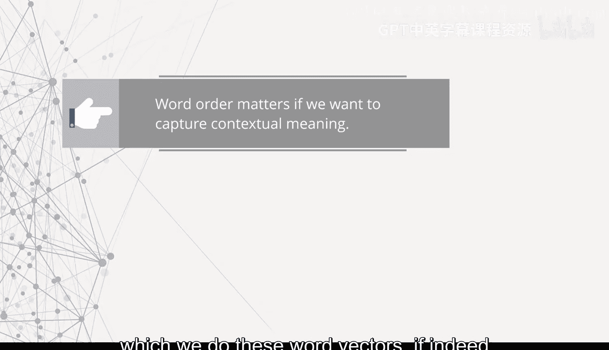
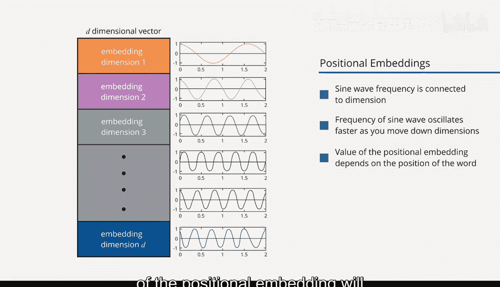
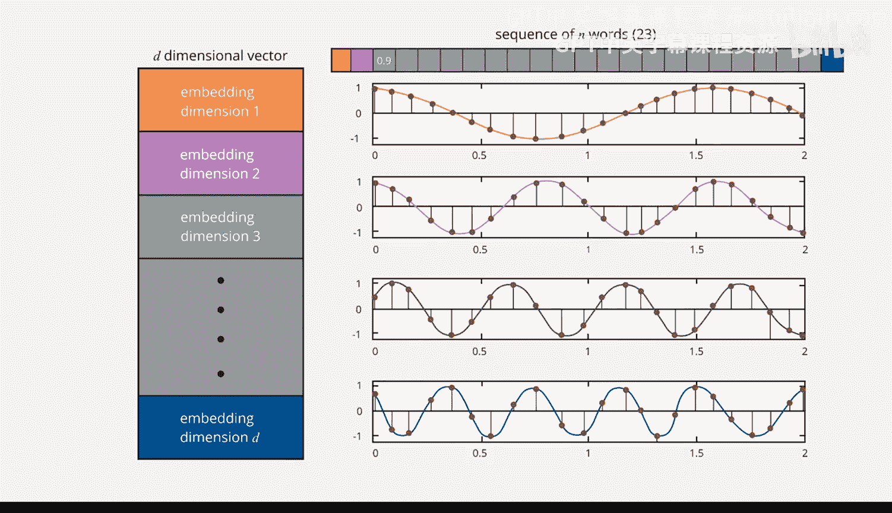
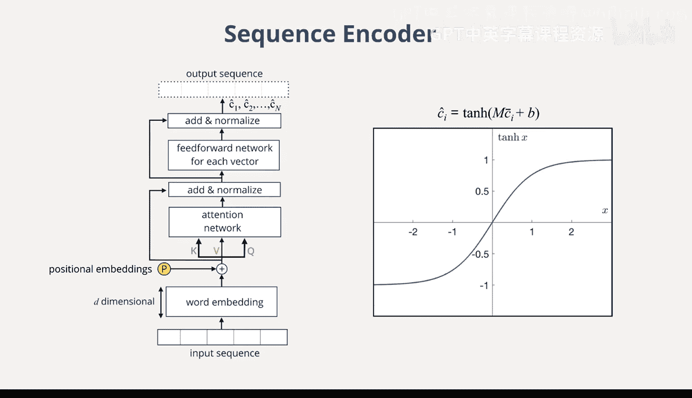
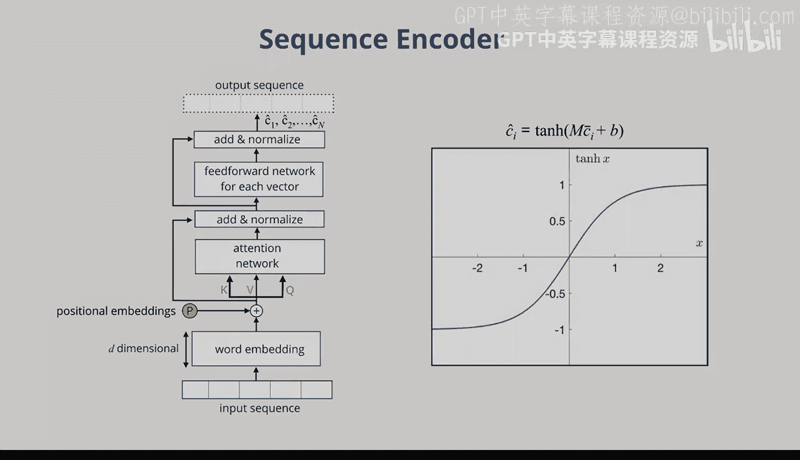

# 杜克大学《机器学习｜Introduction to Machine Learning》中英字幕 p57 57_05_03_自注意力与位置编码.zh_en -BV1yjvdBQEaU_p57-

Okay， so summarizing。This。We take the case word， we map it with the case word。

 which is represented by a code CK。Wwhich is independent of the context in which it is manifested。

 We map it through this attention mechanism to note a new code C tilde K。

 which takes into account the relationship of that word C K to all of the n words in the sequence just a little bit of notation。

 the R's RK1 RK2 RN recall those are always positive and a sum to1 that process of them always being positive and suming to1 mathematically means that the final code C tilde K is a convex combination of the values。

 So the values remember we C1 through CN when we weight them by those N relational numbers。

 RK1 through RN。 this is called a。Vex combination of those codes。

And so what we were talking about earlier was we took an arbitrary。Word。

 the k word represented by a code C K。 and through this inner product and through this attention mechanism。

 we were able to map it to a new code C tillilde， which took into account the surrounding the context of the surrounding words。

 Now we can do this for each of the n words in our sequence。 So now let's go back to the beginning。

 We have a sequence of n words， W1 through W N N words。 We map each of those words to a vector， C1。

 C2 through C N。 Those C's are what we call codes。 The problem with this is that mapping to codes is independent of the surrounding words。

 Now， what we can do is we can take the first code C1。 and it could play the role of our query。😊。

It can play the role of the CK that we were talking about before， and so now the arrow。

 what this is meant to reflect is that we could take the original sequence of N codes and map it into a new sequence of codes C1。

 Tilde， C2 tilde and C N tilde。Those codes take into account the context of all other words in the sequence。

 So C1 tilde now is a representation of the first word that takes into account the context associated with all other words。

 C to tilde corresponds to a mapping or a vector associated with the second word that takes into account the context of all surrounding words。

 and then finally， C and Tilde is a code for representing the n word that again takes into account the context of all surrounding words。

 and so the thing that we should recognize through this attention mechanism that we've talked about earlier。

Is that it is a way in which we can map each of the words in our sequence to a vector。

 that vector here， C1 tilde through C and tilde takes into account the original meaning of the word。

 in other words， the original word vector， but then modifies it by the context in which it's employed。

 and so therefore， the word vector associated the vector associated with any word through this process will be modified by the context in which it is placed and the same word in different context。

 in other words， with different surrounding words will be mapped to a different vector。Now。

 the one thing that I want you to notice。Is that this process。Is independent of the word order。

And what this means is that if I take the original N words， W1 through WN。

And I scramble the order or the word we use mathematically is permute。

 we permute the order of the word。 So the first word becomes the n word。

 the second word becomes the first word， etc ce。 we permute them， this process of attention。

 will give us the same word mapping after this attention mechanism。

 independent of the way in which we reorder the n words。So if you think about that。

Independent of the order in which those n words are manifested。

 the associated word vectors will be the same because this attention mechanism that we talked about earlier pays no attention to the order of the words。

So if we think about this， this is a problem because it implies， well。

 it's a problem because we know that words， the order of words matters。 So United States。

The the sequence United States， the next word that we would expect is different than if we had United in States and they were not next to each other。

 So the word order matters。 And so that word order。

 should come into the way in which we do these word vectors。

 if indeed we want to capture contextual meaning。 And so what we have done before what we have done thus far。

Is very effective in the sense that we have now constituted word vectors that take into account the context of the surrounding words。

 the problem is at this point we have not accounted for word order and so with that understanding we need to make a modification or an augmentation to what we have done here so that the model can take into account word order and so that limitation we're going to address in a moment。

 but before we do that。

Let us try to summarize in a relatively simple diagram， what we have done。

So starting at the bottom， we have an input sequence of words。 So this is n words W1 through W N。

 First step is we embed those。We embed each of those words to a vector。

 so every word is mapped to a vector。 The problem with that is it does not take into account the relationship of that word to its surrounding words。

 In other words， it doesn't take into account context。 So then we constitute the key K， the keys K。

 the values V in the queries Q and we have this thing we call an attention network。

And then we have an output sequence。 That output sequence takes into account the context in which every word is manifested。

 That output sequence is a sequence of vectors where we have a single vector for every word and that vector accounts for the the meaning of the surrounding words。

 But as we have talked about， this attention network is。The output sequence。

 if the input sequence is permuted or the order of the words is flipped around。

 the output sequence will be the same。 the vectors will be the same。

 They will be correspondingly flipped around。 And so what this implies is is that the word vectors don't really pay attention to the order of the words。

 And we know in language， the order of the words have tremendous meaning。

 And so we need to modify this construct to take into account。The order of the word。

 so we're going to make several modifications to this setup that have been found to improve performance。

So the first one is called a skip connection。 So in the original setup that we have here。

 when you go from bottom to top。When we do the attention network and we get the output sequence。

 we have lost the original word embeddings at the bottom。 And so it's been found convenient。

 you notice what we call a skip connection。 So we have the input sequence。

 the input sequence is mapped to a sequence of word embeddings or word vectors。

 and then those correspond to the keys， the values and the queries。 So the same the word embeddings。

 play the roles of the keys， the values and the queries So that is what those arrows are meant to depict and then we go into the attention network Now the problem with that is we have lost the original word embeddings after we've done the attention So the skip connection。

 what it does is it takes the original word embeddings and it skips it above the intention network and then what we do is we add。

The original word embeddings to the output of the intention network。

 and then we after we're done with that process， we normalize them with respect to each other。

 So this is called a skip connection。 it is it has been found。

 This type of a network has been found to improve performance of these types of models。

 So the next thing though。Is to try to augment this setup so that we take into account the position of the words and the way that we do this is with what we call positional embeddings。

 So these are a few modifications to the basic construct to try to improve performance and the thing that we're going to try to achieve here is to account for the order of the words。

 And so the way that we're going to do this is with positional embeddings。

 which we'll talk about in a second。 But the thing I want you to notice is the way that this is going to be done is we take the input sequence。

 which is a sequence of words， each of the words is mapped to a vector through this word embedding。

And then those word embeddings are going to be added to positional embeddings。

 the P with the circle or positional embeddings， which we'll talk about in a second。

 we add these together and then the rest of the network is unchanged and so the question now is how do we constitute these positional embeddings which reflect information。

about the order in which the words are manifested， so the equations are at the top position or POS is meant to reflect position and it means the position of the word is the order of the word。

Remember that we have a D dimensional word embedding。

And so now what we're going to do is we're going to constitute d dimensional positional embeddings。

And the sine and cosine correspond to the sinineusoidal waves that many of us are familiar with that we'll talk about in a second。

 And so P。Represents positional embedding。And what we're going to do is through this positional embedding。

 we're going to constitute a new word vector， a new D dimensional word vector。

Wwhichch will reflect the position of the word in the sequence。

 So depending upon the position of the word， it will get a different vector。

 So let's try to understand what this is doing Now。

 remember that we have D components of our embedding。

 and so what we're going to do is we're going to constitute a d dimensional vector for every word which corresponds to which is connected to its position in this sequence of n words。

 And so remember that we have embedding dimension 1。

 embedding dimension 2 embedding dimension 3 all the way to embedding dimension D。

 The thing that I want you to notice is that embedding dimension1 will have an associated sine wave that has a。

elly low frequency。 so the undulations are large。 Embedding2 has also a sine wave。

 but a more quickly varying sine wave embedding dimension 3 again has an associated sine wave。

 but faster。 And so the thing I want you to notice is that as we move from embedding embedding dimension 1 to embedding dimension 2 to embedding dimension 3 and downward to embedding dimension D。

In each case， there is a sine wave associated with it。And the frequency。

At which that sine wave oscillates。Is connected to the dimension。 dimension1 oscillates slowly。

 dimension 2， faster， dimension 3， faster。 And then what we're going to do is the value of the positional embedding will depend upon the position of the word。

 And so along the horizontal axis is the position of the word in the sequence。 And so the idea is。

 is that if you look at a word with a given position。

In our sequence， we're going to associate。For each of the D dimensions of。Of that embedding。

 we're going to associate a number。 The number is going to be connected to the associated sine wave at that dimension。

 And so if you think about this， the position。For the word the vector。

 the d dimensionsional vector that is going to be associated with each of the words in our sequence will depend upon the order of that word in the sequence or the position of that word in the sequence。

 And so what we have done here through this construct is to take each of the n words in our sequence and map them each of those n words to a d dimensionsal vector。

 remember that the original word embeddings that we were talking about had some underlying meaning that which was connected to language here。

 this is not really connected to language in any other way other than that it reflects the position of the word in the sequence And so the idea so the position of the word is meant to be reflected from left to right along the。

The horizontal and is meant to reflect the first word， second word， third word， fourth word。

 fifth word， and then depending upon where the word is。

 we will pick off the corresponding component of this sine wave at each of the d components and so the key thing to notice through this mechanism。

Is that each of the n words in our sequence is going to be encoded with a d dimensionmensional vector。

 which reflects its position in the sequence。 and in this way。

 we actually encode positional information through these positional embeddings or P。 Now。

 this use of the sine wave and in the use of the frequency of the sine wave connected to the dimension of the embedding。

 This is not the only way that this can be done。 the key thing that we're trying to achieve here。

 is a mechanism by which each of the words in our sequence can be mapped to a d dimensionmensional vector that reflects its position in the sequence。

 this use of a sequence of d sine waves of different frequencies is one way to do it。

 it is by no means the only way to do it。 However， this is。The standard way of doing it。

In in natural language processing， this is proven to be an effective framework。

 so now if we look at the total and well， let's focus on the bottom and think about these positional embeddings。

We have an input sequence， which is a sequence of n words。 W1， W2 through W N。

 We map each of those words to a vector or an embedding those embeddings do not take into account context。

 The other thing is， we have not really taken into account the order。

 What we're going to now do with these positional embeddings， P in the circle。

 What we we now have is for each of the n words in our sequence。

 we have an associated d dimensional vector， which course。

 which reflects the position of that word in the sequence of n words。

 We now add the original word embedding to the positional embeddings。

 So now through that process of word embedding plus positional embedding， we have added mean。

 we have taken the meaning of the word。Which is the word embeddings at the bottom。

 We have the position of the words， which are the positional embeddings。 We add them。

 So now we have meaning plus position。 However， the meaning does not take into account context。

 It doesn't take into account the context of the surrounding words。

 So now we introduce the attention network， the intention network now is going to introduce new word embedding vectors。

 which take into account the the connection of a given word to all of its surrounding words through the positional embedding we will words that are nearby positionally。

Words that are nearby positionally will have similar positional embeddings。 And so therefore。

 their inner products will be high Word that are far apart positionally will have inner products that will have word positional embeddings。

 which are different and consequently， their inner products。Will be negative。 And therefore。

 those words will not be related。 And so through these positional embeddings and through the meaning of word the meaning of word embeddings。

 which are the word embeddings at the bottom。 we are taking into account meaning and position and then in the intention network。

 we now put those two together。 The skip connection is something that has been found convenient to do in practice。

 And then finally， the top the final modification of this framework is to take a feed forward。

 simple feed forward neural network， which is at the top。

 And so what we do is we we take the attention network， we add and normalize。

 And then each of the n vectors。That are now in our modified sequence。

 C C bar I represents the I such component in our sequence is fed through a simple neural network。

 which we've talked about elsewhere in in the class。

 And then we again do the skip connection add and normalizedize。

 And so this is the and this hyperbolic T A and H， we recall call from elsewhere in the class it' called the hyperbolic tangent in its functional form is depicted。

 So this model is called the sequence。Encoder。In the next lesson。

 we're going to walk through each of these components。

 this sequence encoder is fundamental to everything that we're going to do with this type of model for processing of natural language processing so it's important that we think through the meaning of the components of this model。

 so in the next lesson we're going to walk through each of the components one by one。

 think about conceptually what they mean and why this type of model might be effective for natural language processing。

